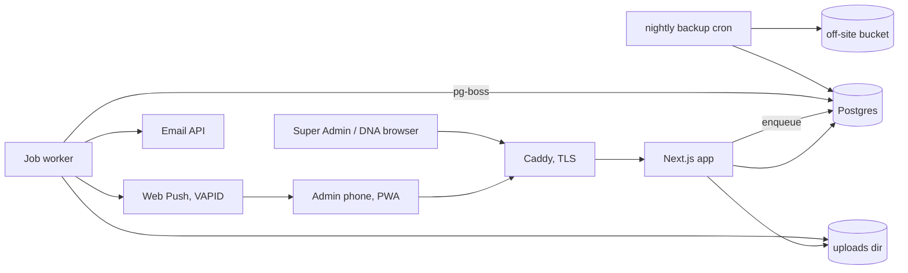
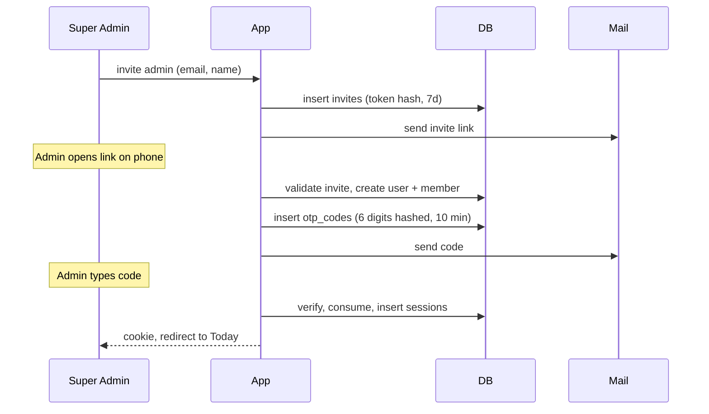
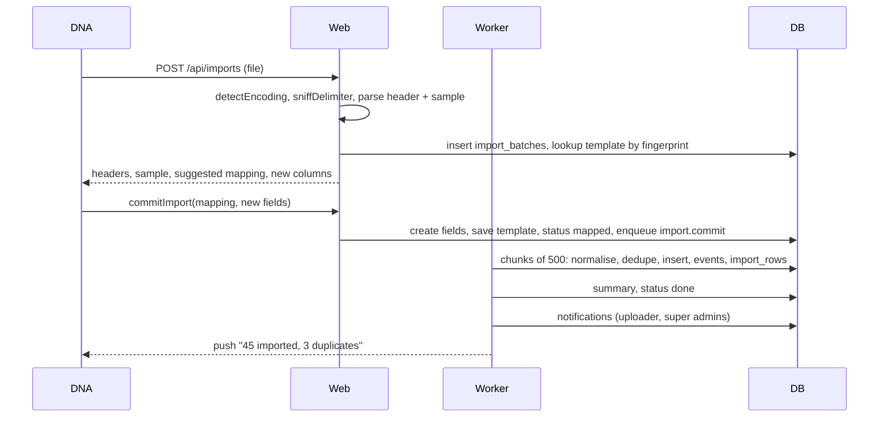

# Anar developer design

Date: 2026-10-27
Base: `ANAR-System-Design.md` in `iranjaya/anar` (dated 2026-10-27). That doc is the product. This one is what a dev team needs to build it.

How to read the marks:

- `[base]` taken from the base doc as it is. Product decisions in it are not changed here.
- `[new]` added in this doc.
- `[default]` the base is silent and it is a business call. I picked a default so work can start. Every one of these is repeated in section 11.
- `[verified on real export]` checked on one real Meta lead export DNA gave us (appendix A). Facts, not guesses.

Short version of the big calls, all `[new]`: one Postgres, `company_id` on every tenant table plus row level security. Next.js with server actions and a job worker in the same repo. PWA, not native. Web Push with our own VAPID keys, no OneSignal. Custom fields in one JSONB column per lead with a fields table as the schema. CSV import is a background job with a saved mapping per form. Scoring is a config row per company, never code.

---

## 1. Product recap `[base]`

Everything in this section is from the base doc, sections 1 to 8. One page, nothing new.

**What it is.** A lead management system DNA (the agency) runs for its client companies. It replaces per-salesperson Excel trackers. Leads come from Facebook and Instagram CSV exports, events and web forms. Each client company is its own isolated workspace. Anar is part of DNA's service, not a separate paid product. Branding is Anar only.

**Roles.**

| Role | Who | Scope |
| --- | --- | --- |
| Platform Owner (DNA) | the agency | all companies, creates workspaces, uploads CSVs, assigns Super Admins, can access any company for support |
| Super Admin | 1 to 2 managers per company | all leads in their company, creates Admins, assigns leads, reports, configures stages and fields, exports |
| Admin | sales staff (Sarina) | own leads only, logs follow-ups, own dashboard, no settings, no users |

**Access matrix.**

| Feature | DNA | Super Admin | Admin |
| --- | --- | --- | --- |
| Create company | Yes | No | No |
| Upload CSV leads | Yes | No | No |
| Create users | Yes (Super Admin) | Yes (Admin) | No |
| Assign leads | Yes | Yes | No |
| View all leads | Yes | Yes | No (own only) |
| Update lead status | Yes | Yes | Yes (own only) |
| View all reports | Yes | Yes | No |
| View own report | Yes | Yes | Yes |
| Export data | Yes | Yes | No |
| Configure pipeline/fields | Yes | Yes | No |

**Lead data.** Fixed fields: full name, phone, email, lead source, lead date, campaign name, assigned to. Custom fields per company, created by DNA in settings or on the fly during upload. Types: dropdown, text, number, date. Only fields with data are shown on a lead.

**Pipeline.** Default stages: New Lead, Contacted, Qualified, Follow-up, Site Visit, Negotiation, Booked, Lost. Super Admin can rename, add, remove. Booked leads stay in the list. Lost needs a reason (Too Expensive, Wrong Location, Bought from Competitor, Not Responding, Not Genuine Lead, Changed Mind, Other), configurable.

**Follow-ups.** Unlimited per lead. Each one: date, outcome, notes, next action date. Outcomes configurable per company (ten defaults listed in base 4.5). Overdue alerts. After 5 failed attempts the system suggests Lost, Super Admin can override.

**Scoring.** Configurable per company. Default: base 1 pt; timeline under 15 days 4, 15 to 30 days 3, 1 to 3 months 2, over 3 months 1; budget fit yes 3, maybe 2; decision maker yes 2, shared 1. Hot 8+, Warm 5 to 7, Cold under 5.

**Dashboards.** Super Admin: team overview, one Admin's detail, two Admins side by side. Admin: three buckets on login, Overdue, Due Today, New. Targets per Admin: calls per day/week, site visits per week/month, bookings per month, more later.

**Notifications (push).** Overdue follow-up, new assignment, daily summary for Admins, weekly summary for Super Admins.

**Flows.**

1. DNA signs a client, creates the company, invites 1 to 2 Super Admins.
2. Super Admin creates Admin accounts.
3. DNA downloads the CSV from Ads Manager each morning, uploads it to the company, saved mapping applies, leads land unassigned.
4. Super Admin assigns leads, one by one or in bulk, reassigns when someone is sick or leaves.
5. Admin opens Anar on the phone, sees Overdue / Due Today / New, taps a lead, taps Call (tel: link), then fills the quick form: outcome, notes, next date, stage change. Site Visit Done and Booked are marked the same way.
6. Super Admin watches the dashboard, pulls daily and weekly reports, compares Admins.

**Technical decisions already taken.** Web app, phone first. English. Email invitation plus OTP on email. Stay logged in 30 days, auto logout after 30 days of no use. Self-hosted. Manual daily CSV upload by DNA, Facebook API sync later. Duplicate detection by phone. No manual lead entry by Admins. Click-to-call.

---

## 2. System architecture `[new]`

### 2.1 Components



| Component | Job | Runs as |
| --- | --- | --- |
| Next.js app | UI, server actions for mutations, route handlers for upload, download, push subscribe, health | `web` container |
| Job worker | imports, score recompute, overdue scan, summaries, push and email sends, exports, retention purge | `worker` container, same repo, `pnpm worker` |
| Postgres | all data, and the job queue (pg-boss tables) | `db` container, volume on disk |
| uploads dir | raw CSV files and generated exports | bind mount, backed up with the DB |
| Caddy | TLS, reverse proxy, request size limit | `proxy` container |
| Backup cron | `pg_dump` plus uploads tar, encrypt, upload off-site | host cron |

One server, Docker Compose, four containers. No Redis, no S3 in the MVP. pg-boss uses Postgres as the queue so there is one thing to back up and one thing to monitor.

### 2.2 Multi-tenancy model

**Pick: one Postgres, one schema, `company_id` on every tenant table, Postgres row level security (RLS) on every tenant table, plus a tenant-scoped DB client in the app.**

Why this and not the others:

- Schema per company: every migration runs N times, connection poolers fight with `search_path`, and DNA cross-company views (list all companies with counts) need union queries. Tens of companies, not thousands, so the isolation win is small and the ops cost is daily.
- Database per company: same problems plus N backups and N restore drills on one self-hosted box.
- Shared tables without RLS: one forgotten `WHERE company_id` is a cross-company leak. RLS makes the DB refuse it.

How it is enforced:

1. Two DB roles. `anar_migrate` owns the tables and runs migrations. `anar_app` is what the app and worker connect as. It has no `BYPASSRLS`, is not the owner, and tables have `FORCE ROW LEVEL SECURITY` so even the owner is subject to policies in tests.
2. Every tenant table has one policy: `company_id = current_setting('app.company_id', true)::uuid` for select, insert, update, delete. No `company_id` set means no rows.
3. The app only touches tenant tables through `withTenant(ctx, fn)`. It opens a transaction, runs `SET LOCAL app.company_id = $1` and `SET LOCAL app.user_id = $2`, then runs `fn(tx)`. Feature modules receive `tx`, never the pool.
4. Platform tables (`companies`, `users`, `invites`, `otp_codes`, `sessions`, `push_subscriptions`, `audit_log`) have no `company_id` policy. Only the `auth`, `companies` and `tenant` modules may import the platform client. An ESLint `no-restricted-imports` rule blocks it everywhere else.
5. A CI check queries `pg_tables` and `pg_policies` and fails if a table with a `company_id` column has RLS off or no policy.

DNA is a platform role, not a company member. To see a company DNA calls `enterCompany(companyId, reason)`. That writes `acting_company_id`, `acting_reason` and `acting_until` (8 hours) on the DNA session row and one audit row. From then on `requireContext()` builds the context with that company id and RLS applies to DNA exactly as it does to a Super Admin. There is no "see all companies' leads" query anywhere. A banner at the top says which company DNA is in and a "leave" button clears it.

### 2.3 Auth

`[base]` Invite plus email OTP, 30 day session, auto logout after 30 days of no use.

`[new]` How it works:

**Invite.** DNA or Super Admin enters an email and a role. We store a row in `invites` with a random token (hashed) and a 7 day expiry, and send an email with the link. Opening the link shows the email, asks for a name, then goes to OTP. Accepting creates the `users` row if the email is new and the `company_members` row. An email that already exists as a user in another company just gets a second membership.

**OTP.** User enters email. If the email is a known active user we create an `otp_codes` row: 6 digits, hashed, expires in 10 minutes, max 5 verify attempts, one active code per user (new request replaces the old). The response is the same whether the email exists or not. Rate limits are in section 8.5.

**Session.** On verify we create a `sessions` row with a random 32 byte token, store its hash, and set an `httpOnly`, `Secure`, `SameSite=Lax` cookie. `expires_at = last_seen_at + 30 days`, sliding, updated at most once per hour. Deactivating a member or changing a role revokes all sessions of that user in that company. A user can see their sessions (device, last seen) and revoke any. Settings, user management and export ask for a fresh OTP if the session's last OTP is older than 15 minutes (step-up). That is the main defence for shared phones, see risk 7.4.

**Context.** Every server action and route handler starts with `requireContext()`: cookie to session to user to membership (or DNA acting company), returning `{ user, companyId, member, role, session }`. Then `can(ctx, permission, resource?)` against the table in section 5.1.



### 2.4 File import pipeline

The CSV never goes straight into `leads`. Steps, each its own function and each testable on its own:

1. **Upload** (route handler, streaming): save the raw file to `uploads/imports/<companyId>/<batchId>.csv`, max 25 MB, insert `import_batches` with status `uploaded`.
2. **Decode**: sniff the BOM and bytes, pick the encoding, decode to text. Record the encoding on the batch.
3. **Parse**: sniff the delimiter, parse with a streaming CSV parser, take the first non-empty row as the header, read up to 20 sample rows for the preview and count the rows.
4. **Match mapping**: fingerprint the headers. Exact fingerprint match on a saved template applies it. Else suggest a mapping from a synonym list and offer new custom fields for unknown columns.
5. **Confirm** (UI): user reviews the mapping, creates fields on the fly, saves the template, sees a preview with validation counts, and commits.
6. **Commit** (worker job): rows in chunks of 500, each chunk one transaction: normalise, validate, dedupe in file and against the DB, insert lead, event, score, write an `import_rows` row per input row.
7. **Report**: summary on the batch, notification to the uploader and the company's Super Admins.

Details and edge cases in section 6.1.

### 2.5 Background jobs

pg-boss in Postgres. The worker registers these:

| Job | Trigger | What it does |
| --- | --- | --- |
| `import.commit` | after mapping confirm | section 6.1 step 6 and 7 |
| `scoring.recompute` | scoring config saved | rescore all open leads of the company in chunks |
| `followups.overdue_scan` | cron every 30 min | finds leads past `next_action_at`, sends one overdue alert per lead per day |
| `summary.daily` | cron 08:00 company local time | per Admin: overdue, due today, new; push plus in-app |
| `summary.weekly` | cron Monday 08:00 company local | per Super Admin: team numbers for the week |
| `notify.push` | enqueued by any feature | sends one Web Push, retries 3 times, disables dead subscriptions |
| `notify.email` | enqueued by auth and summaries | sends one email through the email module |
| `export.build` | export requested | runs the filtered query, streams a CSV or XLSX to `uploads/exports`, link valid 24 h |
| `retention.purge` | cron daily 03:00 | deletes raw import files older than 30 days, `import_rows.raw` older than 90 days, expired exports, expired sessions and OTPs |

Jobs are idempotent by key: `import.commit` keyed by batch id, `scoring.recompute` by company id plus config version, overdue alerts by `(lead_id, date)`. A worker crash mid-import resumes from `import_batches.last_row_no`.

### 2.6 Notifications

Three channels, one table. Every notification is first a row in `notifications` (in-app list with a bell). Then:

- **Web Push** (VAPID keys we generate, `web-push` library, service worker in the PWA). Works on Android Chrome, and on iOS 16.4+ only once the PWA is added to the home screen. Onboarding tells Admins to install it.
- **Email** for invites and OTP always, and as the fallback for the daily and weekly summary when the user has no live push subscription.
- No SMS in MVP.

### 2.7 Hosting

`[base]` Self-hosted. `[new]` One VPS (4 vCPU, 8 GB, 80 GB SSD is enough for the first years), Ubuntu LTS, Docker Compose, Caddy with automatic TLS on `anar.<dna-domain>`. Separate from Ekata (section 3). Staging is a second Compose project on the same box with its own DB and subdomain until it gets its own VPS. Backups go off the box every night (section 8.3).

---

## 3. Tech stack decisions `[new]`

Each open question from base section 9, with the pick and one line of reason.

| # | Base question | Pick | Why |
| --- | --- | --- | --- |
| 1 | Next.js + PostgreSQL or other | **Next.js (App Router) + TypeScript + Postgres 17 + Drizzle ORM** | One language end to end, server actions fit a forms-heavy app, Drizzle stays close to SQL so RLS, JSONB and `SET LOCAL` are not fought through an ORM. |
| 2 | Same server as Ekata or separate | **Separate VPS, same provider is fine** | A different client's personal data and a different blast radius; Ekata deploys or load must not touch Anar. Cost is one small VPS. |
| 3 | Push service | **Web Push with our own VAPID keys, no OneSignal or Firebase** | Self-hosted and no third party holding lead data; the PWA already needs the service worker; free. |
| 4 | Email for OTP | **Resend, behind one `sendEmail()` module** | Simplest API, free tier covers OTP and invite volume, swap to SES is one file if volume grows. Needs SPF, DKIM and DMARC on the sending domain. |
| 5 | Scheduled reports | **Daily and weekly summaries as push plus in-app with a link to the dashboard. Full reports are pulled manually as export.** | The base already asks for the summaries; an emailed PDF adds a rendering pipeline for little gain. Revisit after launch. |
| 6 | Admin manual lead entry | **Data model supports it now (`leads.source_kind = import \| manual \| api`), no UI in MVP** | Costs nothing in the model; the UI is one small later slice if walk-in leads become real. Business call, section 11. |
| 7 | Additional target types | **`targets.metric` is an enum: `calls`, `site_visits`, `bookings`; new type = one enum value and one metric query** | Keeps targets simple; nothing else to design until a new type is named. |
| 8 | Mobile app vs PWA | **PWA** | One codebase, no store review, click-to-call and push both work; iOS push needs home-screen install, accepted. Native only if that becomes a blocker. |
| 9 | Facebook API auto-sync | **Later phase, section 10.3. Import pipeline takes rows from a source, CSV now, API later, same mapping and dedupe.** | Needs a Meta app, `leads_retrieval` permission and app review; do it after the manual flow is proven. |

Rest of the stack, same reasoning (small, boring, one box):

- Node current LTS, pnpm, Vitest, Playwright, Biome.
- Tailwind plus shadcn/ui for the phone-first UI.
- zod at every boundary (actions, route handlers, job payloads, CSV rows).
- `libphonenumber-js` for E.164. `csv-parse` streaming. `exceljs` streaming writer for XLSX. `web-push`. `pino` logs.
- UUIDv7 primary keys, generated in the app (time ordered, good index locality).
- Reports: SQL aggregates read live for dashboards; export as a job (section 2.5). No warehouse, no cube.

---

## 4. Data model `[new]`

All ids are UUIDv7. All tables have `created_at`, tenant tables also `updated_at`. Tenant tables have `company_id` with RLS (section 2.2). Soft delete only where listed.

### 4.1 Custom fields: JSONB, not key-value rows

`[base]` says custom fields are "stored as key-value pairs per lead". That is the logical model. `[new]` Physically they live in one `leads.custom` JSONB column keyed by the field key, with a `fields` table as the schema registry.

Why JSONB over an EAV table (`lead_field_values(lead_id, field_id, value)`):

- A lead reads as one row. The detail page and the list need no pivot and no N joins.
- "Filter by any custom field" is a `custom @> '{"budget":"50L+"}'` on a GIN index. EAV needs one self-join per filter.
- Type safety comes from the app: on every write the value is validated against `fields.type` and `fields.options`. The DB does not need to know.
- Display rule (show only fields with data) is `custom` keys that exist and are not null.

Cost accepted: renaming a field key is a data migration (we do not allow it; label changes are free, keys are fixed). Changing a field's type once it has data is refused; archive and create a new field instead.

### 4.2 Tables

**Platform tables** (no `company_id` policy, platform client only)

| Table | Key columns | Keys and indexes |
| --- | --- | --- |
| `companies` | `id, name, slug, status (active\|suspended\|closing), default_country (NP), timezone (Asia/Kathmandu), settings jsonb, closing_at` | unique `slug` |
| `users` | `id, email citext, name, platform_role (null\|dna), deactivated_at` | unique `email` |
| `invites` | `id, company_id null for DNA, email, role, token_hash, expires_at, accepted_at, created_by` | unique `token_hash`; index `(email)` |
| `otp_codes` | `id, user_id, code_hash, expires_at, attempts, consumed_at, ip` | index `(user_id, created_at)` |
| `sessions` | `id, user_id, token_hash, device_label, user_agent, ip, last_seen_at, expires_at, revoked_at, last_otp_at, acting_company_id, acting_reason, acting_until` | unique `token_hash`; index `(user_id)` |
| `push_subscriptions` | `id, user_id, session_id, endpoint, p256dh, auth, failed_at` | unique `endpoint` |
| `audit_log` | `id, company_id null, actor_user_id, actor_role, action, target_type, target_id, data jsonb, ip` | index `(company_id, created_at)`, `(actor_user_id, created_at)`. Append only: `anar_app` has INSERT and SELECT, no UPDATE or DELETE. |

**Tenant tables** (RLS on `company_id`)

| Table | Key columns | Keys and indexes |
| --- | --- | --- |
| `company_members` | `id, company_id, user_id, role (super_admin\|admin), status (invited\|active\|deactivated), invited_by, deactivated_at` | unique `(company_id, user_id)`; index `(company_id, status)` |
| `fields` | `id, company_id, key, label, type (text\|number\|date\|dropdown), options jsonb (dropdown only, [{ value, label }]), is_system, position, archived_at` | unique `(company_id, key)` |
| `stages` | `id, company_id, name, position, kind (open\|won\|lost), is_default, archived_at` | unique `(company_id, name)`; exactly one `is_default` per company (partial unique) |
| `outcomes` | `id, company_id, name, counts_as_failed bool, position, archived_at` | unique `(company_id, name)` |
| `lost_reasons` | `id, company_id, name, position, archived_at` | unique `(company_id, name)` |
| `scoring_configs` | `id, company_id, version, base_points, hot_min, warm_min, rules jsonb, active, created_by` | unique `(company_id, version)`; one active per company (partial unique) |
| `mapping_templates` | `id, company_id, name, header_fingerprint, headers jsonb, mapping jsonb, form_name, campaign_name, created_by, last_used_at` | unique `(company_id, header_fingerprint)`; index `(company_id, form_name)`. `form_name` is null for CSV templates, the Meta export has no form column `[verified on real export]` |
| `import_batches` | `id, company_id, uploaded_by, source_kind (csv\|api), file_name, file_path, file_size, encoding, delimiter, row_count, status (uploaded\|mapped\|running\|done\|failed), mapping_template_id, mapping jsonb, last_row_no, summary jsonb, error, started_at, finished_at` | index `(company_id, created_at)` |
| `import_rows` | `id, batch_id, company_id, row_no, raw jsonb, phone_e164, result (imported\|duplicate_db\|duplicate_file\|invalid\|error), lead_id, reason` | unique `(batch_id, row_no)`; index `(lead_id)` |
| `leads` | `id, company_id, full_name, phone_e164, phone_raw, phone_valid bool, email, source (facebook\|instagram\|event\|web\|other\|null), source_kind (import\|manual\|api), external_id (Meta lead id, API only, null for CSV leads), lead_date, campaign_name, form_name, assigned_to (company_members.id), stage_id, lost_reason_id, custom jsonb, score int, priority (hot\|warm\|cold), score_breakdown jsonb, scored_at, next_action_at, last_contacted_at, failed_attempts int, lost_suggested_at, import_batch_id, merged_into_id, deleted_at` | partial unique `(company_id, phone_e164) where phone_e164 is not null and merged_into_id is null and deleted_at is null`; partial unique `(company_id, external_id) where external_id is not null`; index `(company_id, assigned_to, next_action_at)`; `(company_id, stage_id)`; `(company_id, lead_date desc)`; `(company_id, priority)`; GIN `custom jsonb_path_ops`; trigram GIN on `full_name`; btree `(company_id, phone_e164 varchar_pattern_ops)` for prefix search. `external_id` stays null for every CSV lead, the export has no id column `[verified on real export]` |
| `follow_ups` | `id, company_id, lead_id, by_member_id, outcome_id, notes, happened_at, next_action_at, stage_before_id, stage_after_id` | index `(lead_id, happened_at desc)`; `(company_id, by_member_id, happened_at)` |
| `lead_events` | `id, company_id, lead_id, type, actor_member_id null, actor_user_id, data jsonb` | index `(lead_id, created_at desc)`; `(company_id, created_at)` |
| `targets` | `id, company_id, member_id, metric (calls\|site_visits\|bookings), period (day\|week\|month), value, starts_on, ends_on null` | index `(company_id, member_id)` |
| `notifications` | `id, company_id, user_id, type, title, body, url, data jsonb, dedupe_key, read_at, pushed_at, emailed_at` | unique `(user_id, dedupe_key)`; index `(user_id, read_at, created_at desc)` |
| `export_jobs` | `id, company_id, requested_by, format (csv\|xlsx), filters jsonb, status, file_path, row_count, expires_at` | index `(company_id, created_at)` |

`lead_events.type` values: `imported`, `duplicate_import`, `assigned`, `unassigned`, `stage_changed`, `follow_up_logged`, `fields_updated`, `score_changed`, `lost_suggested`, `lost_suggestion_dismissed`, `merged`, `note_added`, `created_manually`. `data` holds the before and after for the event (old and new stage id, old and new assignee, which keys changed, the merged lead snapshot).

Why `assigned_to` points at `company_members` and not `users`: a user can be a member of two companies (a manager DNA shares, or DNA itself). Assignment is per company, so the member row is the right thing. Reports group by member too.

`scoring_configs.rules` shape, one entry per scored field:

```
[
  { "fieldKey": "purchase_timeline", "kind": "options",
    "points": { "<15 days": 4, "15-30 days": 3, "1-3 months": 2, "3+ months": 1 } },
  { "fieldKey": "budget_fit", "kind": "options", "points": { "Yes": 3, "Maybe": 2 } },
  { "fieldKey": "decision_maker", "kind": "options", "points": { "Yes": 2, "Shared": 1 } }
]
```

`kind: "range"` with `[{ "min": 0, "max": 15, "points": 4 }]` is for number fields. Nothing else in MVP. The base default is seeded as version 1 on company creation, with the three fields created as dropdowns.

`points` is keyed by the option `value`, never the label. The real Meta form answers arrive as codes (`within_1_month`, `3_bhk`, `for_myself/family`) `[verified on real export]`, so for a company fed by that form the config looks like this `[default]`, points in question 26:

```
[
  { "fieldKey": "purchase_timeline", "kind": "options",
    "points": { "within_1_month": 4, "within_2_months": 3, "within_3_months": 2, "just_exploring": 1 } },
  { "fieldKey": "apartment_type", "kind": "options",
    "points": { "1_bhk": 2, "2_bhk": 2, "3_bhk": 2, "not_sure_yet": 0 } },
  { "fieldKey": "purchase_purpose", "kind": "options",
    "points": { "for_myself/family": 2, "both": 2, "investment": 1, "just_exploring": 0 } },
  { "fieldKey": "budget_fit", "kind": "options", "points": { "Yes": 3, "Maybe": 2 } },
  { "fieldKey": "decision_maker", "kind": "options", "points": { "Yes": 2, "Shared": 1 } }
]
```

The timeline column maps onto the seeded `purchase_timeline` field, so one field carries both the base options and the Meta codes. `budget_fit` and `decision_maker` stay Admin-filled after the call; the form does not ask them.

`mapping_templates.mapping` shape, one entry per CSV header. This is the real Meta export, all 10 columns in file order `[verified on real export]`:

```
[
  { "header": "created_time", "target": "system:lead_date" },
  { "header": "campaign_name", "target": "system:campaign_name" },
  { "header": "platform", "target": "system:source" },
  { "header": "which_apartment_are_you_planning_to_purchase?", "target": "field:apartment_type" },
  { "header": "when_are_you_planning_to_purchase?_", "target": "field:purchase_timeline" },
  { "header": "what_is_your_primary_purpose?", "target": "field:purchase_purpose" },
  { "header": "full_name", "target": "system:full_name" },
  { "header": "phone", "target": "system:phone" },
  { "header": "job_title", "target": "field:job_title" },
  { "header": "email", "target": "system:email" }
]
```

`header` is the original text, trailing `?_` and all. The field keys are what DNA picked on the mapping page; the default key is the normalised header (6.1 step 3), which is long, so DNA shortens it there. `system:external_id` and `skip` exist for the API path and for other exports; this file has nothing for them.

### 4.3 Seed on company creation

Eight default stages, ten default outcomes (`No Answer`, `Not Interested` and `Callback Requested` with `counts_as_failed = true` `[default]`), seven lost reasons, scoring config v1 with its three dropdown fields, `default_country = NP`, `timezone = Asia/Kathmandu`. Which outcomes count as failed is a business call, section 11.

---

## 5. API design `[new]`

Mutations are Next.js server actions. Route handlers only where a browser needs a URL: file upload, file download, push subscribe, health. Every action and handler: `requireContext()` then `can()` then `withTenant()`. zod on every input. Errors are typed (`unauthorized`, `forbidden`, `not_found`, `validation`, `conflict`) and never leak another company's existence (`not_found` for both missing and foreign ids, RLS makes them the same).

### 5.1 Permissions

One table in `modules/tenant/permissions.ts`, mirror of the base access matrix.

| Permission | DNA (in a company) | Super Admin | Admin |
| --- | --- | --- | --- |
| `company.create`, `company.list`, `company.enter` | yes (platform) | no | no |
| `members.invite_super_admin` | yes | no | no |
| `members.invite_admin`, `members.deactivate`, `members.list` | yes | yes | no |
| `settings.manage` (fields, stages, outcomes, lost reasons, scoring, targets) | yes | yes (step-up) | no |
| `imports.upload`, `imports.commit` | yes | no (flag `company.settings.super_admin_can_import`, off `[default]`) | no |
| `leads.view` | all | all | own (`assigned_to = ctx.member.id`) |
| `leads.assign`, `leads.bulk` | yes | yes | no |
| `leads.update` (fields, stage, notes) | all | all | own |
| `leads.merge` | yes | yes | no |
| `leads.export` | yes | yes (step-up) | no |
| `followups.log` | all | all | own |
| `reports.view_all`, `reports.compare` | yes | yes | no |
| `reports.view_own` | yes | yes | yes |
| `sessions.manage_own` | yes | yes | yes |

"own" is checked by `can(ctx, 'leads.update', lead)` which compares `lead.assigned_to` with `ctx.member.id`. The list queries add the same filter so an Admin never gets a foreign id back to probe with.

### 5.2 Endpoints and actions

Shapes are TypeScript-ish. `Cursor` lists return `{ items, nextCursor }` with page size 50.

**Auth and session**

| Name | Kind | Input | Output | Check |
| --- | --- | --- | --- | --- |
| `acceptInvite` | action | `{ token, name }` | `{ userId }` then redirects to OTP | valid, unexpired, unaccepted token |
| `requestOtp` | action | `{ email }` | `{ ok: true }` always | rate limit, section 8.5 |
| `verifyOtp` | action | `{ email, code }` | sets cookie, `{ redirectTo }` | ≤5 attempts, not expired, not consumed |
| `stepUp` | action | `{ code }` | `{ ok }` sets `sessions.last_otp_at` | active session |
| `logout`, `revokeSession` | action | `{ sessionId? }` | `{ ok }` | own sessions only |
| `listSessions` | query | none | `{ id, deviceLabel, lastSeenAt, current }[]` | own |
| `POST /api/push/subscribe` | route | `PushSubscriptionJSON` | 204 | active session; ties subscription to `session_id` so revoke kills push too |

**Companies (DNA)**

| Name | Input | Output | Check |
| --- | --- | --- | --- |
| `createCompany` | `{ name, slug, defaultCountry, timezone }` | `{ companyId }`, seeds defaults (4.3), audit | `platform_role = dna` |
| `listCompanies` | `{ cursor? }` | `{ id, name, status, memberCount, leadCount, lastImportAt }[]` | dna |
| `enterCompany` | `{ companyId, reason }` | `{ ok }`, session acting fields, audit `dna.enter_company` | dna; reason min 5 chars |
| `leaveCompany` | none | `{ ok }` | dna |
| `inviteSuperAdmin` | `{ companyId, email, name }` | `{ inviteId }`, audit | dna |
| `closeCompany` | `{ companyId }` | status `closing`, 30 day timer, audit | dna, step-up |

**Members**

| Name | Input | Output | Check |
| --- | --- | --- | --- |
| `inviteAdmin` | `{ email, name }` | `{ inviteId }`, audit | `members.invite_admin`, step-up |
| `listMembers` | none | `{ id, name, email, role, status, openLeads, overdue }[]` | `members.list` |
| `deactivateMember` | `{ memberId, reassignTo? }` | `{ reassigned: number }`, revokes sessions, audit | `members.deactivate`, step-up; refuse if it is the last active Super Admin |
| `resendInvite` | `{ inviteId }` | `{ ok }` | invite creator role |

**Settings**

| Name | Input | Output | Check |
| --- | --- | --- | --- |
| `createField` | `{ key?, label, type, options? }` | `{ fieldId }` (key is slugified from label if absent) | `settings.manage` |
| `updateField` | `{ fieldId, label?, options?, position? }` | `{ ok }`; type change refused with `conflict` if any lead has data | `settings.manage` |
| `archiveField` | `{ fieldId }` | `{ ok }`; data stays on leads, hidden from forms | `settings.manage` |
| `upsertStage`, `archiveStage`, `reorderStages` | `{ ... }` | `{ ok }`; archive refused if leads are in it (must move first) | `settings.manage` |
| `upsertOutcome`, `upsertLostReason` and archive | `{ ... }` | `{ ok }` | `settings.manage` |
| `saveScoringConfig` | `{ basePoints, hotMin, warmMin, rules }` | `{ version }`, enqueues `scoring.recompute`, audit | `settings.manage`; refuses unknown field keys |
| `setTarget` | `{ memberId, metric, period, value, startsOn }` | `{ targetId }` | `settings.manage` |

**Imports**

| Name | Kind | Input | Output | Check |
| --- | --- | --- | --- | --- |
| `POST /api/imports` | route, multipart | file | `{ batchId, encoding, delimiter, headers, sample: string[][], rowCount, matchedTemplate?, suggestedMapping, newColumns, missingColumns }` | `imports.upload`; size ≤ 25 MB; `.csv` or `.txt` |
| `commitImport` | action | `{ batchId, mapping, saveTemplate?: { name }, newFields?: { header, key?, label, type, options?: { value, label }[] }[] }` | `{ jobId }`; creates fields, saves template, enqueues `import.commit` | `imports.commit`; every `field:` target must exist or be in `newFields`; exactly one `system:phone` |
| `getImportBatch` | query | `{ batchId }` | `{ status, rowCount, lastRowNo, summary: { imported, duplicateDb, duplicateFile, invalid, error } }` | `imports.upload` or `leads.view` all |
| `listImportRows` | query | `{ batchId, result?, cursor? }` | rows with `rowNo, result, reason, leadId, raw` | same |
| `listImportBatches` | query | `{ cursor? }` | batches with summary | same |
| `listMappingTemplates`, `deleteMappingTemplate` | | | | `imports.upload` |

**Leads**

| Name | Input | Output | Check |
| --- | --- | --- | --- |
| `listLeads` | `{ q?, stageIds?, sources?, assignedTo?: memberId \| 'unassigned', priority?, dateFrom?, dateTo?, custom?: Record<key, value>, sort?, cursor? }` | `{ items: LeadRow[], nextCursor, total }` | `leads.view`; Admin gets `assignedTo` forced to self |
| `getLead` | `{ leadId }` | `{ lead, fields (only with data), followUps, events, duplicates: { id, name }[] }` | `leads.view` on that lead |
| `updateLeadFields` | `{ leadId, fullName?, email?, custom?: Record<key, value> }` | `{ lead }`, event `fields_updated`, rescore | `leads.update`; values validated against `fields` |
| `changeStage` | `{ leadId, stageId, lostReasonId? }` | `{ lead }`, event | `leads.update`; `lost` kind needs a reason |
| `assignLeads` | `{ leadIds: uuid[] (≤500), memberId \| null }` | `{ updated }`, events, one notification to the assignee, audit | `leads.assign`; member active in this company |
| `bulkChangeStage` | `{ leadIds, stageId, lostReasonId? }` | `{ updated }` | `leads.bulk` |
| `dismissLostSuggestion` | `{ leadId }` | `{ ok }`, resets `failed_attempts` to 0, event | `leads.assign` role (Super Admin or DNA) |
| `mergeLeads` | `{ primaryId, duplicateId }` | `{ lead }`, event `merged`, audit | `leads.merge`, both in company, neither already merged |
| `createLead` (later) | `{ fullName, phone, ... }` | `{ leadId }` | `leads.assign` role; `source_kind = manual` |

**Follow-ups**

| Name | Input | Output | Check |
| --- | --- | --- | --- |
| `logFollowUp` | `{ leadId, outcomeId, notes?, nextActionAt?, stageId?, lostReasonId?, custom?: Record<key, value> }` | `{ lead, followUp, lostSuggested: bool }` | `followups.log` on that lead |

**Dashboard and reports**

| Name | Input | Output | Check |
| --- | --- | --- | --- |
| `getMyToday` | none | `{ overdue: LeadRow[], dueToday: LeadRow[], newLeads: LeadRow[], counts }` | `reports.view_own` |
| `getTeamOverview` | `{ from, to }` | `{ totals: { leads, newToday, calls, siteVisits, bookings }, perMember: { memberId, calls, overdue, hot, warm, cold, bookings }[], funnel: { stageId, count }[], bySource }` | `reports.view_all` |
| `getMemberDashboard` | `{ memberId, from, to }` | same shape as the Admin's own view plus `targets: { metric, period, value, actual }[]` | `reports.view_all`, or own id |
| `compareMembers` | `{ a, b, from, to }` | `{ a: Metrics, b: Metrics }` with calls, median response hours, site visits, bookings, conversion | `reports.compare` |
| `requestExport` | `{ format, filters (same as listLeads) }` | `{ exportId }`, enqueues `export.build`, audit | `leads.export`, step-up |
| `GET /api/exports/:id/download` | route | | file stream, 410 after expiry | requester or Super Admin of that company |

**Notifications**

| Name | Input | Output | Check |
| --- | --- | --- | --- |
| `listNotifications` | `{ cursor? }` | items | own |
| `markRead` | `{ ids }` | `{ ok }` | own |

**Ops**

| Name | Output |
| --- | --- |
| `GET /api/health` | `{ db: ok, worker: lastHeartbeatAt, queue: { waiting, failed } }`, 503 if DB down or worker heartbeat older than 5 min |

---

## 6. Key flows `[new]`

### 6.1 CSV import

Owner: `modules/imports`. Pure functions first, IO at the edges.

**1. Upload.** Stream the body to `uploads/imports/<companyId>/<batchId>.csv`. Refuse over 25 MB, refuse anything that is not `text/csv`, `text/plain` or `application/vnd.ms-excel` by content type, but trust the bytes not the header. Insert the batch with `status = uploaded`.

**2. Encoding.** `detectEncoding(bytes): { encoding, bomLength }`:

- `FF FE` → `utf-16le`, BOM 2. `FE FF` → `utf-16be`, BOM 2. `EF BB BF` → `utf-8`, BOM 3.
- No BOM: sample the first 64 KB. If more than 30% of odd-position bytes are `0x00` → `utf-16le`. If more than 30% of even-position bytes are `0x00` → `utf-16be`.
- Else try `TextDecoder('utf-8', { fatal: true })`. Success → `utf-8`.
- Else `windows-1252` and the batch gets a warning the UI shows ("could not confirm encoding, check names in the preview").

The real Meta export is UTF-16 LE with the `FF FE` BOM, CRLF line ends, tab delimited `[verified on real export]`. That is the first branch above. Nothing in the code assumes it. Every path has a fixture file (section 9.1).

**3. Delimiter and parse.** Count `,` `\t` `;` `|` outside quotes in the first 5 lines, take the max (tab on the real export `[verified on real export]`). Parse with `csv-parse` streaming, `relax_column_count`, `bom: false` (we already stripped it), `skip_empty_lines`; `csv-parse` takes CRLF as is. The header is the first row with at least 2 non-empty cells. Normalise each header for matching and for the default field key: trim, collapse spaces, lowercase, drop a trailing `?` and `_`. The real file has both: `which_apartment_are_you_planning_to_purchase?` and `when_are_you_planning_to_purchase?_` `[verified on real export]`, so the keys become `which_apartment_are_you_planning_to_purchase` and `when_are_you_planning_to_purchase`. Keep the original text for display and for `mapping.header`. Duplicate header names get `_2`, `_3`. Count rows without loading them; keep the first 20 for the preview.

**4. Mapping.** `fingerprint = sha256(sortedNormalisedHeaders.join('\n'))`. Normalised, so if Meta drops the trailing underscore one day the template still matches.

- Exact match on `mapping_templates.header_fingerprint` → apply it, `matchedTemplate` set.
- No exact match but a template with the same `form_name` (only if a `form_name` column exists; the Meta export has none `[verified on real export]`, so for it this rule never fires) → apply it and report `newColumns` and `missingColumns` so DNA only maps the difference.
- Else suggest from a synonym list: `full_name, name, full name, lead name` → `system:full_name`; `phone, phone_number, mobile, contact` → `system:phone`; `email, e-mail` → `system:email`; `created_time, created, date, lead date` → `system:lead_date`; `campaign_name` → `system:campaign_name`; `form_name` → `system:form_name`; `platform` → `system:source`; `id` → `system:external_id`; `ad_id, adset_id, adset_name, ad_name, form_id, is_organic` → `skip`. On the real export the hits are `created_time`, `campaign_name`, `platform`, `full_name`, `phone`, `email` `[verified on real export]`; `id`, `form_name` and the ad columns are not in it.
- `platform` is a system field, not a custom one. Values seen: `fb` and `ig` only `[verified on real export]`. `fb`/`facebook` → `facebook`, `ig`/`instagram` → `instagram`, anything else → `other` with issue `unknown_platform`.
- Every other header → proposed new custom field. Type guess: all sample values parse as numbers → `number`; as dates → `date`; at most 12 distinct values across the file → `dropdown` with those values as options; else `text`. The user can change any of it. On the real export that gives three dropdowns (the three question columns, 4 values each) and one text (`job_title`, free text, mixed case like `Business` and `business`) `[verified on real export]`.
- **Answer codes get labels.** Meta exports the answer as a machine code, not the text the lead saw: `within_1_month`, `3_bhk`, `not_sure_yet`, `for_myself/family` `[verified on real export]`. The code is the option `value` and is what we store on the lead, filter on and score on. The `label` is what Admins see. The proposal guesses it (`_` to space, first letter up: `within_1_month` → "Within 1 month", `2_bhk` → "2 bhk") and DNA fixes it on the mapping page. Same for the field label from the header: `when_are_you_planning_to_purchase?_` → "When are you planning to purchase?". One code to label map per question, and it lives on `fields.options`, nowhere else.
- Known Meta export columns are listed in a fixture, not in code, so a renamed column is a fixture update. The fixture is the real header list, appendix A.

**5. Confirm.** The UI shows the mapping, the preview with the mapped values, and counts from a dry run over the whole file (valid phone, invalid phone, duplicate in file, duplicate in DB). Dry run reuses step 6's pure `normaliseRow` and a single `SELECT phone_e164 FROM leads WHERE company_id = ? AND phone_e164 = ANY(?)` in chunks. `commitImport` creates the new fields, saves the template (name = form name, else the file name without its `_Leads_<from>_<to>.csv` tail, which is how Meta names the file `[verified on real export]`, else the campaign name), stores the mapping on the batch, sets `status = mapped`, enqueues the job.

**6. Commit job.** For rows from `last_row_no + 1`, in chunks of 500, one transaction per chunk inside `withTenant` for the batch's company:

1. `normaliseRow(raw, mapping, fields, defaultCountry) → { lead, custom, issues[] }`. Trim everything. Empty string → null.
2. **Phone to E.164.** Strip a leading `p:`. Every phone in the real export is `p:+<country><number>` `[verified on real export]`: 1,768 of 1,884 are `+977`, the rest `+91`, `+971`, `+974` and a few other codes, 12 to 14 chars after the `p:`. `phone_raw` keeps the value as it came, `p:` included. Then remove spaces, dashes, dots, brackets. If it starts with `00` make it `+`. Parse with `libphonenumber-js` using `default_country`; a number with `+` keeps its own country, so for the Meta file `default_country` never kicks in and the Indian and Gulf numbers stay what they are. Valid → `phone_e164`, `phone_valid = true`. Invalid → keep `phone_raw`, `phone_e164 = null`, `phone_valid = false`, issue `invalid_phone`. `[default]` the row is still imported and flagged; the summary says "imported, 4 need phone review". Business can change this to "skip" (section 11).
3. **Lead date.** Parse ISO 8601 with offset first. Meta `created_time` is `2026-09-12T10:11:12+05:45`, colon in the offset `[verified on real export]`; accept `+0000` style too. Store UTC; the offset in the value wins, `companies.timezone` is not used for parsing. Then `YYYY-MM-DD`, `DD/MM/YYYY`, `MM/DD/YYYY` in that order; ambiguous dates follow the company's `default_country` locale. Unparseable → today, issue `bad_date`.
4. **Custom values.** Validate by field type. Dropdown values are compared on `value` (the code). Value not in options → `[default]` add it to the options with a guessed label (step 4) and record issue `new_option`; a new answer in a Meta form is normal. Text is stored as typed, so `Business` and `business` in `job_title` stay two strings; nothing to do in MVP. Number and date that do not parse → stored as null, issue recorded.
5. **Dedupe in file.** A `Set` of `phone_e164` seen in this batch. Seen before → `duplicate_file`, skip. The real export has no duplicate phones inside it `[verified on real export]`, so this count should be 0 on a clean file.
6. **Dedupe against DB.** Insert with `ON CONFLICT (company_id, phone_e164) WHERE ... DO NOTHING RETURNING id`. No id back → `duplicate_db`: write `import_rows` with the existing `lead_id`. Phone is the only key we have: the export carries no lead id, ad id, adset id, form id or form name `[verified on real export]`. The export is a date range (the real one is 2026-09-12 to 2026-10-24 by file name), so a daily download overlaps yesterday's and most rows come back as `duplicate_db`. That is the normal case, not an error, and the summary must read that way ("1,850 already in, 34 new"). Two kinds of duplicate: same `campaign_name` and same `created_time` as the existing lead → `reason = same_submission`, no event, it is the same row again. Different → `reason = resubmitted`, add a `duplicate_import` event on that lead with the campaign and date so the Admin sees the person came back. Existing lead data is not changed `[default]`.
7. **External id.** Same conflict handling on `(company_id, external_id)` for API re-pulls later. CSV leads have none.
8. New lead: `stage_id = default stage`, `assigned_to = null`, `source_kind = import`, `import_batch_id`, score from the active config (6.4), events `imported`.
9. Write `import_rows` for every row with the result and the reason. Update `last_row_no`.

Any thrown error marks the chunk failed, the batch `failed` with the error, and the job retries twice. On the third failure the batch stays `failed` with `last_row_no`, DNA sees "stopped at row 1234: <reason>" and can resume.

**7. Report.** `summary = { imported, needPhoneReview, duplicateDb, duplicateFile, invalid, error, newOptions }`. Status `done`. One notification to the uploader ("Soaltee: 45 new leads imported, 3 duplicates skipped") and one to each active Super Admin ("45 new unassigned leads"). The batch page lists every non-imported row with its reason and a link to the existing lead for duplicates.



### 6.2 Assignment

1. Super Admin filters the list (default filter: unassigned) and selects leads, or opens one lead.
2. `assignLeads({ leadIds, memberId })`. Checks: role, every lead in this company (RLS), member is `active` and in this company, at most 500 ids.
3. One `UPDATE leads SET assigned_to = ? WHERE id = ANY(?) AND company_id = current` returning the old assignees.
4. One `lead_events` row per lead (`assigned`, `{ from, to }`), one audit row for the batch (`leads.assign`, `{ count, memberId }`).
5. One notification for the assignee with `dedupe_key = assign:<batchUuid>`: "12 new leads assigned to you", URL to Today filtered to New. Push through `notify.push`.
6. `memberId = null` is unassign: same path, event `unassigned`, no notification.
7. Reassign on deactivation: `deactivateMember({ reassignTo })` runs the same function for all that member's open leads, or leaves them unassigned if `reassignTo` is empty.

Auto round-robin (base 1 says "auto-assign or manually distribute", the matrix only has manual): later slice, section 10.3, business call in section 11.

### 6.3 Follow-up logging

Phone-first. The lead page has a `tel:` link with `phone_e164`. Tapping it opens the dialer. Coming back, the page shows the quick form.

1. `logFollowUp({ leadId, outcomeId, notes, nextActionAt, stageId, lostReasonId, custom })`.
2. Checks: `followups.log` on the lead (Admin: `assigned_to = me`), outcome active in this company, stage active, `lost` kind needs a reason, `custom` validated against `fields`.
3. In one transaction: insert `follow_ups` with `stage_before_id` and `stage_after_id`. Update the lead: `last_contacted_at = now`, `next_action_at` (null clears it), `stage_id` if given, `custom` merged if given, `failed_attempts = counts_as_failed ? +1 : 0`, rescore if `custom` changed.
4. Events: `follow_up_logged` with the outcome; `stage_changed` if the stage moved; `fields_updated` if custom changed.
5. If `failed_attempts >= 5` and the stage kind is `open` and `lost_suggested_at` is null: set `lost_suggested_at`, event `lost_suggested`, notification to the Super Admins with a "Mark Lost" and "Keep" link. The lead does not move by itself `[base: Super Admin can override]`. `dismissLostSuggestion` resets the counter; `changeStage` to a lost stage clears the suggestion.
6. Response returns the updated lead so the UI can go to the next one in the bucket.

Response time metric (used in comparison): hours between `assigned` event and the first `follow_up_logged` event for a lead, median per member.

### 6.4 Scoring recompute

`scoreLead(config, custom): { score, priority, breakdown }` is a pure function in `modules/scoring/score.ts`. `breakdown` is `{ base: 1, purchase_timeline: 4, budget_fit: 2 }` and is stored on the lead so a score is always explainable on the detail page.

Inline: every write to `leads.custom` (import, field update, follow-up with custom) calls it with the active config. Event `score_changed` only when `priority` changes, so the timeline does not fill with 5 to 6 noise.

Recompute: `saveScoringConfig` inserts a new version, flips `active`, enqueues `scoring.recompute` keyed `(companyId, version)`. The job walks leads of that company with `merged_into_id is null and deleted_at is null` in chunks of 1000 by id, computes, updates only rows whose `score`, `priority` or `breakdown` changed, `scored_at = now`. Leads in `won` or `lost` stages are rescored too (cheap, and the number stays honest). No events for recompute, one audit row with `{ version, changed }`.

### 6.5 Overdue alerts and summaries

Overdue = `next_action_at < now()` and stage kind `open` and `assigned_to` not null. Due today = `next_action_at` within the company's local day. New = assigned in the last 24 hours and no follow-up yet.

- `followups.overdue_scan` every 30 minutes: for each company, leads that became overdue since the last scan (`next_action_at` between last scan time and now). One notification per lead with `dedupe_key = overdue:<leadId>:<localDate>`, so a lead that stays overdue gets one alert per day, not one every 30 minutes. Push to the assignee.
- `summary.daily` at 08:00 company local time (job runs hourly and picks companies whose local hour is 8): per active Admin with at least one lead, "3 overdue, 5 due today, 12 new", `dedupe_key = daily:<localDate>`. Push, email fallback if no live push subscription. Admins with zero in all three get nothing.
- `summary.weekly` Monday 08:00 local: per Super Admin, leads in, calls, site visits, bookings, overdue count, top and bottom Admin by calls. Same dedupe pattern.

Timezone comes from `companies.timezone`. All timestamps are stored UTC.

### 6.6 Merge

Two leads with the same phone cannot exist (partial unique index), so merge is for the rest: same person with two phones, an invalid-phone row that matches a valid one, or a manual pair the Super Admin picked. The lead page shows `duplicates` by exact `phone_e164`, by `email`, and by trigram similarity on name above 0.6 within the company.

`mergeLeads({ primaryId, duplicateId })` in one transaction:

1. Both in this company, neither `merged_into_id` set, not the same id.
2. Fixed fields: primary wins; an empty primary field takes the duplicate's value. `phone_raw` of the duplicate goes into `custom.alt_phone` if different.
3. `custom`: union, primary wins on conflict. The duplicate's conflicting values go into the event data, not lost.
4. `follow_ups`, `lead_events`, `import_rows.lead_id` re-pointed to the primary. `failed_attempts = max`, `next_action_at = min` of the non-null ones, `last_contacted_at = max`.
5. Stage: primary keeps its stage. `assigned_to`: primary keeps; if primary unassigned take the duplicate's.
6. Duplicate: `merged_into_id = primaryId`, hidden by every list query (`merged_into_id is null`). The row stays for undo and for `getLead` on an old link, which redirects to the primary.
7. Event `merged` on the primary with a full snapshot of the duplicate row. Audit row.
8. Rescore the primary.

Undo is not in MVP; the snapshot makes a manual restore possible. Business call in section 11.

---

## 7. Risk plan `[new]`

One block per risk. Risks 7.1 to 7.9 are the ones the base doc names. 7.10 onward are new.

### 7.1 Cross-tenant data leak

- **Mitigation.** RLS on every tenant table, tenant-scoped client, DNA enters one company at a time. Section 2.2.
- **In code.** `withTenant` is the only way to get a transaction on tenant tables. Feature modules get `tx`, never a pool. ESLint blocks `platformDb` imports outside `auth`, `companies`, `tenant`. Every list query still filters `company_id` in SQL, RLS is the second lock, not the only one. Error type `not_found` for foreign ids.
- **Test.** Integration suite `tenant-isolation.test.ts`: seed two companies with leads, members, imports; for every query and action in section 5.2 run as a Super Admin of company A with company B's ids and assert `not_found` or zero rows. A CI job runs `select tablename from pg_tables where schemaname='public'` minus `pg_policies` and fails on any tenant table without a policy. One test runs a raw `SELECT * FROM leads` as `anar_app` without `app.company_id` set and asserts zero rows.

### 7.2 DNA support access to client data

- **Mitigation.** DNA sees a company only after `enterCompany` with a reason, for at most 8 hours, with a visible banner. Every DNA action in a company is audited with `actor_role = dna`. Super Admins see the last 30 DNA entries in settings.
- **In code.** `requireContext` for a DNA user reads `acting_company_id` and refuses if `acting_until` is past. `audit()` is called by every mutating action; the `tenant` module wraps it so forgetting is a lint failure (`every exported action calls audit` is checked by a small custom rule, or by the integration test below).
- **Test.** For each mutating action run as DNA, assert one `audit_log` row with `actor_role = dna`, `company_id` set and `action` matching. Test that a DNA session with `acting_until` in the past gets `forbidden` on a company page.

### 7.3 Manual CSV upload is a bottleneck on DNA

- **Mitigation.** Mapping templates with fingerprint matching make the daily upload a two-tap job. The import is a background job so a 50k row file does not block anyone. `super_admin_can_import` is a company flag so the business can hand upload to a manager without a code change. Facebook API sync is the real fix, section 10.3.
- **In code.** Permission `imports.upload` checks the flag. The job resumes from `last_row_no`.
- **Test.** Fixture with 50,000 rows imports in under 2 minutes on the staging box. Re-uploading the same file with the same headers matches the template with zero manual mapping (e2e).

### 7.4 Shared phones with 30-day sessions

- **Mitigation.** Sessions list and revoke, "signed in as" always visible with a one-tap sign out, step-up OTP (15 min) for members, settings and export, revoke all sessions on deactivate or role change, push subscriptions tied to the session so revoke stops notifications on that phone too. Idle expiry stays 30 days `[base]`.
- **In code.** `requireContext` checks `revoked_at` and `expires_at` on every request, no cached session. `deactivateMember` and role changes call `revokeAllSessions(userId, companyId)`. Step-up is one helper `requireFreshOtp(ctx)` used by the actions marked in 5.1.
- **Test.** Deactivate a member, the next request with the old cookie is `unauthorized`. Export with `last_otp_at` 20 minutes old returns `step_up_required`. Session not used for 30 days and 1 minute is rejected.

### 7.5 Meta changes the CSV format

- **Mitigation.** Headers are never assumed. A changed file misses the fingerprint and the UI shows exactly which columns are new or missing and asks only for those. Raw rows are kept 90 days so a wrong mapping can be re-run. Known column names live in a fixture list, not in logic.
- **In code.** `matchMapping` returns `newColumns` and `missingColumns`; `commitImport` refuses a mapping that lacks `system:phone`.
- **Test.** Fixtures `meta-v1.csv` (the 10 real headers in file order, UTF-16 LE BOM, CRLF, tab, appendix A `[verified on real export]`) and `meta-v2.csv` (same, with `when_are_you_planning_to_purchase?_` without the underscore, `job_title` renamed to `occupation` and one new question column): v2 after v1 matches on everything but the renamed and the new column, so one missing, one new, and the underscore change alone does not break the fingerprint.

### 7.6 Dedupe accuracy

- **Mitigation.** Dedupe only on valid E.164, in file and in DB; duplicates are shown with a link, never silently dropped; merge covers the rest; a resubmit is written to the existing lead's timeline, a same-row re-export is not. Phone is the only key the CSV gives us, there is no lead id `[verified on real export]`, so overlapping daily exports lean fully on it.
- **In code.** `normalisePhone(raw, defaultCountry)` is the one place a phone is parsed. Partial unique index is the last line. `ON CONFLICT DO NOTHING RETURNING` so the job never races itself. `same_submission` vs `resubmitted` is decided in `normaliseRow`'s caller from `(campaign_name, created_time)` against the existing lead.
- **Test.** Table test: `p:+9779801234567`, `9801234567`, `980-123-4567`, `+977 980 1234567`, `009779801234567` all give `+9779801234567`; `p:+919876543210` → `+919876543210`, `p:+971501234567` → `+971501234567`, `p:+97433123456` → `+97433123456` (country kept, default NP not applied); `12345` is invalid; `p:` alone is invalid. Import fixture with 3 in-file and 2 DB duplicates gives the exact summary counts. Import `meta-v1.csv` twice: the second run is all `duplicate_db` with `reason = same_submission` and adds zero `lead_events`; change one row's `created_time` and that one gets a `duplicate_import` event.

### 7.7 Encoding problems

- **Mitigation.** BOM sniff, null-byte heuristic, strict UTF-8, windows-1252 fallback with a visible warning. The preview shows names so a wrong guess is seen before commit.
- **In code.** `detectEncoding` is pure and returns what it decided; the batch stores it.
- **Test.** Six fixtures: UTF-8, UTF-8 BOM, UTF-16LE BOM, UTF-16LE no BOM, UTF-16BE BOM, windows-1252, each with a Devanagari name and an accented name, all decode to the same rows. Plus `meta-real-anon.csv` (9.1): same bytes layout as the real file, decodes to 1,884 rows and 10 headers with `encoding = utf-16le`, `delimiter = \t`.

### 7.8 Self-hosting

- **Mitigation.** Compose on one box, Caddy for TLS, nightly encrypted backups off-site, a restore drill every quarter on a scratch VM, uptime and disk monitoring, a runbook (`docs/runbook.md`: deploy, roll back, restore, rotate keys, add a company by hand). Accepted: single box is a single point of failure for the MVP; RTO 4 h, RPO 24 h `[default]`.
- **In code.** `/api/health` checks DB and worker heartbeat; deploy script waits on it before switching. Migrations run in a one-shot container before `web` starts, with `pg_dump` taken right before.
- **Test.** The restore drill is a script: pull last night's dump, restore into a fresh Postgres, run the integration smoke test against it, print the row counts next to production's. Run quarterly by hand and logged in the runbook.

### 7.9 Hardcoded scoring

- **Mitigation.** Scoring is `scoring_configs` per company, versioned, edited in settings, recompute is a job. Breakdown stored on the lead so a changed rule is explainable.
- **In code.** `scoreLead` takes the config as an argument; nothing in it names a field.
- **Test.** Table test on `scoreLead` with the base defaults (Hot at 8, Warm at 5, Cold at 4, missing fields give base only). Save a config with budget Yes = 5, assert the recompute job flips the right leads to Hot.

### 7.10 Push does not reach iPhones

- **Mitigation.** iOS needs the PWA installed to the home screen and iOS 16.4+. Onboarding shows an install guide on iOS and asks for permission after install. Every push also exists as an in-app notification, and the daily summary falls back to email.
- **In code.** `notify.push` marks a subscription `failed_at` after a 404 or 410 and stops using it; the summary job checks for a live subscription before choosing push over email.
- **Test.** Unit test on the channel choice. Manual check on one iPhone and one Android in the launch checklist.

### 7.11 OTP abuse and email deliverability

- **Mitigation.** Rate limits (8.5), same response for unknown emails, SPF, DKIM and DMARC on the sending domain, bounce and complaint monitoring in the email provider, alert on send failures.
- **In code.** `requestOtp` goes through `rateLimit(key, limit, window)` backed by a Postgres table (no Redis), two keys: email and IP.
- **Test.** Fourth OTP request for the same email within 10 minutes returns `ok: true` but creates no code and sends no email. Sixth wrong code marks the code consumed.

### 7.12 Big exports and dashboards slow the app

- **Mitigation.** Export is a job that streams to a file; the dashboard queries are plain aggregates with indexes and a 90 day default range.
- **In code.** `export.build` uses a cursor query and a streaming writer. Dashboard queries live in `modules/reports/queries.ts` with an `EXPLAIN` check in a test.
- **Test.** 100k lead company: team overview under 1 s, export of 100k rows finishes under 60 s on staging.

### 7.13 Data loss on merge, archive or field change

- **Mitigation.** Merge keeps the duplicate row and a snapshot. Archive never deletes (fields, stages, outcomes, reasons, members). Field type change is refused once data exists. Company close has a 30 day grace with export first.
- **In code.** No `DELETE` on `leads`, `follow_ups`, `lead_events` from any feature module; only `retention.purge` deletes, and only the tables in 8.2.
- **Test.** Merge then read the event snapshot and assert every duplicate field is in it. `updateField` type change with data returns `conflict`.

### 7.14 Personal data and Meta terms

- **Mitigation.** Minimal data: name, phone, email, job title, the three form answers, campaign name, platform, created time. That is the whole export, there are no ids in it `[verified on real export]`. No ad spend, no tokens in the DB in MVP. Lead data stays on the one box, backups encrypted, no third party sees lead data (push payloads carry counts and a URL, never a name or phone). Meta keeps lead data only 90 days on their side (confirm), so Anar is the record. Nepal's privacy law and each client's own policy are a business check, section 11.
- **In code.** Push and email bodies are built from counts and ids; a test greps the templates for `phone` and `email` placeholders and fails if found. Logs never print `phone_e164`, `email` or `custom` (pino redact list).
- **Test.** Snapshot test on every notification template. Log redaction test.

### 7.15 Admin leaves with the leads

- **Mitigation.** Admins cannot export, cannot see other Admins' leads, and lose access the moment they are deactivated (7.4). Screenshots cannot be stopped. Who viewed which lead is not logged in MVP; the cost of logging every view is not worth it until asked.
- **In code.** `listLeads` forces `assignedTo = self` for Admins server side; the filter is not a UI choice.
- **Test.** Admin calling `listLeads({ assignedTo: otherMemberId })` gets only own leads.

---

## 8. Non-functional `[new]`

### 8.1 Personal data handling

- What we store per lead: name, phone, email, lead date, campaign name, platform, the form answers and job title (custom), everything the Admin types in notes. Form name and Meta lead id only from the API later, the CSV has neither `[verified on real export]`. Nothing else from Meta.
- Who sees it: section 5.1. DNA only inside an entered company.
- At rest: full disk encryption on the VPS, backups encrypted with `age` before upload. In transit: TLS only, HSTS.
- In logs: never. `pino` redact list covers `phone`, `phone_e164`, `phone_raw`, `email`, `custom`, `notes`, `full_name`. Log lead ids and counts.
- In notifications: counts, campaign names and URLs only.
- In exports: Super Admin and DNA only, step-up OTP, file link expires in 24 h, audit row with the filters used.

### 8.2 Retention and deletion

| Data | Keep | Who deletes |
| --- | --- | --- |
| raw CSV files | 30 days | `retention.purge` |
| `import_rows.raw` | 90 days (the row stays, `raw` set to null) | `retention.purge` |
| export files | 24 h | `retention.purge` |
| OTP codes, expired and revoked sessions | 7 days | `retention.purge` |
| app logs | 30 days | logrotate |
| leads, follow-ups, events, audit | for the life of the company `[default]` | nobody automatically |
| lost leads | same as above `[default]`; business may want a 12 month purge, section 11 | |
| deactivated members | kept for history, name stays on old events | |
| closed company | `closing` for 30 days with export available, then hard delete of all tenant rows, files and backups older than the close date are left to age out | `retention.purge` after `closing_at + 30d`, audit row kept on the platform |

Per-lead delete request (a person asks to be removed): `deleteLead` sets `deleted_at` and blanks name, phone, email and custom, keeps the events with the id. Super Admin and DNA only, audit. Not in the MVP UI, one small slice when asked.

### 8.3 Backups and restore drills

- Nightly 02:00 host cron: `pg_dump -Fc` plus `tar` of `uploads/`, encrypt with `age`, upload to an S3-compatible bucket off the provider (Backblaze B2 `[default]`). Keep 30 daily, 12 monthly.
- Weekly check: the backup job writes its size and duration to a log, the uptime monitor alerts if no backup landed in 36 h.
- Restore drill: quarterly, scripted (7.8), result and time written in the runbook. First one before launch.
- Before every migration deploy: an extra dump, kept 7 days.
- RPO 24 h, RTO 4 h `[default]`. WAL archiving for a 1 h RPO is a later option if the business wants it.

### 8.4 Monitoring, alerts, logging

- Uptime: external check on `/api/health` every minute (Better Uptime or Uptime Kuma on another box `[default]`), alerts to a DNA Telegram or email.
- Errors: Sentry (SaaS, free tier) or self-hosted GlitchTip `[default: Sentry]`, with PII scrubbing on, for web and worker.
- Host: Netdata on the VPS for disk, memory, CPU, with alerts at 80% disk.
- Queue: `/api/health` reports failed jobs; alert when `failed > 0` for 15 minutes or `waiting > 1000`.
- Business signals: alert if no import in 3 days on a company that imported daily before (one query in the weekly job), alert on OTP send failures over 5 per hour.
- Logs: `pino` JSON to stdout, Docker log driver with rotation, request id, user id, company id, action name, duration. 30 days on disk. Audit log is in the DB and is the one that matters.

### 8.5 Security

- OWASP basics: zod on every input, parameterised SQL only (Drizzle, no string SQL in features), output escaping by React, CSP with nonce, `X-Frame-Options: DENY`, HSTS, cookies `httpOnly Secure SameSite=Lax`.
- CSRF: server actions check `Origin` by default; route handlers that mutate (upload, push subscribe) check `Origin` and the session.
- Rate limits (Postgres table, per key, sliding window): OTP request 3 per email per 10 min and 20 per IP per hour; OTP verify 5 attempts per code then consumed; invite accept 10 per IP per hour; upload 20 per user per hour; login page 60 requests per IP per minute at Caddy.
- Uploads: size cap, extension and sniffed content check, stored outside the web root, served never (only parsed).
- DB: `anar_app` has no DDL, no `BYPASSRLS`; `audit_log` is insert-only for it. Secrets in a `.env` on the host with mode 600, not in the repo, rotated in the runbook.
- Dependencies: `pnpm audit` in CI, Renovate weekly.
- Sessions: section 2.3 and 7.4.
- Step-up for anything that creates users, changes settings or exports.

### 8.6 Performance targets `[default]`

Measured on staging with a seeded company of 100k leads and 20 Admins.

| What | Target |
| --- | --- |
| Today view (Admin) | p95 under 400 ms server, under 2 s first paint on a mid Android over 4G |
| Lead list page, any filter | p95 under 500 ms |
| Lead detail | p95 under 300 ms |
| Log follow-up | p95 under 500 ms round trip |
| Team overview, 90 days | under 1 s |
| Import, 10k rows | under 2 min end to end |
| Export, 100k rows | under 60 s to file |
| PWA shell | cached, loads offline to the sign-in or Today skeleton |

---

## 9. Testing, CI/CD, environments, Excel migration `[new]`

### 9.1 Testing strategy

- **Unit (Vitest), pure functions.** `detectEncoding`, `sniffDelimiter`, `normaliseHeaders` (incl. trailing `?` and `_`), `fingerprint`, `suggestMapping`, `guessLabel` (code and header to label), `normalisePhone`, `parseLeadDate` (offset with and without colon), `normaliseRow`, `scoreLead`, merge rules, bucket rules (overdue, due today, new), channel choice for notifications, permission table. Table-driven, no mocks.
- **Integration (Vitest + Postgres service in CI).** Real DB, real RLS, `anar_app` role. Suites: tenant isolation (7.1), permission matrix (every action × every role × own/foreign resource, expected allow or deny), import end to end on each fixture (summary counts, events, rows), follow-up and lost suggestion, scoring recompute, merge, overdue scan and summaries with a fake clock, retention purge, audit rows for every mutating action.
- **E2E (Playwright, mobile viewport).** Invite → OTP → Today → call link present → log follow-up → lead moves bucket. DNA upload → mapping → commit → summary. Super Admin assign in bulk → Admin sees it. Export download. Runs against a Compose stack in CI.
- **Fixtures.** `test/fixtures/csv/`: the six encoding files, `meta-v1` (20 made-up rows with the real 10 headers, encoding, CRLF, tab and answer codes, appendix A), `meta-v2`, `dupes.csv`, `bad-phones.csv`, `50k.csv` (generated), `meta-real-anon.csv` (the real export with `full_name`, `phone`, `email` and `job_title` replaced by generated values, same row count and bytes layout, made by a small script in `test/fixtures/anonymise.ts` that never commits the source file), and one Excel tracker export (9.4).
- **Rule.** Tests assert what is stored or returned, not internals. No mocking the DB.

### 9.2 CI/CD

- GitHub Actions on every PR: Biome lint and format check, `tsc`, unit, integration with a Postgres service container, `drizzle-kit generate` must produce no diff (schema and migrations in sync), the RLS policy check, `pnpm audit`, build the image, Playwright against the built image.
- On merge to `main`: build and push the image tagged with the commit sha and `staging`, deploy to staging, run the e2e smoke.
- Release: tag `vX.Y.Z` → image tagged with the version → manual approval → deploy to production: `pg_dump`, run the `migrate` one-shot, `docker compose up -d web worker`, wait on `/api/health`, smoke. Roll back is `docker compose up` with the previous tag; migrations are written to be backward compatible for one version (add column, backfill, drop next release).
- Secrets live in GitHub Environments for the deploy SSH key and in `.env` on the host for the app.

### 9.3 Environments

| Env | Where | Data | Who |
| --- | --- | --- | --- |
| local | Compose on the laptop, Mailpit for email, push to localhost with test VAPID keys | seed script: one company, 2 Super Admins, 3 Admins, 500 leads from fixtures | devs |
| staging | second Compose project on the VPS, own DB and `staging.anar.<domain>`, real email provider with a test domain | anonymised copy of production refreshed on demand (phones and emails replaced) | devs, DNA for UAT |
| production | the VPS | real | DNA, clients |

### 9.4 Migration of existing Excel data

The trackers (Sarina's and the others) are the first real data. Same import pipeline, one special mode, no one-off script.

1. DNA sends one tracker per Admin as CSV (Excel "save as CSV UTF-8"). We need one real file to confirm the column layout; it is not in the base doc (section 11).
2. From the base description the layout is: lead name, phone, source, date, status, up to four follow-ups (date, outcome, notes), remarks, qualification answers (timeline, budget, decision maker). Expect per-tracker differences.
3. The import mapping gets two extra targets for this mode only: `followup:<n>.date`, `followup:<n>.outcome`, `followup:<n>.notes`, and `system:stage`. A row with follow-up columns creates `follow_ups` rows in order and sets `last_contacted_at`, `failed_attempts` and `next_action_at` from them. `system:stage` maps tracker status text to a stage by a table DNA confirms ("Visited" → Site Visit, "Not interested" → Lost with reason Not Responding, and so on). Unknown status → New Lead and a row issue.
4. `assigned_to` is set per batch to the tracker's owner (an import option, `assignAllTo`).
5. Dedupe runs across trackers; the same person in two trackers stays with the first imported and the second shows as a duplicate for the Super Admin to merge or ignore.
6. Dry run on staging. DNA and the Super Admin check the counts and a sample of 20 leads against the Excel. Then run on production. Keep the CSVs as import batches so the report is there.
7. The follow-up date columns in Excel are the main risk (mixed formats). The date parser order in 6.1 step 3 applies; ambiguous rows are listed in the batch report.

---

## 10. Vertical slices `[new]`

Each slice is one end-to-end behaviour, leaves the repo working, has files, uses, gives and proof. Order is MVP first. Sizes are code lines without fixtures and migrations. Approve the spec, then one slice at a time.

### 10.1 MVP

**S0. Skeleton and health.** Compose with `db`, `web`, `worker`, `proxy`; Drizzle setup; two DB roles; `migrate` one-shot; `/api/health`; Biome, Vitest, Playwright wired; CI green on an empty test.
Files: `compose.yml`, `Dockerfile`, `db/`, `app/api/health`, `.github/workflows/ci.yml`.
Gives: `platformDb`, migration flow, CI.
Proof: `docker compose up` then `curl /api/health` returns 200 with `db: ok`.

**S1. Companies, invites, OTP, sessions.** Platform tables, `createCompany` (seeds section 4.3), `inviteSuperAdmin`, invite accept page, OTP request and verify, session cookie, `requireContext`, logout, sessions list and revoke, email module with Resend and Mailpit locally, rate limit table.
Files: `modules/auth/*`, `modules/companies/*`, `modules/tenant/context.ts`, `lib/email/*`, `app/(auth)/*`.
Uses: S0. Gives: `requireContext(): Ctx`, `sendEmail({ to, template, data })`, `rateLimit(key, limit, windowSec)`.
Proof: e2e: DNA creates a company, invites a Super Admin, accepts on a phone viewport, OTP from Mailpit, lands on an empty company home. Integration: 4th OTP in 10 min sends nothing; 6th wrong code is rejected.

**S2. Tenant scoping, members, audit, DNA enter.** RLS policies on `company_members` (and the policy template for every later tenant table), `withTenant`, `can()` and the permission table, `inviteAdmin`, `listMembers`, `deactivateMember`, `audit()`, `enterCompany`/`leaveCompany` with the banner, step-up helper, the CI RLS check, the ESLint import rule.
Files: `db/policies.sql`, `modules/tenant/{withTenant,permissions,audit,stepUp}.ts`, `modules/members/*`, `app/(company)/[slug]/settings/members`.
Uses: S1. Gives: `withTenant(ctx, fn)`, `can(ctx, perm, res?)`, `audit(tx, ctx, action, target, data)`, `requireFreshOtp(ctx)`.
Proof: tenant-isolation test with two companies passes; raw select without `app.company_id` gives zero rows; DNA action writes an audit row; deactivated member's cookie gets `unauthorized`.

**S3. Settings: fields, stages, outcomes, lost reasons.** Tables, CRUD actions, settings pages (phone layout too), archive rules, type-change refusal, defaults seeded on company create moved here.
Files: `modules/settings/*`, `app/(company)/[slug]/settings/{fields,stages,outcomes,lost-reasons}`.
Uses: S2. Gives: `Field`, `Stage`, `Outcome`, `LostReason` types and `loadSchema(tx): CompanySchema` used by imports, leads and scoring.
Proof: integration CRUD and refusal tests; e2e: Super Admin adds a dropdown field and sees it in the list.

**S4. Import upload, encoding, headers, mapping, preview.** `POST /api/imports`, `detectEncoding`, `sniffDelimiter`, header normalise, fingerprint, `suggestMapping`, template match, new-field proposal, dry-run counts, mapping page, `commitImport` up to enqueue (no job yet, status `mapped`).
Files: `modules/imports/{upload,encoding,parse,mapping,templates,commit}.ts`, `app/api/imports`, `app/(company)/[slug]/imports/[batchId]/map`.
Uses: S3 schema. Gives: `normaliseRow`, `ImportBatch`, `Mapping` types, `normalisePhone`, `parseLeadDate` (in `lib/phone`, `lib/dates`).
Proof: unit tests on all six encodings and the phone table; e2e: upload `meta-v1.csv`, see six system columns matched and four new fields proposed (three dropdowns with the codes as values and guessed labels, `job_title` as text), remap the timeline column to the seeded `purchase_timeline`, commit, batch is `mapped`; upload again, template matches with no edits.

**S5. Import commit job and report.** pg-boss worker process, `import.commit`, chunked insert with dedupe, events, `import_rows`, resume from `last_row_no`, summary, notifications table and in-app bell (no push yet), batch report page.
Files: `apps/worker/*`, `modules/jobs/*`, `modules/imports/job.ts`, `modules/notifications/{inapp}.ts`, `app/(company)/[slug]/imports/[batchId]`.
Uses: S4. Gives: `enqueue(job, payload, key)`, `notify(tx, { userId, type, title, body, url, dedupeKey })`, `leads` and `lead_events` tables, `Lead` type.
Proof: fixture `dupes.csv` gives `imported 45, duplicateDb 2, duplicateFile 1, needPhoneReview 4` exactly; `meta-v1.csv` twice gives 20 imported then 20 `duplicate_db` with no new events; `meta-real-anon.csv` gives 1,884 imported, 0 in-file duplicates, lead dates in UTC; kill the worker mid-batch and restart, the batch finishes with the same counts; 50k fixture under 2 min on staging.

**S6. Lead list, search, filters, detail, timeline.** `listLeads` with cursor and every filter including custom JSONB, trigram search, `getLead`, `updateLeadFields`, `changeStage`, detail page showing only fields with data, timeline from `lead_events`, Admin-only-own enforcement.
Files: `modules/leads/{list,detail,update}.ts`, `app/(company)/[slug]/leads`, `app/(company)/[slug]/leads/[id]`.
Uses: S5. Gives: `LeadRow`, `LeadDetail`, `listLeads(ctx, filters)`.
Proof: integration: Admin gets only own leads whatever filter is passed; custom filter hits the GIN index (`EXPLAIN` test); e2e: search by phone prefix finds the lead.

**S7. Assignment.** `assignLeads` single and bulk, unassigned queue as the default Super Admin view, reassign on deactivate, assignment notification in-app.
Files: `modules/leads/assign.ts`, `app/(company)/[slug]/leads` (bulk bar).
Uses: S6. Gives: `assignLeads(ctx, ids, memberId | null)`.
Proof: integration: 500 ids in one call, events per lead, one notification for the assignee; deactivate with reassign moves every open lead; e2e: bulk assign from the list.

**S8. Admin Today and follow-up logging.** `getMyToday` with the three buckets, lead page `tel:` link, quick form, `logFollowUp` with stage change and custom fields, failed attempts, lost suggestion with Super Admin notification, dismiss.
Files: `modules/followups/*`, `modules/leads/today.ts`, `app/(company)/[slug]/today`, follow-up form on the lead page.
Uses: S6, S7. Gives: `logFollowUp(ctx, input)`, bucket rules.
Proof: e2e on mobile viewport: Admin logs No Answer with a next date, lead moves from New to Due Today; after the 5th No Answer the Super Admin gets the suggestion and dismissing resets the counter.

**S9. Scoring.** `scoring_configs`, `scoreLead`, inline scoring on every custom write, settings page, `saveScoringConfig`, recompute job, priority filter and badge, breakdown on the detail page.
Files: `modules/scoring/*`, `app/(company)/[slug]/settings/scoring`.
Uses: S5, S8. Gives: `scoreLead(config, custom)`.
Proof: table test on the base defaults and on the Meta code config from 4.2; config change flips the expected leads after the job; import of `meta-v1.csv` with that config lands each of its 20 rows on the expected priority (`within_1_month` + `3_bhk` + `for_myself/family` is 9, Hot; `just_exploring` + `not_sure_yet` + `just_exploring` is 2, Cold).

**S10. PWA, Web Push, overdue and summary jobs.** Manifest, service worker, install guide for iOS, VAPID keys, `/api/push/subscribe`, `notify.push`, email fallback, `followups.overdue_scan`, `summary.daily`, `summary.weekly`, timezone handling.
Files: `app/manifest.ts`, `public/sw.js`, `modules/notifications/{push,email,channels}.ts`, `modules/jobs/{overdue,daily,weekly}.ts`.
Uses: S5 notifications, S8 buckets. Gives: push on any `notify()`.
Proof: integration with a fake clock: a lead overdue for 3 days gets 3 alerts total; daily summary dedupes by date; dead subscription is disabled after 410. Manual: push received on one Android and one installed-PWA iPhone.

**S11. Super Admin dashboards and targets.** `getTeamOverview`, `getMemberDashboard`, `compareMembers`, `targets` table and `setTarget`, three dashboard views, target vs actual.
Files: `modules/reports/{queries,targets}.ts`, `app/(company)/[slug]/dashboard/*`.
Uses: S8 follow-ups, S9 priority. Gives: `Metrics` type.
Proof: integration on a seeded company with known numbers (calls, site visits, bookings per member) returns them exactly; team overview under 1 s on the 100k seed.

**S12. Export.** `requestExport`, `export.build` streaming CSV and XLSX with fixed columns plus every active custom field, download route, expiry, step-up.
Files: `modules/reports/export.ts`, `app/api/exports/[id]/download`.
Uses: S6 filters, S2 step-up.
Proof: export of a filtered list has the same row count as the list `total`; 410 after expiry; export without fresh OTP returns `step_up_required`.

**S13. Merge.** Duplicate candidates on the lead page, `mergeLeads`, redirect from a merged id.
Files: `modules/leads/merge.ts`, merge dialog on the lead page.
Uses: S6, S9.
Proof: integration: follow-ups and events re-pointed, snapshot holds every duplicate field, the old id redirects; e2e: merge two leads with different phones.

**S14. Ops: backups, monitoring, runbook, restore drill.** Backup cron with `age` and off-site upload, Netdata, uptime check, Sentry wiring with redaction, `docs/runbook.md`, restore drill script and its first run, retention purge job.
Files: `ops/{backup.sh,restore-drill.sh}`, `modules/jobs/retention.ts`, `docs/runbook.md`.
Uses: S0, S5.
Proof: restore drill restores last night's dump into a scratch Postgres and the integration smoke passes; alert fires when the health check is stopped.

**S15. Excel migration run.** Follow-up and stage targets in the mapping (9.4), `assignAllTo` import option, status mapping table, dry run on staging with DNA, production run.
Files: `modules/imports/{mapping,job}.ts` (extend), status table fixture.
Uses: S5.
Proof: each tracker's counts match the Excel row counts minus duplicates, 20 sampled leads match, DNA signs off.

S0 to S10 are the MVP a company can go live on. S11 to S15 are needed before DNA hands it to the first client as "done".

### 10.2 After launch, small

- Manual lead entry by Super Admin (`createLead`, one page). Needs the business answer.
- Round-robin auto-assign on import (company setting, active Admins, skip on leave).
- Per-lead delete request (8.2).
- Emailed daily and weekly summary for Super Admins who ask.
- `super_admin_can_import` flag flipped per company when DNA wants.

### 10.3 Facebook API sync, later phase

Design so it drops into the same pipeline:

1. A Meta app owned by DNA, `leads_retrieval` and `pages_manage_ads` permissions, app review. Business owns the app and the review; dev work cannot start before.
2. Per company: connect a Page (OAuth in settings, DNA does it), store the long-lived Page token encrypted in `companies.settings.meta` (encryption key in env, not in the DB).
3. Webhook `leadgen` route handler: verify the signature, enqueue `meta.fetch_lead` with `leadgen_id`. Fetch the lead by id from the Graph API, turn `field_data` into a row shaped like a CSV row, run it through the same `matchMapping` by `form_id` (templates get a `form_id` column) and `normaliseRow`, insert through the same code as S5 with `source_kind = api` and `external_id`. Unknown form → park in a `pending_mapping` batch and notify DNA to map it once.
4. Backfill job on connect: pull the last 90 days of leads per form, dedupe by `external_id` and phone.
5. Manual CSV upload stays as the fallback.

Timeline is a business call (section 11).

---

## 11. Open questions for the business

Each with the default used in this doc. Changing an answer changes one slice, not the design.

1. **Hosting budget and provider.** Default: one VPS separate from Ekata, same provider, plus a Backblaze B2 bucket for backups.
2. **Email provider.** Default: Resend on a DNA subdomain (`mail.anar.<domain>`). Who owns the DNS for SPF, DKIM, DMARC?
3. **Sending domain and app URL.** `anar.<dna-domain>`? Needed before S1.
4. **Default country for phones.** Default: NP for every company. On the Meta export every phone already carries its country code (1,768 of 1,884 are Nepal, the rest India, UAE, Qatar and a few others) `[verified on real export]`, so this only matters for the Excel trackers. Any tracker with bare local numbers that are not Nepali?
5. **Invalid phone rows on import.** Default: import and flag. Alternative: skip and list in the report.
6. **Duplicate on import.** Default: skip, do not overwrite fields; a resubmit (different campaign or time) goes on the existing lead's timeline, the same row coming back in an overlapping daily export does not. There is no lead id in the export `[verified on real export]`, phone is the whole dedupe. Alternative: fill empty fields from the new row.
7. **Which follow-up outcomes count as failed for the 5-attempt rule.** Default: No Answer, Not Interested, Callback Requested. The base says "failed attempts" without a list.
8. **Should Super Admins be allowed to upload CSVs** for their own company? Default: no, flag exists.
9. **Admin manual lead entry** (walk-ins, events). Default: not in MVP. If yes, Super Admin only or Admin too?
10. **Auto-assign round-robin** on import. Default: no, manual only.
11. **Target types** beyond calls, site visits, bookings. Default: those three.
12. **Scheduled report emails** for Super Admins. Default: push and in-app summary only.
13. **Retention of lost and booked leads.** Default: keep for the life of the company. Purge lost leads after 12 months?
14. **Company offboarding.** Default: 30 day grace with export, then hard delete.
15. **RPO and RTO.** Default: nightly backup (24 h), 4 h to restore. Is 1 h RPO worth WAL archiving?
16. **Session policy on shared phones.** Default: 30 day idle as the base says, plus step-up OTP for sensitive actions. Should a shorter idle apply to Admins (for example 7 days)?
17. **Merge undo.** Default: no undo in MVP, snapshot kept.
18. **Who gets the overdue push:** the Admin only, or the Super Admin too when a lead is 3+ days overdue? Default: Admin only, Super Admin sees it on the dashboard.
19. **Daily summary time and weekly day.** Default: 08:00 local, Monday.
20. **Legal.** Nepal's privacy law obligations and each client's privacy policy for lead data, and Meta's lead data terms (90 day retention on Meta's side, confirm). Who checks?
21. **Excel tracker files.** We need one real tracker per Admin and the status wording in them before S15. The Meta side is answered: we have one real export, `p:` prefix, column names and encoding are confirmed, appendix A.
22. **Facebook API sync timeline** and who owns the Meta app and app review.
23. **Error monitoring provider.** Default: Sentry SaaS with PII scrubbing. Self-hosted GlitchTip if lead ids in a third party is not acceptable.
24. **Uptime monitor.** Default: Better Uptime free tier, alerts to a DNA Telegram group.
25. **Site Visit stage and outcome overlap.** Base has both a `Site Visit` stage and `Site Visit Done` and `Site Visit Scheduled` outcomes. Default: the outcome is what the Admin picks after a call, the stage changes only if they pick it in the same form. Should `Site Visit Done` move the stage automatically?
26. **Points for the Meta form answers.** The form's buckets do not line up with the base scoring: base scores timeline in days (under 15, 15 to 30, 1 to 3 months, over 3), the form asks within 1, 2, 3 months or just exploring `[verified on real export]`. Default in 4.2: timeline 4/3/2/1 in that order; apartment type 2 for any chosen unit, 0 for not sure; purpose 2 for family or both, 1 for investment, 0 for just exploring. With those, a form answer alone can reach Hot before anyone calls. Is that wanted, and should apartment type score at all? Also: the timeline column lands on the seeded `purchase_timeline` field, so it carries the base options and the Meta codes side by side; fine, or a separate field?

---

## Appendix A. The real Meta export `[verified on real export]`

One file, checked by hand, no row data copied here. File name shape: `<form name>_Leads_<from>_<to>.csv`, the real one `1_2_3 BHK September 2026 I_Leads_2026-09-12_2026-10-24.csv`.

| Fact | Value |
| --- | --- |
| Encoding | UTF-16 LE with BOM `FF FE` |
| Line ends | CRLF |
| Delimiter | tab |
| Size | 646,990 bytes |
| Rows | 1,884 data rows, 10 columns |
| `created_time` range | 2026-09-12 to 2026-10-25 local (the file name says to 10-24; one day off, likely the export window is in another zone, not confirmed) |
| Campaigns | one `campaign_name`, shaped `name \| text \| text` |
| Platform | `fb` 1,641, `ig` 243 |
| Phones | every value `p:+...`; 1,768 are `+977`, the rest `+91`, `+971`, `+974` and a few other codes; 12 to 14 chars after `p:`; no duplicates in the file |
| Emails | nearly all distinct |
| Not in the file | lead id, ad id, adset id, form id, form name |

Columns in file order, with what the import does with each:

| # | Header, exact | Values seen | Target |
| --- | --- | --- | --- |
| 1 | `created_time` | ISO 8601 with offset, `2026-09-12T10:11:12+05:45` | `system:lead_date`, stored UTC |
| 2 | `campaign_name` | one value, `name \| text \| text` | `system:campaign_name` |
| 3 | `platform` | `fb`, `ig` | `system:source` → facebook, instagram |
| 4 | `which_apartment_are_you_planning_to_purchase?` | `1_bhk`, `2_bhk`, `3_bhk`, `not_sure_yet` | dropdown field, default key `apartment_type` |
| 5 | `when_are_you_planning_to_purchase?_` (trailing underscore is in the file) | `within_1_month`, `within_2_months`, `within_3_months`, `just_exploring` | dropdown, onto the seeded `purchase_timeline` |
| 6 | `what_is_your_primary_purpose?` | `for_myself/family`, `both`, `investment`, `just_exploring` | dropdown field, default key `purchase_purpose` |
| 7 | `full_name` | free text | `system:full_name` |
| 8 | `phone` | `p:+<country><number>` | `system:phone` |
| 9 | `job_title` | free text, mixed case (`Business`, `business`) | text field `job_title` |
| 10 | `email` | free text | `system:email` |

`meta-v1.csv` mirrors rows 1 to 10 of this table exactly, header text included. Anything here that changes in a later export is a fixture update plus a `meta-v<n>` test, not a code change.
