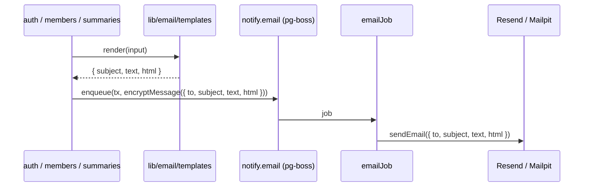

# Anar email templates

Date: 2026-10-29. Lane: Medium (new templates on the existing email seam, one schema change).
Base: `docs/developer-design.md` §2.6 and §5 (jobs), `docs/specs/s1-s2-foundation.md` (S1.2, S1.3, S1.9, S2.2), the design preview `Anar Emails` (https://claude.ai/artifact/CKsLEMTDRqEXDPeqeYM3xY).

## 1. Product

**Problem.** Today the only email is the OTP, a one-line plain-text message. Invites and the summary fallbacks are coming, and people open them on phones in Gmail. Without one shared look, every email will be built ad hoc, and the plain-text and html versions will drift apart.

**What we build.** One base layout and five blocks in the API email module. Every email is a template built from them, giving subject, html and text from one call.

**Success.**

- The sign-in code arrives in Mailpit as html and text. The code is readable at 360 px, and a long press copies all six digits.
- An invite shows who invited you, which company, the role in plain words, one button and the raw link, and says when the link stops working.
- The html and text versions of every email come from the same blocks, so they say the same thing.
- It looks right in Gmail light and dark on a phone, and in Gmail on desktop.

## 2. Architecture

No new service, queue or route. The templates sit in front of the existing `notify.email` path.



- Rendering happens in the feature's transaction, before encryption, the same place the OTP text is built now. The worker stays a dumb sender.
- **Fails:** a template throws on bad input → the feature's transaction rolls back and nothing is enqueued, same as any other write error. Provider refuses html → existing "Email delivery failed" retry path.
- `emailMessageSchema` gets `html: z.string().min(1)`, required. Every email goes through a template, so there is no text-only caller to keep.
- The payload grows from ~100 bytes to ~6 KB of encrypted html per job. Fine for pg-boss.

## 3. Design decisions

**Base layout** (`layout.render`): hidden preheader, header on the page background (text wordmark "Anar" left, company name right, none on the sign-in code), white body card, footer.

**Footer**, three lines on every email: why you got this, "Anar is run by DNA for <company>", who to contact (Admins: their Super Admin; Super Admins: their DNA contact; sign-in code: "Ask the person who invited you").

**Blocks**, each returns `{ html, text }`: `button(label, url)`, `code(digits)`, `stats(items, cols)`, `rows([[label, value]])`, `notice(body, tone, title?)`. Helpers: `heading(title, sub?)`, `para(text)`, `linkFallback(url)` (html only, the button's text version already prints the link).

Each of these rules has a case that needs it:

- Tables and inline styles only, `width=100%; max-width:600px`, no media queries. The Gmail app drops `<style>` for non-Google accounts, so the layout has to hold at 360 px on its own.
- An MSO ghost table at 600 px. Outlook desktop ignores `max-width` and would stretch the card full width.
- `bgcolor` and inline `background` on every filled cell. Gmail dark mode and Outlook each read only one of them.
- System font stack, no web fonts. Gmail drops them, so a web font would only show in our preview.
- `code` puts the six digits in one text run with letter-spacing, no spaces. With a space, a long press copies only half the code, and pasting `482 913` into the OTP field fails.
- Preheader is padded with `&#847;&zwnj;&nbsp;`. Without it, Gmail pulls body text ("Anar Sundar Heights...") into the inbox line.
- Every input is html-escaped. Names are typed by people (invite name), so `Ram & <Sita>` must not break the layout.
- Text wraps at 70 characters. Some phone clients show plain text without wrapping.

**Colors** are the app tokens from `apps/web/app/globals.css` as literal hex (email has no CSS variables): bg `#f3f5f4`, surface `#ffffff`, line `#dee3e1`, ink `#15191b`, ink-2 `#2e3639`, muted `#4a5458`, brand `#7a1438`, brand-soft `#f1e4e9`, overdue `#b42318`/`#fdecea`, due `#7a4a00`/`#fff3d1`/`#d99a06`, new `#1e4fc2`/`#e6eefc`, call `#0b6e4f`/`#e3f2ea`.

**Links** come from `config.publicOrigin` (prod `https://anar.visitshankhuwasabha.com`). Invite: `/invite#token=<secret>` (foundation spec). Today: `/c/<slug>/today`. Dashboard: `/c/<slug>/dashboard`.

**Dates** are formatted in the company time zone before they reach the copy, e.g. `Thu 5 Nov, 4:30 pm`.

**Privacy.** Templates take member names, company names, counts, dates and urls. Never a lead's name, phone or email (developer-design: push and email bodies carry counts and ids only).

### Copy

| Email | Subject | Preheader |
| --- | --- | --- |
| Sign-in code | `482913 is your Anar sign-in code` | It works for 10 minutes. If you did not ask for it, ignore this email. |
| Invite, first agency staff (from the owner) | `Kabir Acharya invited you to set up DNA on Anar` | Set up your agency on Anar. The link works for 7 days. |
| Invite, agency colleague (from staff) | `Rohan Gautam invited you to the DNA team on Anar` | Join as agency staff. The link works for 7 days. |
| Invite, Super Admin | `Rohan Gautam invited you to Sundar Heights on Anar` | Join as Super Admin, the sales manager. The link works for 7 days. |
| Invite, Admin | `Prakash Joshi invited you to Sundar Heights on Anar` | Join as Admin, on the sales team. The link works for 7 days. |
| Invite resent | `New invite link for Sundar Heights on Anar` | Your earlier link no longer works. Use this one within 7 days. |
| Daily summary | `Today: 3 overdue, 5 due today, 12 new` | Start with the 3 overdue. Sundar Heights, Thu 29 Oct. |
| Weekly summary | `Sundar Heights last week: 214 calls, 9 site visits, 2 bookings` | 19 to 25 Oct. 7 follow-ups are overdue now. |

The full body copy for each email is in the preview and in the template snapshots once they land. The code in the sign-in subject is on purpose: it is faster to read on a phone, and the code is already in the body the provider stores.

What the summaries contain (fewest calls by name, deltas, which counts) is a business-logic decision for the summaries slice. The preview is a starting point, not a contract.

## 4. Program design

```
apps/api/src/lib/email/
+ templates/layout.ts         Base layout and the blocks; each block gives its html and text together.
+ templates/signInCode.ts     Sign-in code email.
+ templates/invite.ts         Invite and resent invite, for agency staff, a Super Admin or an Admin.
+ templates/dailySummary.ts   Daily summary for an Admin with push off. (summaries slice)
+ templates/weeklySummary.ts  Weekly summary for a Super Admin with push off. (summaries slice)
~ index.ts                    Sends the html part to Mailpit and Resend.
packages/domain/src/jobs.ts
~ emailMessageSchema          Adds html.
apps/api/src/modules/auth/otp.ts
~ requestOtp                  Builds the message with signInCode.render.
apps/api/test/email/
+ templates.test.ts           Snapshot of html and text per email, plus the escape and privacy checks.
+ __snapshots__/*.html, *.txt
```

Each template file is one object with a default export, like `emailJob`:

```ts
export type RenderedEmail = { subject: string; text: string; html: string };

// layout.ts
type Block = { html: string; text: string | null };
layout.render(input: { preheader: string; company: string | null; blocks: Block[];
  footer: { reason: string; operator: string; contact: string } }): { html: string; text: string }
layout.button(label: string, url: string): Block   // and code, stats, rows, notice, heading, para, linkFallback

// signInCode.ts
signInCode.render(input: { code: string }): RenderedEmail

// invite.ts
invite.render(input: { name: string; role: "agency_staff" | "super_admin" | "admin"; agency: string;
  company: string | null; inviter: { name: string; role: "owner" | "agency_staff" | "super_admin" };
  url: string; expiresAt: Date; timeZone: string; resent: boolean }): RenderedEmail
// The inviter's role picks the copy: an owner invite is the agency's first staff, and agency staff
// can invite an Admin into a company they entered, so "invited by" can't be read from the invitee's role.
```

```diff
 requestOtp(email)
   ...create otp challenge
-  encryptMessage({ to, subject: "Your Anar sign-in code", text: `Your Anar sign-in code is ${code}...` })
+  encryptMessage({ to, ...signInCode.render({ code }) })
   enqueue(tx, "notify.email", ...)

 sendEmail({ to, subject, text, html, deliveryKey })
   emailMessageSchema.parse(...)
-  mailpit body { From, To, Subject, Text }        resend body { from, to, subject, text }
+  mailpit body { From, To, Subject, Text, HTML }  resend body { from, to, subject, text, html }
```

Snapshots use `toMatchFileSnapshot("__snapshots__/<email>.html")` and `.txt`, so a reviewer can open the html file in a browser.

## 5. Slices

**E1. Base layout and the sign-in code, end to end.**
Files: `templates/layout.ts`, `templates/signInCode.ts`, `lib/email/index.ts`, domain `jobs.ts`, auth `otp.ts`, `test/email/templates.test.ts` + snapshots; update the OTP subject/text asserts in the existing auth tests.
Uses: S1.2 `sendEmail`, S1.3 `requestOtp`. Gives: `layout` with all five blocks, `RenderedEmail`, html on `EmailMessage`.
Proof: `pnpm --filter @anar/api test` with the template test: sign-in snapshot (html + text); a name with `& < >` comes out escaped; the code is one run with no spaces. `W test/otpEmail.integration.test.ts`: Mailpit message has both an html and a text part. Then a look at the Mailpit html on a phone width.
Size: ~170 lines of source. The layout carries all blocks even though the sign-in code uses only some, because the blocks are one job (the email look) and E2 needs the rest straight away.

**E2. Invite and resent invite.**
Files: `templates/invite.ts`, snapshots, test cases. Templates only; the invite steps wire them in.
Uses: E1 `layout`, `RenderedEmail`. Gives: `invite.render` for S1.8a (`createAgency`, `resendFirstInvite`), S1.8b (`inviteStaff`, `resendStaffInvite`), S1.9 (`inviteSuperAdmin`) and S2.2 (`inviteAdmin`, `resendInvite`) to call.
Proof: snapshots for first agency staff, agency colleague, Super Admin, Admin and resent. `expiresAt` 2026-11-05T10:45Z reads `Thu 5 Nov, 4:30 pm` in `Asia/Kathmandu` and `10:45 am` in UTC. Resent shows the "earlier link no longer works" notice and drops the phone tip. An Admin invited by agency staff is pointed back to that staff member.
Size: ~150 lines, most of it the copy table for the four invite kinds.

**E3. Daily and weekly summaries.** Built inside the summaries slice, not now: no caller exists yet, and the contents are still a business decision. It reuses `layout.stats` and `layout.rows` as designed. Test cases to carry over: zero overdue switches the preheader and line to "Nothing overdue"; the daily email is not sent when all three counts are zero.

## 6. Review focus

Cases the spec implies, most likely first, and the slice that tests each:

1. A name or company with `&`, `<` or `"` (E1).
2. Invite expiry in the company time zone, not the server's (E2).
3. Zero overdue in the daily summary (E3).
4. A long company name in the header at 360 px: wraps on the right, no sideways scroll (E1, by eye in Mailpit).
5. The text version holds the button's link, since the text has no button (E1).
