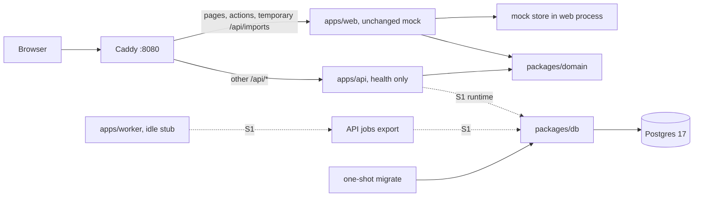

# S0: monorepo, same working mock

Date: 2026-10-29. Lane: Large, architecture refactor; no new product behavior.
Status: proposed implementation spec. This task changes documentation only. Nothing below has been implemented or tested by writing this spec.
Intent: [developer design](../developer-design.md), especially §§2, 5, 8–10; existing seam in [UI mock spec §2](ui-mock-slice.md#2-architecture-one-seam); [design principles](../design-principles.md).

## 1. Outcome and scope

The finished mock is currently the root Next.js app on `ui-mock`. The real backend must have its own HTTP service. S0 puts the mock in `apps/web`, creates the workspace and backend foundations, and proves the same screens still work before any feature switches to real data.

Success: the existing 231 web unit tests and 128 Playwright cases still pass, API answers its one health route, worker starts/stops as a stub, the two DB roles and tenant transaction rules work against Postgres, and CI rejects web importing DB code. New foundation tests add to those counts; they do not replace or reduce the original suites.

Included: mechanical relocation, workspace scripts, shared errors/types, API health, worker lifecycle stub, Drizzle config/migration runner, roles and tenant transaction helper, local Compose, package boundaries, CI and built-image smoke.

Excluded: real auth, business endpoints, real uploads, pg-boss consumers, product tables/seeds, switching mock data to HTTP, UI redesign, dependency upgrades, deployment, opening source CSVs in `docs/`. No source-data migration or live DB access in S0. The database proof uses a disposable test table only.

The eventual web has presentation and transport only. S0 intentionally preserves demo business behavior in the relocated `mock/` and `modules/*/data/`; later S-slices replace that behavior at the seam. This is a temporary demo boundary, never permission to ship mock fallback behind a real session.

## 2. What was verified in the repo

| Evidence | Consequence for S0 |
| --- | --- |
| Root `package.json`: `pnpm@11.28.2`; scripts `dev`, `build`, `start`, `typecheck`, `lint`, `test`, `e2e` | Keep the pin, dependency versions and familiar root commands; add workspace orchestration, not Turbo. |
| `pnpm-workspace.yaml` already sets `storeDir`, `cacheDir`, `saveExact` | Extend it with `apps/*` and `packages/*`; keep cache settings anchored at root. |
| `modules/leads/server.ts`, imports/tenant equivalents, page re-exports under `app/` | Preserve explicit entry files, async signatures, UI import paths and feature ownership. |
| `lib/errors.ts` defines six codes, `AppError`, `ActionResult<T>`, `actionFailure` | Share the one implementation; retain web compatibility exports so `instanceof AppError` still works. |
| Module `types.ts` files use `Date`, including nested leads, import date ranges and reports | Keep the in-process types unchanged. ISO wire schemas/Date decoding arrive with actual endpoints, not a raw JSON cast. |
| `app/api/imports/route.ts` accepts JSON metadata and calls the mock import action | Keep it and route to web in S0. The health-only API cannot receive this request yet. |
| `modules/followups/actions.ts` chooses a next lead; imports actions import schemas from mock data | Move unchanged in S0. Later feature cutovers move orchestration to API and schemas to domain; do not hide this work behind “only change a URL.” |
| `playwright.config.ts`: four projects, one worker, serial failure projects, generated per-port tsconfig | Preserve project order and single shared mock process; resolve cwd/cache beneath `apps/web`. |
| `next.config.ts`: per-`E2E_PORT` dist directory and tsconfig | Preserve isolation from normal `.next`; do not reuse the developer's running server. |
| `vitest.config.ts`: app-local `@` alias and `server-only` empty shim | Resolve from `apps/web`, verify pnpm's installed shim path; do not alias all workspace packages to source. |
| `biome.json`: module/mock rules and shared component restrictions | Rebase overrides under `apps/web`; keep them effective in addition to new package rules. |

The 231/128 counts come from the task brief. This docs pass did not run either suite. Before relocation, record baseline command output and case names; a different count is a baseline issue to resolve, not a reason to change the target quietly.

## 3. Decisions

**HTTP framework: Fastify.** Plugins/hooks fit a small HTTP service; injection tests exercise routes without opening a port.
Keep zod contracts explicit and routes thin; no Nest controller framework, RPC code generator or second validation model. [Fastify testing](https://fastify.dev/docs/latest/Guides/Testing/).

**Worker: its own `apps/worker` app.** It needs independent lifecycle and resource limits for imports/exports. S0 has only a signal-aware stub; S1 adds pg-boss and imports the explicit side-effect-free `@anar/api/jobs` registration entry. Backend handlers stay in API feature modules; no duplicate scoring/import implementation and no sixth shared-backend package now.

**Workspace:** private packages `@anar/web`, `@anar/api`, `@anar/worker`, `@anar/db`, `@anar/domain`, one root lockfile, `workspace:*` for internal dependencies. Root is orchestration/tooling only. Keep existing web versions and pnpm pin. Pick Node `24.22.1` (verified local executable), matching the current Node type major; pin it in `.node-version` and CI/images, and verify newly selected package engines before adding them. [pnpm workspace protocol](https://pnpm.io/workspaces#workspace-protocol-workspace).

**Build:** Node apps and packages are ESM, TypeScript `NodeNext`, emitted `dist/` with declarations for shared packages and explicit package exports. Package source uses Node-compatible `.js` relative specifiers. Web keeps Next's bundler-resolution tsconfig and `@/*` relative to its own directory. Use `tsx` for Node development entry points and `tsc` for production; compiled Node startup must work without `tsx`, source aliases or dev-only loaders.

**Shared output:** consumers resolve the same built `@anar/domain` entry, including tests. Build domain before web/API tests; no second source alias that creates two `AppError` class identities. Run dependency builds in topological order. Local root `dev` builds shared output then starts web; `dev:stack` starts Compose. When editing shared contracts, use the documented domain watch command alongside local web dev.

**Local origin:** Caddy on `http://localhost:8080`, web internal `3000`, API internal `3001`. API/worker/db are not publicly exposed by default. Loopback-only DB exposure is an optional developer override. S0 keeps `/api/imports` routed to web, `/api/*` otherwise to API, all remaining paths to web. S4 removes the upload exception. Same-origin deployment avoids a cross-origin cookie design.

**Health:** `GET /api/health` returns exactly `{ status: 'ok', service: 'api' }` with HTTP 200 and JSON content type. This is liveness only; it works with no DB URL. No auth, queue, tenant or readiness route in S0. S1 adds dependency health when real sessions and email jobs land.

## 4. System and ownership



S0's DB package is exercised by migration/proof commands, not by a fake health query. Failure behavior: API down gives a proxy error for health; web still serves the mock. DB down fails DB proof/migrate while API liveness stays 200. Worker has no readiness promise until it consumes jobs. A stub crash is still a process failure and visible in Compose.

### Existing seam and later contract

```diff
 app route -> module page -> module server.ts -> data function
 client form -> module actions.ts ------------^
-data function -> mock/access.ts              (root today)
+data function -> mock/access.ts              (apps/web after S0)
 lib/errors.ts -> @anar/domain/errors         (one class, same callers)

 # Later, only when the owning S-slice lands:
-data function -> mock/access.ts
+data function -> lib/api/client -> API route -> service -> withTenant -> repository
```

S0 changes no existing server function signature. Mock `Ctx`, `DemoUser`, demo cookie, `can`, reset/failure controls and store stay in web. Backend `requireContext`, authoritative `can` and session storage arrive in S1/S2; `withTenant` is infrastructure in DB. Domain holds shared shapes, never authentication authority.

The eventual HTTP client forwards the session cookie per request, keeps `cache: 'no-store'`, maps safe errors to the existing class, and parses DTO date schemas before returning to pages. API ignores client context/role claims. CSRF/CORS, session refresh and `Set-Cookie` forwarding are decided in developer design §§5.3 and 8.5 and tested in S1, not partly implemented in the health stub.

### File-tree diff

```diff
 anar/
-  app/ components/ lib/ mock/ modules/ e2e/
-  next.config.ts postcss.config.mjs components.json
-  tsconfig.json vitest.config.ts playwright.config.ts
+  apps/web/                     exact relocated files above
+    package.json                current app dependencies and Next/test scripts
+    Dockerfile                  dev/build/runtime targets
+  apps/api/
+    package.json tsconfig.json vitest.config.ts Dockerfile
+    src/app.ts                  constructs Fastify; no socket, DB or env side effects
+    src/main.ts                 binds host/port; closes Fastify on SIGINT/SIGTERM
+    src/routes/health.ts        registers the one health endpoint
+    test/health.test.ts         HTTP injection contract and route absence
+  apps/worker/
+    package.json tsconfig.json vitest.config.ts Dockerfile
+    src/main.ts                 idle lifecycle stub; exits cleanly on signal
+    test/lifecycle.test.ts      child process starts, remains alive, then exits
+  packages/domain/
+    package.json tsconfig.json vitest.config.ts
+    src/errors.ts               existing AppError/ActionResult/actionFailure
+    src/health.ts               zod health schema and HealthResponse
+    src/{tenant,settings,scoring,leads,imports,reports}.ts
+                               shared model/view types from current type entries
+    test/errors.test.ts         class identity/result and expected-error behavior
+  packages/db/
+    package.json tsconfig.json vitest.config.ts drizzle.config.ts
+    src/schema/index.ts         empty schema entry; product tables start in S1
+    src/migrate.ts              explicit migration command, migrate URL only
+    src/tenant.ts               transaction-scoped settings and TenantTx type
+    src/connection.ts           runtime pool construction, not import-time I/O
+    migrations/                committed migration output begins in S1
+    test/roles.test.ts          real roles, grants and migration ownership
+    test/tenant.test.ts         disposable fixture, real RLS and pool reuse
+  ops/postgres/bootstrap.sh     fresh-dev roles/schema, administrative connection
+  ops/postgres/roles.sql        role attributes, grants and defaults, no passwords
+  ops/Caddyfile                 same-origin routing plus temporary mock exception
+  scripts/check-boundaries.ts   resolves import paths and checks package edges
+  scripts/check-boundaries.test.ts  allowed/forbidden edge fixtures
+  scripts/smoke-compose.ts      built services, proxy routing, shutdown checks
+  scripts/check-migrations.ts   scratch generation and untracked-aware drift check
+  compose.yml .env.example .dockerignore .node-version
+  tsconfig.base.json            common strict options, no Next aliases/plugins
   package.json                 root orchestration and common tooling only
   pnpm-workspace.yaml          package globs plus existing settings
   pnpm-lock.yaml               one lock, moved importer plus new dependencies
   biome.json .gitignore         workspace scope and generated-file exclusions
+  .github/workflows/ci.yml      the gates in §7
   docs/ ANAR-System-Design.md AGENTS.md   stay at root
```

Do not move or copy `.git`, `node_modules`, `.next`, `.cache`, test reports, `tsconfig.tsbuildinfo`, ignored `next-env.d.ts`, secrets or source CSVs. Generate Next type files in `apps/web` after install. Keep root `AGENTS.md`; inspect any generated `apps/web/AGENTS.md` and retain the Next-generated rule if created. Preserve ignore rules for CSVs, environments and build/test output at every workspace depth. `public/` does not exist in the inspected tree; if it is added before implementation, move its tracked assets with web.

### Foundation signatures

| Owner | Contract and reason |
| --- | --- |
| domain/errors | Preserve `AppError(code: AppErrorCode, message: string)`, `ActionResult<T>`, `actionFailure(error: unknown): ActionResult<never>` exactly. Unknown exceptions still throw. Six S0 codes: `unauthorized`, `forbidden`, `not_found`, `validation`, `conflict`, `unavailable`. S1 adds `step_up_required` and updates HTTP mapping then. |
| domain/health | `healthResponseSchema` validates the literal service/status payload; `HealthResponse` is inferred from it, shared by route test and Compose smoke. |
| domain model entries | Move current non-demo type definitions without broadening string unions or replacing Dates. Rewrite internal imports to local package entries; preserve `hotMin`, `Target`, `MappingTemplate` and all other current exports. Web `types.ts` explicitly re-exports the same names; tenant `Ctx` and `DemoUser` stay web-local. |
| api/app | `buildApp(): FastifyInstance`, no listener or DB dependency; test calls `inject` then `close`. Health registration is the only feature plugin. |
| api/main | `startApi(): Promise<void>` reads/bounds `HOST` and `PORT`, listens, installs shutdown handlers; bad port/bind failure exits nonzero. Importing `app.ts` never runs it. |
| worker/main | `startWorker(signal: AbortSignal): Promise<void>` keeps the stub alive until stop, then releases its keepalive and signal handlers. It starts no HTTP server, queue, polling work or DB connection. CLI entry attaches SIGINT/SIGTERM and awaits it. |
| db/connection | `createDb(connectionString: string): DbHandle`, internal Drizzle/pool constructor used by DB entries and tests; no singleton created on import. Runtime entry requires `anar_app`; migration entry requires `anar_migrate`. |
| db/tenant | `createTenantDb(connectionString: string): Promise<TenantDb>` validates runtime role and returns only bound `withTenant` and `close(): Promise<void>`. `TenantScope = { companyId: string; userId: string }`; `withTenant<T>(scope: TenantScope, fn: (tx: TenantTx) => Promise<T>): Promise<T>`. Validate UUID inputs, set both variables transaction-locally, commit/rollback and release on all paths. |
| db/migrate | `migrate(): Promise<void>` consumes only `MIGRATION_DATABASE_URL`, rejects a different DB role, applies committed migrations once and closes its pool. Empty S0 schema is a successful no-op; runner bookkeeping is not product data. |

Backend startup/proof setup calls `createTenantDb`, passes its bound `withTenant` to services, and calls `close` on shutdown. Feature modules never receive the pool or `createDb`. Export only `@anar/db/tenant` in S0; migration runs as an explicit CLI entry, not a runtime export. No blanket `index.ts` leaks tables/platform access. `@anar/db/platform` is introduced with S1 under the design's allowlist.

## 5. Database and local runtime details

S0 creates no product table. Drizzle config points at `src/schema/index.ts`, PostgreSQL dialect and `migrations/`, using `MIGRATION_DATABASE_URL`; do not use `drizzle-kit push`. First product migration is S1. Empty migration-directory handling is explicit, so a fresh checkout can run the no-op without depending on a locally generated file.

Bootstrap uses Postgres's administrative identity only on the local/CI database. It creates exactly two application login roles: `anar_migrate` owns the application schema/objects; `anar_app` has connection/schema usage and explicit DML/default grants on objects created by the owner, with no schema/database CREATE, TRUNCATE, role membership, superuser or BYPASSRLS. Revoke public CREATE. No passwords in SQL or tracked config; bootstrap takes them from local environment. Role setup is repeat-safe on a fresh disposable instance; restarting an existing volume does not reset credentials or rerun data initialization.

Production bootstrap and schema upgrades later use reviewed operational commands, not a runtime privileged connection. Future `audit_log` overrides broad DML defaults to INSERT/SELECT only. pg-boss schema/queue setup is S1 under the migration role with the runtime migration path disabled; verify its pinned-version grants rather than granting DDL to `anar_app`. [pg-boss install](https://pgboss.io/install).

The RLS fixture is created by the migration role in a disposable test database/schema, then dropped by test teardown. It has two company UUIDs, `ENABLE` plus `FORCE ROW LEVEL SECURITY`, and identical `USING`/`WITH CHECK` comparisons to `NULLIF(current_setting('app.company_id', true), '')::uuid`. Populate through explicit scopes, not by giving the runtime owner privileges. `set_config(..., true)` carries parameterised company/user values inside the same connection/transaction as the callback. Scope must disappear after commit and rollback. [Postgres row security](https://www.postgresql.org/docs/17/ddl-rowsecurity.html).

| Compose service | S0 behavior and configuration |
| --- | --- |
| `db` | Postgres 17, persistent named dev volume, `pg_isready` health, fresh-volume bootstrap; never mount `docs/`. |
| `migrate` (one-shot) | DB package command after DB is healthy; only service with migration URL. Completes successfully before backend startup in the documented startup sequence. |
| `api` | Fastify `0.0.0.0:3001`; health-only, no runtime DB connection yet. Receives only app-role URL if configured; never migration/admin credentials. |
| `worker` | Lifecycle stub stays running; no heartbeat or queue health claim. Same runtime-role credential boundary as API. |
| `web` | Next `0.0.0.0:3000`, relocated mock; no DB, migration, email or push credentials. `API_INTERNAL_URL=http://api:3001` is reserved for S1; S0 does not fetch it from product modules. |
| `proxy` | Caddy `localhost:8080`, preserves `/api` prefix. Exact `/api/imports` mock exception before `/api/*` API match; Next dev WebSocket traffic still reaches web. |

Five long-running services plus one one-shot. `.env.example` names separate app/migration/bootstrap credentials and local-only values; do not pass one shared `env_file` containing every secret to all apps. Mount uploads into API/worker only when S4 needs files. S0 needs no uploads volume or mail service. Mailpit is added in S1.

Docker build context is repository root, with a strict `.dockerignore` excluding `.git`, all `docs/`, CSVs, local caches, `node_modules` and `.env*` except the example if needed. Copy only required manifests, lockfile and source for each target. Dev mounts source and isolates Linux dependency volumes from host dependencies; install from the frozen root lock during setup, never separately per app.

Build Node packages first. Web production uses Next standalone output, with workspace tracing root set to the repo and static assets copied to the location used by the emitted server. API/worker runtime images have compiled output plus production workspace dependencies; no root `node_modules` assumption or host symlink. Inspect the actual standalone tree to select the startup path. Read the installed Next guides for `output`, `cookies`, `server-actions` and `transpilePackages` before implementation; version here is `16.4.3`, not a remembered older convention.

## 6. Implementation steps

These are future reviewable steps, not authorization to implement them in this docs task. Each leaves a usable observable result. Source review, then its tests/proof, then the next step. Target 100–200 changed logic/config lines per review; mechanical relocation/type extraction is larger by file count but must show unchanged content separately. If new logic grows, split at the named observable boundary.

### S0.1: move the working demo into a workspace

Files: move the tracked web directories/configs in §4; create `apps/web/package.json`; edit root `package.json`, `pnpm-workspace.yaml`, `pnpm-lock.yaml`, `biome.json`, `.gitignore`; create `tsconfig.base.json`, `.node-version`. Keep docs and root agent rules in place.

Uses: exact current mock and test configs. Gives: runnable `@anar/web`, app-local aliases/caches, root command compatibility. No UI, seed, action or server body edits.

Details: split root and web dependencies rather than duplicate manifests. Keep app tools Next/Vitest/Playwright where their scripts run, root Biome/TypeScript tooling where root commands need it. Move all imports unchanged under `@/*`; inherited tsconfig must not include API/worker source. Rebase Biome glob exclusions/overrides to the new paths immediately so moved code remains linted. Preserve per-port Playwright caches, `workers: 1`, failure project dependencies, `reuseExistingServer: false`, and the `server-only` test shim.

Proof: baseline at root before the move, then `pnpm --filter @anar/web typecheck`, `pnpm --filter @anar/web test`, `E2E_PORT=3100 pnpm --filter @anar/web e2e`, `pnpm --filter @anar/web build`; expect original 231/128 passing and build success. Compare tracked file contents across the rename; only config path changes belong in the semantic diff. Root `pnpm dev`, `pnpm test`, `pnpm e2e` keep working.

### S0.2: share contracts without changing callers

Files: create domain manifest/config and `src/{errors,health,tenant,settings,scoring,leads,imports,reports}.ts`, error tests; replace web `lib/errors.ts` and the six module `types.ts` entries with explicit re-exports plus local demo types; update web dependency and root lock through the integrator only.

Uses: S0.1 aliases and unchanged public names. Gives: one `@anar/domain/errors` class identity, browser-safe model types, `healthResponseSchema`/`HealthResponse`.

Keep `actionFailure` behavior and all six codes; do not add future auth codes yet. No score/bucket/permission logic, fixtures, cookies or Next imports in domain. No request schemas copied out of mock implementations just to fill a package. Later API slices add their own schemas when used.

Proof: `pnpm --filter @anar/domain build`, `pnpm --filter @anar/domain test`, web typecheck and units; throw an error from the package and catch it through web compatibility exports, preserving code/message/result. Unknown exceptions still throw. Compare all public type names, including current `LeadDetail.hotMin` and report/import types. Web production build detects accidental server imports. Original unit count remains 231; new package cases are reported separately.

### S0.3: boot API health and the independent worker stub

Files: create API and worker manifests/TypeScript/Vitest configs, API `src/{app,main}.ts`, `src/routes/health.ts`, `test/health.test.ts`; worker `src/main.ts`, `test/lifecycle.test.ts`; integrate root scripts/dependencies via writer A.

Uses: domain health contract. Gives: `buildApp`, runnable API on 3001, worker process with clean stop. No jobs export until S1 has a caller with a real handler.

Proof: `pnpm --filter @anar/api test`, API build/typecheck, worker build/typecheck and lifecycle test. API injection returns exact 200 JSON; GET unknown and POST health do not succeed; no other business route is registered. Compiled API starts with no DB URL and fails cleanly on occupied port. Spawn compiled worker, observe it stays alive, SIGTERM it and assert exit 0 without orphan handles; test API SIGTERM too. API can restart without restarting worker or web.

### S0.4: prove the two roles and scoped transaction foundation

Files: create DB manifest/config, `drizzle.config.ts`, `src/{connection,tenant,migrate}.ts`, empty `src/schema/index.ts`, DB tests; `ops/postgres/{bootstrap.sh,roles.sql}`. No business schema migration. Dependency/root-lock edits go through A.

Uses: workspace Node build; a disposable Postgres 17 test service. Gives: `TenantScope`, `TenantTx`, `withTenant`, explicit pool lifecycle and migration command; role separation ready for S1.

Proof: `pnpm --filter @anar/db build`, `pnpm --filter @anar/db test:integration` with separate admin/bootstrap, migration and app credentials. Bootstrap twice without duplicate-role errors; migration twice on empty schema is harmless. Inspect role attributes/ownership, deny runtime CREATE/TRUNCATE/SET ROLE, allow its granted fixture DML. A sees A only, B sees B only, unset scope reads zero, cross-company INSERT/UPDATE is denied, and both success and thrown-callback reuse leave no company/user settings. Close pools so tests exit. No assertion is made only through a privileged connection.

### S0.5: boot the mock and health through local Compose

Files: `compose.yml`, `.env.example`, `.dockerignore`, `ops/Caddyfile`, `apps/{web,api,worker}/Dockerfile`, `scripts/smoke-compose.ts`; web Next output configuration; app runtime scripts as agreed with B.

Uses: S0.1–S0.4 builds and startup contracts. Gives: reproducible five-service dev stack plus migration one-shot, and three production image targets.

Proof: `docker compose build`; `docker compose up -d db`; `docker compose run --rm migrate`; `docker compose up -d api worker web proxy`; `pnpm smoke:compose`. Through `http://localhost:8080`, health returns exact API JSON and mock screens render. Exercise DNA mock upload with metadata and confirm the original result: `/api/imports` reaches web. Stop API and confirm mock still renders; restart it; stop/start worker and confirm independent lifecycles. Run the same smoke with built runtime targets, no source bind mounts. Check web environment/image has no DB secrets or DB package. Preserve volumes on normal shutdown.

### S0.6: enforce boundaries and put the complete proof in CI

Files: root `biome.json`, `package.json`, boundary/migration scripts and their focused fixtures, `.github/workflows/ci.yml`; package scripts and test configs coordinated through their owner.

Uses: all S0 entries and images. Gives: enforced graph and reproducible fresh-checkout gates in §7.

Proof: `pnpm lint`, `pnpm check:boundaries`, `pnpm typecheck`, `pnpm test`, `pnpm test:integration`, `pnpm check:migrations`, `pnpm build`, original web e2e and built Compose smoke. A forbidden direct import, relative escape, alias escape, re-export or dependency declaration must fail; the legal web→domain path must pass. CI must count/discover the full old web suite and preserve its serial failure projects. No `--passWithNoTests` or blanket ignored failure makes the gate green.

## 7. Boundaries, scripts and proof gates

### Allowed imports

| From | Allowed workspace dependency | Forbidden |
| --- | --- | --- |
| web | domain public exports | db, API/worker source, `pg`, Drizzle, pg-boss and backend runtime credentials |
| API | domain, explicit db entries | web, worker, mock data |
| worker | domain, explicit db entries; `@anar/api/jobs` from S1 only | web; API HTTP entry, private feature files and arbitrary API exports |
| db | domain type/contracts only when needed | all apps, Next/React, mock |
| domain | zod, its own entries | all apps, db, Node built-ins, server-only libraries and environment access |

S0 worker has no API dependency because it is a stub. Add the single jobs export and dependency together in S1. Runtime APIs must import repositories through their feature owner; web modules still use explicit `server`, `actions`, `components`, `pages`, `types` entry files. Keep existing mock import restrictions. No wildcard package exports that bypass these rules.

Biome enforces readable restricted-import rules; a small TypeScript-AST/resolution check closes relative-path and alias bypasses, validates package manifests and detects package cycles. Inspect static imports, type imports, re-exports, `require` and literal dynamic imports; reject nonliteral cross-boundary loading. Do not pretend string-glob rules alone cover resolved paths. Treat the existing same-module imports as legal; don't introduce an unrelated lint cleanup. Platform DB allowlist starts in S1 and follows design §2.2.

| Root command | Behavior after S0 |
| --- | --- |
| `pnpm dev` / `pnpm start` | build required shared output then delegate to web dev/start; forward user arguments; start expects a prior production build |
| `pnpm dev:stack` | documented Compose dev startup, including successful one-shot migrate |
| `pnpm lint` | Biome workspace check plus boundary check; generated/output/docs exclusions retained |
| `pnpm check:boundaries` | graph/import rules and negative fixtures; actionable importer/target paths on failure |
| `pnpm typecheck` | dependency builds then all package checks; `next typegen` only in web |
| `pnpm test` | build shared and Node app output required by child-process tests, then run all non-DB unit/HTTP/lifecycle/boundary tests; separately reports original web 231 and added suites |
| `pnpm test:integration` | DB role/RLS fixture against disposable Postgres; API/worker DB suites added when real features exist |
| `pnpm check:migrations` | generate into scratch state from committed migration history, compare SQL and metadata including untracked files; empty schema is verified in S0; custom role/RLS SQL reviewed/tested separately |
| `pnpm build` | dependency-first domain/db/API/worker builds and web Next build; reject unresolved runtime workspace imports |
| `pnpm e2e` | build domain if needed then delegate to existing web Playwright config; all 128 cases, no API/DB required |
| `pnpm smoke:compose` | separate built-stack proxy/process smoke; does not overwrite Playwright's webServer target |
| `pnpm db:migrate` | explicit delegation to DB migration command; never called by web startup |

CI starts from a clean checkout and frozen root lockfile. Jobs: (1) lint/boundaries/types/units/build, (2) Postgres bootstrap/migration/role/RLS checks, (3) original 128-case Playwright suite with browser install, (4) built Compose smoke. Dependency cache keys include root lock and Node/pnpm pins. Publish Playwright reports and failed-service logs with secrets redacted. Run `pnpm audit` as the existing design requires; any exception is named/reviewed, never `|| true`.

Both local and CI proof record commit, Node/pnpm versions, counts, commands and exit codes. No “passes” without output. A path move can leave all unit tests green while a Docker image loses workspace symlinks, so compiled/image startup is a separate required check.

### Failure cases and their owning proof

| Case implied by the design | Owner and proof |
| --- | --- |
| Test counts shrink after relocation, or a reused mock server hides state bugs | S0.1/S0.6: compare discovered cases and 231/128 results; keep one worker, project dependencies and fresh web server. |
| `@` resolves at root or a pnpm shim path is stale | S0.1: web typegen, unit suite and production build from package cwd. |
| Two AppError classes break `instanceof` and form error handling | S0.2: package error caught through existing web export, unknown exception still throws. |
| Web accidentally imports DB through a relative path or re-export | S0.6: negative resolved-import fixtures plus manifest check. |
| A connection retains company after an exception | S0.4: reuse a one-connection pool after commit and rollback; unscoped query remains empty. |
| Runtime connects as owner and “passes” RLS | S0.4: inspect current role/ownership and deny owner escalation; FORCE policy fixture also tested as migration owner. |
| Proxy routes mock metadata to API's missing import endpoint | S0.5: DNA upload through proxy returns the same mock result. |
| Health pretends queue/DB are ready | S0.3/S0.5: exact liveness body with DB absent; full dependency health is S1. |
| Worker exits immediately, or SIGTERM hangs | S0.3/S0.5: real compiled child-process and container lifecycle checks. |
| Standalone web or Node image depends on host files | S0.5: production targets with no source mounts and isolated dependencies. |
| Role init only works once or empty migrations crash | S0.4: repeat bootstrap/migrate on disposable DB; S0.5 fresh Compose volume. |
| HTTP Date/cookie/CSRF contracts drift when real endpoints arrive | S1 transport/session tests plus each owning feature's DTO tests; S0 cannot prove endpoints that do not exist. |

## 8. Two writers without clashes

This is ownership for later implementation, not two simultaneous writers on the same files. Source/test review checkpoints still apply within each step.

| Writer | Exclusive files | Work |
| --- | --- | --- |
| A, integrator/web | all root manifests/lock/config, `apps/web/**`, `compose.yml`, `.env.example`, `.dockerignore`, `ops/Caddyfile`, root scripts and CI, all Dockerfiles | S0.1; web compatibility exports for S0.2; S0.5/S0.6 integration and final whole-workspace proof |
| B, backend/packages | `apps/api/**` and `apps/worker/**` except Dockerfiles; `packages/domain/**`, `packages/db/**`; `ops/postgres/**` | domain extraction, health/stub, DB roles/helper and their focused tests |

Order: A completes the mechanical move and publishes that baseline. B reads frozen `apps/web` type/error entries and builds domain; A alone changes the web wrappers after the exports are handed off. B then supplies API/worker/DB scripts, ports and environment names; A wires containers and CI against those contracts. B never edits web files or root config to make a local test work.

Only A runs dependency installation/lock generation at shared integration points; B supplies exact dependency requests. Separate worktrees may be used later, but manifests meet in one integration order and `pnpm-lock.yaml` is regenerated once from both sets, not hand-merged. No concurrent package-manager writes or competing Playwright servers. API, worker and DB ports/databases are isolated for B's focused proof. A owns the final 231/128 runs and Compose smoke after integration; both read the final diff for unintended UI changes and package cycles.

## 9. Open questions, with picks

1. **Keep Next server actions as UI adapters?** Removing them would change all form callers; keeping them as transport preserves the seam. **Pick:** keep signatures, move backend decisions to API in each feature slice. S0 only relocates them.
2. **Own worker app or second API entry point?** A second entry is fewer manifests but couples startup/build ownership; a separate app makes job lifecycle explicit. **Pick:** own app, single narrow `@anar/api/jobs` export from S1, no extra backend package yet.
3. **One browser origin or separate API hostname?** Separate hostname needs credentialed CORS and more cookie configuration. **Pick:** one Caddy origin, `/api/*` to API; exact local-origin CORS only when direct-port development is needed.
4. **How much DB and queue work belongs in S0?** Full product schema/pg-boss would turn a relocation into feature implementation. **Pick:** Drizzle config, roles, transaction helper and disposable RLS proof now; product tables, pg-boss migrations/consumer and dependency health in S1.
5. **Extract all model types now or only errors/health?** Errors-only is smaller but leaves API types tied to web as soon as S1 starts. **Pick:** mechanically extract current non-demo types now, explicit compatibility exports; add zod DTO schemas only alongside the endpoints that consume them.
6. **Exact runtime patch?** The repo pins pnpm and libraries but not a Node executable. **Pick:** locally verified Node `24.22.1`, pinned once for local/CI/images after checking added dependency engines; no web library upgrades in S0.
7. **What happens to the temporary upload route?** Sending all `/api/*` to health-only API breaks the demo's metadata upload. **Pick:** narrow `/api/imports` proxy exception in S0, removed in S4 with the real multipart adapter and API endpoint in the same change.
