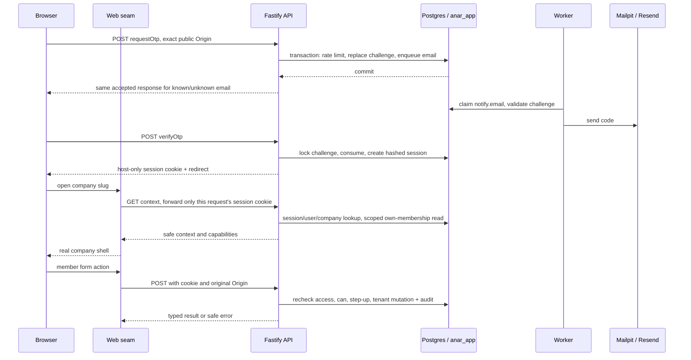
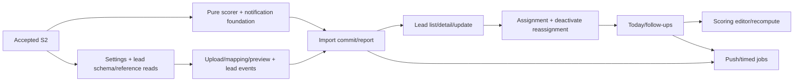

# S1–S2: real identity, company access and the module hand-off

Date: 2026-10-29. Lane: Large. Status: proposed spec, for review before implementation.
Docs only: this pass writes no application code, installs nothing, runs no application tests and makes no commit.
Intent: [developer design](../developer-design.md) §§2.2–2.5, 4, 5, 7.1–7.4, 8.5, 9 and 10; [S0](s0-monorepo.md); [UI mock seam](ui-mock-slice.md#2-architecture-one-seam); [design principles](../design-principles.md).

## 1. Outcome and scope

DNA can create a company and invite its managers. A person proves control of their email, stays signed in, and reaches only the companies they belong to. A manager can invite or deactivate salespeople. DNA must enter a company with a reason before doing company work, and the company can see those entries.

After S2, module writers have one identity model, one permission policy, one scoped transaction path, one audit writer, one queue and one web HTTP client. They can build against those contracts in separate worktrees. Shared foundations do not get copied into features.

Success is observable: invite email reaches Mailpit; OTP opens a real company shell; logout and deactivation reject the next request; changing an ID cannot expose the other company; DNA entry expires after eight hours; a failed API request shows an error and preserves input. Phone and desktop remain usable at 390 px and 1440 px.

S1 includes minimal membership RLS, email jobs and health, not just login forms. S2 completes permissions, members, audit coverage and DNA entry. No settings, leads, imports, scoring, push, reports or live-data backfills are implemented here. Company creation initially creates a shell; S3 adds settings defaults and S5 adds scoring defaults as the developer design's revised delivery order requires.

### Verified starting point

| Evidence inspected on `ui-mock`, baseline `be1f336` | Consequence |
| --- | --- |
| `packages/db/src/schema/index.ts` is empty; `src/migrate.ts` supports an empty migration directory | No existing product rows or schema are assumed. S1 supplies the first product migrations. |
| `packages/db/src/tenant.ts` exposes `createTenantDb`, `TenantScope`, `TenantTx`, `withTenant`; only `./tenant` is exported | Extend this transaction foundation. Introduce restricted platform/queue entries, not a second pool in each feature. |
| `packages/db/test/database.integration.test.ts` checks real Postgres 17, runtime roles, FORCE RLS, rollback and connection reuse | Extend its real-role proof to product tables. Its current “public tables are empty” assertion is S0-only and must become a product-schema assertion. |
| `apps/api/src/app.ts` constructs Fastify with only health; `main.ts` owns startup/shutdown | Add injected dependencies and route registration here; feature imports must not start services. |
| Domain has six error codes and shared models, but no auth/context/member HTTP schemas | Add schemas at the owning endpoint, preserve the existing `AppError` identity and Date-based UI models. |
| Tenant `data/context.ts` trusts `anar_demo`; companies uses `requireDemoContext` and `setActingCompany`; members uses mock `verifyContext` | These bodies must be replaced in real mode. Sending a mock `Ctx` over HTTP would preserve the wrong trust model. |
| `enterCompany(companyId)` has no reason; `homeFor` builds paths from `companyId`; `Company.id` and slug happen to align in the mock | Reason entry and slug-based routing are deliberate seam changes. Real UUIDs must never become slugs by accident. |
| `pg-boss` is absent from manifests/lock; worker is a lifecycle stub | Queue compatibility is an S1 proof, not a verified property of S0. |
| S0.6 boundaries/CI are being finished by another writer | Do not edit their work. Rebase implementation onto the accepted S0.6 baseline; root script names below are the required S0/S1 interface, not a claim they all exist today. |

No CSV under `docs/` was opened. The untracked `apps/web/AGENTS.md` is pre-existing and outside this change.

## 2. Architecture and trust boundaries



Failure boundaries: DB/queue transaction failure rolls back challenge/invite and queued email together; mail-provider failure retries the same delivery, never issues a new code; invalid/expired authentication returns `unauthorized`; a foreign company/resource returns `not_found`; DNA without valid entry returns `forbidden`. Timeout, malformed API response and network failure become `unavailable`, never mock data or empty results.

### Context and transaction rules

1. `requireSession(request)` hashes only `anar_session`, loads session and user, and checks expiry, revocation and global user deactivation on every request. No cached authorization and no `anar_demo`, role, user ID or member object accepted as identity.
2. `requireContext(request, slug)` resolves the candidate company through the companies owner, rejects inactive companies, then uses `withTenant({ companyId, userId }, tx => ...)` to read that user's active membership. Before authorization, this scoped bootstrap may read only the requesting user's membership, never a company member list or feature rows.
3. DNA uses the persisted session's `acting_company_id`, nonblank reason and `acting_until > now`; its member is null. The requested slug must resolve to that company. DNA uses the same company RLS as everybody else.
4. `withContext(ctx, fn)` opens the feature transaction, rechecks session, user, company and membership/acting expiry, and supplies the current backend context and `TenantTx` to `fn`. The recheck and resource checks occur inside that transaction. Mutable authorization rows are held through the write; multi-user mutations acquire affected locks in a documented deterministic order. This prevents a queued stale context from authorizing a write after deactivation commits.
5. Features check `can(current, permission, resource?)` before their writes. They load resource rows inside the same transaction and check own-resource permissions there. Lists enforce an Admin's member ID in SQL; a missing resource never grants an own-only permission.
6. Platform operations use `requireSession` plus a DNA/own-session permission. Their mutation wrapper `withPlatformSession(actor, fn)` reloads and locks the session/user inside the write transaction, then rechecks revocation, expiry, DNA role and OTP freshness as required. A previously resolved `AuthSession` is not sufficient authority for a later write. They never invent a company context. Company list counts use a separate authorized `withTenant` per listed company, solely for the named summary counts, not arbitrary DNA tenant access.
7. Audit inserts, membership changes, session revocation and queued mail publish share the caller's transaction. An audit failure rolls back the mutation. Helpers take the transaction; they do not open nested independent transactions.

`Ctx` is backend-only and includes validated session state, `company`, `companyId`, `user`, `member` and `role`. `ContextView` is the safe UI subset: current user, company, member, role, session `{ id, actingCompanyId, actingReason, actingUntil }`, capability names and resource access mode (`all | own`). It contains no token/hash/IP/user-agent. The session ID is an own-session handle, not a credential. Clients may return an ID/slug as a selector; API resolves every selector again.

### Permissions table

This is a code table in `apps/api/src/modules/tenant/permissions.ts`, not an editable DB table or a new RBAC system. `Permission` names live in browser-safe domain; policy lives only in API. Step-up is a separate freshness guard, not a role permission.

| Permission | DNA | Super Admin | Admin |
| --- | --- | --- | --- |
| `company.create`, `company.list`, `company.enter` | Platform | No | No |
| `members.invite_super_admin` | Platform, selected company | No | No |
| `members.invite_admin`, `members.deactivate`, `members.list` | Entered company | Own company | No |
| `settings.manage`, `leads.assign`, `leads.bulk`, `leads.merge`, `leads.export` | Entered company | Own company | No |
| `imports.upload`, `imports.commit` | Entered company | Only when stored `super_admin_can_import` is true; default false | No |
| `leads.view`, `leads.update`, `followups.log` | All in entered company | All in own company | Own assigned member ID only |
| `reports.view_all`, `reports.compare` | Entered company | Own company | No |
| `reports.view_own` | Entered company | Own company | Own company and member |
| `sessions.manage_own` | Own user | Own user | Own user |

Creating users/invites, deactivating members, changing settings and exporting require OTP age at most 15 minutes, for DNA too. Company creation also uses step-up. Read-only lists, login, refresh, own-session revocation and DNA leave do not. Enter requires a reason, not an extra OTP beyond a valid session. A Super Admin cannot deactivate/promote another Super Admin; DNA handles that. Nobody can deactivate the last active Super Admin. Role-edit UI is outside S2; its future owner must use the same mutation/revocation guard.

## 3. Contracts and HTTP

All request and response schemas are zod in `packages/domain/src`. Strict object schemas reject unknown identity fields. IDs are UUIDs; slug is 3–63 lowercase letters/digits/hyphens, with reserved app names refused; email is trimmed and case-normalized without provider-specific dot/plus rewriting. Names are trimmed 1–120 chars; company name 1–160; reason trimmed 5–500. OTP is exactly six decimal digits. Dates on the wire are ISO UTC strings, explicitly decoded to `Date` at the web seam. Country/timezone stay `NP`/`Asia/Kathmandu` for this foundation, matching the current `Company` model.

Success: `{ ok: true, data }`. Failure: the existing `ActionResult` error envelope. Health is an explicit unwrapped exception. Error mapping: `unauthorized` 401, `forbidden` 403, `not_found` 404, `validation` 400, `conflict` 409, `unavailable` 503, new `step_up_required` 428. Unexpected exceptions return safe `unavailable` with HTTP 500 and a redacted request ID. OTP-request throttling still returns the same 200 `{ ok: true }` data as accepted/unknown requests. Invite-accept throttling uses HTTP 429 with `validation` and `Retry-After`; extend the client status allowlist, not the error-class hierarchy.

Schema names below denote payloads; `apiSuccessSchema(payload)` and `apiFailureSchema` in `http.ts` validate envelopes. `auth.ts` owns named auth schemas, `companies.ts` company schemas, `members.ts` member schemas, `context.ts` context/capabilities and `jobs.ts` the email job. Existing `tenant.ts` keeps `Company`, `Member`, `Role`, `User`; no duplicate domain concepts.

| Endpoint | Input schema and shape | Output schema and shape | Authority / slice |
| --- | --- | --- | --- |
| `POST /api/auth/requestOtp` | `requestOtpSchema`: `{ email }` | `okSchema`: `{ ok: true }` | Public, rate limited; S1.3 |
| `POST /api/auth/verifyOtp` | `verifyOtpSchema`: `{ email, code }` | `verifyOtpResultSchema`: `{ redirectTo }`, Set-Cookie | Public, single-use challenge; S1.4 |
| `POST /api/auth/refresh` | `emptySchema`: `{}` | `okSchema`, Set-Cookie using stored expiry | Valid session; S1.5 |
| `POST /api/auth/logout` | `emptySchema` | `okSchema`, expired cookie | Idempotently revoke current token if present; S1.6 |
| `GET /api/auth/listSessions` | no query | `sessionListSchema`: `{ id, deviceLabel, lastSeenAt, current }[]` | Own nonrevoked, unexpired sessions; S1.6 |
| `POST /api/auth/revokeSession` | `revokeSessionSchema`: `{ sessionId }` | `okSchema`; clear cookie if current | Own session or `not_found`; S1.6 |
| `POST /api/auth/requestStepUp` | `emptySchema` | `okSchema` | Session chooses email; same OTP request limits; S1.7 |
| `POST /api/auth/stepUp` | `stepUpSchema`: `{ code }` | `okSchema` | Session-bound challenge, update only current `last_otp_at`; S1.7 |
| `GET /api/auth/getSession` | no query | `sessionViewSchema`: `{ user, session, companies: Company[], redirectTo }` | Own active memberships, DNA gets no tenant data; S1.11 |
| `POST /api/companies/createCompany` | `createCompanySchema`: `{ name, slug, defaultCountry, timezone }` | `createCompanyResultSchema`: `{ companyId }` | DNA + fresh OTP; S1.8 |
| `GET /api/companies/listCompanies` | `companyListQuerySchema`: `{ cursor? }` | `companyPageSchema`: `{ items: CompanySummary[], nextCursor }` | DNA; page size 50; S1.8 |
| `POST /api/companies/inviteSuperAdmin` | `inviteSuperAdminSchema`: `{ companyId, email, name }` | `inviteResultSchema`: `{ inviteId }` | DNA + fresh OTP, active company; S1.9 |
| `POST /api/auth/inspectInvite` | `inviteTokenSchema`: `{ token }` | `inviteViewSchema`: `{ email, name, companyName, expiresAt }` | Token possession only, no consumption; S1.10 |
| `POST /api/auth/acceptInvite` | `acceptInviteSchema`: `{ token, name }` | `acceptInviteResultSchema`: `{ userId }` | Token + 10/IP/hour; no cookie issued; S1.10 |
| `GET /api/context?company=<slug>` | `contextQuerySchema`: `{ company: slug }` | `contextViewSchema`: `ContextView` | Session plus scoped membership/acting check; S1.11/S2.4 |
| `GET /api/companies/:slug/members/listMembers` | no query | `memberListSchema`: `MemberView[]` | `members.list`; S2.2 |
| `GET /api/companies/:slug/members/listInvites` | no query | `pendingInviteListSchema`: `{ id, email, name, role, expiresAt }[]` | `members.list`, pending invites in this company only; S2.2 |
| `POST /api/companies/:slug/members/inviteAdmin` | `inviteAdminSchema`: `{ email, name }` | `inviteResultSchema` | `members.invite_admin` + fresh OTP; S2.2 |
| `POST /api/companies/:slug/members/resendInvite` | `resendInviteSchema`: `{ inviteId }` | `okSchema` | DNA for Super Admin invites, DNA/SA for Admin invites, fresh OTP; S2.2 |
| `POST /api/companies/:slug/members/deactivateMember` | `deactivateMemberSchema`: `{ memberId, reassignTo?: uuid }` | `deactivateMemberResultSchema`: `{ reassigned: number }` | `members.deactivate` + fresh OTP and target-role checks; S2.3 |
| `POST /api/companies/enterCompany` | `enterCompanySchema`: `{ companyId, reason }` | `okSchema` | DNA, active company; S2.4 |
| `POST /api/companies/leaveCompany` | `emptySchema` | `okSchema` | DNA session, even after acting expiry/suspension; S2.4 |
| `GET /api/companies/:slug/members/listDnaEntries` | no query | `dnaEntryListSchema`: `{ id, actorName, reason, enteredAt }[]` | `members.list`, latest 30 entry records; S2.5 |
| `GET /api/health` | no query | `healthResponseSchema`: `{ status: 'ok' \| 'degraded', service: 'api', db: 'ok' \| 'down', worker: { lastSeenAt: string \| null, healthy: boolean }, queue: { waiting, active, failed } \| null }` | Public, no user/job payloads; S1.14 |

`CompanySummary = Company & { memberCount: number; leadCount: number; lastImportAt: Date | null }`; `MemberView = Member & { email: string; openLeads: number; overdue: number }`. Wire versions replace those dates with strings. Before membership/lead/import tables exist, zero and null are truthful because no product writes exist, not error fallbacks. S1.9/S3/S4/S8 attach real owner-provided count queries before those fields can become nonzero; schema/query failure is never caught as zero. Company pagination orders by `(created_at,id)` with an opaque validated cursor; the adapter drains pages serially, not an unbounded parallel fan-out.

`getSession` company discovery enumerates active platform company candidates through tenant ownership, then performs only the current user's scoped membership lookup for each. Only matched companies leave API. Tens of companies make this acceptable; no unscoped membership query. Multi-company users choose from `/workspaces`; a single company redirects by slug. Until product modules arrive, the real destination is `/[slug]`, a working company home; future role homes activate only with their real adapters.

### Authentication and delivery decisions

- Invite tokens and session tokens use 32 random bytes, URL-safe encoding, hash-only storage. Invitations last seven days. Accept locks the invite, upserts the user by normalized email, adds the company membership and consumes the token in one transaction. A new user name comes from acceptance; an existing user's name/role/membership is not silently overwritten. Existing active membership is a conflict; reactivating a deactivated user/member is a separate approved action. Acceptance never grants a session: OTP proves the invited email. Opening a link only previews it; link scanners cannot consume it. No public DNA signup/invite endpoint.
- OTP lasts ten minutes. One live challenge per user across login/step-up; replacement invalidates the prior one. Use a keyed hash over challenge ID, purpose and code, with a backend-only pepper, because six digits have too little entropy for an unkeyed hash. Wrong attempts increment atomically; the fifth consumes the challenge, and a sixth attempt cannot succeed. Concurrent successes create at most one session. Login challenges cannot step up, and a step-up challenge is bound to its requesting session. Expiry uses `now >= expires_at`.
- Email/IP limits use persistent sliding windows and transaction locks, not process memory: request 3/email/10 min and 20/IP/hour, invite acceptance 10/IP/hour. Unknown emails take the same limiter path and response. Store normalized-email/IP limiter keys as keyed hashes; use the proxy-verified IP. Resending an invite replaces its token, is limited to 3/invite/10 min and invalidates the earlier link. Inspection is read-only and capped at 60/IP/min. Login HTML is capped at 60/IP/min at the proxy; verify the actual Caddy build supports that cap or add a named fallback gate before deployment.
- `requestOtp`/invite writes publish `notify.email` in the same DB transaction. Its payload has `{ kind, referenceId, expiresAt, encryptedMessage }`; the message containing the token/code is authenticated-encrypted using a separate backend mail key. Never put raw codes/tokens in queue logs, audit or job output. The worker checks that the referenced invitation/challenge is still valid before delivery. Expired/replaced challenges are skipped. A delayed old email can still arrive; verification always rejects the old code.
- Email uses one `sendEmail(input)` owner: Mailpit locally, Resend in staging/production. A delivery key based on challenge/invite revision is reused on retries; cap retries at three and never retry past the challenge expiry. Delivery is at least once; a provider-accept/crash window can duplicate the same email, never a second usable credential. Queue retention and redaction cover encrypted payloads; no SMTP/API secrets go to web.
- The first DNA user is created by an explicit operator bootstrap command under the auth owner, against a named environment, with email/name arguments. It does not issue a cookie, print credentials or seed production demo users. Refuse promoting an existing non-DNA user. Local seed adds a real company, two managers and three Admins through these same owners; migrations contain no production identities.

### Sessions, step-up and browser transport

Sessions slide for 30 days, updated at most hourly, and `last_otp_at` changes only on successful login or step-up. Refresh locks the session, checks validity before extending it, writes `last_seen_at/expires_at` atomically, and returns a cookie with the stored expiry. Render-time GETs do not renew DB or cookie lifetime. An active browser posts refresh at startup, hourly while active, and on return to the foreground when due. Repeated refreshes inside an hour use the stored expiry, not `now + 30 days`.

Cookie: `anar_session`, host-only, `Path=/`, HttpOnly, SameSite=Lax, Secure on HTTPS. Only explicitly local HTTP disables Secure. Caddy forwards Set-Cookie unchanged. Browser auth and refresh call same-origin `/api/auth/*` directly, so a Server Component need not write cookies. Logout is one tap; a failed network logout shows failure rather than pretending the server session was revoked. The sessions screen permits revoking this or another own device.

Pick for the ambiguous multi-company revocation rule: deactivate/role-change revokes **all sessions of that user**, including other companies, atomically with the membership change. The current session model has no company-session binding. This is simpler and safer than adding a second company authorization-token system; the cost is another OTP for unaffected memberships. Record this as an explicit choice in §10, not an invisible interpretation of “sessions in that company.”

`apps/web/lib/api/client.ts` is server-only; `apiRequest(request, responseSchema)` uses a 10-second timeout, `cache: 'no-store'`, no automatic mutation retry, and request-local headers. Forward only `anar_session`, request ID and the original verified browser Origin on unsafe methods. Do not forward the whole cookie/header bag or any `Ctx`. Use `API_INTERNAL_URL`, never a public secret. Authenticated API responses are private/no-store. Parse the entire envelope, then the exact payload/date schema; invalid JSON, bad nested dates and unexpected shapes fail closed as `unavailable`.

All unsafe browser methods, including public auth and logout, must have the exact configured Origin; reject missing, `null` and hostile values before writes or mail. Next actions retain their own Origin check and forward that received Origin. A server render cannot call a write while manufacturing an allowed Origin. If an auth action wrapper is later needed, it explicitly forwards only the approved `anar_session` Set-Cookie through Next's async cookie API. The installed Next `cookies` guide confirms writes belong in actions/route handlers, not rendering.

Production has no CORS grants. Optional direct-port local development has an exact credentialed allowlist, explicit methods/headers and `Vary: Origin`; hostile preflight is refused. Trust forwarded IP/proto only from the configured Caddy/web hops; web may not forward arbitrary browser proxy headers. The public Origin comes from config, not Host. Redact tokens, OTPs, cookies, authorization, invite URLs, email, names and mail content from API/worker logs. Invite links use `/invite#token=<secret>`: the client reads the fragment into form state, clears it from browser history, and posts it to inspect/accept. The fragment never reaches proxy URL logs. Use `Referrer-Policy: no-referrer`, no persistent browser token storage, and explicit invalid-link UI if the transient token is lost.

B owns the developer design's browser security headers in S1.12/S1.14: per-request nonce CSP for dynamically rendered authenticated/auth pages through `apps/web/proxy.ts`, `frame-ancestors 'none'`, `X-Frame-Options: DENY`, and HSTS on the HTTPS proxy only. Follow the installed Next CSP guide for request/response nonce propagation; do not reuse/cache nonce-bearing HTML or permit unrestricted inline scripts to make tests pass. Verify login, company forms and existing UI components still hydrate under the final policy. Built-image smoke checks nonce changes per page response, matching script nonces, frame refusal and HTTPS HSTS; local HTTP does not advertise HSTS.

## 4. Storage, migrations and audit

All product IDs are application UUIDv7; timestamps use `timestamptz`. Platform rows have `created_at`; tenant rows also `updated_at`. Foreign keys are explicit and deletion is restricted where history matters. Migrations are owned by `anar_migrate`; API/worker connect only as `anar_app`.

| Schema file / table | Columns and constraints introduced here | Behavior / owner |
| --- | --- | --- |
| `schema/platform.ts`: `users` | `id, email citext UNIQUE, name, platform_role NULL or dna, deactivated_at, created_at` | Auth owns identities; install citext via reviewed migration/bootstrap prerequisite. |
| Same: `companies` | `id, name, slug UNIQUE, status active/suspended/closing, default_country, timezone, settings jsonb, closing_at, created_at` | Companies owns shell; settings initially `{ super_admin_can_import: false }`; close/offboard endpoint deferred. |
| Same: `invites` | `id, company_id nullable, email citext, name, role, token_hash UNIQUE, expires_at, accepted_at, revoked_at, created_by, created_at` | S1 permits only nonnull company and admin/SA role. Reserve nullable company only for future DNA provisioning; no public path. Partial unique pending `(company_id,email)` where unaccepted and unrevoked; revoke expired pending row before reissue. |
| Same: `otp_codes` | `id, user_id, code_hash, purpose login/step_up, session_id nullable, expires_at, attempts 0..5, consumed_at, ip, created_at` | Partial unique `user_id` where unconsumed; consume old row before replacement; purpose/session consistency check. |
| Same: `sessions` | `id, user_id, token_hash UNIQUE, device_label, user_agent, ip, last_seen_at, expires_at, revoked_at, last_otp_at, acting_company_id, acting_reason, acting_until, created_at` | Index user and expiry. Acting triplet is all null or all present; only auth/tenant/companies owners write it. |
| `schema/members.ts`: `company_members` | `id, company_id, user_id, role admin/SA, status invited/active/deactivated, invited_by, deactivated_at, created_at, updated_at` | Unique `(company_id,user_id)` and `(company_id,id)`; index `(company_id,status)`. RLS from the first migration. Pending users remain invites; no invented user merely to list an invitation. |
| `schema/audit.ts`: `audit_log` | `id, company_id nullable, actor_user_id, actor_role, action, target_type, target_id, data jsonb, ip, created_at` | Index company/time and actor/time. Runtime INSERT/SELECT only; explicitly revoke UPDATE/DELETE inherited from S0 defaults. |
| `schema/authLimits.ts`: `auth_rate_limits` | `key_hash PRIMARY KEY, scope, hits timestamptz[], created_at, updated_at` | Auth-only platform infrastructure. Under row lock prune hits outside the window, count, append if allowed; fixed lock order for email/IP keys. Bound the array by the threshold. |
| `schema/operations.ts`: `worker_heartbeats` | `worker_id PRIMARY KEY, started_at, last_seen_at, created_at` | Queue owner only; heartbeat every 30 seconds after consumers register, stops on failed worker/queue lifecycle. |
| Dedicated `pgboss` schema | Version-pinned vendor tables/functions and runtime grants | Queue setup, schema migration and queue creation under migration credentials; no runtime DDL. |

Platform-table exception list becomes exactly `companies`, `users`, `invites`, `otp_codes`, `sessions`, `audit_log`, `auth_rate_limits`, `worker_heartbeats`; `push_subscriptions` is reserved and added with S10. The last two are explicit additions to the design for its specified persistent rate limits/heartbeat. Vendor `pgboss` and Drizzle bookkeeping have separate exact-schema checks, never a blanket exemption for any table lacking `company_id`.

Every present and future company table, starting with `company_members`, has ENABLE and FORCE RLS, plus both USING and WITH CHECK equal to `company_id = NULLIF(current_setting('app.company_id', true), '')::uuid`. Missing/reset context exposes no rows and refuses inserts; cross-company updates/deletes match no rows, and changing an owned row's company is rejected. Feature queries still include company predicates. Future cross-tenant references use composite `(company_id,id)` FKs, because a globally unique referenced ID alone does not prevent a tenant A row from pointing at tenant B's row.

Keep `withTenant`'s bound transaction entry. Add `@anar/db/platform` with `createPlatformDb(...): Promise<PlatformDb>` exposing `transaction(fn)` and `close`, but no pool. Its imports and platform schema imports are restricted to API `auth`, `companies`, `tenant`, and later `notifications/subscriptions`. Members calls auth/tenant public functions for user/invite/session/audit data; it cannot gain a platform DB import. Add narrow `@anar/db/queue` for queue startup/heartbeat through API `lib/jobs`, migration tooling and worker composition only. Its runtime operations cannot query arbitrary platform tables. Package exports and resolved-import checks enforce both constructor access and table imports, including relative escapes/re-exports.

Audit begins with S1 company creation/invites rather than losing those actions until S2. S2 completes the coverage and read view. `audit(tx, ctx, action, target, data)` writes actor/role/company from server context, not input. Use structured IDs and changed fields only; never tokens, codes or arbitrary request bodies. DNA entry stores its reason; company mutations record the acting reason/entry expiry so support work can be traced. Audit create/invite/accept/resend/deactivate/enter/leave and each later DNA company mutation exactly once in its transaction. Login/refresh reads do not generate an audit flood. An idempotent leave with no active entry makes no duplicate row. Failed mutations leave neither state nor success audit.

### Migration sequence

These are logical units, not allocated numeric filenames. Each step carries only the schema it uses; do not create all future tables up front.

| Logical change | Step | Prerequisites and proof |
| --- | --- | --- |
| Identity, audit grants and citext prerequisite | S1.1 | Bootstrap first DNA; audit update/delete refused. |
| Queue vendor setup, queue grants and worker heartbeat | S1.2 | No product tenant dependency; runtime can consume, cannot create queues. |
| OTP/rate-limit storage, then session storage and challenge-session FK | S1.3–S1.4 | FK added when sessions exists; until then no step-up challenges. Concurrent challenge/verify proof. |
| Company shell and acting-company FK | S1.8 | User/session tables exist; duplicate slug is conflict. |
| Invites, members, RLS and composite member key | S1.9 | Company/users exist; policy effective before application grants are used. |
| S2 constraints/policy coverage corrections, only if required | S2.1–S2.5 | Do not recreate S1 tables or issue a ceremonial empty migration. |

Integrator assigns the next migration number from the accepted branch, reviews SQL and snapshots, runs fresh-install and upgrade/repeat proof, and extends policy/grant coverage. Do not edit an applied migration. Company defaults/backfills in S3/S5 are separate reviewed data-change decisions with actual row counts, runtime and rollback plan; this spec does not authorize changing stored staging/production data.

### Queue and lifecycle contract

Use one queue publisher and one explicit `@anar/api/jobs` export. Official pg-boss documentation describes publishing through an existing transaction and its public Drizzle adapter, and separately supports reviewed schema installation without runtime CREATE privileges. These support the design; the chosen package version still needs a real-role proof. [Transaction adapters](https://pgboss.io/api/adapters), [database installation](https://pgboss.io/install).

S1.2 pins a version compatible with the installed Node/Drizzle, verifies transactional send/rollback, worker claim/retry/complete and maintenance under `anar_app`, and records the exact grants and setup command. Queue creation/partition DDL runs only during migration/setup. If vendor maintenance needs DDL, move that specific operation to migration-owned setup or select a compatible documented mode; never grant CREATE/BYPASSRLS to runtime. No unproven dual-write “commit then enqueue” substitute.

API startup constructs runtime dependencies and closes its own pools on shutdown. Worker starts pg-boss with runtime migration disabled, registers handlers through `registerJobs`, then starts heartbeat; shutdown stops heartbeat, stops fetching, drains within a bound and closes resources. Importing `@anar/api/jobs` starts nothing. Health checks DB, worker heartbeat (healthy only within five minutes) and queue counts; DB/queue query failure or stale/missing heartbeat returns 503. Failed-job count is reported for alerting, not silently erased. S0 liveness-only tests are updated to this new contract at S1.14; Docker health probes must not create a startup cycle with the worker.

## 5. Program design and existing seams

```diff
 Browser auth -> /api/auth route -> auth service -> platform transaction
+  requestOtp -> persistent limits -> replace OTP -> enqueue(tx, notify.email)
+  verifyOtp -> locked challenge -> consume -> insert session -> cookie
+  stepUp -> session-bound challenge -> consume -> update current session

 Web route -> module page -> module server.ts -> data function
-  data -> mock store / demo cookie
+  data -> apiRequest -> zod envelope/date decode -> existing view type
 Web form -> actions.ts -> same server.ts -> API
+  API route -> requireContext -> withContext -> can/freshness
+    -> repository(tx) -> audit(tx) / enqueue(tx) -> commit

+ DNA enter -> requireSession(dna) -> lock session + company
+   -> validate reason/status -> set acting fields + audit -> commit
+ DNA leave -> requireSession(dna) -> clear acting fields + audit -> commit
```

### File-tree diff and jobs

Paths below are new unless marked `~`. Test files live beside their package's existing tests or in the owning web module.

```diff
 packages/domain/src/
+  http.ts                 envelopes and wire-date schema helpers
+  auth.ts                 login, invite acceptance and own-session schemas
+  companies.ts            company/invite/entry contracts
+  context.ts              safe ContextView, Permission names, capability shapes
+  members.ts              member and DNA-entry read contracts
+  jobs.ts                 common job envelope and encrypted email payload
~  errors.ts health.ts     step_up_required and dependency-health contract
 packages/db/src/
+  platform.ts queue.ts    restricted runtime entries, explicit lifecycle
+  schema/{platform,members,audit,authLimits,operations}.ts
~  schema/index.ts         explicit registration, integrator only
+  queueSetup.ts           migration-only vendor schema/queue/grant setup
~  migrate.ts              coordinated ordered application/queue setup
 apps/api/src/
~  app.ts main.ts          dependency composition, routes and shutdown
+  lib/{http,config}.ts    safe error mapping, Origin/proxy configuration
+  lib/jobs/               transaction publisher and runtime queue lifecycle
+  lib/email/              sendEmail transport and encrypted delivery content
+  jobs/index.ts           explicit handler registration used by worker
+  modules/auth/           routes, OTP, sessions, limits, invite acceptance, bootstrap, emailJob
+  modules/companies/      routes, service, repository; company creation/list/invites/entry
+  modules/tenant/         context, permissions, audit, stepUp; backend Ctx and public entry
+  modules/members/        routes, service, repository; company-scoped membership writes
~  routes/health.ts        dependency readiness response
 apps/worker/src/
~  main.ts                 queue lifecycle instead of keepalive stub
 apps/web/lib/api/
+  client.ts               server-only typed HTTP, timeout and errors
+  mode.ts                 fixed local demo/real selection, server-controlled
 apps/web/modules/
+  auth/                   login, OTP, sessions, step-up and workspace chooser UI/transport
~  tenant/{server,types,permissions,pages}.ts and data/context.ts
+  tenant/data/demo.ts     isolated existing demo implementation
~  tenant/ui/              shell/home/nav, sign-out, refresh, local-only DemoBar
~  companies/{server,actions}.ts and data/companies.ts
+  companies/data/demo.ts  preserved local mock adapter
~  companies/ui/           create/invite forms and reason prompt, existing list layout
~  members/{server.ts,data/members.ts}
+  members/{actions,pages}.ts and ui/   team management and latest DNA entries
+  members/data/demo.ts    preserved local mock adapter
 apps/web/app/
+  login/page.tsx invite/page.tsx account/sessions/page.tsx workspaces/page.tsx
+  (company)/[slug]/page.tsx and settings/members/page.tsx
~  layout.tsx              gate DemoBar; auth refresh is real-mode only
+  e2e-foundation/         separate full-stack auth/company/member stories
+  playwright.foundation.config.ts     isolated full-stack config at apps/web root
~  package manifests, root scripts/boundaries/CI, Compose, env example, Caddy
```

Each API module exposes named public entries; HTTP route registration is separate. Use `tenant/index.ts` for context operations and a separate public `tenant/audit.ts` for transactional audit; the latter imports no auth/context/module index. Repositories accept `tx` and own their module's rows. Auth owns email recipient/session operations, tenant owns auditing/context, members owns membership writes, companies owns company writes. Generic transport/queue/email remain in `lib`; features do not create private clients or rate limiters.

Keep the foundation acyclic: tenant context receives narrow session/company reader dependencies at app composition and owns its scoped self-membership bootstrap read. Auth invite acceptance receives `activateInvitedMember` and the companies owner's active-company reader as typed callbacks wired by the composition root, not imports of those modules. Members/companies may call auth's public invitation/session functions; auth never imports either module back. Audit/freshness/permission helpers accept plain actor data. App composition passes exact functions, not a service locator. Add import-graph tests and an integration test proving the supplied membership callback uses the same transaction.

### Key signatures

| Owner | Signature / purpose |
| --- | --- |
| API app | `buildApp(deps: AppDeps): FastifyInstance`; injected clock/DB/jobs/mail configuration, no listener on import. |
| auth | `requireSession(request): Promise<AuthSession>`; `withPlatformSession<T>(actor, fn: (tx: PlatformTx, current: AuthSession) => Promise<T>): Promise<T>`; `requestOtp(input, requestMeta): Promise<{ ok: true }>`; `verifyOtp(input, requestMeta): Promise<SessionIssue>`; `refreshSession(session): Promise<SessionIssue>`; `revokeSession(actor, sessionId): Promise<void>`; `revokeAllSessions(tx, userId): Promise<void>`. `SessionIssue` stays backend-only and contains the cookie instruction plus safe redirect. |
| auth invites | `createInvite(tx, actor, input): Promise<{ inviteId: string }>`; `acceptInvite(input, requestMeta): Promise<{ userId: string }>`; `resendInvite(tx, actor, inviteId): Promise<void>`. Auth resolves user/email; members owner supplies `activateInvitedMember(tx, input): Promise<Member>` under the invite-derived company scope. |
| tenant | `requireContext(request, slug): Promise<Ctx>`; `withContext<T>(ctx, fn: (tx: TenantTx, current: Ctx) => Promise<T>): Promise<T>`; `can(ctx: AuthSession \| Ctx, permission: Permission, resource?: { companyId: string; assignedTo: string \| null }): boolean`; `requireFreshOtp(ctx: AuthSession \| Ctx): void`. |
| tenant audit | `audit(tx, actor, action: AuditAction, target: { type: string; id: string }, data: AuditData): Promise<void>`; `listDnaEntries(tx, ctx): Promise<DnaEntry[]>`. `AuditData` is a per-action whitelist, not an arbitrary request object. |
| queue/email | `enqueue(tx, job: JobName, payload: JobPayload, key: string): Promise<string>`; `registerJobs(deps: JobDeps): Promise<void>`; `sendEmail(input: EmailMessage): Promise<void>`. Domain job schemas are split into feature files as new jobs arrive; integrator registers them. |
| companies | `createCompany(actor, input): Promise<{ companyId: string }>`; `listCompanies(actor, query): Promise<CompanyPage>`; `enterCompany(actor, input): Promise<void>`; `leaveCompany(actor): Promise<void>`. |
| members | `listMembers(ctx): Promise<MemberView[]>`; `listInvites(ctx): Promise<PendingInvite[]>`; `inviteAdmin(ctx, input): Promise<{ inviteId: string }>`; `deactivateMember(ctx, input): Promise<{ reassigned: number }>`; `requireActiveMember(tx, companyId, memberId): Promise<Member>`. |
| web client | `apiRequest<T>(request: ApiRequest, response: z.ZodType<T>): Promise<T>`; `ApiRequest` carries method/path/query/body, never trusted context. |
| web tenant | Preserve `requireContext(slug): Promise<ContextView>` and `getCompanyShell(slug): Promise<{ ctx: ContextView; company: Company }>`; add `getSessionView(): Promise<SessionView>`. Web `Ctx` becomes a compatibility alias for the safe view. |
| web companies/members | Preserve `listCompanies(): Promise<CompanySummary[]>`, `leaveCompany(): Promise<{ redirectTo: string }>`, `listMembers(ctx): Promise<Member[]>`. Deliberately change entry to `enterCompany(companyId, reason): Promise<{ redirectTo: string }>` and action input to `{ companyId, reason }`. |

Transaction reuse is essential at invite acceptance: auth opens a platform transaction, validates the invite, sets tenant-local context through a DB-owned helper on that same transaction, and calls membership activation. Extend the existing tenant implementation with an internal scope setter shared by `withTenant` and this restricted platform transaction path; never copy `set_config` into auth or open a second transaction. Export that bridge only to platform owners and test that rollback removes both invite acceptance and membership.

### Web cutover and demo isolation

Keep `server.ts` as the door. In real mode tenant/companies/members `data/` uses the HTTP client; `actions.ts` parses form data, calls the seam and handles revalidation/redirects. Backend policy is never copied into real web adapters. Web `can` is only a view helper over server capabilities/resource mode; existing mock permission tests stay attached to the local demo implementation.

Preserve list shapes: company adapter drains the API's cursor pages to the current array contract; members maps `MemberView[]` to the existing `Member[]` for assignment consumers and exposes the richer view to its new settings page. `lastImportAt` and session/entry dates are decoded explicitly. Resolve company IDs to slugs using the API view, not string substitution in `homeFor`. Add a safe local-relative redirect validator; no user-supplied external return URL.

Demo mode is a fixed process/build selection (`ANAR_DATA_MODE=demo`) allowed only in explicit local development or the isolated local/CI demo test profile. Deployed staging/production fails startup if demo is enabled. It is not a cookie, query string, per-request selector or automatic API-error fallback. Preserve mock bodies in their local adapters; DemoBar and switch/reset/failure actions themselves check this mode. Forging `anar_demo` in real mode changes nothing. Do not keep importing demo functions into the real root home or companies page.

Because leads/settings/reports/imports still contain mock code after S2, the integrator owns an explicit real-feature route/action allowlist. Real mode exposes only auth, company home/list and members initially. Unfinished routes are absent from navigation and direct route/action calls are blocked before a mock data function can run. S4 enables upload preview only with API multipart and removal of Caddy's mock exception; S5 enables commit only after its handler exists. Existing mock suites run in their separate demo process with no real credentials. No production-shaped build may silently mix a real tenant context with mock leads.

New forms reuse existing tokens, primitives and layouts: one main action, inline help before validation, errors after interaction, input retained on failed invite/enter/deactivate. DNA reason is required in the Enter dialog; banner shows company, reason and expiry with Leave. The member settings page shows the last 30 entries. Sign-in identity and logout remain visible. S1/S2 do not redesign Today, dashboards or imports.

## 6. Reviewable implementation steps

These are future steps, not permission to implement during this docs task. Each has source review, then tests/proof review, then the next step. Target 100–200 changed logic lines; generated migrations/fixtures are shown separately. The queue and UI substeps below are separate review checkpoints, not one large source drop. If another step grows beyond one behavior, update its decomposition before implementation.

Proof vocabulary: `D` = `pnpm --filter @anar/domain test`; `U` = `pnpm --filter @anar/api test -- <file>` (unit or Fastify injection without DB); `I` = `pnpm --filter @anar/api test:integration -- <file>` (injection with real disposable Postgres and `anar_app`); `DB` = `pnpm --filter @anar/db test:integration`; `W` = `pnpm --filter @anar/worker test:integration -- <file>`; `E` = `pnpm --filter @anar/web e2e:foundation -- <file>` through isolated Caddy/Mailpit. Integrator adds the new scripts/config splits before first use; current API `test/**/*.test.ts` must exclude DB integrations so unit runs stay DB-free. All listed outcomes are expected, not results of this docs pass.

### S1 steps

**S1.1 — Bootstrap the first real DNA identity.**
Files: DB `platform.ts`, `schema/{platform,audit}.ts`, logical identity migration; API `modules/auth/{bootstrap,repository}.ts`, tenant `audit.ts`; domain `http.ts`; package exports/boundary registration via integrator.
Uses: S0 role checks/connection lifecycle. Gives: `PlatformDb`, `AuthUser`, minimal atomic `audit`, explicit operator bootstrap.
Proof: `DB` + `I test/auth/bootstrap.integration.test.ts`: repeat bootstrap creates one DNA user, refuses promoting an existing non-DNA user, prints no credentials; runtime cannot update/delete audit or import platform DB from a forbidden module. No product endpoint is publicly unguarded as a temporary shortcut.

**S1.2 — Prove transactional queue delivery and email transport.**
Files: DB `queue.ts`, `queueSetup.ts`, `schema/operations.ts`, queue migration/grants; domain `jobs.ts`; API `lib/{jobs,email}/`, `jobs/index.ts`; worker `main.ts`; Compose Mailpit and package/config edits through integrator.
Uses: S1.1 platform transaction. Gives: `enqueue(tx,...)`, `registerJobs`, `sendEmail`, queue lifecycle and heartbeat storage. S1.2a provisions a queue and proves runtime publish/rollback under real roles; S1.2b delivers a synthetic encrypted message to Mailpit through a test-only queue/handler and proves worker lifecycle. Each is a source/test checkpoint.
Proof: `W test/email.integration.test.ts` + `DB`: committed fixture delivery reaches Mailpit; rolled-back write has no job/email; retry preserves delivery key, encrypted payload/logs reveal no message; worker restart consumes pending work and shutdown closes resources. Setup repeated safely; runtime queue DDL denied. Test handlers are not production exports. Production `notify.email` validation/registration starts in S1.3 when OTP storage exists; S1.9 adds invites. No real emails sent by these tests.

**S1.3 — Request an email OTP with durable limits.**
Files: domain `auth.ts`; DB `schema/{platform,authLimits}.ts`, OTP/limits migration; API auth `routes.ts`, `otp.ts`, `rateLimits.ts`, `repository.ts`, `emailJob.ts`; `lib/http.ts`, app/job registration.
Uses: S1.1 identity, S1.2 atomic publisher. Gives: `requestOtp`, keyed challenge storage and common Origin/error boundary.
Proof: `D`, `U test/auth/requestOtp.test.ts`, `I test/auth/requestOtp.integration.test.ts` and `W test/otpEmail.integration.test.ts`: real known user gets a code in Mailpit through the production handler; unknown and throttled email have identical body/status; fourth/email and 21st/IP enqueue nothing; parallel requests and two API instances cannot exceed limits; replacement invalidates old code; worker skips expired/replaced/consumed challenges; hostile/missing Origin writes nothing.

**S1.4 — Verify one OTP into one browser session.**
Files: domain `auth.ts`; DB session migration and challenge/session FK; API auth `otp.ts`, `sessions.ts`, `cookies.ts`, routes/repository; session unit/injection/integration tests.
Uses: S1.3 challenge. Gives: `verifyOtp`, `SessionIssue`, `requireSession`, `withPlatformSession`, hashed token and host-only cookie.
Proof: `U test/auth/verifyOtp.test.ts`, `I test/auth/verifyOtp.integration.test.ts`: five wrong attempts consume; sixth/correct-after-fifth fails; exact expiry, replay and concurrent verify cannot create a second session; hashes only in DB; Secure behavior depends on configured local/HTTPS environment; globally deactivated user cannot sign in.

**S1.5 — Renew an active session without extending an expired one.**
Files: API auth `sessions.ts`, refresh route, domain `auth.ts`; clock-driven refresh tests.
Uses: `requireSession`, `SessionIssue`. Gives: hourly-throttled `refreshSession`, consistent DB/browser expiry.
Proof: `I test/auth/refresh.integration.test.ts`: no extension before an hour, extension after activity, cookie equals stored expiry, 30 days plus one minute fails; concurrent refresh cannot resurrect revoked sessions; GET reads do not slide expiry.

**S1.6 — List devices, revoke a device and log out.**
Files: API auth sessions/routes/repository, domain session schemas; API own-session tests.
Uses: S1.4 sessions. Gives: `listSessions`, `revokeSession`, `revokeAllSessions(tx,userId)`, idempotent `logout`.
Proof: `I test/auth/sessions.integration.test.ts`: other user's session ID is `not_found`; revoked cookie fails next direct request; current revoke clears cookie; repeated logout succeeds with allowed Origin; hostile logout cannot revoke or clear anything.

**S1.7 — Require a fresh OTP for sensitive actions.**
Files: API auth OTP/routes and tenant `stepUp.ts`; domain `auth.ts`, `errors.ts`; HTTP error mapping.
Uses: S1.3 limits, S1.4 session. Gives: `requestStepUp`, `stepUp`, `requireFreshOtp`, 428 `step_up_required`.
Proof: `U test/tenant/stepUp.test.ts`, `I test/auth/stepUp.integration.test.ts`: fresh/15-minute boundary, stale session, wrong purpose and other-session challenge; successful proof refreshes only current session; failed proof never extends freshness. Code generation uses the same limits as login.

**S1.8 — Create and list real company shells.**
Files: DB company migration/FK; domain `companies.ts`; API companies routes/service/repository and initial tenant platform permissions.
Uses: `requireSession`, `requireFreshOtp`, `audit`. Gives: `createCompany`, cursor `listCompanies`, real UUID/slug separation.
Proof: `D`, `I test/companies/companies.integration.test.ts`: DNA creates/lists, other roles denied, duplicate/reserved slug refused, audit and company roll back together, empty list is truthful; a paused platform request resumed after device revoke cannot create a company. Defaults contain no nonexistent settings/scoring rows. Name/country/timezone errors identify the input.

**S1.9 — Invite a company's first Super Admin.**
Files: DB invites/members migration with RLS, domain `companies.ts`, API companies invite route, auth invite creation/email handler variant, members activation owner and minimum `requireActiveMember` API; real scoped company member counts.
Uses: company shell, fresh DNA session, queue, scoped transaction bridge. Gives: seven-day invitation, minimal membership schema and tenant-policy proof.
Proof: `I test/auth/invite.integration.test.ts`, `W test/inviteEmail.integration.test.ts`, `DB`: Mailpit link points at configured public URL with fragment token; raw token absent from row/audit/logs; expired/revoked/accepted invitation job is skipped; duplicate pending invite conflicts; inactive/foreign target handling; rollback leaves neither invitation nor job; revoke completing before the invite transaction rejects the stale actor. Member RLS is enabled immediately, not postponed to S2.

**S1.10 — Accept an invitation without granting an unverified session.**
Files: domain `auth.ts`; API auth inspect/accept routes and invite service, members activation; shared tenant scope bridge tests.
Uses: S1.9 invitation and S1.3 OTP path. Gives: `inspectInvite`, `acceptInvite`; UI can request OTP after acceptance.
Proof: `I test/auth/acceptInvite.integration.test.ts`: expired/revoked/used token, simultaneous acceptance, acceptance limit, existing email in another company gains exactly one membership, existing user name is retained, deactivated membership not revived; rollback restores token and removes new membership/user. Preview does not consume; acceptance sets no cookie.

**S1.11 — Resolve a real session and company context.**
Files: domain `context.ts`; API tenant `context.ts`, `index.ts`, auth getSession route; membership lookup/companies public read functions.
Uses: sessions, companies, RLS members. Gives: backend `Ctx`, `ContextView`, `requireContext`, `withContext`, company chooser data.
Proof: `I test/tenant/context.integration.test.ts`: two companies, inactive/deactivated/no membership, forged headers/body, UUID unlike slug, multiple memberships; no tenant read before scoped self-membership; public context exposes no secret. DNA company access remains denied until S2.4. Revalidation rejects an old context after membership/session revoke.

**S1.12 — Sign in and manage the real browser session.**
Files: web `lib/api/{client,mode}.ts`, `modules/auth/`, thin login/invite/account/workspaces routes, `proxy.ts` and nonce-aware layout; domain HTTP/date compatibility tests; real refresh/logout UI; Playwright foundation config.
Uses: auth HTTP contracts, safe session view and typed errors. Gives: login/invite/OTP/session screens, request-local client, browser refresh and sign-out.
Proof: web client unit tests + `E auth.spec.ts`: invite → Mailpit OTP → authenticated home, device revoke, refresh and logout at both widths; two simultaneous browser users never share cookies; stale step-up retains pending form values; API outage shows error; malformed Dates reject; cookie round-trip through built proxy. No render-time cookie mutation.

Separate source/test checkpoints: S1.12a adds `lib/api/client.ts` and one session read adapter, proving request isolation/error/date parsing; S1.12b adds login/OTP UI and refresh/logout, proving browser cookie login/logout; S1.12c adds invite preview/acceptance UI, proving fragment handling and failed-form preservation; S1.12d adds own-session list/revoke UI, proving another-device revocation; S1.12e adds step-up UI and workspace chooser, proving same-session freshness and multi-company routing; S1.12f adds nonce/frame headers and hydration proof. Each touches only its named adapter/UI/routes/headers and focused story. During S1.12, successful login reaches a real account/workspace screen; S1.13 activates the company-home redirect once that destination exists.

**S1.13 — Swap tenant and company seams and isolate the demo.**
Files: web tenant/companies server/data/actions/UI, local demo adapters, root layout/home, new company home route, feature route/action gate; `e2e-foundation/companies.spec.ts`.
Uses: S1.8/S1.11/S1.12 contracts. Gives: unchanged list/shell view shapes backed by API, create/invite forms, slug redirects, local-only demo controls.
Proof: `E companies.spec.ts` plus existing demo unit/e2e suites: real company home loads with UUID distinct from slug; creation/invite errors preserve input; no DNA enter button enabled until S2.4; forged demo cookie/reset action and direct unfinished feature URL/action cannot reach mocks in real mode. Demo still works in its separate local profile.

S1.13a is tenant shell/home/nav plus demo route/action gating, with direct-bypass proof; S1.13b is company list/create UI and data seam, with cursor/slug/duplicate-slug proof; S1.13c is Super Admin invitation form/action, with fresh-OTP and Mailpit proof. Each is independently reviewed with its own focused e2e cases before the next.

**S1.14 — Report full dependency health and prove the S1 stack.**
Files: domain `health.ts`, API health route, worker heartbeat wiring, health/lifecycle tests; integrator CI/Compose/Caddy smoke/scripts, HTTPS security headers and foundation seed.
Uses: running API/queue/worker/mail/browser path. Gives: truthful health and reproducible foundation test stack.
Proof: `W test/lifecycle.integration.test.ts`, `E auth.spec.ts`, `pnpm smoke:compose`: DB down, queue query failure or heartbeat older than five minutes gives 503; recovery restores health, stopped worker stops heartbeat, no startup cycle; built images deliver Mailpit OTP. Verify nonce/frame policy, HTTPS-only HSTS and login-page rate cap through proxy. Root full checks pass after accepted S0.6 integration; report actual counts, no reused development servers.

### S2 steps

**S2.1 — Enforce the complete role and tenant policy.**
Files: API tenant `permissions.ts`, context/capability mapping; domain `context.ts`; DB product-policy coverage test; boundary negative fixtures via integrator.
Uses: S1 backend `Ctx`, RLS membership, step-up. Gives: full `can` table, resource access modes, schema coverage gate for every later module.
Proof: `U test/tenant/permissions.test.ts`, `I test/tenant/access.integration.test.ts`, `DB`: every permission × role × own/foreign/missing resource; default/true import flag; direct HTTP rejects forged authority. Runtime and owner no-context reads, cross-company insert/update/delete, failed-write rollback and one-connection reuse. New unprotected tenant table/platform import fails the gate. Future lead endpoints extend the same matrix when they exist.

**S2.2 — Invite and list Admins through the members seam.**
Files: domain `members.ts`; API members routes/service/repository and auth resend public function; web members server/data/actions/pages/UI and member settings route.
Uses: S1 invitation flow, S2.1 permissions, `requireFreshOtp`. Gives: `listMembers`, `listInvites`, `inviteAdmin`, `resendInvite`, manager team screen. List endpoints are S2.2a, invite form/API S2.2b, resend S2.2c; each includes its domain contract, API owner, matching web seam/UI and focused proof.
Proof: `I test/members/invites.integration.test.ts`, `E members.spec.ts`: SA can invite Admin but not SA/DNA, Admin denied, email and names come through auth owner, foreign invite/member ID hidden, resend invalidates old link, stale OTP prompts/retries with input intact. Pending invites appear separately from active member counts; failed load does not look like an empty team.

**S2.3 — Deactivate a member and invalidate access atomically.**
Files: API members deactivate service, auth session revocation hook, domain deactivate schema; web deactivation form/action.
Uses: `withContext`, `revokeAllSessions(tx,userId)`, step-up, audit. Gives: next-request revocation, last-manager/target-role guards, future assignment integration point.
Proof: `I test/members/deactivate.integration.test.ts`, `E members.spec.ts`: next request unauthorized, other-company member ID hidden, SA cannot remove SA, last active SA refused including concurrent deactivations, repeat deactivation harmless, forced failure rolls back membership/revocation/audit. Until S7, reject nonempty `reassignTo` explicitly; no leads can exist at S2. Before S3/S5 enables persisted leads, attach lead-owner count/refusal so a member holding open leads cannot be deactivated without S7 reassignment.

**S2.4 — Enter and leave a DNA company with a reason and expiry.**
Files: domain company/context schemas; API companies entry/leave service, tenant context; web companies entry seam/action/reason UI, tenant banner/home.
Uses: DNA session, company status, audit, `withTenant`. Gives: eight-hour acting access, reason/expiry banner and Leave.
Proof: `I test/companies/acting.integration.test.ts`, `E dna.spec.ts`: missing/short reason rejected; session/audit commit together; changing slug cannot cross companies; expiry at eight hours rejects next request; refresh/step-up do not extend entry; entering B invalidates old A tab; leaving works after expiry or company suspension; no-op leave creates no extra audit. UI retains reason on failed entry/leave.

**S2.5 — Show DNA entries and close audit coverage gaps.**
Files: API tenant audit query/action schema, members listDnaEntries route; domain member audit DTO; web member settings entry list; route-level audit integration matrix.
Uses: S1 audit table and S2.4 entries. Gives: latest 30 DNA entries visible to company managers, complete S1/S2 mutation audit contract.
Proof: `I test/tenant/audit.integration.test.ts`, `E dna.spec.ts`: latest 30 ordered by time and ID, another company invisible, Admin denied, every DNA mutation has one accurate actor/company/action record; failed mutation has none; raw secrets absent; runtime UPDATE/DELETE audit denied. Force an audit insertion failure and verify domain write rollback.

**S2.6 — Freeze the foundation and prove the fan-out hand-off.**
Files: integrator's explicit registrations, boundary/policy/CI scripts and foundation fixtures; web foundation acceptance stories; module-contract hand-off notes within this spec if reviewed decisions change.
Uses: S1/S2 delivered contracts. Gives: accepted integration baseline, stable ownership and test harness for each module writer.
Proof: root lint/boundaries/typecheck/units/build/migration checks, `DB`, API/worker integrations, original demo e2e and full `E` suite, built-image proxy smoke. Cases include two companies/every role, concurrent refresh/revoke/invite, real Date/cookie transport, foreign Origin, API outage, and no mock fallback. This validates existing endpoints only; later owners must add their own HTTP isolation and job proofs.

### Review focus: cases that must not fall between steps

| Failure case | Assigned proof |
| --- | --- |
| Rollback leaves an email job, accepted invitation or member behind | S1.2, S1.9, S1.10 integration |
| Races bypass limits, use one code twice or revive a revoked session | S1.3–S1.7 integration |
| Existing email/name/role is overwritten while accepting another company invite | S1.10 integration |
| Wrong-purpose/session OTP grants fresh authorization | S1.7 integration |
| Real UUID used as slug, stale cookie hidden by SSR or cookies shared between users | S1.11–S1.13 client/e2e |
| Direct unfinished route or server action reaches mock data with a real session | S1.13 real-mode negative e2e |
| Platform table imported through relative escape; RLS coverage exempts a new table accidentally | S2.1 boundary fixtures and DB catalog checks |
| Deactivation succeeds while audit/session revoke fails; two managers remove the final manager | S2.3 integration with concurrent transactions |
| DNA expiry, entry to B, or leave leaves A authorized; sensitive mutations lack audit | S2.4–S2.5 integration/e2e |
| Worker restart sends old OTP, heartbeat lies, or runtime quietly needs migration privilege | S1.2/S1.14 real worker/DB proof |

## 7. Two writers for S1 and S2

Use separate worktrees from the accepted S0.6 commit, not simultaneous edits in the shared `ui-mock` checkout. This is a future assignment plan; no implementation writers are started by this docs task.

| Writer | Exclusive ownership | Work and hand-offs |
| --- | --- | --- |
| A: identity and company backend | API `modules/{auth,companies,tenant,members}/`; DB `schema/{platform,members,audit,authLimits}.ts`, `platform.ts`, tenant scope bridge; domain `auth.ts`, `companies.ts`, `context.ts`, `members.ts`, `http.ts`, error code addition; matching focused tests | S1.1, S1.3–S1.11 and S2 backend. Publishes exact contracts, route plugins, logical migrations and fixtures to B. Uses B's queue/email public API; never edits B's registrations. |
| B: web, runtime and integrator | `apps/web/**`, worker, API `lib/{jobs,email,http,config}`, `jobs/index.ts`, app/main/health registration; DB queue entry/setup/operations schema; domain jobs/health; all package manifests/exports, lockfile, schema index/generated migrations, root/ops/Compose/CI/full runs | S1.2 and S1.12–S1.14, S2 web/integration. B alone applies shared error export/mapping requests and all generated artifacts; A owns the error source change. |

First freeze the signatures for `PlatformDb`, the transaction scope bridge, `enqueue`, `JobDeps`, HTTP envelopes and auth/context DTOs. A can build identity/OTP logic while B builds queue delivery and client/UI against schema fixtures; acceptance waits for real endpoints. A's challenge request cannot be enabled before B's atomic queue proof. B cannot merge a web adapter that needs an unmerged contract. S2 permission unit work and B's member/entry UI can proceed together, then merge backend before enabling UI actions. Neither writer fixes the other's folder opportunistically; request the owner change or transfer ownership explicitly.

Each writer supplies focused proof on a unique disposable DB/Compose project and ports. B serializes root installs, migrations, full suites and built-stack runs. Spec approval does not remove the skill's source/test checkpoints; a wider batch needs explicit authorization.

## 8. Fan-out after S2

Six module writers plus one integrator. Parallel implementation starts after the S2 gate; dependency-ready merges happen in the order below. A writer may build pure logic/contract tests before an upstream feature is ready, but may not ship a fake repository, runtime fallback or second implementation of an upstream owner.

### Exclusive ownership table

DB paths are under `packages/db/src/schema/`; domain paths under `packages/domain/src/`; API paths under `apps/api/src/`; web paths under `apps/web/`. Every writer owns their focused tests and proposes migrations as described below.

| Writer / slices | API ownership | DB schema ownership | Domain contract ownership | Web ownership | Dependency / hand-off |
| --- | --- | --- | --- | --- | --- |
| Settings, S3 | `modules/settings/**` | `settings.ts`; requests lead reference queries from lead writer | `settings.ts` | `modules/settings/**`, settings routes excluding members/scoring | S2; first merge creates defaults with lead writer's schema/reference foundation. |
| Imports, S4–S5 | `modules/imports/**`; `lib/phone.ts`, `lib/dates.ts` for backend normalization | `imports.ts`, `mappingTemplates.ts`; proposes lead-to-batch FK migration to integrator | `imports.ts`, `jobs/imports.ts` | `modules/imports/**`, import route/transport only | S3 schema + early lead writes, scorer and notifications; S4 preview before S5 commit. |
| Leads, S6–S7 plus required S3/S4/S5 foundations | `modules/leads/**`, including referenceCounts, import write/event APIs, assignment, Today/bucket query primitives | `leads.ts`, `leadEvents.ts` and lead indexes | `leads.ts` (current shared FollowUp shapes retained), `assignment.ts` | `modules/leads/**` | Supplies minimal schema/reference APIs for S3, dedupe/event/write APIs for S4/S5; then S6/S7 on persisted imports. Owns all lead/event writes. |
| Follow-ups, S8 | `modules/followups/**`, including overdue scan handler | `followups.ts` | `followups.ts`, `jobs/followups.ts`; lead DTO changes requested from lead writer | `modules/followups/**`; requests Today data/UI changes from lead writer | S6/S7 and inline scorer; uses `applyFollowUp(tx,...)`. Lead writer owns Today; this writer owns logging and returns next-lead requirements. |
| Scoring, S9 plus S5 scorer foundation | `modules/scoring/**`, including `score.ts` from its first introduction | `scoring.ts` | `scoring.ts`, `jobs/scoring.ts` | `modules/scoring/**`, scoring settings route | Pure scorer/schema/v1 default delivered for S5; editor/recompute after S8 writes. Never imports lead repositories. |
| Push/jobs, S10 plus S5 notifications foundation | `modules/notifications/**`, `modules/reports/summaries.ts`; shared queue/email changes requested from integrator | `notifications.ts`, `pushSubscriptions.ts` | `notifications.ts`, `jobs/notifications.ts`, `jobs/summaries.ts` | `modules/notifications/**`, manifest/service worker/install UI | In-app `notify` for S5; push infrastructure can start after S2; timed jobs await S8 buckets and follow-up scan. |
| Integrator | `app.ts`, `main.ts`, `jobs/index.ts`, shared `lib/jobs`, `lib/email`, `lib/http`, foundation tenant/auth/companies/members changes; explicit cross-owner composition | `schema/index.ts`, package exports, **all numbered migrations, journals, snapshots**, role/RLS coverage, queue setup | Common `http/auth/context/companies/members/jobs/health/errors` entries and export map; resolves cross-file type changes | `lib/api`, root layout/nav, feature enablement, shared route composition and test configs | Lockfile, **all package manifests**, dependency installation, root config, Compose/Caddy/ops/CI, full runs and final integration gate. |

Ownership resolves the developer design's cross-module overlaps rather than assigning two writers the same file: S3's `leads.ts`/referenceCounts belong to the lead writer; S4's lead events belong to leads; S5's scorer belongs to scoring; S5 notifications belong to push/jobs. Follow-ups supplies overdue handling; push/jobs supplies scheduling requests and consumes it through registration. S8 Today changes are requests to the lead writer. Member deactivation and company-creation default hooks remain integrator-owned foundation edits, using published module functions. No reports/dashboard rewrite is smuggled into the summaries worker; S11 remains later.

### Required S2 hand-off

The baseline must include compiled explicit package entries, safe context/permissions/step-up/audit, restricted tenant/platform/queue transactions, tested queue/email lifecycle, stable HTTP errors/dates/cookies, and a real-mode feature gate. Supply a disposable fixture factory for two companies, DNA, two managers, Admins, an inactive member and multi-company user; deterministic clocks; no source CSV or production credentials. Fixtures call owners or run clearly scoped migration-role setup, while assertions run as `anar_app`.

Freeze the following feature-facing contract names and owner in hand-off review. The declarations/design are agreed by S2; only foundations already used by S1/S2 must be implemented then. Feature implementations arrive in their earliest dependent slice, not as empty S2 stubs.

| Contract | Owner / earliest usable delivery | Consumers |
| --- | --- | --- |
| `loadSchema(tx): Promise<CompanySchema>`, `seedDefaults(tx): Promise<void>`, `createFields(tx,ctx,input): Promise<Field[]>` | Settings / S3 | Imports, leads, follow-ups, scoring; integrator company creation hook |
| `getReferenceCounts(tx,input): Promise<ReferenceCounts>` and `getMemberOpenLeadCount(tx,memberId): Promise<number>` | Leads / S3 | Settings refusal checks and foundation deactivation refusal |
| `findImportMatches(tx,input): Promise<ImportMatch[]>`, `addImportedLeads(tx,ctx,input): Promise<ImportWriteResult>` | Leads / S4 reads, S5 writes | Imports; handles lead/event writes and dedupe constraints |
| `scoreLead(input: ScoreInput, config: ScoringConfig): ScoreResult`, `loadActiveConfig(tx): Promise<ScoringConfig>`, `seedScoringDefaults(tx): Promise<void>` | Scoring / S5 | Leads/import commit, follow-ups, S9 recompute, company default hook |
| `notify(tx,input: NotificationInput): Promise<{ id: string }>` with stable dedupe key | Notifications / S5 | Imports, assignment, follow-ups and later push |
| `assignLeads(tx,ctx,input): Promise<{ updated: number }>`, `reassignOpenLeads(tx,ctx,from,to): Promise<number>` | Leads / S7 | Assignment route and integrator's member deactivation transaction |
| `applyFollowUp(tx,ctx,input): Promise<Lead>` and `getMyToday(ctx): Promise<TodayResult>` | Leads / S8 collaboration with follow-ups | Follow-up service and existing Today seam; lead writer owns bucket/next-lead selection |
| `listDueFollowUps(tx,at): Promise<DueFollowUp[]>`, summary count readers | Leads/follow-ups / S8; summaries / S10 | Overdue and timed notifications; scoped read APIs, no reverse private imports |

Argument/result types live with their domain owner and must be concrete in that module's pre-code spec, matching current UI shapes. No feature may start depending on a placeholder type such as `unknown`, a TODO implementation or cross-owner private repository. Job payload base includes company/actor IDs for tenant work; API creates these from authorized context, worker validates persisted payload and re-enters `withTenant`. Session credentials and browser `Ctx` are never job authority. Auth email is the explicit platform-job exception and resolves its invitation/challenge through auth ownership.

### Dependency and merge order



All six writers can start their owned work, but there is no claim that six complete product slices merge immediately after S2. First merge S3 settings plus the lead writer's table/reference-count contribution. S4 adds imports/events and the FK. Before S5 merge scoring's baseline and notifications' `notify` alongside lead insert/event ownership; commit becomes enabled only when the complete job exists. Then merge S6, S7, S8. S9 and completed S10 can merge in parallel after S8. Push subscriptions/PWA work can land earlier behind the feature gate, without timed jobs or unimplemented notification consumers being registered.

Avoid a scoring↔leads cycle: the pure scorer accepts plain data. Recompute reads through a public lead reader and submits score changes through a public lead writer; composition is supplied by the integrator/job registration if direct imports would form a cycle. Similarly settings reference checks receive the lead owner's read function at composition, rather than leads importing settings while settings imports the lead repository. Notifications receives final delivery data, not a callback into every feature. Preserve one direction at runtime and in resolved-import checks.

### Parallel migrations without collisions

1. Each writer changes only their schema file and supplies a logical migration proposal in `docs/migrations/<module>/<change>.md`: tables/constraints/RLS/grants, dependencies, data impact, upgrade/rollback compatibility and required proof. Optional scratch SQL stays unnumbered outside `packages/db/migrations`; the integrator reviews it. Writers never commit generated journals/snapshots or reserve number ranges.
2. Integrator takes one reviewed change at a time on the current integration head, registers schemas, generates the next migration from the actual accepted snapshot, and adds reviewed custom RLS/grant/queue SQL. No parallel “0005” files and no hand-merged journals. Record which owner/PR supplied the logical change.
3. Apply to an empty Postgres 17 database and one at the previous accepted head; run migration twice, catalog RLS/grants/FK checks and the module integration proof. Failed upgrade does not get hidden by recreating a local DB. Cross-module FK waits until both referenced tables exist; the lead-to-batch FK is the explicit S4 example.
4. Merge schema + final generated migration + dependent runtime behavior as a coherent reviewed unit. The integrator does not silently rewrite module logic. Other writers rebase onto this accepted head before their final DB proof; stale scratch migrations are regenerated, never renumbered in isolation.
5. Integrator alone updates manifests, runs package installation and regenerates the single lockfile. Writers supply exact dependency requests. No shared pnpm writes; no overlapping full Playwright/Compose runs. An applied migration is immutable; subsequent corrections are new migrations.

The integrator publishes a short hand-off per merge: accepted commit, exported contract changes, ordered migration list, flags now enabled and proof commands/results. A writer can keep building pure logic on an older baseline, but merge proof must use the latest accepted contracts/schema. Source and tests still get separate reviews; parallelism changes ownership, not permission to skip review.

## 9. Final verification and limits

The implementation integrator runs the accepted S0.6 root gates, then adds S1/S2 suites: `pnpm lint`, `pnpm check:boundaries`, `pnpm typecheck`, `pnpm test`, `pnpm test:integration`, `pnpm check:migrations`, `pnpm build`, `pnpm e2e`, `pnpm --filter @anar/web e2e:foundation`, `pnpm smoke:compose`. Use fresh isolated services/ports and built images as well as API injection. Keep the original demo suite separate and record its actual discovered case count; the old 231/128 numbers are a regression floor to reconcile with the accepted S0.6 baseline, not results claimed here.

No live DB is inspected or changed by this planning pass. No application proof is claimed. Document review checks every requirement against a slice, checks cross-owner paths for conflicts and verifies migration/feature dependencies. S1/S2 production readiness still needs chosen sender/public URL, successful pinned queue proof and real deployment gates. Live company data defaults/backfills remain their own decisions under S3/S5.

## 10. Open questions, with picks

1. **Sending domain and app URL.** Mailpit unblocks local work, but real OTP links and sender verification need DNA's domain/DNS owner. **Pick:** Resend on a verified DNA mail subdomain, one `anar.<dna-domain>` origin; confirm actual values before staging delivery, never invent them in config.
2. **Revocation for a person in two companies.** Current global sessions cannot be revoked “only in company A” without another authorization record. **Pick:** revoke all their sessions when any membership is deactivated/role-changed. This adds one login for other memberships; company-only epochs are a separate feature if that cost is unacceptable.
3. **Who may deactivate a Super Admin?** The broad manager permission does not say whether peers can remove each other. **Pick:** DNA only, with fresh OTP and at least one active Super Admin remaining. SA manages Admins; no role-edit UI in S2.
4. **Invite acceptance before email proof.** The source flow creates membership at link acceptance, then asks for OTP; moving creation after OTP adds pending-acceptance state. **Pick:** keep the source flow, consume the secret invite atomically but issue no session until email OTP. Existing inactive membership is not reactivated by invitation.
5. **Shared-phone session length.** Shorter Admin sessions reduce exposure but change the base requirement. **Pick:** 30-day idle, hourly browser renewal, one-tap logout, own-device revoke and 15-minute step-up for all sensitive mutations, including DNA.
6. **How much can really fan out after S2?** Six writers cannot skip settings/lead/scorer/notification dependencies. **Pick:** start all six with exclusive owners, pull the named S3–S5 prerequisites forward under those owners, and merge by the dependency graph. One integrator owns shared files and migration numbering throughout.
7. **Demo while modules are unfinished.** Keeping the bar with real authentication would leave a second identity path and fake product results. **Pick:** separate local-only demo process/profile; real mode exposes only completed adapters and uses a real company home until product routes arrive.
