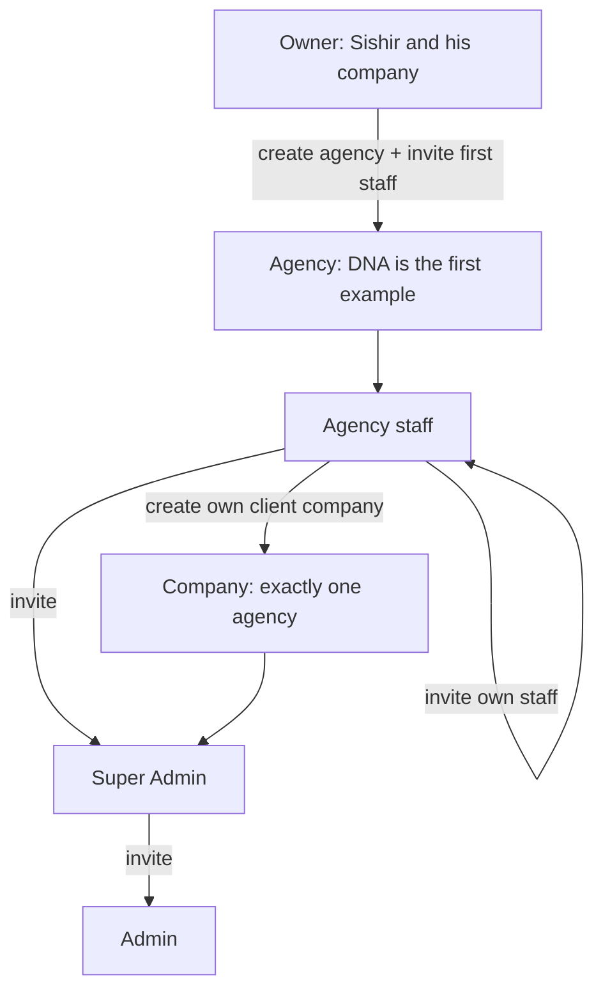
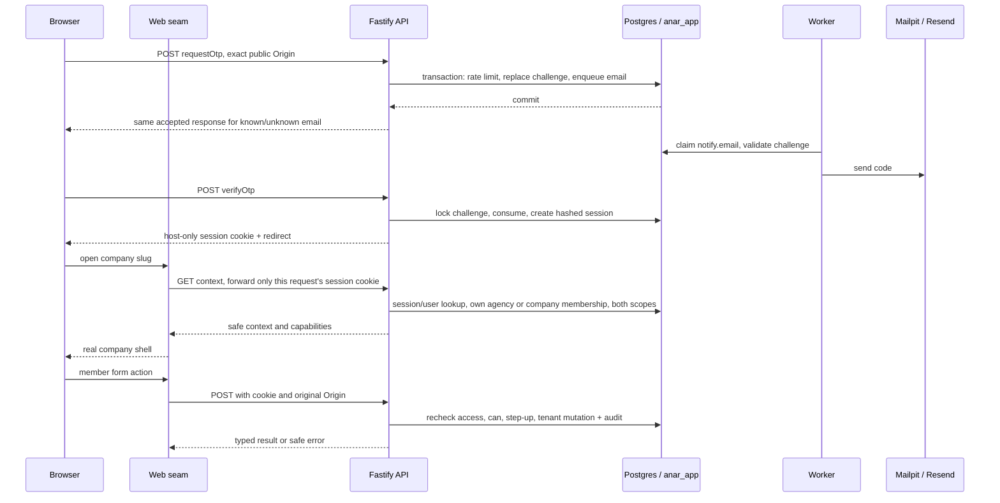
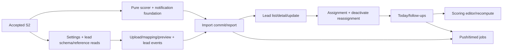

# S1–S2: owner, agencies, company access and the module hand-off

Date: 2026-10-29. Lane: Large. Status: proposed spec, for review before implementation.
Revision: `[agency]` marks sections changed for Sishir's 2026-10-29 decision; a heading mark covers its section. Proposed picks are in §10. DNA is only the first agency's name in examples and seed data, never an authorization role.
Docs only: this pass writes no application code, installs nothing, runs no application tests and makes no commit.
Intent: [developer design](../developer-design.md) §§2.2–2.5, 4, 5, 7.1–7.4, 8.5, 9 and 10; [S0](s0-monorepo.md); [UI mock seam](ui-mock-slice.md#2-architecture-one-seam); [design principles](../design-principles.md).

## 1. Outcome and scope `[agency]`

Anar is sold to many agencies. The owner is Sishir and his company, above every agency. Only the owner creates an agency, by inviting its first staff member. Agency staff create client companies, invite their Super Admins, upload leads and enter their own companies with a reason. Every company belongs to exactly one agency. Super Admin and Admin work stays the same.

The owner can list agencies and their status, but has no company membership, support entry or lead permissions. Agency staff can invite their own staff with fresh OTP. Staff cannot create another agency or see another agency's companies, staff, members, invites or leads. Never deactivate the last active agency staff member or the last active company Super Admin.

After S2, module writers share identity, agency/company context, permissions, scoped transactions, audit, queue and web transport. Success: owner invites agency A's first staff; that staff signs in, invites a colleague and creates a company; the company manager accepts and signs in. Agency B sees none of A's data, including via guessed URLs or IDs. Staff removal rejects the next request. Support entry expires after eight hours. Failure preserves form input. Phone and desktop remain usable at 390 px and 1440 px.

S1 includes the owner bootstrap, agency onboarding, minimal agency/company RLS and real email/session delivery. S2 completes permissions, staff/member management, support entry and audit. No product leads/settings/imports/scoring or live-data backfill here. Company creation creates a shell; S3 supplies settings defaults and S5 scoring defaults. Agency transfer, billing, owner delegation and suspension controls are outside S1/S2; stored inactive status still denies access.

### Verified starting point and small amendments

Read on shared branch `ui-mock`, 2026-10-29. These are file observations, not claims that the ongoing writers have finished or passed tests. S1.3–S1.5 are being written in this checkout; leave their files alone. The old S0-era empty-schema snapshot is no longer current.

| Existing slice / inspected files | What changes later; what stays |
| --- | --- |
| S1.1: `schema/platform.ts`, auth `bootstrap.ts` / `repository.ts`, domain `auth.ts`, API package bootstrap script | Replace the old agency-specific bootstrap with `bootstrap:owner`, `bootstrapOwner`, `BootstrapOwnerInput`, `bootstrapOwnerSchema`. `users.platform_role` becomes `owner \| null`; staff authority comes from agency membership. Refuse promotion of an existing ordinary user and creation of a second owner, including concurrent calls. |
| S1.1: `schema/audit.ts`, API `tenant/audit.ts` | Add nullable `agency_id`; current actor roles become `owner \| agency_staff \| super_admin \| admin`; bootstrap action becomes `auth.bootstrap_owner`. Preserve INSERT/SELECT-only grants and historical records. |
| S1.2: DB `queue.ts`, `queueSetup.ts`, operations schema, API jobs/email, worker | No architecture change. Reuse encrypted transactional mail; add invite variants only when onboarding ships. |
| S1.3: `schema/authLimits.ts`, auth `otp.ts`, `rateLimits.ts`, `emailJob.ts`, request route | No OTP/limiter algorithm or storage change. Login proves email, not agency authority. Extend fixtures to owner and staff; membership/status checks belong at protected access. |
| S1.4: `schema/platform.ts` sessions, auth `sessions.ts` / `cookies.ts` / verify route | Keep token hashing, single-use OTP, cookie and acting triplet. No agency ID or role snapshot in sessions. Keep `/workspaces` as verify redirect. S1.8a factors the existing locked identity check into `lockSessionActor` for the new transaction wrappers; S1.11 supplies home routing. |
| S1.5: auth `sessions.ts` refresh | No renewal algorithm change. Refresh may renew identity, never restore revoked agency membership or extend acting expiry. Existing locked `withPlatformSession` remains the identity guard; add authorization in the new agency wrapper. |
| DB `tenant.ts`, `tenantScope.ts`, `platform.ts` | Extend the existing scope setter and same-transaction bridge with agency scope. Do not add feature pools or copy `set_config`. |
| Domain `tenant.ts` / `auth.ts` | Separate real `AuthUser` from demo `User` before removing the legacy role from real auth. Add real agency/company context contracts without changing mock users, cookies, roles or seed behavior. |
| Migrations `0000_lucky_bastion.sql` through `0003_messy_hydra.sql` | Identity/audit, heartbeat, OTP/limits and sessions already exist. Keep all four and their snapshots immutable; generate follow-up migrations from the accepted writer head. No assumption that the next free number is 0004. |

No company, invitation or membership table exists in the inspected migrations. Therefore these are new tables, not a claimed production backfill. No live DB or source CSV was opened. Existing edits to developer-design email documentation are preserved.

### Hierarchy



## 2. Architecture and trust boundaries `[agency]`



Failure boundaries: DB/queue transaction failure rolls back challenge/invite and queued email together; mail-provider failure retries the same delivery, never issues a new code; invalid/expired authentication returns `unauthorized`; a foreign company/resource returns `not_found`; agency staff without valid entry returns `forbidden`. Timeout, malformed API response and network failure become `unavailable`, never mock data or empty results.

### Context and transaction rules

1. `requireSession(request)` hashes only `anar_session` and checks session expiry/revocation and global user deactivation on every request. Identity has no agency privilege. Never trust a browser's role, agency/company ID or member object.
2. `requireOwner(request)` requires fresh server-read `user.platformRole = owner`. Its mutation wrapper reuses `withPlatformSession` and repeats this check plus OTP freshness inside the write transaction. Owner authority is limited to agency onboarding/registry and own sessions. It is never an RLS bypass or an implicit company role.
3. `requireAgencyContext(request)` reads only this user's active `agency_members` row under identity scope, resolves its active agency and returns `AgencyCtx`. Proposed MVP pick: one agency per staff user, enforced by unique `agency_members.user_id`; no staff agency selector from the browser. `withAgencyContext` locks identity and agency inside the mutation transaction, sets the previously resolved agency scope, then locks/rechecks staff membership. No business callback runs before all checks pass. Agency staff company creation/list/invite targets are filtered by that agency.
4. `requireContext(request, slug)` uses identity-scoped membership discovery for a company user, or the agency-scoped company reader for staff. It resolves `company.agencyId`, active agency/company and either active company membership or the current staff member's persisted acting triplet. It returns `Ctx` with both `agencyId` and `companyId`. A different agency's slug/ID is `not_found`; staff in their own agency without matching valid entry get `forbidden`. Owner is refused before company resolution.
5. Staff entry requires an active staff membership in the company's agency, nonblank reason and `acting_until > now`; company `member` is null. Slug must match `acting_company_id`. Derive agency from the company and recheck membership each request; no `acting_agency_id` column. Entry to another company replaces the first entry; refresh/step-up never extend it.
6. `withContext(ctx, fn)` locks/rechecks identity inside one transaction, sets the previously resolved agency/company selectors, then locks/rechecks agency, company and membership/entry in the order below. Only after those checks does it supply current `Ctx` and `TenantTx` to the feature callback. Scope selection alone never authorizes feature reads. Authorization locks last through writes. Features load resource rows there and run `can`; Admin lists also constrain assigned member ID in SQL. No resource means no own-resource grant.
7. Shared lock order for agency/company authorization writes: affected user rows sorted by ID, affected session rows sorted by ID, agency row, company row when present, affected membership rows sorted by ID, then invitation rows sorted by ID. Resolve target user IDs in a scoped/token-bound preliminary read; pass the complete set before acquiring locks and revalidate the target afterward. Never lock the actor first then discover a lower-ID target. Staff removal takes the agency row before counting staff whose membership is active and user is not globally deactivated; company manager removal takes the company row before counting active Super Admins. Use this order in acceptance, entry and revocation. A paused stale request cannot write after removal commits.
8. Agency company-list counts are a named summary-only scoped query per authorized company on the current page; list permission does not authorize lead/member details or normal feature handlers before entry. Owner list returns agency metadata/status only, no company counts or tenant data.
9. Audit, membership/status changes, session revocation and queued email share the caller's transaction. The existing `withPlatformTenant` bridge sets both IDs in the same transaction during acceptance; no nested independent commit.

`AuthSession` remains backend identity only. `OwnerCtx` has role `owner` and no tenant scope. `AgencyCtx` has role `agency_staff`, agency, agencyId and staff membership, but no company. `Ctx` is a company context with agency/agencyId, company/companyId, user, session, member and role `agency_staff | super_admin | admin`. Owner and staff cannot also acquire company memberships in S1/S2; a company user may keep explicitly invited memberships in multiple companies, including across agencies, without any agency staff rights.

`ContextView` is the safe company UI subset with both agency and company, current user/member/role, session `{ id, actingCompanyId, actingReason, actingUntil }`, capability names and resource access mode `all | own`. It contains no credential/hash/IP/user-agent. Agency and owner pages use their own safe views, never a fake company context.

### Permissions table

One code table in `apps/api/src/modules/tenant/permissions.ts`, not editable RBAC. Domain owns permission names; API owns policy. “Entered” always means an active staff membership plus unexpired entry into a company belonging to that same agency.

| Permission | Owner | Agency staff | Super Admin | Admin |
| --- | --- | --- | --- | --- |
| `agency.create`, `agency.list`, `agency.resend_first_invite` | Yes; registry and initial onboarding only | No | No | No |
| `agency.staff.list`, `agency.staff.invite`, `agency.staff.resend`, `agency.staff.deactivate` | No | Own agency | No | No |
| `company.create`, `company.list`, `company.enter` | No | Own agency | No | No |
| `members.invite_super_admin` | No | Own agency's selected company; entry not required | No | No |
| `members.invite_admin`, `members.deactivate`, `members.list` | No | Entered company | Own company | No |
| `settings.manage`, `leads.assign`, `leads.bulk`, `leads.merge`, `leads.export` | No | Entered company | Own company | No |
| `imports.upload`, `imports.commit` | No | Entered company | Only with stored `super_admin_can_import = true`; default false | No |
| `leads.view`, `leads.update`, `followups.log` | No | All in entered company | All in own company | Own assigned member ID |
| `reports.view_all`, `reports.compare` | No | Entered company | Own company | No |
| `reports.view_own` | No | Entered company | Own company | Own company/member |
| `sessions.manage_own` | Own user | Own user | Own user | Own user |

Agency/company creation, all invitations/resends, staff/member deactivation, settings and export require OTP age at most 15 minutes, including the owner. Lists, login/refresh, own-session revoke and leave do not. Entry needs a reason and valid session, without an extra step-up. Staff may deactivate another staff member or themselves only if at least one active staff member remains; pending invites do not count. Only own-agency staff may deactivate a Super Admin, after entry and fresh OTP, with at least one active Super Admin left. Super Admin manages Admins. No role-edit UI in S2.

## 3. Contracts and HTTP `[agency]`

All request and response schemas are zod in `packages/domain/src`. Strict object schemas reject unknown identity fields. IDs are UUIDs; slug is 3–63 lowercase letters/digits/hyphens, with reserved app names refused; email is trimmed and case-normalized without provider-specific dot/plus rewriting. Names are trimmed 1–120 chars; company name 1–160; reason trimmed 5–500. OTP is exactly six decimal digits. Dates on the wire are ISO UTC strings, explicitly decoded to `Date` at the web seam. Country/timezone stay `NP`/`Asia/Kathmandu` for this foundation, matching the current `Company` model.

Success: `{ ok: true, data }`. Failure: the existing `ActionResult` error envelope. Health is an explicit unwrapped exception. Error mapping: `unauthorized` 401, `forbidden` 403, `not_found` 404, `validation` 400, `conflict` 409, `unavailable` 503, new `step_up_required` 428. Unexpected exceptions return safe `unavailable` with HTTP 500 and a redacted request ID. OTP-request throttling still returns the same 200 `{ ok: true }` data as accepted/unknown requests. Invite-accept throttling uses HTTP 429 with `validation` and `Retry-After`; extend the client status allowlist, not the error-class hierarchy.

Schema names below denote payloads; `apiSuccessSchema(payload)` and `apiFailureSchema` in `http.ts` validate envelopes. `auth.ts` owns named auth schemas, `companies.ts` company schemas, `members.ts` member schemas, `context.ts` context/capabilities and `jobs.ts` the email job. Existing `tenant.ts` keeps company member shapes and demo compatibility. Real `AuthUser` is explicit in `auth.ts` (`platformRole: 'owner' | null`), not `User & ...`; real `Agency`, `AgencyMember` and `AgencyCompany = Company & { agencyId: string }` live in `agencies.ts`. Real contexts/DTOs use these types. The legacy demo `User` is confined to demo adapters.

| Endpoint | Input schema and shape | Output schema and shape | Authority / slice |
| --- | --- | --- | --- |
| `POST /api/auth/requestOtp` | `requestOtpSchema`: `{ email }` | `okSchema`: `{ ok: true }` | Public, rate limited; S1.3 |
| `POST /api/auth/verifyOtp` | `verifyOtpSchema`: `{ email, code }` | `verifyOtpResultSchema`: `{ redirectTo }`, Set-Cookie | Public, single-use challenge; S1.4 |
| `POST /api/auth/refresh` | `emptySchema`: `{}` | `okSchema`, Set-Cookie using stored expiry | Valid session; S1.5 |
| `POST /api/auth/logout` | `emptySchema` | `okSchema`, expired cookie | Idempotently revoke current token if present; S1.6 |
| `GET /api/auth/listSessions` | no query | `sessionListSchema`: `{ id, deviceLabel, lastSeenAt, current }[]` | Own nonrevoked, unexpired sessions; S1.6 |
| `POST /api/auth/revokeSession` | `revokeSessionSchema`: `{ sessionId }` | `okSchema`; clear cookie if current | Own session or `not_found`; S1.6 |
| `POST /api/auth/requestStepUp` | `emptySchema` | `okSchema` | Session chooses email; same OTP request limits; S1.7 |
| `POST /api/auth/stepUp` | `stepUpSchema`: `{ code }` | `okSchema` | Session-bound challenge, update only current `last_otp_at`; S1.7 |
| `GET /api/auth/getSession` | no query | `sessionViewSchema`: `{ user, session, workspace: owner/agency/company/none, redirectTo }` | Own identity and authorized discovery only; S1.11 |
| `POST /api/agencies/createAgency` | `createAgencySchema`: `{ name, slug, email, staffName }` | `createAgencyResultSchema`: `{ agencyId, inviteId }` | Owner + fresh OTP; atomically pending agency and first-staff invite; S1.8a |
| `GET /api/agencies/listAgencies` | `agencyListQuerySchema`: `{ cursor? }` | `agencyPageSchema`: `{ items: Agency[], nextCursor }` | Owner; metadata/status only, page size 50; S1.8a |
| `POST /api/agencies/resendFirstInvite` | `resendFirstInviteSchema`: `{ agencyId }` | `okSchema` | Owner + fresh OTP; pending agency's first invite only; S1.8a |
| `GET /api/agencies/getAgency` | no query | `agencyViewSchema`: safe `AgencyView` | Active own-agency staff; S1.8b |
| `GET /api/agencies/listStaff`, `GET /api/agencies/listInvites` | `{ cursor? }` | `agencyStaffPageSchema` / `agencyInvitePageSchema` | Own agency; page size 50; S1.8b |
| `POST /api/agencies/inviteStaff` | `inviteStaffSchema`: `{ email, name }` | `inviteResultSchema` | Own active agency staff + fresh OTP; no agency/role override; S1.8b |
| `POST /api/agencies/resendStaffInvite` | `resendInviteSchema`: `{ inviteId }` | `okSchema` | Own agency staff + fresh OTP; staff invite only; S1.8b |
| `POST /api/agencies/deactivateStaff` | `deactivateStaffSchema`: `{ staffId }` | `okSchema` | Own agency + fresh OTP, never last active staff; S2.3a |
| `POST /api/companies/createCompany` | `createCompanySchema`: `{ name, slug, defaultCountry, timezone }` | `createCompanyResultSchema`: `{ companyId }` | Own agency staff + fresh OTP; agency derived from context; S1.8c |
| `GET /api/companies/listCompanies` | `companyListQuerySchema`: `{ cursor? }` | `companyPageSchema`: `{ items: CompanySummary[], nextCursor }` | Own agency staff; page size 50; S1.8c |
| `POST /api/companies/inviteSuperAdmin` | `inviteSuperAdminSchema`: `{ companyId, email, name }` | `inviteResultSchema`: `{ inviteId }` | Own-agency staff + fresh OTP, active company; S1.9 |
| `POST /api/auth/inspectInvite` | `inviteTokenSchema`: `{ token }` | `inviteViewSchema`: `{ kind: agency_staff \| company_member, email, name, agencyName, companyName: string \| null, expiresAt }` | Token possession only, no consumption; S1.8a, extended S1.10 |
| `POST /api/auth/acceptInvite` | `acceptInviteSchema`: `{ token, name }` | `acceptInviteResultSchema`: `{ userId }` | Token + 10/IP/hour; no cookie issued; S1.8a, extended S1.10 |
| `GET /api/context?company=<slug>` | `contextQuerySchema`: `{ company: slug }` | `contextViewSchema`: `ContextView` | Session plus scoped membership/acting check; S1.11/S2.4 |
| `GET /api/companies/:slug/members/listMembers` | no query | `memberListSchema`: `MemberView[]` | `members.list`; S2.2 |
| `GET /api/companies/:slug/members/listInvites` | no query | `pendingInviteListSchema`: `{ id, email, name, role, expiresAt }[]` | `members.list`, pending invites in this company only; S2.2 |
| `POST /api/companies/:slug/members/inviteAdmin` | `inviteAdminSchema`: `{ email, name }` | `inviteResultSchema` | `members.invite_admin` + fresh OTP; S2.2 |
| `POST /api/companies/:slug/members/resendInvite` | `resendInviteSchema`: `{ inviteId }` | `okSchema` | agency staff for Super Admin invites, agency staff/SA for Admin invites, fresh OTP; S2.2 |
| `POST /api/companies/:slug/members/deactivateMember` | `deactivateMemberSchema`: `{ memberId, reassignTo?: uuid }` | `deactivateMemberResultSchema`: `{ reassigned: number }` | `members.deactivate` + fresh OTP and target-role checks; S2.3 |
| `POST /api/companies/enterCompany` | `enterCompanySchema`: `{ companyId, reason }` | `okSchema` | Own-agency staff, active company; S2.4 |
| `POST /api/companies/leaveCompany` | `emptySchema` | `okSchema` | agency staff session, even after acting expiry/suspension; S2.4 |
| `GET /api/companies/:slug/members/listAgencyEntries` | no query | `agencyEntryListSchema`: `{ id, actorName, reason, enteredAt }[]` | `members.list`, latest 30 entry records; S2.5 |
| `GET /api/health` | no query | `healthResponseSchema`: `{ status: 'ok' \| 'degraded', service: 'api', db: 'ok' \| 'down', worker: { lastSeenAt: string \| null, healthy: boolean }, queue: { waiting, active, failed } \| null }` | Public, no user/job payloads; S1.14 |

`CompanySummary = AgencyCompany & { memberCount: number; leadCount: number; lastImportAt: Date | null }`; `MemberView = Member & { email: string; openLeads: number; overdue: number }`. Wire versions replace those dates with strings. Before membership/lead/import tables exist, zero and null are truthful because no product writes exist, not error fallbacks. S1.9/S3/S4/S8 attach real owner-provided count queries before those fields can become nonzero; schema/query failure is never caught as zero. Company pagination orders by `(created_at,id)` with an opaque validated cursor; the adapter drains pages serially, not an unbounded parallel fan-out.

Agency contracts in `agencies.ts`: `Agency = { id, name, slug, status: pending | active | suspended | closing, createdAt }`; `AgencyMember = { id, agencyId, userId, status: active | deactivated, invitedBy, deactivatedAt, createdAt, updatedAt }`; `AgencyStaffView = AgencyMember & { name, email }`; `AgencyView = { agency, staff: AgencyStaffView, capabilities: Permission[] }`. Staff-invite view is `{ id, email, name, role: 'agency_staff', expiresAt, createdAt }`. Each page is `{ items: T[], nextCursor: string | null }`, ordered by createdAt/id, page size 50, always filtered by current agency. Auth returns name/email only for IDs supplied by an authorized staff/member query. Owner's agency registry has no staff email or company data. Agency names use the company-name limit; agency slugs use the same syntax/reservations as company slugs.

`getSession` never enumerates all companies across agencies. Under identity scope it reads only the user's agency membership or company memberships, then joins their active agency/company metadata with paginated queries. Workspace is a discriminated union: `{ kind: 'owner' }`, `{ kind: 'agency', agency }`, `{ kind: 'company' }` or `{ kind: 'none' }`; company users fetch `GET /api/auth/listWorkspaces?cursor=...` (`workspacePageSchema`: `{ items: AgencyCompany[], nextCursor }`, page size 50) for only their memberships. Pending/inactive agencies grant no staff access; an authenticated user without usable membership gets the no-access account view and logout.

Verify keeps its existing `/workspaces` redirect. S1.11 discovery sends owner to `/owner/agencies`, staff to `/agency/companies`, and company users to a chooser or their only company's `/[slug]` home. Reserve `owner`, `agency`, `login`, `invite`, `account`, `workspaces` and existing app paths as slugs. Until their pages land, use the real account/workspace screen, never a mock page.

### Authentication and delivery decisions

- Invite tokens and session tokens use 32 random bytes, URL-safe encoding, hash-only storage. Invitations last seven days. Accept locks the invite, upserts the user by normalized email, adds the invite's exact agency-staff or company membership and consumes the token in one transaction. A new user name comes from acceptance; an existing user's name/role/membership is not silently overwritten. Existing active membership is a conflict; reactivating a deactivated user/member is a separate approved action. Acceptance never grants a session: OTP proves the invited email. Opening a link only previews it; link scanners cannot consume it. No public owner or agency signup. Owner onboarding and staff invitations are authenticated endpoints with the permissions above.
- OTP lasts ten minutes. One live challenge per user across login/step-up; replacement invalidates the prior one. Use a keyed hash over challenge ID, purpose and code, with a backend-only pepper, because six digits have too little entropy for an unkeyed hash. Wrong attempts increment atomically; the fifth consumes the challenge, and a sixth attempt cannot succeed. Concurrent successes create at most one session. Login challenges cannot step up, and a step-up challenge is bound to its requesting session. Expiry uses `now >= expires_at`.
- Email/IP limits use persistent sliding windows and transaction locks, not process memory: request 3/email/10 min and 20/IP/hour, invite acceptance 10/IP/hour. Unknown emails take the same limiter path and response. Store normalized-email/IP limiter keys as keyed hashes; use the proxy-verified IP. Resending an invite replaces its token, is limited to 3/invite/10 min and invalidates the earlier link. Inspection is read-only and capped at 60/IP/min. Login HTML is capped at 60/IP/min at the proxy; verify the actual Caddy build supports that cap or add a named fallback gate before deployment.
- `requestOtp`/invite writes publish `notify.email` in the same DB transaction. Its payload has `{ kind, referenceId, expiresAt, encryptedMessage }`; the message containing the token/code is authenticated-encrypted using a separate backend mail key. Never put raw codes/tokens in queue logs, audit or job output. The worker checks that the referenced invitation/challenge is still valid before delivery. Expired/replaced challenges are skipped. A delayed old email can still arrive; verification always rejects the old code.
- Email uses one `sendEmail(input)` owner: Mailpit locally, Resend in staging/production. A delivery key based on challenge/invite revision is reused on retries; cap retries at three and never retry past the challenge expiry. Delivery is at least once; a provider-accept/crash window can duplicate the same email, never a second usable credential. Queue retention and redaction cover encrypted payloads; no SMTP/API secrets go to web.
- The first owner is created once with `pnpm --filter @anar/api bootstrap:owner --environment <env> --email <email> --name <name>`, under the existing auth CLI and runtime-role connection. `--environment` must equal `ANAR_ENV`. A partial unique index permits only one owner; same-email repeat is a no-op with no second audit, different-email repeat conflicts. Refuse ordinary-user promotion, inactive-owner resurrection and additional owners. No HTTP bootstrap, cookie, credential output or seeded production identity.
- Owner creation of an agency writes status `pending`, its first staff invite, audit and email job atomically. First-staff acceptance changes pending to active in the same transaction as membership creation. Only that initial owner invite can activate pending status; staff invites require an already active agency. Owner may resend the pending initial invite, never use that route to add staff to an active agency.
- Invitations discriminate `agency_staff` (agency required, company null) from `super_admin/admin` (agency and matching company required). Server chooses the role and scope from the route/context. Accept/inspect/delivery verify current target status; acceptance also checks the issuer still has the authority for that invite (owner, active own-agency staff, or active company Super Admin). Staff removal revokes their pending invitations transactionally. Invite acceptance takes the same authorization locks as issuer removal. No token can change agency/company/role, promote an owner or staff identity, revive inactive membership, or create staff in a second agency. Conflict responses to issuers never reveal where an existing email has access.
- Disposable real fixtures create an owner, DNA as the first example agency, a second agency and their staff/companies through the same owners. Existing UI demo seeds/roles stay untouched. Migrations contain no production identities.

### Sessions, step-up and browser transport

Sessions slide for 30 days, updated at most hourly, and `last_otp_at` changes only on successful login or step-up. Refresh locks the session, checks validity before extending it, writes `last_seen_at/expires_at` atomically, and returns a cookie with the stored expiry. Render-time GETs do not renew DB or cookie lifetime. An active browser posts refresh at startup, hourly while active, and on return to the foreground when due. Repeated refreshes inside an hour use the stored expiry, not `now + 30 days`.

Cookie: `anar_session`, host-only, `Path=/`, HttpOnly, SameSite=Lax, Secure on HTTPS. Only explicitly local HTTP disables Secure. Caddy forwards Set-Cookie unchanged. Browser auth and refresh call same-origin `/api/auth/*` directly, so a Server Component need not write cookies. Logout is one tap; a failed network logout shows failure rather than pretending the server session was revoked. The sessions screen permits revoking this or another own device.

Pick for the ambiguous multi-company revocation rule: deactivate/role-change of agency staff or company membership revokes **all sessions of that user**, including other companies, atomically with the membership change. The current session model has no company-session binding. This is simpler and safer than adding a second company authorization-token system; the cost is another OTP for unaffected memberships. Record this as an explicit choice in §10, not an invisible interpretation of “sessions in that company.”

`apps/web/lib/api/client.ts` is server-only; `apiRequest(request, responseSchema)` uses a 10-second timeout, `cache: 'no-store'`, no automatic mutation retry, and request-local headers. Forward only `anar_session`, request ID and the original verified browser Origin on unsafe methods. Do not forward the whole cookie/header bag or any `Ctx`. Use `API_INTERNAL_URL`, never a public secret. Authenticated API responses are private/no-store. Parse the entire envelope, then the exact payload/date schema; invalid JSON, bad nested dates and unexpected shapes fail closed as `unavailable`.

All unsafe browser methods, including public auth and logout, must have the exact configured Origin; reject missing, `null` and hostile values before writes or mail. Next actions retain their own Origin check and forward that received Origin. A server render cannot call a write while manufacturing an allowed Origin. If an auth action wrapper is later needed, it explicitly forwards only the approved `anar_session` Set-Cookie through Next's async cookie API. The installed Next `cookies` guide confirms writes belong in actions/route handlers, not rendering.

Production has no CORS grants. Optional direct-port local development has an exact credentialed allowlist, explicit methods/headers and `Vary: Origin`; hostile preflight is refused. Trust forwarded IP/proto only from the configured Caddy/web hops; web may not forward arbitrary browser proxy headers. The public Origin comes from config, not Host. Redact tokens, OTPs, cookies, authorization, invite URLs, email, names and mail content from API/worker logs. Invite links use `/invite#token=<secret>`: the client reads the fragment into form state, clears it from browser history, and posts it to inspect/accept. The fragment never reaches proxy URL logs. Use `Referrer-Policy: no-referrer`, no persistent browser token storage, and explicit invalid-link UI if the transient token is lost.

B owns the developer design's browser security headers in S1.12/S1.14: per-request nonce CSP for dynamically rendered authenticated/auth pages through `apps/web/proxy.ts`, `frame-ancestors 'none'`, `X-Frame-Options: DENY`, and HSTS on the HTTPS proxy only. Follow the installed Next CSP guide for request/response nonce propagation; do not reuse/cache nonce-bearing HTML or permit unrestricted inline scripts to make tests pass. Verify login, company forms and existing UI components still hydrate under the final policy. Built-image smoke checks nonce changes per page response, matching script nonces, frame refusal and HTTPS HSTS; local HTTP does not advertise HSTS.

## 4. Storage, migrations and audit `[agency]`

IDs remain UUIDv7 and timestamps `timestamptz`. Tenant rows have created/updated times. `anar_migrate` owns migrations; API/worker use `anar_app`, non-owner, no BYPASSRLS/DDL/TRUNCATE. An owner user is not a Postgres role.

| Schema file / table | Columns and constraints | Behavior / owner |
| --- | --- | --- |
| `schema/platform.ts`: `users` | Existing identity columns; `platform_role NULL or owner`; partial unique constant key where role is owner | Auth identity. No global agency-staff role or agency privilege cached on user/session. |
| `schema/agencies.ts`: `agencies` | `id, name, slug UNIQUE, status pending/active/suspended/closing, created_by, created_at, updated_at` | Agency owner module. Registry metadata only; owner lists status. No company transfer or status-edit UI here. |
| Same: `agency_members` | `id, agency_id, user_id UNIQUE, status active/deactivated, invited_by, deactivated_at, created_at, updated_at`; unique `(agency_id,id)`; index `(agency_id,status)` | Agency staff membership with agency RLS. Invites stay separate until accepted. One agency per staff user, including inactive rows; reassignment/reactivation is a later explicit action. |
| `schema/platform.ts`: `companies` | Existing planned company columns plus `agency_id NOT NULL REFERENCES agencies`; unique global slug and `(agency_id,id)`; index `(agency_id,created_at,id)` | Companies owns shell, agency RLS. Agency is immutable here; settings start `{ super_admin_can_import: false }`. |
| Same: `invites` | `id, agency_id NOT NULL, company_id nullable, email citext, name, role, token_hash UNIQUE, expires_at, accepted_at, revoked_at, created_by, created_at` | Role check: staff iff company null; company roles require company. Composite FK `(agency_id,company_id)` to companies; agency FK always. Partial unique pending `(agency_id,email)` for staff, `(company_id,email)` for company members. Expired pending rows revoked before reissue. |
| Same: `otp_codes`, `sessions` | Existing challenge/session columns unchanged; add acting-company FK when companies exists | No agency column on OTP/session. Preserve challenge/session FK, all-null/all-present acting triplet and hash-only credentials. |
| `schema/members.ts`: `company_members` | Planned columns plus `agency_id NOT NULL`; unique `(company_id,user_id)`, `(company_id,id)`; composite FK `(agency_id,company_id)` to companies | Duplicate agency ID only here to make self-membership bootstrap policies nonrecursive; FK prevents mismatch. Company roles/status unchanged. |
| `schema/audit.ts`: `audit_log` | Existing fields plus nullable `agency_id`; index `(agency_id,created_at,id)`; company requires agency; composite company FK | Append-only. Global owner bootstrap has neither ID; agency events have agency only; company events have both. Historical actor/action text remains immutable. |
| `schema/authLimits.ts`: `auth_rate_limits` | Existing keyed hashes, scope, bounded hit arrays and timestamps | No agency dimension: global email/IP limits cannot be bypassed by choosing another agency. |
| `schema/operations.ts`: `worker_heartbeats` and vendor `pgboss` schema | Existing heartbeat/vendor storage and exact grants | No hierarchy change; queue DDL stays migration-owned. |

### RLS at both boundaries

`TenantScope = { agencyId, companyId, userId }`; `AgencyScope = { agencyId, userId }`. Extend `tenantScope.ts`, not the pool foundation. All values are server-resolved UUIDs, parameter-bound with transaction-local `set_config`. The helper replaces **all** scope settings on every switch: `app.scope_kind = identity | agency | company`, `app.user_id`, `app.agency_id`, `app.company_id`; unused IDs are empty. Commit/rollback clears them. A missing or empty scope denies all scoped tables.

| Table / scope | Required policies, ENABLE and FORCE RLS |
| --- | --- |
| `agency_members` | In agency/company scope, `agency_id = app.agency_id`; identity-scope SELECT permits only `user_id = app.user_id`. INSERT/UPDATE/DELETE use agency equality, never the self-read exception. |
| `companies` | Agency scope: `agency_id = app.agency_id`. Company scope: that equality **and** `id = app.company_id`. Identity-scope SELECT: only a company with the current user's active `company_members` row. Mutation policies have no identity-scope arm. |
| `company_members` | Normal USING/WITH CHECK: agency and company IDs both equal current company scope. Separate identity-scope SELECT: only this user's own membership. The agency ID is on this row, so this policy never queries companies. |
| All other company tables | Company scope only: `company_id = app.company_id` **and** a matching company row with `companies.agency_id = app.agency_id`. Same condition for USING and WITH CHECK. Never grant company rows just because agency matches. |

Identity bootstrap runs only inside `withPlatformIdentity(tx, userId, fn)` after session validation. Auth invite acceptance has one narrow exception: after proving the secret token, it may scope separately to the recipient resolved from invite email and the persisted issuer, solely to check recipient role conflicts and issuer authority. Those IDs never come from acceptance input; no membership list leaves the API. Recheck token/issuer/target after the shared locks, and switch to the validated agency/company scope before membership FOR UPDATE or activation. Invite preview and delivery likewise derive target scope from the validated invitation before reading its now-RLS company, never from caller/job-supplied agency selectors. Identity scope is SELECT-only, never a locking/write shortcut. Ordinary discovery exposes only the current person's explicitly invited memberships across agencies; no identity policy exists on leads/imports/features.

The company SELECT policy reads company_members, whose policy has no company lookup; this avoids RLS recursion. S1.8c installs agency/company-scope company policies only; S1.9 adds the identity SELECT arm in the same migration that creates company_members. Test generated policies as the runtime role, not merely their text. Multiple permissive policies combine with OR, so every arm must include its scope-kind guard. [Postgres 17 RLS](https://www.postgresql.org/docs/17/ddl-rowsecurity.html).

Company feature tables retain `company_id`; do not add agency ID to every future lead/event row. The parent-company check enforces the agency pair. Composite tenant FKs `(company_id,id)` still prevent cross-company references. Staff/company FK constraints prevent a company member or invite naming the wrong agency. API guards remain mandatory: RLS limits rows selected by trusted scopes, it does not make a caller-supplied scope authoritative.

Exact unscoped platform exception list: `users`, `agencies` (registry only), `invites`, `otp_codes`, `sessions`, `audit_log`, `auth_rate_limits`, `worker_heartbeats`. `companies` is removed from the exception list. Invitations stay auth-owned because public token acceptance/delivery must find one hash-bound row before a tenant session exists; all authenticated invite list/write paths validate agency/company authority, and public responses use only that valid token's target. Audit remains an append-only platform writer; readers require a company context or the named owner/agency registry action. No generic audit/invite query endpoint. Future push subscriptions are an explicit reviewed user/session-scoped exception, not an exemption for any table lacking company_id.

Keep `PlatformDb.transaction`, `withPlatformTenant` and `TenantDb.withTenant`. Add a restricted `withPlatformAgency` bridge for agency owner operations; no new pool constructor is needed. Platform imports/schema imports are allowed only to API `auth`, `agencies`, `companies`, `tenant`, and later notifications/subscriptions. Members calls their public helpers; normal modules cannot obtain unscoped platform handles. Resolved-import checks include relative escapes/re-exports and new agency schema paths. Queue entry permissions stay separate.

### Audit

Extend the existing `audit(tx, actor, action, target, data)`. Actor role and agency/company IDs come from the validated context, never the body. Actions include `auth.bootstrap_owner`, `agency.created`, `agency.staff_invited`, `agency.staff_accepted`, `agency.staff_deactivated`, invitation resends, company create/invite/accept/deactivate, `agency.enter_company`, `agency.leave_company` and each later staff company mutation. Agency creation records one creation event referencing its initial invite, not a second invented staff membership.

Agency actions have agency ID; company actions have both IDs, with entered reason/expiry on support mutations. Public acceptance uses the proven invitation as its narrow grant and records the accepting user's resulting role plus inviter ID. No arbitrary body/token/code/email content in audit data. Latest 30 company entry events are visible to its Super Admins and entered own-agency staff, ordered by time then ID. Owner registry grants no company-audit access. Failed mutations roll back audit/state/mail together; a no-op leave or repeat deactivation adds no audit.

### Migration sequence and existing rows

| Logical change | Step | Prerequisites and proof |
| --- | --- | --- |
| Existing identity/audit, heartbeat, OTP/limits, sessions | S1.1–S1.5 as already built/in progress | Keep migrations 0000–0003 and writer changes; do not regenerate their history. |
| Owner constraint/bootstrap correction | S1.1a | Follow-up migration changes current role check and single-owner uniqueness; bootstrap/audit names change. Empty and previous-head upgrade proof. |
| Agency registry/staff, invite storage, agency RLS and audit agency scope | S1.8a | Owner/session/step-up/queue; pending agency + first-staff acceptance is atomic. |
| Company shell, company/member RLS, invite company FK and session acting FK | S1.8c/S1.9 | Agency exists. Attach FKs when referenced company table exists; no cross-agency mismatch accepted. |
| Only required policy/constraint corrections | S2 | No ceremonial empty migration or recreated foundation. |

An existing agency-specific privileged user is **not** automatically the owner. Before a populated upgrade, inventory privileged users, memberships and audit counts in that environment and get Sishir's explicit mapping/data-change decision. Proposed conversion: old operational users become first-agency staff with platform_role cleared; create Sishir's owner separately through the command; revoke converted users' sessions. Preserve historical audit text, and only attach historical agency/company scope with an approved mapping. Default migration refuses unexplained legacy privileged rows rather than granting owner power. Disposable fixtures may be reset or explicitly mapped in test setup. No production reset/backfill is authorized by this docs task.

Integrator generates the next migration from the accepted schema head, with fresh-install, previous-head upgrade, repeat and runtime-grants/RLS proofs. Applied migrations are immutable; no promise about the next numeric filename. Deploy corrected auth and hierarchy schema together; old runtime expecting its former role must not run against the corrected check. Populated upgrades need the separately reviewed data plan; actual row counts, duration and rollback are unknown here.

### Queue and lifecycle contract

Use one queue publisher and one explicit `@anar/api/jobs` export. Official pg-boss documentation describes publishing through an existing transaction and its public Drizzle adapter, and separately supports reviewed schema installation without runtime CREATE privileges. These support the design; the chosen package version still needs a real-role proof. [Transaction adapters](https://pgboss.io/api/adapters), [database installation](https://pgboss.io/install).

S1.2 pins a version compatible with the installed Node/Drizzle, verifies transactional send/rollback, worker claim/retry/complete and maintenance under `anar_app`, and records the exact grants and setup command. Queue creation/partition DDL runs only during migration/setup. If vendor maintenance needs DDL, move that specific operation to migration-owned setup or select a compatible documented mode; never grant CREATE/BYPASSRLS to runtime. No unproven dual-write “commit then enqueue” substitute.

API startup constructs runtime dependencies and closes its own pools on shutdown. Worker starts pg-boss with runtime migration disabled, registers handlers through `registerJobs`, then starts heartbeat; shutdown stops heartbeat, stops fetching, drains within a bound and closes resources. Importing `@anar/api/jobs` starts nothing. Health checks DB, worker heartbeat (healthy only within five minutes) and queue counts; DB/queue query failure or stale/missing heartbeat returns 503. Failed-job count is reported for alerting, not silently erased. S0 liveness-only tests are updated to this new contract at S1.14; Docker health probes must not create a startup cycle with the worker.

## 5. Program design and existing seams `[agency]`

```diff
 Browser auth -> /api/auth route -> auth service -> platform transaction
+  requestOtp -> persistent limits -> replace OTP -> enqueue(tx, notify.email)
+  verifyOtp -> locked challenge -> consume -> insert session -> cookie
+  stepUp -> session-bound challenge -> consume -> update current session

 Web route -> module page -> module server.ts -> data function
-  data -> mock store / demo cookie
+  data -> apiRequest -> zod envelope/date decode -> existing view type
 Web form -> actions.ts -> same server.ts -> API
+  API route -> requireContext -> withContext -> can/freshness
+    -> repository(tx) -> audit(tx) / enqueue(tx) -> commit

+ Owner create agency -> requireOwner + fresh OTP -> pending agency + invite + audit + email
+ Agency accept -> token grant -> lock target -> staff membership + activate agency + audit
+ Agency invite staff -> requireAgencyContext + fresh OTP -> same invite service
+ Agency staff enter -> requireAgencyContext -> lock identity + agency + company
+   -> validate reason/status -> set acting fields + audit -> commit
+ Agency staff leave -> requireSession -> clear own acting fields + audit -> commit
```

### File-tree diff and jobs

This is the target file map, not a claim every `+` path is still absent. S1.1–S1.5 files already present are amended as §1/§6 specify; writers keep their current work. Test files stay with their owners.

```diff
 packages/domain/src/
+  http.ts                 envelopes and wire-date schema helpers
+  auth.ts                 login, invite acceptance and own-session schemas
+  agencies.ts             real agency/staff/company identity and onboarding contracts
+  companies.ts            company/invite/entry contracts
+  context.ts              safe ContextView, Permission names, capability shapes
+  members.ts              member and agency staff-entry read contracts
+  jobs.ts                 common job envelope and encrypted email payload
~  errors.ts health.ts     step_up_required and dependency-health contract
 packages/db/src/
+  platform.ts queue.ts    restricted runtime entries, explicit lifecycle
+  schema/agencies.ts      registry and staff membership
~  schema/{platform,members,audit,authLimits,operations}.ts
~  schema/index.ts         explicit registration, integrator only
+  queueSetup.ts           migration-only vendor schema/queue/grant setup
~  migrate.ts              coordinated ordered application/queue setup
 apps/api/src/
~  app.ts main.ts          dependency composition, routes and shutdown
+  lib/{http,config}.ts    safe error mapping, Origin/proxy configuration
+  lib/jobs/               transaction publisher and runtime queue lifecycle
+  lib/email/              sendEmail transport and encrypted delivery content
+  jobs/index.ts           explicit handler registration used by worker
+  modules/auth/           routes, OTP, sessions, limits, invite acceptance, bootstrap, emailJob
+  modules/agencies/       owner registry, agency onboarding, staff/context owner
+  modules/companies/      routes, service, repository; company creation/list/invites/entry
+  modules/tenant/         context, permissions, audit, stepUp; backend Ctx and public entry
+  modules/members/        routes, service, repository; company-scoped membership writes
~  routes/health.ts        dependency readiness response
 apps/worker/src/
~  main.ts                 queue lifecycle instead of keepalive stub
 apps/web/lib/api/
+  client.ts               server-only typed HTTP, timeout and errors
+  mode.ts                 fixed local demo/real selection, server-controlled
 apps/web/modules/
+  auth/                   login, OTP, sessions, step-up and workspace chooser UI/transport
+  agencies/               real owner registry/create and agency staff screens/transport
~  tenant/{server,types,permissions,pages}.ts and data/context.ts
+  tenant/data/demo.ts     isolated existing demo implementation
~  tenant/ui/              shell/home/nav, sign-out, refresh, local-only DemoBar
~  companies/{server,actions}.ts and data/companies.ts
+  companies/data/demo.ts  preserved local mock adapter
~  companies/ui/           create/invite forms and reason prompt, existing list layout
~  members/{server.ts,data/members.ts}
+  members/{actions,pages}.ts and ui/   team management and latest agency staff entries
+  members/data/demo.ts    preserved local mock adapter
 apps/web/app/
+  login/page.tsx invite/page.tsx account/sessions/page.tsx workspaces/page.tsx
+  owner/agencies/page.tsx agency/companies/page.tsx agency/staff/page.tsx
+  (company)/[slug]/page.tsx and settings/members/page.tsx
~  layout.tsx              gate DemoBar; auth refresh is real-mode only
+  e2e-foundation/         separate full-stack auth/company/member stories
+  playwright.foundation.config.ts     isolated full-stack config at apps/web root
~  package manifests, root scripts/boundaries/CI, Compose, env example, Caddy
```

Each API module exposes named public entries; HTTP route registration is separate. Use `tenant/index.ts` for context operations and a separate public `tenant/audit.ts` for transactional audit; the latter imports no auth/context/module index. Repositories accept `tx` and own their module's rows. Auth owns identity/email/session/invitation token operations; agencies owns registry/staff writes; tenant owns auditing/context; members owns company membership writes; companies owns company writes. Generic transport/queue/email remain in `lib`; features do not create private clients or rate limiters.

Keep the foundation acyclic: tenant context receives narrow session/agency/company reader dependencies at app composition and owns its scoped self-membership bootstrap read. Auth invite acceptance receives `activateInvitedStaff`, `activateInvitedMember`, and agency/company target and issuer readers as typed callbacks wired by the composition root, not imports of those modules. Agencies/members/companies may call auth's public invitation/session functions; auth never imports these modules back. Audit/freshness/permission helpers accept plain actor data. App composition passes exact functions, not a service locator. Add import-graph tests and an integration test proving the supplied membership callback uses the same transaction.

At S1.8a, factor the existing sessions service's locked identity validation into `lockSessionActor(tx, actor, affectedUserIds = []): Promise<AuthSession>`. It locks the actor/affected users in sorted order, then the current session and any target sessions to revoke in sorted order, and checks current identity. Existing `withPlatformSession` delegates with no extra targets; agency/company wrappers open one transaction and call this helper with server-resolved affected IDs before agency/company/member locks. They never nest `withPlatformSession` transactions or duplicate its expiry checks. Public acceptance has no actor session; auth uses the same user-lock ordering for issuer/recipient and validates its token grant. Membership acceptance and global revocation must serialize on the user row, including when concurrent invites try to give one user incompatible staff/company roles.

### Key signatures

| Owner | Signature / purpose |
| --- | --- |
| API app | `buildApp(deps: AppDeps): FastifyInstance`; injected clock/DB/jobs/mail configuration, no listener on import. |
| auth | `requireSession(request): Promise<AuthSession>`; `withPlatformSession<T>(actor, fn: (tx: PlatformTx, current: AuthSession) => Promise<T>): Promise<T>`; `lockSessionActor(tx: PlatformTx, actor: AuthSession, affectedUserIds?: string[]): Promise<AuthSession>`; `requestOtp(input, requestMeta): Promise<{ ok: true }>`; `verifyOtp(input, requestMeta): Promise<SessionIssue>`; `refreshSession(request): Promise<SessionIssue>`; `revokeSession(actor, sessionId): Promise<void>`; `revokeAllSessions(tx, userId): Promise<void>`. `SessionIssue` stays backend-only and contains the cookie instruction plus safe redirect. |
| agencies | `requireOwner(request): Promise<OwnerCtx>`; `requireAgencyContext(request): Promise<AgencyCtx>`; `withAgencyContext<T>(ctx, fn: (tx: PlatformTx, current: AgencyCtx) => Promise<T>, affectedUserIds?: string[]): Promise<T>`; `createAgency(actor: OwnerCtx, input: CreateAgencyInput): Promise<{ agencyId: string; inviteId: string }>`; `listAgencies(actor: OwnerCtx, query): Promise<AgencyPage>`; `getAgency(ctx): Promise<AgencyView>`; `listStaff(ctx, query): Promise<AgencyStaffPage>`; `listStaffInvites(ctx, query): Promise<AgencyInvitePage>`; `inviteStaff(ctx, input): Promise<{ inviteId: string }>`; `resendStaffInvite(ctx, inviteId): Promise<void>`; `resendFirstInvite(actor, agencyId): Promise<void>`; `deactivateStaff(ctx, staffId): Promise<void>`; `activateInvitedStaff(tx, input): Promise<AgencyMember>`. |
| DB scope | `withPlatformIdentity(tx, userId, fn)`, `withPlatformAgency(tx, scope: AgencyScope, fn)`, `withPlatformTenant(tx, scope: TenantScope, fn)`; reuse the caller's transaction and one scope setter; `withTenant(scope: TenantScope, fn)` still owns a fresh feature transaction. All return the callback's result. |
| auth invites | `createInvite(tx, actor, input): Promise<{ inviteId: string }>`; `acceptInvite(input, requestMeta): Promise<{ userId: string }>`; `resendInvite(tx, actor, inviteId): Promise<void>`. Auth resolves user/email; members owner supplies `activateInvitedMember(tx, input): Promise<Member>` under the invite-derived company scope. |
| tenant | `requireContext(request, slug): Promise<Ctx>`; `withContext<T>(ctx, fn: (tx: TenantTx, current: Ctx) => Promise<T>, affectedUserIds?: string[]): Promise<T>`; `can(ctx: OwnerCtx \| AgencyCtx \| Ctx, permission: Permission, resource?: { companyId: string; assignedTo: string \| null }): boolean`; `requireFreshOtp(ctx: AuthSession \| OwnerCtx \| AgencyCtx \| Ctx): void`. |
| tenant audit | `audit(tx, actor, action: AuditAction, target: { type: string; id: string }, data: AuditData): Promise<void>`; `listAgencyEntries(tx, ctx): Promise<AgencyEntry[]>`. `AuditData` is a per-action whitelist, not an arbitrary request object. |
| queue/email | `enqueue(tx, job: JobName, payload: JobPayload, key: string): Promise<string>`; `registerJobs(deps: JobDeps): Promise<void>`; `sendEmail(input: EmailMessage): Promise<void>`. Domain job schemas are split into feature files as new jobs arrive; integrator registers them. |
| companies | `createCompany(actor: AgencyCtx, input): Promise<{ companyId: string }>`; `listCompanies(actor: AgencyCtx, query): Promise<CompanyPage>`; `enterCompany(actor: AgencyCtx, input): Promise<void>`; `leaveCompany(actor): Promise<void>`. |
| members | `listMembers(ctx): Promise<MemberView[]>`; `listInvites(ctx): Promise<PendingInvite[]>`; `inviteAdmin(ctx, input): Promise<{ inviteId: string }>`; `deactivateMember(ctx, input): Promise<{ reassigned: number }>`; `requireActiveMember(tx, companyId, memberId): Promise<Member>`. |
| web client | `apiRequest<T>(request: ApiRequest, response: z.ZodType<T>): Promise<T>`; `ApiRequest` carries method/path/query/body, never trusted context. |
| web tenant | Preserve `requireContext(slug): Promise<ContextView>` and `getCompanyShell(slug): Promise<{ ctx: ContextView; company: Company }>`; add `getSessionView(): Promise<SessionView>`. Web `Ctx` becomes a compatibility alias for the safe view. |
| web companies/members | Preserve `listCompanies(): Promise<CompanySummary[]>`, `leaveCompany(): Promise<{ redirectTo: string }>`, `listMembers(ctx): Promise<Member[]>`. Deliberately change entry to `enterCompany(companyId, reason): Promise<{ redirectTo: string }>` and action input to `{ companyId, reason }`. |

Transaction reuse is essential at invite acceptance: auth opens a platform transaction, validates the invite, sets tenant-local context through a DB-owned helper on that same transaction, and calls membership activation. Extend the existing `tenantScope.ts` setter shared by `withTenant` and the identity/agency/company platform bridges; never copy `set_config` into auth or open a second transaction. Export that bridge only to platform owners and test that rollback removes both invite acceptance and membership.

### Web cutover and demo isolation

Keep `server.ts` as the door. In real mode tenant/companies/members `data/` uses the HTTP client; `actions.ts` parses form data, calls the seam and handles revalidation/redirects. Backend policy is never copied into real web adapters. Web `can` is only a view helper over server capabilities/resource mode; existing mock permission tests stay attached to the local demo implementation.

Preserve list shapes: company adapter drains the API's cursor pages to the current array contract; members maps `MemberView[]` to the existing `Member[]` for assignment consumers and exposes the richer view to its new settings page. `lastImportAt` and session/entry dates are decoded explicitly. Resolve company IDs to slugs using the API view, not string substitution in `homeFor`. Add a safe local-relative redirect validator; no user-supplied external return URL.

Demo mode is a fixed process/build selection (`ANAR_DATA_MODE=demo`) allowed only in explicit local development or the isolated local/CI demo test profile. Deployed staging/production fails startup if demo is enabled. It is not a cookie, query string, per-request selector or automatic API-error fallback. Preserve mock bodies in their local adapters; DemoBar and switch/reset/failure actions themselves check this mode. Forging `anar_demo` in real mode changes nothing. Do not keep importing demo functions into the real root home or companies page.

Keep the existing UI mock, demo role names, controls and seeds unchanged; no demo owner role is needed. Real owner/agency screens are separate HTTP-backed routes. Do not rename demo identity literals while changing real auth contracts. Domain's demo `User` stays a compatibility type until a separately approved mock change.

Because leads/settings/reports/imports still contain mock code after S2, the integrator owns an explicit real-feature route/action allowlist. Real mode exposes only auth, owner agency registry/onboarding, own-agency company/staff screens, company home and members initially. Unfinished routes are absent from navigation and direct route/action calls are blocked before a mock data function can run. S4 enables upload preview only with API multipart and removal of Caddy's mock exception; S5 enables commit only after its handler exists. Existing mock suites run in their separate demo process with no real credentials. No production-shaped build may silently mix a real tenant context with mock leads.

New forms reuse existing tokens, primitives and layouts: one main action, inline help before validation, errors after interaction, input retained on failed invite/enter/deactivate. Agency staff must give a reason in the Enter dialog; banner shows company, reason and expiry with Leave. The member settings page shows the last 30 entries. Sign-in identity and logout remain visible. S1/S2 do not redesign Today, dashboards or imports.

## 6. Reviewable implementation steps `[agency]`

S1.1/S1.2 have source in the checkout; S1.3–S1.5 are in progress. Keep those numbers for the writers. S1.1a is the small owner correction; S1.8 is split into agency onboarding, staff invites and companies. The rest are future steps, not permission to implement during this docs task. Each has source review, then tests/proof review, then the next step. Target 100–200 changed logic lines; generated migrations/fixtures are shown separately. The queue and UI substeps below are separate review checkpoints, not one large source drop. If another step grows beyond one behavior, update its decomposition before implementation.

Proof vocabulary: `D` = `pnpm --filter @anar/domain test`; `U` = `pnpm --filter @anar/api test -- <file>` (unit or Fastify injection without DB); `I` = `pnpm --filter @anar/api test:integration -- <file>` (injection with real disposable Postgres and `anar_app`); `DB` = `pnpm --filter @anar/db test:integration`; `W` = `pnpm --filter @anar/worker test:integration -- <file>`; `E` = `pnpm --filter @anar/web e2e:foundation -- <file>` through isolated Caddy/Mailpit. Integrator adds the new scripts/config splits before first use; current API `test/**/*.test.ts` must exclude DB integrations so unit runs stay DB-free. All listed outcomes are expected, not results of this docs pass.

### S1 steps

**S1.1 — Existing identity/bootstrap foundation; keep its history.**
Already present: DB platform/audit, CLI bootstrap, domain auth/HTTP and tests. Retain transaction, environment check, hash-free output and append-only audit. The role semantics change in S1.1a, not by rewriting migration 0000.

**S1.1a — Bootstrap the single owner.**
Files: `packages/db/src/schema/{platform,audit}.ts`; `packages/domain/src/auth.ts`; API `modules/auth/{bootstrap,repository}.ts`, `modules/tenant/audit.ts`, `apps/api/package.json`; follow-up migration and existing bootstrap proof via integrator.
Uses: S1.1 `PlatformDb` and current S1.3–S1.5 `AuthUser` callers. Gives: explicit real `AuthUser`, `bootstrapOwnerSchema`, `bootstrapOwner(db,input): Promise<AuthUser>`, `bootstrap:owner`; current audit actor role changes, historical audit unchanged.
Proof: `DB` and existing `apps/api/test/auth/bootstrap.integration.spec.ts` harness: same-email repeat one owner/audit, different-email/concurrent second owner refused, ordinary-user promotion refused, inactive owner not revived, wrong environment refused, no credentials printed, audit failure rolls back identity. New migration refuses unreviewed legacy rows. Demo types/build remain compatible.

**S1.2 — Prove transactional queue delivery and email transport.**
Files: DB `queue.ts`, `queueSetup.ts`, `schema/operations.ts`, queue migration/grants; domain `jobs.ts`; API `lib/{jobs,email}/`, `jobs/index.ts`; worker `main.ts`; Compose Mailpit and package/config edits through integrator.
Change from built S1.2: none to transport/queue; later invite kinds reuse it.
Uses: S1.1 platform transaction. Gives: `enqueue(tx,...)`, `registerJobs`, `sendEmail`, queue lifecycle and heartbeat storage. S1.2a provisions a queue and proves runtime publish/rollback under real roles; S1.2b delivers a synthetic encrypted message to Mailpit through a test-only queue/handler and proves worker lifecycle. Each is a source/test checkpoint.
Proof: `W test/email.integration.test.ts` + `DB`: committed fixture delivery reaches Mailpit; rolled-back write has no job/email; retry preserves delivery key, encrypted payload/logs reveal no message; worker restart consumes pending work and shutdown closes resources. Setup repeated safely; runtime queue DDL denied. Test handlers are not production exports. Production `notify.email` validation/registration starts in S1.3 when OTP storage exists; S1.8a adds agency invites and S1.9 company invites. No real emails sent by these tests.

**S1.3 — Request an email OTP with durable limits.**
Files: domain `auth.ts`; DB `schema/{platform,authLimits}.ts`, OTP/limits migration; API auth `routes.ts`, `otp.ts`, `rateLimits.ts`, `repository.ts`, `emailJob.ts`; `lib/http.ts`, app/job registration.
Change from in-progress S1.3: no algorithm/schema edits; add owner/staff fixtures after S1.1a/S1.8.
Uses: S1.1 identity, S1.2 atomic publisher. Gives: `requestOtp`, keyed challenge storage and common Origin/error boundary.
Proof: `D`, `U test/auth/requestOtp.test.ts`, `I test/auth/requestOtp.integration.test.ts` and `W test/otpEmail.integration.test.ts`: real known user gets a code in Mailpit through the production handler; unknown and throttled email have identical body/status; fourth/email and 21st/IP enqueue nothing; parallel requests and two API instances cannot exceed limits; replacement invalidates old code; worker skips expired/replaced/consumed challenges; hostile/missing Origin writes nothing.

**S1.4 — Verify one OTP into one browser session.**
Files: domain `auth.ts`; DB session migration and challenge/session FK; API auth `otp.ts`, `sessions.ts`, `cookies.ts`, routes/repository; session unit/injection/integration tests.
Change from in-progress S1.4: keep fixed `/workspaces` redirect and session schema; consume explicit real `AuthUser` type only.
Uses: S1.3 challenge. Gives: `verifyOtp`, `SessionIssue`, `requireSession`, `withPlatformSession`, hashed token and host-only cookie.
Proof: `U test/auth/verifyOtp.test.ts`, `I test/auth/verifyOtp.integration.test.ts`: five wrong attempts consume; sixth/correct-after-fifth fails; exact expiry, replay and concurrent verify cannot create a second session; hashes only in DB; Secure behavior depends on configured local/HTTPS environment; globally deactivated user cannot sign in.

**S1.5 — Renew an active session without extending an expired one.**
Files: API auth `sessions.ts`, refresh route, domain `auth.ts`; clock-driven refresh tests.
Change from in-progress S1.5: none to refresh logic; S2 proves deactivated staff cannot regain scoped access by refresh.
Uses: `requireSession`, `SessionIssue`. Gives: hourly-throttled `refreshSession`, consistent DB/browser expiry.
Proof: `I test/auth/refresh.integration.test.ts`: no extension before an hour, extension after activity, cookie equals stored expiry, 30 days plus one minute fails; concurrent refresh cannot resurrect revoked sessions; GET reads do not slide expiry.

**S1.6 — List devices, revoke a device and log out.**
Files: API auth sessions/routes/repository, domain session schemas; API own-session tests.
Uses: S1.4 sessions. Gives: `listSessions`, `revokeSession`, `revokeAllSessions(tx,userId)`, idempotent `logout`.
Proof: `I test/auth/sessions.integration.test.ts`: other user's session ID is `not_found`; revoked cookie fails next direct request; current revoke clears cookie; repeated logout succeeds with allowed Origin; hostile logout cannot revoke or clear anything.

**S1.7 — Require a fresh OTP for sensitive actions.**
Files: API auth OTP/routes and tenant `stepUp.ts`; domain `auth.ts`, `errors.ts`; HTTP error mapping.
Uses: S1.3 limits, S1.4 session. Gives: `requestStepUp`, `stepUp`, `requireFreshOtp`, 428 `step_up_required`.
Proof: `U test/tenant/stepUp.test.ts`, `I test/auth/stepUp.integration.test.ts`: fresh/15-minute boundary, stale session, wrong purpose and other-session challenge; successful proof refreshes only current session; failed proof never extends freshness. Code generation uses the same limits as login.

**S1.8a — Owner creates an agency by inviting its first staff.**
Files: DB `schema/agencies.ts`, invite/audit agency schema and logical migration; domain `agencies.ts`/auth invite schemas; API `modules/agencies/{routes,service,repository}.ts`, auth invite creation/inspect/accept/email variant, sessions `lockSessionActor` extraction, tenant scope/audit; composition/exports via integrator.
Uses: owner, S1.6 revoke helper, S1.7 step-up, S1.2 queue and existing scope setter. Gives: owner registry/create/resend APIs, `Agency`/`AgencyMember`, `OwnerCtx`/`AgencyCtx`, `requireAgencyContext`, `withAgencyContext`, token acceptance dispatch and `activateInvitedStaff`. First staff acceptance activates the pending agency; email OTP still required for a session.
Proof: `I test/agencies/onboarding.integration.test.ts`, `W test/inviteEmail.integration.test.ts`, `DB`: owner-only create/list, denied owner lead/company access, pending creation/mail/audit rollback, first invite preview/acceptance through Mailpit, expired/replayed/concurrent acceptance, exact role/scope, existing-role conflict, resend invalidates old token, owner cannot add staff via initial-invite route after activation. Re-run session refresh/revoke proof after extracting the shared lock helper.
Review checkpoints: (1) pending agency/create/list plus email, (2) initial-invite inspect/accept + activation, (3) resend pending initial invite. Each includes its small contract/schema/API change and focused proof; never expose an incomplete acceptance route.

**S1.8b — Agency staff invite and list their own staff.**
Files: agency staff list/invite/resend routes/service/repository, domain agency page/inputs, auth invite target/issuer validation.
Uses: S1.8a active agency, `AgencyCtx`, token/email path. Gives: `listStaff`, `listStaffInvites`, `inviteStaff`, `resendStaffInvite`, noninitial staff acceptance.
Proof: `I test/agencies/staffInvites.integration.test.ts`: staff invites staff with fresh OTP; agency B's staff/invites invisible; forged agency/role rejected; company roles/owner cannot use staff invite; second-agency staff membership conflicts without disclosing the other agency; revoked issuer invalidates pending token; pending members do not count as active.
Review checkpoints: lists, invite/accept, resend. No separate staff-specific OTP implementation.

**S1.8c — Agency staff create and list their own company shells.**
Files: DB company/acting FK and agency policy, domain `companies.ts`, API companies routes/service/repository and permissions.
Uses: active `AgencyCtx`, step-up, audit and agency scope. Gives: `AgencyCompany`, `createCompany`, paginated `listCompanies`; immutable `agency_id` set from context, real UUID/slug separation.
Proof: `D`, `I test/companies/companies.integration.test.ts`, `DB`: each of two agencies sees only its own companies; owner/SA/Admin denied; forged agency rejected; duplicate/reserved slug returns generic conflict without naming another tenant; company/audit roll back; stale actor after revoke fails. No invented settings/scoring rows.

**S1.9 — Invite a company's first Super Admin.**
Files: extend existing invites for company targets; DB members migration with RLS, domain `companies.ts`, API companies invite route, auth invite creation/email handler variant, members activation owner and minimum `requireActiveMember` API; real scoped company member counts.
Uses: S1.8c company shell, fresh own-agency staff context, S1.8a invitation core, queue and scoped transaction bridge. Gives: seven-day invitation, minimal membership schema and tenant-policy proof.
Proof: `I test/auth/invite.integration.test.ts`, `W test/inviteEmail.integration.test.ts`, `DB`: Mailpit link points at configured public URL with fragment token; raw token absent from row/audit/logs; expired/revoked/accepted invitation job is skipped; duplicate pending invite conflicts; inactive/foreign target handling; rollback leaves neither invitation nor job; revoke completing before the invite transaction rejects the stale actor. Member RLS is enabled immediately, not postponed to S2.

**S1.10 — Extend invitation acceptance to company members.**
Files: domain `auth.ts`; API auth inspect/accept routes and invite service, members activation; shared tenant scope bridge tests.
Uses: S1.8a inspect/accept core, S1.9 company invitation and S1.3 OTP path. Gives: `inspectInvite`, `acceptInvite`; UI can request OTP after acceptance.
Proof: `I test/auth/acceptInvite.integration.test.ts`: expired/revoked/used token, simultaneous acceptance, acceptance limit, existing company user in another company/agency gains exactly the invited membership, existing user name is retained, deactivated membership not revived; rollback restores token and removes new membership/user. Owner/staff cannot become company members through this path; wrong agency/company pair and inactive issuer rejected. Preview does not consume; acceptance sets no cookie.

**S1.11 — Resolve a real session and company context.**
Files: domain `context.ts`; API tenant `context.ts`, `index.ts`, auth getSession route; membership lookup/companies public read functions.
Uses: sessions, companies, RLS members. Gives: agency-aware backend `Ctx`/`ContextView`, `requireContext`, `withContext`, paginated own-workspace discovery; owner/agency/company/none routing.
Proof: `I test/tenant/context.integration.test.ts`: two agencies with two companies each, inactive agency/company/deactivated/no membership, forged headers/body, UUID unlike slug, multiple memberships; no tenant read before scoped self-membership; public context exposes no secret. Staff company access remains denied until S2.4; owner can never resolve company context. Identity bootstrap reads only own memberships and does not scan the registry. Revalidation rejects an old context after membership/session revoke.

**S1.12 — Sign in and manage the real browser session.**
Files: web `lib/api/{client,mode}.ts`, `modules/auth/`, thin login/invite/account/workspaces routes, `proxy.ts` and nonce-aware layout; domain HTTP/date compatibility tests; real refresh/logout UI; Playwright foundation config.
Uses: auth HTTP contracts, safe session view and typed errors. Gives: login/invite/OTP/session screens, request-local client, browser refresh and sign-out.
Proof: web client unit tests + `E auth.spec.ts`: invite → Mailpit OTP → authenticated home, device revoke, refresh and logout at both widths; two simultaneous browser users never share cookies; stale step-up retains pending form values; API outage shows error; malformed Dates reject; cookie round-trip through built proxy. No render-time cookie mutation.

Separate source/test checkpoints: S1.12a adds `lib/api/client.ts` and one session read adapter, proving request isolation/error/date parsing; S1.12b adds login/OTP UI and refresh/logout, proving browser cookie login/logout; S1.12c adds invite preview/acceptance UI, proving fragment handling and failed-form preservation; S1.12d adds own-session list/revoke UI, proving another-device revocation; S1.12e adds step-up UI and workspace chooser, proving same-session freshness and multi-company routing; S1.12f adds nonce/frame headers and hydration proof. Each touches only its named adapter/UI/routes/headers and focused story. During S1.12, successful login reaches a real account/workspace screen; S1.13 activates the company-home redirect once that destination exists.

**S1.13 — Swap tenant and company seams and isolate the demo.**
Files: web agencies module and owner/agency routes; web tenant/companies server/data/actions/UI, local demo adapters, root layout/home, new company home route, feature route/action gate; `e2e-foundation/companies.spec.ts`.
Uses: S1.8a–c/S1.11/S1.12 contracts. Gives: unchanged list/shell view shapes backed by API, create/invite forms, slug redirects, local-only demo controls.
Proof: `E companies.spec.ts` plus existing demo unit/e2e suites: real company home loads with UUID distinct from slug; creation/invite errors preserve input; no agency staff enter button enabled until S2.4; forged demo cookie/reset action and direct unfinished feature URL/action cannot reach mocks in real mode. Demo still works in its separate local profile.

S1.13a: tenant shell/home/nav and demo gating with direct-bypass proof. S1.13b: real owner agency registry/create/resend screen, proving status and first invite. S1.13c: agency staff list/invite/resend screen and own-agency company list/create seam, split into separate source/test reviews for staff and companies. S1.13d: Super Admin invite form, proving fresh OTP and Mailpit. These are new real pages; existing mock layouts/roles are unchanged and no demo owner is added. Each is independently reviewed with its own focused e2e cases before the next.

**S1.14 — Report full dependency health and prove the S1 stack.**
Files: domain `health.ts`, API health route, worker heartbeat wiring, health/lifecycle tests; integrator CI/Compose/Caddy smoke/scripts, HTTPS security headers and foundation seed.
Uses: running API/queue/worker/mail/browser path. Gives: truthful health and reproducible foundation test stack.
Proof: `W test/lifecycle.integration.test.ts`, `E auth.spec.ts`, `pnpm smoke:compose`: DB down, queue query failure or heartbeat older than five minutes gives 503; recovery restores health, stopped worker stops heartbeat, no startup cycle; built images deliver Mailpit OTP. Verify nonce/frame policy, HTTPS-only HSTS and login-page rate cap through proxy. Root full checks pass after accepted S0.6 integration; report actual counts, no reused development servers.

### S2 steps

**S2.1 — Enforce the complete role and tenant policy.**
Files: API tenant `permissions.ts`, context/capability mapping; domain `context.ts`; DB product-policy coverage test; boundary negative fixtures via integrator.
Uses: S1 backend `Ctx`, RLS membership, step-up. Gives: full `can` table, resource access modes, schema coverage gate for every later module.
Proof: `U test/tenant/permissions.test.ts`, `I test/tenant/access.integration.test.ts`, `DB`: owner/agency staff/SA/Admin × every permission × own/foreign/missing resource; two agencies, two companies each; default/true import flag; direct HTTP rejects forged authority. Runtime and table-owner no-context reads, mismatched agency/company pair, cross-agency and cross-company insert/update/delete, failed-write rollback and one-connection reuse. New unprotected tenant table/platform import fails the gate. Future lead endpoints extend the same matrix when they exist.

**S2.2 — Invite and list Admins through the members seam.**
Files: domain `members.ts`; API members routes/service/repository and auth resend public function; web members server/data/actions/pages/UI and member settings route.
Uses: S1 invitation flow, S2.1 permissions, `requireFreshOtp`. Gives: `listMembers`, `listInvites`, `inviteAdmin`, `resendInvite`, manager team screen. List endpoints are S2.2a, invite form/API S2.2b, resend S2.2c; each includes its domain contract, API owner, matching web seam/UI and focused proof.
Proof: `I test/members/invites.integration.test.ts`, `E members.spec.ts`: SA can invite Admin but not SA/staff/owner, Admin denied, email and names come through auth owner, foreign invite/member ID hidden, resend invalidates old link, stale OTP prompts/retries with input intact. Pending invites appear separately from active member counts; failed load does not look like an empty team.

**S2.3a — Remove agency staff without removing the last active staff member.**
Files: agency deactivate service/route, auth pending-invite/session revocation helpers, domain staff mutation, real agency staff deactivate UI.
Uses: `withAgencyContext`, shared lock order, `revokeAllSessions(tx,userId)`, audit, fresh OTP. Gives: own-agency staff removal including self-removal, transactional revoke of sessions and issuer's pending invites.
Proof: `I test/agencies/deactivate.integration.test.ts`, `E agencies.spec.ts`: two simultaneous removals leave one active staff; pending/inactive staff never satisfy the count; last staff self-removal refused; foreign staff ID hidden; old company entry unusable after removal; refresh cannot restore membership; forced audit/revoke failure rolls everything back; invite acceptance racing issuer removal cannot grant unauthorized staff.

**S2.3b — Deactivate a company member and invalidate access atomically.**
Files: API members deactivate service, auth session revocation hook, domain deactivate schema; web deactivation form/action.
Uses: `withContext`, `revokeAllSessions(tx,userId)`, step-up, audit. Gives: next-request revocation, last-manager/target-role guards, future assignment integration point.
Proof: `I test/members/deactivate.integration.test.ts`, `E members.spec.ts`: next request unauthorized, other-company member ID hidden, SA cannot remove SA, last active SA refused including concurrent deactivations, repeat deactivation harmless, forced failure rolls back membership/revocation/audit. Until S7, reject nonempty `reassignTo` explicitly; no leads can exist at S2. Before S3/S5 enables persisted leads, attach lead-owner count/refusal so a member holding open leads cannot be deactivated without S7 reassignment.

**S2.4 — Agency staff enter and leave their own company with a reason and expiry.**
Files: domain company/context schemas; API companies entry/leave service, tenant context; web companies entry seam/action/reason UI, tenant banner/home.
Uses: active `AgencyCtx`, agency/company status, audit and `withTenant({ agencyId, companyId, userId }, fn)`. Gives: eight-hour acting access, reason/expiry banner and Leave.
Proof: `I test/companies/acting.integration.test.ts`, `E agency.spec.ts`: owner denied; missing/short reason rejected; session/audit commit together; staff cannot enter another agency's company by ID/slug; changing slug cannot cross companies; expiry at eight hours rejects next request; refresh/step-up do not extend entry; entering B invalidates old A tab; leaving clears only the authenticated user's existing acting triplet, even after entry expiry or agency/company suspension; no-op leave creates no extra audit. UI retains reason on failed entry/leave.

**S2.5 — Show agency staff entries and close audit coverage gaps.**
Files: API tenant audit query/action schema, members listAgencyEntries route; domain member audit DTO; web member settings entry list; route-level audit integration matrix.
Uses: S1 audit table and S2.4 entries. Gives: latest 30 agency staff entries visible to company managers, complete S1/S2 mutation audit contract.
Proof: `I test/tenant/audit.integration.test.ts`, `E agency.spec.ts`: latest 30 ordered by time and ID, another company invisible, Admin denied, every agency staff mutation has one accurate actor/agency/company/action record; failed mutation has none; raw secrets absent; runtime UPDATE/DELETE audit denied. Force an audit insertion failure and verify domain write rollback.

**S2.6 — Freeze the foundation and prove the fan-out hand-off.**
Files: integrator's explicit registrations, boundary/policy/CI scripts and foundation fixtures; web foundation acceptance stories; module-contract hand-off notes within this spec if reviewed decisions change.
Uses: S1/S2 delivered contracts. Gives: accepted integration baseline, stable ownership and test harness for each module writer.
Proof: root lint/boundaries/typecheck/units/build/migration checks, `DB`, API/worker integrations, original demo e2e and full `E` suite, built-image proxy smoke. Cases include two agencies with two companies each/every role, concurrent refresh/revoke/invite, real Date/cookie transport, foreign Origin, API outage, and no mock fallback. This validates existing endpoints only; later owners must add their own HTTP isolation and job proofs.

### Review focus: cases that must not fall between steps

| Failure case | Assigned proof |
| --- | --- |
| Staff uses foreign agency/company/lead ID; owner gets implicit tenant access; invalid scope pair or pooled scope leaks | S1.8a–c, S1.11, S2.1, S2.4 and each later endpoint |
| Identity bootstrap policy recurses or exposes another person's memberships | S1.9/S1.11 runtime RLS and bounded discovery proof |
| Upgrade promotes a legacy operational user to owner or admits two owners | S1.1a empty/upgrade/concurrent CLI proof |
| Rollback leaves an email job, accepted invitation or member behind | S1.2, S1.9, S1.10 integration |
| Races bypass limits, use one code twice or revive a revoked session | S1.3–S1.7 integration |
| Existing email/name/role is overwritten while accepting another company invite | S1.10 integration |
| Wrong-purpose/session OTP grants fresh authorization | S1.7 integration |
| Real UUID used as slug, stale cookie hidden by SSR or cookies shared between users | S1.11–S1.13 client/e2e |
| Direct unfinished route or server action reaches mock data with a real session | S1.13 real-mode negative e2e |
| Platform table imported through relative escape; RLS coverage exempts a new table accidentally | S2.1 boundary fixtures and DB catalog checks |
| Deactivation/audit/revoke diverge; two removals delete last staff/manager; issuer removal races accept | S1.8a/S2.3a–b concurrent integration |
| agency staff expiry, entry to B, or leave leaves A authorized; sensitive mutations lack audit | S2.4–S2.5 integration/e2e |
| Worker restart sends old OTP, heartbeat lies, or runtime quietly needs migration privilege | S1.2/S1.14 real worker/DB proof |

## 7. Two writers for S1 and S2 `[agency]`

Two writers are currently building S1.3–S1.5 in shared `ui-mock`. This docs pass does not interrupt them, change code, regenerate migrations or start replacement implementation writers. They finish their accepted work; the integrator captures that head and applies the small §1 amendments afterward. Use separate worktrees from that accepted head for subsequent work.

| Writer | Exclusive ownership | Work and hand-offs |
| --- | --- | --- |
| A: identity, agency and company backend | API `modules/{auth,agencies,companies,tenant,members}/`; DB `schema/{platform,agencies,members,audit,authLimits}.ts`, `platform.ts`, tenant scope bridge; domain `auth.ts`, `agencies.ts`, `companies.ts`, `context.ts`, `members.ts`, `http.ts`, error code addition; matching focused tests | S1.1a, S1.3–S1.11 including S1.8a–c, and S2 backend. Publishes exact contracts, route plugins, logical migrations and fixtures to B. Uses B's queue/email public API; never edits B's registrations. |
| B: web, runtime and integrator | `apps/web/**`, worker, API `lib/{jobs,email,http,config}`, `jobs/index.ts`, app/main/health registration; DB queue entry/setup/operations schema; domain jobs/health; all package manifests/exports, lockfile, schema index/generated migrations, root/ops/Compose/CI/full runs | S1.2 and S1.12–S1.14, S2 web/integration. B alone applies shared error export/mapping requests and all generated artifacts; A owns the error source change. |

First freeze the amended `AuthUser`, `AgencyCtx`, `Ctx`, `TenantScope`, identity/agency scope bridges, invitation target union and audit agency IDs. Reuse already built `PlatformDb`, `enqueue`, `JobDeps` and HTTP envelopes. A owns agency/auth/schema amendments; B owns export registration/migration generation, demo compatibility wiring and real owner/agency screens. A can build identity/OTP logic while B builds queue delivery and client/UI against schema fixtures; acceptance waits for real endpoints. A's challenge request cannot be enabled before B's atomic queue proof. B cannot merge a web adapter that needs an unmerged contract. S2 permission unit work and B's member/entry UI can proceed together, then merge backend before enabling UI actions. Neither writer fixes the other's folder opportunistically; request the owner change or transfer ownership explicitly.

Each writer supplies focused proof on a unique disposable DB/Compose project and ports. B serializes root installs, migrations, full suites and built-stack runs. Spec approval does not remove the skill's source/test checkpoints; a wider batch needs explicit authorization.

## 8. Fan-out after S2 `[agency]`

Six module writers plus one integrator. Parallel implementation starts after the S2 gate; dependency-ready merges happen in the order below. A writer may build pure logic/contract tests before an upstream feature is ready, but may not ship a fake repository, runtime fallback or second implementation of an upstream owner.

### Exclusive ownership table

DB paths are under `packages/db/src/schema/`; domain paths under `packages/domain/src/`; API paths under `apps/api/src/`; web paths under `apps/web/`. Every writer owns their focused tests and proposes migrations as described below.

| Writer / slices | API ownership | DB schema ownership | Domain contract ownership | Web ownership | Dependency / hand-off |
| --- | --- | --- | --- | --- | --- |
| Settings, S3 | `modules/settings/**` | `settings.ts`; requests lead reference queries from lead writer | `settings.ts` | `modules/settings/**`, settings routes excluding members/scoring | S2; first merge creates defaults with lead writer's schema/reference foundation. |
| Imports, S4–S5 | `modules/imports/**`; `lib/phone.ts`, `lib/dates.ts` for backend normalization | `imports.ts`, `mappingTemplates.ts`; proposes lead-to-batch FK migration to integrator | `imports.ts`, `jobs/imports.ts` | `modules/imports/**`, import route/transport only | S3 schema + early lead writes, scorer and notifications; S4 preview before S5 commit. |
| Leads, S6–S7 plus required S3/S4/S5 foundations | `modules/leads/**`, including referenceCounts, import write/event APIs, assignment, Today/bucket query primitives | `leads.ts`, `leadEvents.ts` and lead indexes | `leads.ts` (current shared FollowUp shapes retained), `assignment.ts` | `modules/leads/**` | Supplies minimal schema/reference APIs for S3, dedupe/event/write APIs for S4/S5; then S6/S7 on persisted imports. Owns all lead/event writes. |
| Follow-ups, S8 | `modules/followups/**`, including overdue scan handler | `followups.ts` | `followups.ts`, `jobs/followups.ts`; lead DTO changes requested from lead writer | `modules/followups/**`; requests Today data/UI changes from lead writer | S6/S7 and inline scorer; uses `applyFollowUp(tx,...)`. Lead writer owns Today; this writer owns logging and returns next-lead requirements. |
| Scoring, S9 plus S5 scorer foundation | `modules/scoring/**`, including `score.ts` from its first introduction | `scoring.ts` | `scoring.ts`, `jobs/scoring.ts` | `modules/scoring/**`, scoring settings route | Pure scorer/schema/v1 default delivered for S5; editor/recompute after S8 writes. Never imports lead repositories. |
| Push/jobs, S10 plus S5 notifications foundation | `modules/notifications/**`, `modules/reports/summaries.ts`; shared queue/email changes requested from integrator | `notifications.ts`, `pushSubscriptions.ts` | `notifications.ts`, `jobs/notifications.ts`, `jobs/summaries.ts` | `modules/notifications/**`, manifest/service worker/install UI | In-app `notify` for S5; push infrastructure can start after S2; timed jobs await S8 buckets and follow-up scan. |
| Integrator | `app.ts`, `main.ts`, `jobs/index.ts`, shared `lib/jobs`, `lib/email`, `lib/http`, foundation tenant/auth/agencies/companies/members changes; explicit cross-owner composition | `schema/index.ts`, package exports, **all numbered migrations, journals, snapshots**, role/RLS coverage, queue setup | Common `http/auth/agencies/context/companies/members/jobs/health/errors` entries and export map; resolves cross-file type changes | `lib/api`, root layout/nav, feature enablement, shared route composition and test configs | Lockfile, **all package manifests**, dependency installation, root config, Compose/Caddy/ops/CI, full runs and final integration gate. |

Ownership resolves the developer design's cross-module overlaps rather than assigning two writers the same file: S3's `leads.ts`/referenceCounts belong to the lead writer; S4's lead events belong to leads; S5's scorer belongs to scoring; S5 notifications belong to push/jobs. Follow-ups supplies overdue handling; push/jobs supplies scheduling requests and consumes it through registration. S8 Today changes are requests to the lead writer. Member deactivation and company-creation default hooks remain integrator-owned foundation edits, using published module functions. No reports/dashboard rewrite is smuggled into the summaries worker; S11 remains later.

### Required S2 hand-off

The baseline must include compiled explicit package entries, safe context/permissions/step-up/audit, restricted tenant/platform/queue transactions, tested queue/email lifecycle, stable HTTP errors/dates/cookies, and a real-mode feature gate. Agency/company hierarchy, pending activation, last-staff guard and owner-denial matrix must pass before fan-out. Each feature accepts the full server `Ctx`, never infers agency from a request body or treats staff as globally privileged. Supply a disposable fixture factory for one owner, two agencies (DNA and a second example), two companies per agency, at least two staff per agency, managers/Admins, inactive staff/member, and an explicitly invited multi-company user; deterministic clocks; no source CSV or production credentials. Fixtures call owners or run clearly scoped migration-role setup, while assertions run as `anar_app`.

Freeze the following feature-facing contract names and owner in hand-off review. The declarations/design are agreed by S2; only foundations already used by S1/S2 must be implemented then. Feature implementations arrive in their earliest dependent slice, not as empty S2 stubs.

| Contract | Owner / earliest usable delivery | Consumers |
| --- | --- | --- |
| `loadSchema(tx): Promise<CompanySchema>`, `seedDefaults(tx): Promise<void>`, `createFields(tx,ctx,input): Promise<Field[]>` | Settings / S3 | Imports, leads, follow-ups, scoring; integrator company creation hook |
| `getReferenceCounts(tx,input): Promise<ReferenceCounts>` and `getMemberOpenLeadCount(tx,memberId): Promise<number>` | Leads / S3 | Settings refusal checks and foundation deactivation refusal |
| `findImportMatches(tx,input): Promise<ImportMatch[]>`, `addImportedLeads(tx,ctx,input): Promise<ImportWriteResult>` | Leads / S4 reads, S5 writes | Imports; handles lead/event writes and dedupe constraints |
| `scoreLead(input: ScoreInput, config: ScoringConfig): ScoreResult`, `loadActiveConfig(tx): Promise<ScoringConfig>`, `seedScoringDefaults(tx): Promise<void>` | Scoring / S5 | Leads/import commit, follow-ups, S9 recompute, company default hook |
| `notify(tx,input: NotificationInput): Promise<{ id: string }>` with stable dedupe key | Notifications / S5 | Imports, assignment, follow-ups and later push |
| `assignLeads(tx,ctx,input): Promise<{ updated: number }>`, `reassignOpenLeads(tx,ctx,from,to): Promise<number>` | Leads / S7 | Assignment route and integrator's member deactivation transaction |
| `applyFollowUp(tx,ctx,input): Promise<Lead>` and `getMyToday(ctx): Promise<TodayResult>` | Leads / S8 collaboration with follow-ups | Follow-up service and existing Today seam; lead writer owns bucket/next-lead selection |
| `listDueFollowUps(tx,at): Promise<DueFollowUp[]>`, summary count readers | Leads/follow-ups / S8; summaries / S10 | Overdue and timed notifications; scoped read APIs, no reverse private imports |

Argument/result types live with their domain owner and must be concrete in that module's pre-code spec, matching current UI shapes. No feature may start depending on a placeholder type such as `unknown`, a TODO implementation or cross-owner private repository. Job payload base includes agency/company/actor IDs for tenant work; API creates these from authorized context. Worker validates the payload and persisted agency/company relationship and active statuses before `withTenant({ agencyId, companyId, userId }, fn)`. User-triggered jobs also recheck current actor authority under the owning service; system schedules use a named scheduler authority, not an owner session or arbitrary browser role. Freeze permission/entry-expiry behavior for long-running imports in S4/S5; default is current membership plus the original authorized operation, without extending browser entry. Each writer proves agency A jobs cannot write agency B and a mismatched ID pair fails. Session credentials and browser `Ctx` are never job authority. Auth email is the explicit platform-job exception and resolves its invitation/challenge through auth ownership.

### Dependency and merge order



All six writers can start their owned work, but there is no claim that six complete product slices merge immediately after S2. First merge S3 settings plus the lead writer's table/reference-count contribution. S4 adds imports/events and the FK. Before S5 merge scoring's baseline and notifications' `notify` alongside lead insert/event ownership; commit becomes enabled only when the complete job exists. Then merge S6, S7, S8. S9 and completed S10 can merge in parallel after S8. Push subscriptions/PWA work can land earlier behind the feature gate, without timed jobs or unimplemented notification consumers being registered.

Avoid a scoring↔leads cycle: the pure scorer accepts plain data. Recompute reads through a public lead reader and submits score changes through a public lead writer; composition is supplied by the integrator/job registration if direct imports would form a cycle. Similarly settings reference checks receive the lead owner's read function at composition, rather than leads importing settings while settings imports the lead repository. Notifications receives final delivery data, not a callback into every feature. Preserve one direction at runtime and in resolved-import checks.

### Parallel migrations without collisions

1. Each writer changes only their schema file and supplies a logical migration proposal in `docs/migrations/<module>/<change>.md`: tables/constraints/RLS/grants, dependencies, data impact, upgrade/rollback compatibility and required proof. Optional scratch SQL stays unnumbered outside `packages/db/migrations`; the integrator reviews it. Writers never commit generated journals/snapshots or reserve number ranges.
2. Integrator takes one reviewed change at a time on the current integration head, registers schemas, generates the next migration from the actual accepted snapshot, and adds reviewed custom RLS/grant/queue SQL. No parallel “0005” files and no hand-merged journals. Record which owner/PR supplied the logical change.
3. Apply to an empty Postgres 17 database and one at the previous accepted head; run migration twice, catalog RLS/grants/FK checks and the module integration proof. Failed upgrade does not get hidden by recreating a local DB. Cross-module FK waits until both referenced tables exist; the lead-to-batch FK is the explicit S4 example.
4. Merge schema + final generated migration + dependent runtime behavior as a coherent reviewed unit. The integrator does not silently rewrite module logic. Other writers rebase onto this accepted head before their final DB proof; stale scratch migrations are regenerated, never renumbered in isolation.
5. Integrator alone updates manifests, runs package installation and regenerates the single lockfile. Writers supply exact dependency requests. No shared pnpm writes; no overlapping full Playwright/Compose runs. An applied migration is immutable; subsequent corrections are new migrations.

The integrator publishes a short hand-off per merge: accepted commit, exported contract changes, ordered migration list, flags now enabled and proof commands/results. A writer can keep building pure logic on an older baseline, but merge proof must use the latest accepted contracts/schema. Source and tests still get separate reviews; parallelism changes ownership, not permission to skip review.

## 9. Final verification and limits `[agency]`

The implementation integrator runs the accepted S0.6 root gates, then adds S1/S2 suites: `pnpm lint`, `pnpm check:boundaries`, `pnpm typecheck`, `pnpm test`, `pnpm test:integration`, `pnpm check:migrations`, `pnpm build`, `pnpm e2e`, `pnpm --filter @anar/web e2e:foundation`, `pnpm smoke:compose`. Use fresh isolated services/ports and built images as well as API injection. Keep the original demo suite separate and record its actual discovered case count; the old 231/128 numbers are a regression floor to reconcile with the accepted S0.6 baseline, not results claimed here.

No live DB is inspected or changed by this planning pass. No application proof is claimed. Document review checks every requirement against a slice, checks cross-owner paths for conflicts and verifies migration/feature dependencies. S1/S2 production readiness still needs chosen sender/public URL, successful pinned queue proof and real deployment gates. Live company data defaults/backfills remain their own decisions under S3/S5.

## 10. Open questions, with picks `[agency]`

The hierarchy and own-agency isolation are decided by Sishir. These are proposed implementation/product details, not requests to reopen that decision.

1. **Can staff belong to several agencies or also be company users?** Multiple staff memberships need an agency chooser and role precedence; mixed staff/company roles make support entry avoidable. **Pick:** one agency per staff user, no owner/staff company memberships in S1/S2. Existing company users may hold explicitly invited memberships across agencies; they gain no agency-wide access.
2. **When is a new agency active, and who resends its first invite?** Activating before any staff exists leaves an empty agency; staff cannot resend before the first acceptance. **Pick:** pending until first staff accepts; owner may resend only that initial pending invite. Staff manage subsequent invitations.
3. **Who removes staff and changes agency status?** The brief requires agency self-management and protects the final staff member; it asks the owner to view status, not suspend agencies. **Pick:** own-agency staff may deactivate peers/self with fresh OTP and a locked last-active check. No agency status-edit, owner takeover or extra-owner UI in S1/S2; persisted inactive status is still enforced.
4. **What happens to existing privileged identities?** Their old operational access is not evidence that they are the platform owner. **Pick:** separate reviewed mapping to first-agency staff, revoke their sessions, bootstrap Sishir separately, preserve historical audit. Migration refuses unexplained rows; inspect actual counts before choosing a data tool/migration. No live conversion in this task.
5. **Are company slugs global or agency-local?** Agency-local slugs require changing every company URL and selector. **Pick:** keep global uniqueness and `/[slug]`; generic duplicate-slug error reveals no other agency metadata. Revisit URL namespacing separately.
6. **Sending domain and app URL.** A multi-agency service should not depend on one client's agency domain. **Pick:** one owner-controlled Anar origin and verified sending subdomain behind the existing Resend transport; exact domain/DNS owner must be supplied before staging. Mailpit unblocks local work.
7. **Revocation for multi-company users.** Sessions are global identity sessions. **Pick:** any agency-staff/company-membership deactivation or role change revokes all that user's sessions atomically; no company-only epochs. Agency/company checks still run every protected request.
8. **Who deactivates a Super Admin?** Peer-manager removal can lock out a client. **Pick:** entered own-agency staff only, fresh OTP and at least one active Super Admin left. Super Admin manages Admins; no role-edit UI.
9. **Accept before OTP?** Creating membership only after OTP adds a separate pending acceptance protocol. **Pick:** keep token-bound acceptance atomic, issue no session until email OTP, and never reactivate an inactive identity/membership through an invite.
10. **Session length and support expiry.** Shorter sessions change the existing shared-phone requirement. **Pick:** retain 30-day idle sessions/hourly renewal, 15-minute freshness for sensitive actions and independent eight-hour staff entry. Refresh never extends support access.
11. **Demo and fan-out.** A demo owner adds a second model to maintain; six feature writers still need real dependency contracts. **Pick:** keep existing demo roles/seeds/UI, no demo owner; build real owner/agency pages separately. Gate six feature writers on accepted two-agency S2 proof and merge by the existing dependency graph; one integrator owns shared schema/migrations.
