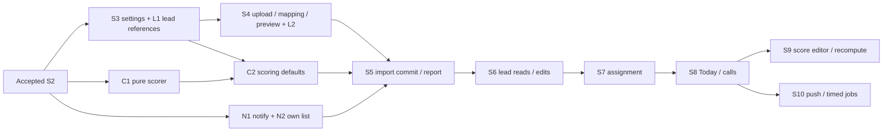

# S3–S10: module fan-out

Date: 2026-10-31. Lane: Large. Status: approved by Sishir 2026-10-31, with all five §9 picks.
Baseline: `ui-mock`, `969212c`. This document approves no implementation, data change or deployment.
Scope: full specs for wave 1; contracts and dependencies for S5–S10. Source and tests still have separate review stops.

## 1. Outcome and evidence

An entered agency staff member can prepare a real CSV import. A company manager can maintain the fields, stages, outcomes and lost reasons that the import and call screens use. New companies get real defaults. The scorer and in-app notification writer are ready before import commit ships.

Wave 1 ends at a saved, reloadable preview. It creates no imported leads, starts no import job and offers no working Commit button. Lead fixtures used for refusal and duplicate proofs are test setup, not a production creation endpoint.

Read against [developer design](../developer-design.md), [S1/S2 hand-off and §8](s1-s2-foundation.md#8-fan-out-after-s2-agency), [mock spec](ui-mock-slice.md), [migration rule](../migrations/README.md), and the current module code. The last five commits are `969212c`, `d867502`, `d76b1a5`, `09cd9f8`, `41eadf1`: foundation work, ending in real roles, staff entry, audit and health. These are repository observations, not freshly run application proofs.

| Observed seam | Decision for the real module |
| --- | --- |
| `settings/data/schema.ts` returns `CompanySchema`; settings has no editor, only the separate members-owned Team page | Keep the schema shape; add settings screens using existing tokens, forms and PageShell. Do not rewrite Team. |
| `leads/ui/{TodayPage,LeadDetailView,UnassignedPage}.tsx` | Preserve three buckets, selected detail, queue selection, reason chips, timeline and hidden-empty facts. `LeadDetail.hotMin` and Today `hasAssignedLeads` are required, not optional conveniences. |
| `followups/ui/{LogCallSheet,LogCallForm}.tsx` | Preserve the bottom/right sheet, retained input and `nextLeadId` result. Replace demo context and fixed Kathmandu date handling when S8 lands. |
| `imports/ui/{FileCard,ImportMapPage,MappingRows,CheckStep,ImportResultPage}.tsx` | Preserve File → Columns → Check → Done, code/label editing, saved-mapping shortcut and counts beside evidence. Replace metadata-only upload, fixed UTF-16/tab copy and the job-ID navigation assumption. |
| `scoring/ui/{ScoreBadge,WhyScore}.tsx` | Preserve priority, points, field labels, stored breakdown and configurable Hot threshold. There is no scoring editor yet. |
| `reports/ui/DashboardPage.tsx` and domain report types | Keep fixed-period tiles, range-driven table/compare, member targets and queue aside for S11. S10 summaries do not replace this dashboard. |
| No `modules/notifications` or notification bell exists | Add a small own-notification list and bell; there is no mock notification layout to copy. |
| `tenant/server.ts` has real `getCompanyContext`, while old `requireContext` is demo-only | Integrator supplies the explicit real/demo presentation bridge below. Never convert agency staff into the demo role to obtain access. |

## 2. Writers, waves and merge order

Seven ownership roles do not mean seven running agents. Run **two module writers plus one integrator**, three agents total. With two slots, run one writer and the integrator; alternate independent writers at review stops. The integrator can review while writers work, but serializes installs, generated files, built-stack runs and merge checks.

| Writer | Exclusive files | Starts / waits |
| --- | --- | --- |
| Settings | API `modules/settings/**`; DB `schema/settings.ts`; domain `settings.ts`; web `modules/settings/**` and settings routes except Team/scoring | Starts S3 with leads. Needs lead reference reads before edit refusals can merge. |
| Leads | API `modules/leads/**`; DB `schema/{leads,leadEvents}.ts`; domain `{leads,assignment}.ts`; web `modules/leads/**` | Starts schema/reference foundation. Supplies S4 matches and S5 insert/event APIs. Product list/detail waits for S5. |
| Imports | API `modules/imports/**`, `lib/{phone,dates}.ts`; DB `schema/{imports,mappingTemplates}.ts`; domain `imports.ts`, `jobs/imports.ts`; web imports and upload transport | Parser work can start from agreed types; S4 integration waits for S3. S5 waits for scorer, notify and lead writes. |
| Follow-ups | API `modules/followups/**`; DB `schema/followups.ts`; domain `followups.ts`, `jobs/followups.ts`; web `modules/followups/**` | May read and design now; implementation waits for S6/S7 and scorer. Requests Today changes from leads. |
| Scoring | API `modules/scoring/**`, including the only `score.ts`; DB `schema/scoring.ts`; domain `scoring.ts`, `jobs/scoring.ts`; web scoring and scoring settings route | Pure scorer can start after S2. Seed storage joins after S3. Editor/recompute waits for S8. |
| Push/jobs | API `modules/notifications/**`, later `modules/reports/summaries.ts`; DB `schema/{notifications,pushSubscriptions}.ts`; domain notification/job entries; web notification/PWA files | Notify foundation can start after S2. Timed delivery waits for S8 readers; no S11 dashboard work. |
| Integrator | API app/main/jobs and shared jobs/email/http/config; tenant/auth/agencies/companies/members amendments; DB schema index, public exports, custom SQL, every generated migration; common domain entries/exports; web API client, tenant bridge, shell/nav, composition; manifests, lockfile, configs, ops and full suites | Composes public functions. Never edits a writer's private implementation to resolve a dependency silently. |

Each writer owns focused tests and its logical migration note in `docs/migrations/<module>/`. No two writers edit the same web barrel, domain file, schema file or fixture. Shared foundation fixture changes go through the integrator.

| Work window | Writer slot A | Writer slot B | Merge gate |
| --- | --- | --- | --- |
| 1A, now after approval | Settings S3.1–S3.7 | Leads L1 | Merge settings schema/defaults and L1 together; their separately reviewed source changes need the same schema. |
| 1B | Scoring C1 then C2 | Notifications N1 then N2 | Independent folders. C1 can be pulled forward while settings is under review; C2 follows S3 defaults. |
| 1C, wave-1 tail | Imports I1–I4 | Leads L2, then free for review | I1 may be written earlier; I2 needs S3, I4 needs L2. S4 is included, but never blocks acceptance of S3/C/N. |
| 2 | Imports S5 | Leads S5 write contribution | Scorer/notify already accepted; complete worker, report and lead writes merge together before Commit is enabled. |
| 3 | Leads S6 then S7 | Follow-ups prepares S8 contracts/proofs | Follow-ups source starts only against the accepted lead write surface. One writer owns Today. |
| 4 | Follow-ups S8 | Leads S8 bucket/next-lead contribution | One atomic logging path and one bucket implementation. |
| 5 | Scoring S9 | Push/jobs S10 completion | Both follow S8; separate files, integrator serializes job registration and schema generation. |

The exact merge order remains **S3 + L1 → S4 + L2/events/FK → S5 → S6 → S7 → S8 → S9 and S10**. C1/C2 and N1/N2 land before S5; their early delivery does not rename S9 or S10. Early PWA/push work is possible behind gates, but is not part of this wave's build scope.



## 3. Rules shared by every wave-1 slice

### Context, transport and dependencies

Backend `Ctx` is the existing server type from `modules/tenant/index.ts`; `TenantTx` is from `@anar/db/tenant`. Every HTTP service receives the full Ctx, then calls existing `withContext(ctx, (tx,current) => ...)`. It checks permission and fresh OTP on **current**, inside that transaction. No feature creates a pool or sets scope itself. Low-level `loadSchema(tx)`, reference, seed and notify functions use the transaction's validated company setting; absent scope fails rather than selecting a default company.

Use existing `permissions.require`, `stepUp.requireFreshOtp`, typed `audit.audit`, `apiRequest`, errors and `enqueue(tx,job,payload,key)`. Audit additions are integrator-owned allowlists of strings, matching the S2 implementation. Domain types and zod input/output schemas remain browser-safe; DTO dates are Date at the web seam and ISO UTC strings on HTTP. Date-only field values are validated `YYYY-MM-DD` strings. Numbers are finite; IDs received over HTTP validate as UUIDs.

Integrator adds `FeatureContext = ContextView | DemoCtx` and `requireFeatureContext(slug: string): Promise<FeatureContext>` in web tenant public entries, with its body in `modules/tenant/data/featureContext.ts`. Here DemoCtx is the existing web `Ctx`, unchanged. In real mode unwrap `getCompanyContext` or throw its AppError; in explicit demo mode call the existing demo resolver. Add `hasCapability(view: FeatureContext, permission: Permission): boolean`: real views use their API capabilities, demo views use demo policy. This is display logic only. Real adapters require a ContextView, use `view.company.slug`, and forward the request cookie; they never serialize the view as authority. Feature-owned data adapters choose mode explicitly before calling either body; an HTTP failure never selects the mock body.

Reads use GET under `/api/companies/:slug/<module>/<operation>`; writes use POST with validated JSON, except multipart upload. Every POST retains the existing exact-Origin check. Success uses the existing `{ ok: true, data }` envelope. Missing/foreign resource: 404 `not_found`; disallowed role: 403 `forbidden`; malformed input: 400 `validation`; reference/concurrent conflict: 409 `conflict`; OTP older than 15 minutes: 428 `step_up_required`; outage/bad response: `unavailable`. No empty-on-error responses. Settings writes always need fresh OTP; schema/settings reads, notification reads/read-marks, upload and preview do not. Creating fields or extending options during S5 commit does need fresh OTP.

Cross-owner composition is explicit: settings receives the lead reference reader from the integrator; leads does not import settings repositories. Scoring accepts plain data and never imports lead repositories. Notifications receives final content and identifiers, never callbacks into each feature. Public owner entry files export named functions/types only; private repositories stay private.

### Storage and RLS

All new tenant tables use UUIDv7 `id`, `company_id NOT NULL`, `created_at`, `updated_at` (timestamptz, millisecond precision). They have a company FK and unique `(company_id,id)` where referenced. Relational feature references use composite `(company_id,foreign_id)` FKs, including stage, lost reason, assignee, import batch and event lead references. Nullable references use PostgreSQL's normal nullable composite-FK behavior. Notification JSON identifiers have no SQL FK: the producing feature validates them against its scoped rows in the transaction before calling notify; there is no public sender endpoint. No cascade deletes of history.

Each new table gets ENABLE **and FORCE** RLS. USING and WITH CHECK require `app.scope_kind = company`, `company_id = app.company_id`, and an existing parent company whose `agency_id = app.agency_id`. Use the existing parameter-bound transaction settings. Agency-only and identity-only scope give no feature rows. Company scope alone never bypasses API membership/resource checks. Missing scope, a mismatched agency/company pair, and foreign IDs cannot read or write rows. Runtime gets only SELECT/INSERT/UPDATE, no DELETE/TRUNCATE/DDL/BYPASSRLS; audit remains INSERT/SELECT only. Reference tables archive; they do not delete.

Notification RLS is company-scoped, like the other feature tables. Its public read/update service additionally forces `user_id = current.user.id`; notify can insert for another authorized recipient within that company. Making recipient equality an INSERT policy would break manager notifications created by the uploader.

### Migrations and seeds

Nothing is deployed. Each slice with storage below supplies a logical proposal, never a numbered migration. The integrator registers accepted schema, regenerates **only `0000_initial.sql` and its one snapshot/journal**, and preserves reviewed RLS/FORCE/grants in `initial-sql/{before,after}.sql`. The lead-to-batch FK lands only once both tables exist. No range reservations, parallel pnpm installs or hand-merged metadata.

`docs/migrations/README.md` supersedes the older immutable/upgrade sentences in the developer design and S1/S2 §8. A changed initial migration is **not** an upgrade for a DB whose migration journal already records the old initial. Prove a fresh disposable DB, repeated migrate and role bootstrap, schema drift and RLS catalog checks. Record an old-head disposable DB as requiring explicit recreation; do not call a no-op migrate an upgrade success or reset the shared development stack.

New company creation calls settings seed and, after C2, scoring seed in its existing transaction via `withPlatformTenant`. No seed-on-read and no startup backfill. Existing disposable fixtures are recreated through the owners. Any retained local shells need a separate reviewed, company-scoped seed command with actual row counts, repeat-safety and rollback impact before it is written or run. This spec does not authorize that data operation.

### Proof and review stops

Each slice has a source stop, then tests after source review. Aim for 100–200 handwritten source lines per review; generated SQL, schema declarations and fixtures are counted separately. If a slice grows because it contains two behaviors, split at the named operation before writing. Parser/upload slices may exceed that target for bounded streaming and cleanup; report the actual count, do not omit those behaviors.

Proof codes used below refer to these real commands; all are **planned, not run in this docs pass**:

| Code | Command / expected result |
| --- | --- |
| U | `pnpm --filter @anar/domain test`; `pnpm --filter @anar/api test test/<module>/<name>.test.ts`; web adapter tests with `pnpm --filter @anar/web test modules/<module>`. Named cases pass; no snapshots silently updated. |
| I | `pnpm --filter @anar/api test:integration test/<module>/<name>.integration.spec.ts`, plus `pnpm --filter @anar/db test:integration` for catalog/RLS. Real Postgres 17, assertions as anar_app. |
| E | `pnpm --filter @anar/web e2e:auth <name>.spec.ts --project=phone --project=desktop`. Existing `e2e-auth` harness, 390×844 and 1440×900, fresh disposable stack. No invented e2e:foundation suite. |
| G | Integrator: `pnpm lint`, `pnpm check:boundaries`, `pnpm typecheck`, `pnpm test`, `pnpm test:integration`, `pnpm check:migrations`, `pnpm build`, `pnpm e2e`, `pnpm --filter @anar/web e2e:auth`, `pnpm smoke:compose`. Serialize full runs on unique ports/projects. |

Every I includes owner denied, Admin write denied, authorized manager/entered staff, expired staff entry, revoked session, second company in the same agency, another agency, malformed scope pair and no scope. Every new POST adds missing/hostile Origin and direct-call proof. Every settings POST adds stale-OTP refusal, fresh-session retry and audit rollback proof. E asserts no sideways scroll at both widths, one copy of each control, preserved input on error, and real sessions unable to reach unfinished demo pages/actions. Pure helpers have no invented browser route: their E coverage is the named later consumer, and that dependency is recorded before enabling the consumer.

## 4. Wave 1A: settings and the lead reference foundation

### Shared settings and reference contracts

Keep existing domain `Field, Stage, Outcome, LostReason, CompanySchema` from `packages/domain/src/settings.ts`. `loadSchema` returns active rows only, ordered by position then ID. The settings editor uses a separate catalog with archive timestamps; historical lead detail must resolve archived labels separately in S6, not put archived choices back into call forms.

```ts
type Option = { value: string; label: string };
type FieldDefinition =
  | { type: "dropdown"; options: Option[] }
  | { type: "text" | "number" | "date"; options?: never };
type CreateFieldInput = { key?: string; label: string } & FieldDefinition;
type CreateFieldsInput = (CreateFieldInput & { key: string })[];
type UpdateFieldInput = {
  fieldId: string; label?: string; position?: number;
  definition?: FieldDefinition;
};
type IdInput = { id: string };
type StageInput = {
  id?: string; name: string; kind: "open" | "won" | "lost";
  isDefault: boolean;
};
type ReorderStagesInput = { stageIds: string[] };
type OutcomeInput = { id?: string; name: string; countsAsFailed: boolean };
type LostReasonInput = { id?: string; name: string };
type SettingsCatalog = {
  fields: Field[];
  stages: (Stage & { archivedAt: Date | null })[];
  outcomes: (Outcome & { archivedAt: Date | null })[];
  lostReasons: (LostReason & { archivedAt: Date | null })[];
};
type ReferenceInput =
  | { kind: "field"; fieldKey: string }
  | { kind: "stage"; stageId: string };
type ReferenceCounts = { leadCount: number };
type MemberLeadCounts = { openLeads: number; overdue: number };
type SettingsReferenceReader =
  (tx: TenantTx, input: ReferenceInput) => Promise<ReferenceCounts>;

loadSchema(tx: TenantTx): Promise<CompanySchema>;
seedDefaults(tx: TenantTx): Promise<void>;
createFields(tx: TenantTx, ctx: Ctx, input: CreateFieldsInput): Promise<Field[]>;
getReferenceCounts(tx: TenantTx, input: ReferenceInput): Promise<ReferenceCounts>;
getMemberOpenLeadCount(tx: TenantTx, memberId: string): Promise<number>;
getMemberLeadCounts(tx: TenantTx, memberId: string, at: Date): Promise<MemberLeadCounts>;
```

The backend service methods below use `(ctx: Ctx, input)`; the web seam uses FeatureContext. `createFields` is the transaction-taking owner API for S5; it checks settings.manage and fresh OTP, validates the full list before writing, then returns rows in input order. `NewField.header` belongs to imports; imports strips that property before calling settings. No settings → imports type dependency.

Validation: trimmed label/name length 1–120; keys `^[a-z][a-z0-9_]{0,63}$`, reserved `base` refused; absent key is a lower-case ASCII slug of label, and an empty result asks the user for a key. Dropdowns have 1–200 unique nonempty codes, code length ≤120 and label length ≤120. No automatic key suffix on conflict. Positions are nonnegative integers. Update must include a change. Field keys, option codes and system status cannot be renamed through updates. Range/order lists reject duplicate IDs and foreign IDs before writes.

### L1. Real reference counts, no lead creation route

**Owner / uses / gives.** Lead writer, beside settings S3.1; uses S2 TenantTx and the settings table definitions. Gives the three reference/count functions above. Observable result: settings can refuse destructive edits based on real lead rows, and member removal refuses to orphan open work before S7 exists.

**Files.**

```diff
+ packages/db/src/schema/leads.ts                 lead storage and scoped references
+ apps/api/src/modules/leads/referenceCounts.ts   field/stage use and member counts
+ apps/api/src/modules/leads/index.ts             public owner entry
~ packages/domain/src/leads.ts                    reference input/results only
+ docs/migrations/leads/reference-foundation.md   logical schema and refusal proof
```

Integrator alone connects the count functions in `modules/members/service.ts` and app/main composition. No change to the member endpoint's input/result types: `reassignTo` stays refused until S7; deactivation with open leads becomes 409 conflict. Member list counts become real, including overdue, instead of the existing literal zeros.

**DB.** `leads` has every existing Lead field in snake_case, plus updated_at. Nullable text: full_name, phone_e164, phone_raw, email, campaign_name, form_name, external_id; typed source/source_kind; required lead_date, stage_id, custom JSONB, integer score, priority, score_breakdown JSONB, scored_at; nullable assigned_to, lost_reason_id, next_action_at, last_contacted_at, lost_suggested_at, import_batch_id, merged_into_id, deleted_at; nonnegative failed_attempts default 0. Keep phone_valid explicit. Do not invent a score for production rows: no production lead insert exists yet.

Composite FKs cover stage, lost reason, assignee and merged_into. import_batch_id is nullable without its FK until L2. Indexes: live phone uniqueness excluding merged/deleted/null phone; company/external_id partial uniqueness; company/assignee/next_action; company/stage; company/lead_date descending; company/priority; custom GIN jsonb_path_ops; name trigram GIN; company/phone prefix btree. Integrator enables pg_trgm through migration credentials. RLS/grants follow §3.

Reference counts include all retained rows with a non-null custom value or the stage ID, including merged rows, because archive/type changes must preserve history. A missing/non-null distinction is real: numeric zero and empty text are data. Open member counts exclude merged/deleted leads and join stages of kind open. Overdue adds next_action_at < at. Validate a member through its owning service before exposing these counts.

**API/web.** No lead HTTP endpoint or screen. Existing Team list and deactivate surface gain truthful counts/refusal through integrator wiring. Lead pages remain gated.

**Proof.** U `leads/referenceCounts.test.ts`: contracts and open/closed criteria. I `leads/references.integration.spec.ts`: scoped counts, foreign composite FKs, zero-valued custom data, merged rows, pending/closed rows, no DELETE grant. I members: open lead prevents removal and keeps sessions/audit unchanged. E `settings.spec.ts`: stage/field refusal through S3 editor; E `foundation.spec.ts`: Team displays fixture counts and removal refusal, both widths. Migration proposal pairs with S3.1; schema-only rows have no public write path.

### S3.1. Defaults and a readable settings page

**Owner / uses / gives.** Settings; uses L1 and S2 company creation. Gives `loadSchema`, `seedDefaults`, `getSettings(ctx: Ctx): Promise<SettingsCatalog>`. The new company's manager sees the same field/stage/outcome/reason choices later used by imports and calls.

**Files.**

```diff
+ packages/db/src/schema/settings.ts                   four reference tables
~ packages/domain/src/settings.ts                       inputs/catalog/wire schemas
+ apps/api/src/modules/settings/{index,service,repository,routes}.ts
+ apps/api/src/modules/settings/defaults.ts             seed values and repeat-safe inserts
~ apps/web/modules/settings/{server,types}.ts
~ apps/web/modules/settings/data/schema.ts              explicit HTTP/demo dispatch
+ apps/web/modules/settings/{pages.ts,ui/SettingsPage.tsx}
+ apps/web/app/(company)/[slug]/settings/page.tsx         thin route
+ docs/migrations/settings/defaults.md
```

**DB.** `fields`: key, label, type, options JSONB/null, is_system, position, archived_at; unique company/key. `stages`: name, position, kind, is_default, archived_at; unique company/name, one active default by partial unique index. `outcomes`: name, counts_as_failed, position, archived_at; unique company/name. `lost_reasons`: name, position, archived_at; unique company/name. Stages/outcomes/reasons also have a storage-only nullable immutable seed_key and unique (company_id,seed_key): seeding must recognize a renamed default by identity, not its editable name. Custom rows have null seed_key. Checks enforce enums, nonnegative positions and default stage being active/open. RLS/grants follow §3. The service keeps at least one active won and lost stage so the call form can always offer both endings.

Defaults, in this order: New Lead (default/open), Contacted, Qualified, Follow-up, Site Visit, Negotiation, Booked (won), Lost (lost). Outcomes: Connected - High Interest, Connected - Low Interest, Not Interested, No Answer, Callback Requested, Budget Discussion, Site Visit Scheduled, Site Visit Done, Negotiation Started, Document Submitted. Failed defaults: No Answer, Not Interested, Callback Requested, as decided in Q2. Reasons: Too Expensive, Wrong Location, Bought from Competitor, Not Responding, Not Genuine Lead, Changed Mind, Other.

Seed three non-system dropdowns: purchase_timeline with codes `<15 days, 15-30 days, 1-3 months, 3+ months, within_1_month, within_2_months, within_3_months, just_exploring`; budget_fit with `Yes, Maybe`; decision_maker with `Yes, Shared`. Labels match the existing mock, including Under 15 days, 15 to 30 days, 1 to 3 months, Over 3 months and Within 1/2/3 months. No apartment/purpose/job field is created for every company.

Seed runs under the locked company row; repeat calls preserve all existing edits and archived rows, and insert only missing seed identities. Seed keys are the lower-case underscore versions of the initial names, fixed after insertion; fields use their immutable field key. Existing label, name, order, default choice and failed flag are never reset. An existing seed field must retain its type and required codes; additional codes and edited labels are preserved. Missing required codes or an incompatible type is conflict, never an overwrite. On company creation the integrator calls it through withPlatformTenant in the same transaction as the company and audit. Failure leaves no company, defaults or audit.

**API.** GET settings/loadSchema → CompanySchema for any valid company context (Admin needs choices for its own calls; no lead records are exposed). GET settings/getSettings → SettingsCatalog requires settings.manage; no OTP for reads. No public seed route.

**Web.** /[slug]/settings has Fields, Stages, Outcomes, Lost reasons sections; Team remains its existing route. Phone: stacked labeled sections. Desktop: section navigation left, list/editor area right, content >1000px. Initial read-only page shows real defaults, active/archive state and load failure distinctly. Admin has no settings navigation and receives forbidden on getSettings.

```diff
+ createCompany -> withAgencyContext -> insert company
+   -> withPlatformTenant -> seedDefaults -> company.created audit -> commit
+ SettingsPage -> requireFeatureContext -> getSettings -> withContext -> settings.manage -> catalog
```

**Proof.** U `settings/defaults.test.ts`: exact values/codes and validators. I `settings/defaults.integration.spec.ts`: 8/10/7 reference rows, 3 fields, two seeds identical, rollback and two-company isolation. E `settings.spec.ts`: create company through staff flow, manager opens defaults, denial/failure states and layouts at both widths. Integrator regenerates the initial migration with L1; no existing-shell backfill.

### S3.2. Add a custom field

**Uses / gives.** S3.1. `createField(ctx: Ctx, input: CreateFieldInput): Promise<{fieldId: string}>` wraps `createFields`; the latter is the published import hand-off.

**Files.** Add API `settings/fields.ts`, web `settings/{actions.ts,ui/FieldForm.tsx}`; extend owned service/routes/repository/server/data/types and SettingsPage. No new table. Integrator adds typed audit action `settings.field_created`, target field, data `{fieldId: string}`.

**API/DB.** POST settings/createField, settings.manage + fresh OTP. Validate the full definition, lock company, reserve next position, insert field and audit together. Existing/archived key conflict is 409. A batch call validates all entries and inserts all or none. NewField callers cannot set companyId/isSystem/archivedAt.

**Web.** One form: label, optional key, type, dropdown code/label pairs. Codes remain visible and distinct from labels. Add returns the field into the list. Fresh-code prompt keeps the form, calls existing auth step-up, then requires an explicit retry; no automatic mutation replay.

**Proof.** U `settings/fields.test.ts`: generated/invalid/reserved key, duplicate option codes, dropdown/non-dropdown shapes. I `settings/fields.integration.spec.ts`: atomic batch, concurrent duplicate key, oldest OTP boundary, audit and foreign scope. E `settings.spec.ts`: add a dropdown, edit labels without changing codes, stale OTP and outage retain every input at both widths.

### S3.3. Edit or archive a field without losing its data

**Uses / gives.** S3.2 + injected SettingsReferenceReader. `updateField(ctx: Ctx, input: UpdateFieldInput): Promise<{ok: true}>`; `archiveField(ctx: Ctx, input: {fieldId: string}): Promise<{ok: true}>`.

**Files.** Extend API fields/service/routes/repository and web FieldForm/actions/data; add `settings/ui/FieldList.tsx`. No new table; archive updates archived_at only.

**API/DB.** POST settings/updateField and archiveField, settings.manage + fresh OTP. Lock company then field; read references in the same transaction. A type change with any stored value is conflict. For a used dropdown allow labels and added codes, refuse removal/replacement of existing codes; for an unused field, replacing the definition is allowed. Seeded scoring fields keep their types/codes and cannot be archived before S9 owns an explicit scoring-rule change; this is a named rule for the three keys, not a silent rescore. Other archives preserve lead JSON, remove the field from active forms and reserve its key. Label/position changes are always permitted for non-system fields. System fields are read-only. Repeat archive is a no-op with no duplicate audit. Audit actions: settings.field_updated/field_archived, data {fieldId}.

**Web.** Active fields plus a separate archived list. Edit next to each row; archive explains that stored data stays. Refused edits show the message beside Save and retain the proposed definition. No bulk data rewrite or restore UI.

**Proof.** U fields validators. I `settings/fieldEdits.integration.spec.ts`: populated type/code removal refused, zero counts as populated, archive preserves JSON and excludes active choices, concurrent writer cannot pass a stale reference check (all lead writes later use the same company lock), repeat archive. E settings: fixture-backed refusal, label change and archive at both widths. No new migration; existing settings schema supplies archive.

### S3.4. Add or rename a stage

**Uses / gives.** S3.1 + L1. `upsertStage(ctx: Ctx, input: StageInput): Promise<{ok: true}>`.

**Files.** Add API `settings/stages.ts`, web `settings/ui/StageForm.tsx`; extend settings routes/service/repository/actions/data/page. No new table. POST settings/upsertStage requires settings.manage + fresh OTP.

Lock company and affected stage rows. Insert appends position; an edit keeps position. Names remain unique including archived names. Default must be active/open; selecting a new default clears the prior one atomically, and clearing the sole default without a replacement is conflict. Kind changes are refused if any lead references the stage; never remove the last active won/lost kind through a kind change. Audit settings.stage_saved, data {stageId}. Labels in schema reads change immediately; stored IDs do not.

**Web.** Name, kind and Default control; clear help for default and terminal-stage refusals. Same list/editor layout as Fields. **Proof.** U `settings/stages.test.ts` validates inputs. I `settings/stages.integration.spec.ts`: default swap, duplicate names, used-kind refusal, last-kind guard, concurrent swaps leave one default. E settings: add/rename/select default, persisted after reload, both widths. Migration uses S3.1 constraints.

### S3.5. Reorder or archive stages

**Uses / gives.** S3.4. `reorderStages(ctx: Ctx, input: ReorderStagesInput): Promise<{ok: true}>`; `archiveStage(ctx: Ctx, input: {stageId: string}): Promise<{ok: true}>`.

**Files.** Extend stages/service/routes/repository; add web `settings/ui/StageList.tsx`, wire actions/data/page. POST settings/reorderStages and archiveStage, settings.manage + fresh OTP. No new table.

Reorder supplies the complete current active ID set once each, assigns contiguous positions and rejects a stale/missing/foreign set with no writes. Archive refuses the default, any referenced stage and the last won/lost stage; user must move leads first after S6 exists. Lock company then rows before counts. Audit settings.stages_reordered {count: string} or settings.stage_archived {stageId}; unchanged requests do not add audit noise.

**Web.** Up/Down buttons with accessible labels on the same rows; no drag-only control. Disabled reason is visible for the default/last ending; DB references are checked by API on submit. **Proof.** U stage-set validation. I `settings/stageOrder.integration.spec.ts`: malformed permutations, foreign IDs, used/default/last-stage archive, concurrent reorder/add. E settings: keyboard reorder and reload, archive refusal and retained list at 390/1440. No new migration.

### S3.6. Maintain call outcomes

**Uses / gives.** S3.1. `upsertOutcome(ctx: Ctx, input: OutcomeInput): Promise<{ok: true}>`; `archiveOutcome(ctx: Ctx, input: {outcomeId: string}): Promise<{ok: true}>`.

**Files.** Add API `settings/outcomes.ts`, web `settings/ui/OutcomeList.tsx`; extend owned routes/service/repository/actions/data/page. POST settings/upsertOutcome and archiveOutcome, settings.manage + fresh OTP; audit settings.outcome_saved/outcome_archived {outcomeId}. No new table.

Append position on creation; edit name/failed flag, preserve ID. Archive removes a choice from future calls and keeps historical references; refuse archiving the last active outcome. Changes to countsAsFailed affect future calls only, never rewrite previous failed_attempts or logs. Duplicate names include archived rows. All mutations lock company before their row.

**Web/proof.** Name and “Counts as a failed attempt” checkbox per outcome, explanation of future calls, archive action. U `settings/outcomes.test.ts` checks input. I `settings/outcomes.integration.spec.ts` covers last-active, archive preservation, audit and failed-flag update. E settings changes the flag and sees it after reload at both widths; S8 adds the proof of future-call counting against persisted outcomes.

### S3.7. Maintain lost reasons

**Uses / gives.** S3.1. `upsertLostReason(ctx: Ctx, input: LostReasonInput): Promise<{ok: true}>`; `archiveLostReason(ctx: Ctx, input: {lostReasonId: string}): Promise<{ok: true}>`.

**Files.** Add API `settings/lostReasons.ts`, web `settings/ui/LostReasonList.tsx`; extend the owned settings entries/actions/data/page. POST settings/upsertLostReason and archiveLostReason, settings.manage + fresh OTP; audit settings.reason_saved/reason_archived {lostReasonId}. No new table.

Append on create, rename without changing ID, archive without deleting historical lost_reason_id values. Keep at least one active reason; reject duplicate names including archived. An archived reason can still label a past lead, but cannot be picked for a new stage change. The future detail reader resolves that historical row separately from loadSchema.

**Proof.** U `settings/lostReasons.test.ts` validation. I `settings/lostReasons.integration.spec.ts`: last-active refusal, old lead retains FK/name, active schema excludes archive, repeat archive, permission/OTP matrix. E settings: add/rename/archive and refusal at both widths. S6/S8 own the later historical-detail and reason-chip consumer proofs. No new migration.

## 5. Wave 1B: scorer and notification foundations

### C1. One pure scorer with an explainable result

**Owner / uses / gives.** Scoring writer; can start on S2 with the agreed settings field codes. Gives the frozen input-first signature below. It supersedes the older developer-design example with reversed arguments.

```ts
type ScoreInput = { custom: Record<string, string | number | null> };
type ScoringRule =
  | { fieldKey: string; kind: "options"; points: Record<string, number> }
  | { fieldKey: string; kind: "range";
      ranges: { min: number | null; max: number | null; points: number }[] };
type ScoringConfig = {
  id: string; companyId: string; version: number; basePoints: number;
  hotMin: number; warmMin: number; rules: ScoringRule[]; active: boolean;
};
type ScoreResult = {
  score: number; priority: "hot" | "warm" | "cold";
  breakdown: Record<string, number>;
};
scoreLead(input: ScoreInput, config: ScoringConfig): ScoreResult;
```

**Files.** Add API `modules/scoring/{score,index}.ts`; extend domain `scoring.ts` with the rule union, input/result and schemas. Existing web `scoring/types.ts` re-exports the domain; do not create another scorer in web or imports.

**Behavior.** Start breakdown with base. A matched option uses the stored code, never its label; missing/null/unlisted values contribute zero and have no breakdown entry. Matched zero-point rules retain their zero entry. Numeric rules accept finite numbers only, with half-open intervals [min,max), null as unbounded. Validate min < max, non-overlap, one rule per field, no reserved base key, integer nonnegative points, version ≥1 and 0 ≤ warmMin < hotMin. Do not coerce text into numbers inside the scorer. Score is the sum of breakdown; Hot ≥hotMin, Warm ≥warmMin, otherwise Cold. No clocks, DB, mutation or events.

**DB/API/web.** None in this slice. The existing ScoreBadge and WhyScore consume the resulting fields unchanged; lead owner stores breakdown as scoreBreakdown and owns scoredAt/events.

**Proof.** U `scoring/score.test.ts`: exact 4/5/7/8 boundaries, missing values yield base, labels do not match codes, zero points, adjacent/unbounded ranges, malformed overlaps and deterministic repeat input. Domain test validates the discriminated union. I is C2's stored-config round trip. E is S6 lead detail at both widths with a real stored score and WhyScore whose sum matches its badge; that consumer gate cannot be claimed at C1. No migration or new route is justified for a pure function.

### C2. Seed and read scoring v1

**Uses / gives.** C1 and S3.1. `loadActiveConfig(tx: TenantTx): Promise<ScoringConfig>`, `seedScoringDefaults(tx: TenantTx): Promise<void>`. API service `getScoringDefaults(ctx: Ctx): Promise<ScoringConfig>` is a read-only manager view.

**Files.**

```diff
+ packages/db/src/schema/scoring.ts
+ apps/api/src/modules/scoring/{config,repository,defaults,routes}.ts
~ apps/api/src/modules/scoring/index.ts
~ packages/domain/src/scoring.ts
+ apps/web/modules/scoring/{server,pages}.ts
+ apps/web/modules/scoring/data/config.ts
+ apps/web/modules/scoring/ui/ScoringDefaultsPage.tsx
+ apps/web/app/(company)/[slug]/settings/scoring/page.tsx
+ docs/migrations/scoring/default-config.md
```

**DB.** scoring_configs: company_id, version int, base_points int, hot_min int, warm_min int, rules JSONB, active bool, created_by UUID FK users, timestamps. Unique company/version and partial unique company where active. Numeric checks match C1. RLS/grants follow §3; no recompute queue exists yet.

Seed under the locked company row, reading the three active seeded field definitions. Settings owns field creation; scorer never inserts fields. Version 1 is base 1, Hot 8, Warm 5; purchase_timeline base options 4/3/2/1 and Meta codes 4/3/2/1; budget Yes 3 / Maybe 2; decision maker Yes 2 / Shared 1. No apartment/purpose points in a universal seed; Q3 proposes keeping those company-specific for S9. The scorer is generic even though its separate default builder names these three fields.

Seed takes created_by from the transaction's current user. An active config makes a repeat a no-op; none plus a conflicting existing version 1 is conflict. Missing/incompatible fields fail; loadActiveConfig with no active config is unavailable, never a mock/default fallback. Integrator extends company creation: seedDefaults then seedScoringDefaults in the same transaction; either failing rolls everything back.

**API/web.** GET scoring/getScoringDefaults requires settings.manage, no fresh OTP. Read-only /settings/scoring shows Base, thresholds and rule code/label/points rows. Phone cards; desktop aligned columns, one markup. No Save control until S9. This is a new screen; preserve existing badge/WhyScore components. Staff entry banner stays visible.

**Proof.** U `scoring/defaults.test.ts` exact points and absent company-specific fields. I `scoring/defaults.integration.spec.ts`: one active v1 after repeat/concurrent seed, correct creator, missing schema rolls back company creation, field codes round-trip and score correctly, tenant isolation. E `scoring.spec.ts`: new company read-only defaults at both widths, denial/outage, no premature editor. Initial migration regenerated by integrator; retained-shell seeding follows §3.

### N1. Write one in-app notification per event and recipient

**Owner / uses / gives.** Push/jobs writer; uses S2 scoped transactions and identity/membership owner reads. Gives `notify(tx,input)` before S5. This does not add Web Push, a cron or an email queue payload.

```ts
type NotificationData =
  | { type: "import_complete"; batchId: string; imported: number; duplicateDb: number }
  | { type: "assigned"; assignmentId: string; count: number }
  | { type: "lost_suggested"; leadId: string; failedAttempts: number }
  | { type: "overdue"; leadId: string; localDate: string }
  | { type: "daily"; localDate: string; overdue: number; dueToday: number; newLeads: number }
  | { type: "weekly"; weekStart: string; leads: number; calls: number;
      siteVisits: number; bookings: number; overdue: number };
type NotificationInput = {
  companyId: string; userId: string; title: string; body: string;
  url: string; dedupeKey: string; data: NotificationData;
};
type Notification = NotificationInput & {
  id: string; type: NotificationData["type"]; readAt: Date | null;
  pushedAt: Date | null; emailedAt: Date | null; createdAt: Date;
};
type NotificationQuery = { cursor?: string };
type NotificationPage = {
  items: Notification[]; nextCursor: string | null; unreadCount: number;
};
notify(tx: TenantTx, input: NotificationInput): Promise<{id: string}>;
listNotifications(ctx: Ctx, input: NotificationQuery): Promise<NotificationPage>;
markRead(ctx: Ctx, input: {ids: string[]}): Promise<{ok: true}>;
```

**Files.** New DB `schema/notifications.ts`, domain `notifications.ts`, API `modules/notifications/{index,service,repository}.ts`, logical note `docs/migrations/notifications/in-app.md`. Integrator exports the schema/domain and wires a public tenant recipient check, `canReceiveCompanyNotification(tx: TenantTx, userId: string): Promise<boolean>`, through existing agencies/members/auth owners. That check derives company/agency from the scope, requires an active usable company member or active usable staff in that agency, and does not grant the recipient browser entry. No feature imports platform tables to look up users.

**DB.** notifications: company_id, user_id FK users, type, title, body, url, data JSONB of the union above, dedupe_key, read_at, pushed_at, emailed_at, timestamps. Unique user_id/dedupe_key; index company/user/read_at/created_at DESC/id DESC. RLS and grants as §3. A stable key always contains company ID: `import:<companyId>:<batchId>:complete`, `assign:<companyId>:<assignmentId>`, `lost:<companyId>:<leadId>:<suggestionEventId>`, `overdue:<companyId>:<leadId>:<localDate>`, `daily:<companyId>:<localDate>`, `weekly:<companyId>:<weekStart>`. User ID is the other uniqueness dimension, so the same event reaches each recipient once.

Validate companyId equals scope, active recipient, bounded title ≤160/body ≤500/key ≤240, nonnegative integer counts and a same-company relative URL. Reject schemes, protocol-relative URLs, traversal and another slug. Allowed targets are the company home, persisted batch, Today, lead detail or dashboard paths; feature owners choose an enabled target. The record keeps only counts and identifiers, never lead names/phones/emails/notes. Caller supplies final text; type is derived from data.type, not a second conflicting input.

Insert with conflict handling; repeat returns the existing ID without changing content/readAt. A conflicting key whose company/type/content differs is conflict, not an overwrite or disclosure. Use the caller's transaction so rollback removes the notification with the feature write. Feature operation owns its audit. There is no public “send notification” API.

**Proof.** U `notifications/input.test.ts`: data variants, same-company paths, bounds, key construction and safe content fixtures. I `notifications/notify.integration.spec.ts`: concurrent repeat gives one row/same ID, changed-payload collision, rollback, foreign or inactive recipient, uploader staff and manager recipients, cross-agency scope. E is N2's seeded own list at both widths; S5 later proves the real uploader/manager producer. Initial migration regenerated only by integrator.

### N2. Read and mark your own notifications

**Uses / gives.** N1 and the real ContextView. Gives listNotifications and markRead above. No global cross-company inbox.

**Files.** Add API `notifications/routes.ts`; extend service/repository; add web `modules/notifications/{server,actions,pages,components,types}.ts`, `data/notifications.ts`, `ui/{NotificationBell,NotificationsPage}.tsx`, thin /[slug]/notifications route. Integrator mounts the bell in real CompanyNav only and adds audit action notifications.read {count: string} for staff mark-read actions.

**API.** GET notifications/listNotifications, any valid company context, forced current.user.id; newest first, opaque validated cursor over createdAt/id, page size 50, separately queried unreadCount for that user/company. POST notifications/markRead, any valid company context + Origin, no fresh OTP, 1–100 unique UUIDs. Load every requested row with own-user/company predicates first; any missing/foreign ID returns not_found and changes none. Already-read rows remain unchanged. No caller-supplied userId accepted.

**Web.** Bell has accessible unread count; opens the own-company list. Phone: full-width rows with title, body, time, unread state, Mark read and Open. Desktop: same rows in the wide shell, not a second DOM copy. A bell API failure shows “Notifications unavailable”, never a fake zero; list has separate no-notifications and retry states. Open routes only to currently enabled pages; a seeded test can use the company home. S5 completion links use the batch report; later lead/Today/dashboard links are enabled with their consumers.

**Proof.** U `notifications/cursor.test.ts` and web date/error adapter test. I `notifications/read.integration.spec.ts`: >50 rows across pages, equal timestamps, own user forced even for Super Admin/staff, multi-company user isolation, mixed-owner markRead rolls back, repeated markRead, stale OTP still allowed, expired entry denied. E `notifications.spec.ts`: two signed-in users see distinct lists; mark/read/reload and API failure at both widths. No new table or queue; N1's migration covers it.

## 6. Wave 1C: S4 upload, mapping and preview

This fits as the **tail of wave 1**, once S3 and L2 are accepted. It is four small review stops, not one large import implementation. Scoring and notifications need not block a preview that writes no leads. Nothing registers import.commit until S5.

### Shared import contracts and compatibility changes

Keep existing Mapping, NewField, MappingTemplate, ImportSummary and ImportBatch's display fields. Extend the encoding/delimiter literals, add system:form_name to MappingTarget, and reserve external_id for the later API input path: a CSV mapping cannot populate it. Preserve Field/Lead/FollowUp ownership. Wire schemas must decode nested dateRange, raw preview dates and nullable batch timestamps.

```ts
type Encoding = "utf-8" | "utf-16le" | "utf-16be" | "windows-1252";
type Delimiter = "," | "\t" | ";" | "|";
type EncodingResult = { encoding: Encoding; bomLength: 0 | 2 | 3;
  warning: "encoding_fallback" | null };
type HeaderColumn = { index: number; original: string; header: string; normalized: string };
type CsvProfile = {
  encoding: Encoding; delimiter: Delimiter; columns: HeaderColumn[];
  sample: string[][]; rowCount: number;
  dateRange: {from: Date; to: Date} | null;
  warning: "encoding_fallback" | null;
  columnKinds: {header: string; type: Field["type"]; options: Option[]}[];
};
type UploadResultReal = Omit<UploadResult, "encoding" | "delimiter" | "dateRange"> & {
  encoding: Encoding; delimiter: Delimiter;
  dateRange: {from: Date; to: Date} | null;
  warnings: ("encoding_fallback")[];
};
type ImportDraftInput = {
  batchId: string; mapping: Mapping; newFields: NewField[];
  saveTemplate?: {name: string}; expectedRevision: number;
};
type ImportIssue = {
  code: "invalid_phone" | "bad_date" | "invalid_number" | "invalid_custom_date"
      | "new_option" | "unknown_platform" | "column_count";
  header: string | null; message: string;
};
type PhoneResult = { phoneRaw: string | null; phoneE164: string | null; phoneValid: boolean };
type ParsedLeadDate = { value: Date; issue: "bad_date" | null };
type NormalizedLead = {
  fullName: string | null; phoneRaw: string | null;
  phoneE164: string | null; phoneValid: boolean; email: string | null;
  source: Lead["source"]; leadDate: Date; campaignName: string | null;
  formName: string | null; externalId: null;
  custom: Record<string, string | number | null>;
};
type NormalizedRow = {
  lead: NormalizedLead; issues: ImportIssue[];
  newOptions: {fieldKey: string; option: Option}[];
  invalid: boolean;
};
type NormaliseRowInput = {
  row: string[]; columns: HeaderColumn[]; mapping: Mapping;
  fields: Field[]; defaultCountry: string; timezone: string; importedAt: Date;
};
type PreviewRow = ImportRow & {
  display: {fullName: string | null; phoneRaw: string | null};
  issues: ImportIssue[];
};
type DryRunResult = Omit<DryRun, "resubmitted" | "duplicateFile" | "phoneReview"> & {
  resubmitted: PreviewRow[]; duplicateFile: PreviewRow[]; phoneReview: PreviewRow[];
  invalidRows: PreviewRow[];
  counts: {rowCount: number; resubmitted: number; duplicateFile: number; invalid: number};
  previewRevision: number;
};
type ImportDraft = Omit<ImportDraftInput, "expectedRevision"> & {
  revision: number; preview: DryRunResult | null;
};
type FindImportMatchesInput = {phones: string[]};
type ImportMatch = {leadId: string; phoneE164: string; campaignName: string | null; leadDate: Date};
type MappingSuggestion = Pick<UploadResultReal,
  "matchedTemplate" | "suggestedMapping" | "proposedFields" | "newColumns" | "missingColumns">;
type ReadControl = {signal: AbortSignal};

detectEncoding(bytes: Uint8Array): EncodingResult;
detectDelimiter(text: string): Delimiter;
profileCsv(path: string, control: ReadControl): Promise<CsvProfile>;
matchMapping(input: {profile: CsvProfile; fields: Field[];
  templates: MappingTemplate[]; fileName: string}): MappingSuggestion;
normalisePhone(raw: string | null, defaultCountry: string): PhoneResult;
parseLeadDate(raw: string | null, input: {
  defaultCountry: string; timezone: string; importedAt: Date;
}): ParsedLeadDate;
normaliseRow(input: NormaliseRowInput): NormalizedRow;
findImportMatches(tx: TenantTx, input: FindImportMatchesInput): Promise<ImportMatch[]>;
getUploadResult(ctx: Ctx, batchId: string): Promise<UploadResultReal>;
getImportDraft(ctx: Ctx, batchId: string): Promise<ImportDraft | null>;
dryRunImport(ctx: Ctx, input: ImportDraftInput, control: ReadControl): Promise<DryRunResult>;
```

Domain imports may import Lead's source type and Field, never a backend owner. Backend-only byte/stream/file functions stay in the API types. UploadResultReal and DryRunResult preserve the old display members while extending real behavior; the explicit demo path retains its existing result. Real response schemas require the new members. Shared UI accepts the real/demo union and branches on the actual DTO shape; it never truncates a real count to the length of a sample.

Preview arrays contain at most the first 50 rows per category, with a visible “Showing first 50 of N” message. Counts cover the whole file. This avoids sending every raw exception row in a 50k-row preview. S5's result page provides paginated access to all persisted result rows. raw stays faithful to source headers; display carries mapped name/phone, so a column named “Contact” still shows its phone correctly.

### L2. Scoped duplicate lookup and event storage

**Owner / uses / gives.** Lead writer, beside imports; uses L1 and accepted import batch table from I2. Gives findImportMatches above, max 500 distinct valid E.164 phones per call. It returns only live, unmerged leads of the current company. Empty input returns []; duplicates in the request do not duplicate output.

**Files.** Add API `leads/importMatches.ts`, extend public entry/domain; add DB `schema/leadEvents.ts`; logical note `docs/migrations/leads/import-references.md`. Integrator adds the lead-to-import-batch FK after I2's imports schema is registered.

**DB.** lead_events: company_id, lead_id, type, actor_member_id nullable, actor_user_id required FK users, data JSONB, timestamps; scoped lead/member FKs; indexes lead/created_at DESC/id and company/created_at. RLS/grants as §3. Early event data is a strict union: imported {batchId, rowNo}, duplicate_import {batchId, rowNo, campaignName: string|null, leadDate: ISO UTC string}. No event write endpoint or event emitter in S4. The lead owner will add the other named event payloads with their owning behaviors, replacing the current broad mock event-data type at cutover.

**API/web.** Internal reader only, consumed by preview. Do not add lead detail just to make a preview duplicate link work; show the row and “Lead detail available after the lead screen is enabled” until S6.

**Proof.** U `leads/importMatches.test.ts`: phone request schema/bound. I `leads/importMatches.integration.spec.ts`: active/merged/deleted rows, same phone in two companies, exact campaign/date, empty input and composite event/batch FKs. E is I4's real duplicate preview at both widths. Initial regeneration is paired with I2, before I4.

### I1. Parse and normalize a synthetic file

**Owner / uses / gives.** Imports; pure foundations can start from S2, accepted schemas from S3. Gives encoding, delimiter, profile, phone/date/row functions above. A fixture-to-preview-data run is observable without an HTTP route.

**Files.** New API `imports/{encoding,parse,normalize,mapping,types}.ts`, `lib/{phone,dates}.ts`; update owned domain imports types. I1 also delivers the pure matchMapping contract and rules described in I3, so I2 returns real suggestions from its first merge rather than placeholder arrays. Synthetic fixtures under `apps/api/test/fixtures/csv/`; no source export is read or copied. Integrator alone adds exact pinned `csv-parse` and `libphonenumber-js` dependencies selected from the registry at implementation time, plus manifest/lockfile changes.

**Behavior.** BOM sniff and 64 KiB null-byte heuristic follow design §6.1. Validate UTF-8 without treating a partial multi-byte character at the sample boundary as corrupt; fallback to windows-1252 adds a visible warning. Count delimiters outside quoted cells over the first five logical records; deterministic tie order comma, tab, semicolon, pipe. First record with ≥2 nonempty cells is header. Preserve original header text; unique display headers suffix duplicates _2/_3 while normalized headers trim/collapse/lowercase and strip trailing ?/_. Map by that unique header identity, not by array position from a different file.

Streaming parser handles quoted delimiters/newlines, CRLF, blank records and uneven column counts. Empty/header-only input is validation; malformed quoting is validation; short rows pad missing cells, extra nonempty cells mark the row invalid with column_count. Scan full data for row count and dropdown distinctness (stop collecting after 13 values); keep only 20 sample rows. Guess number/date from nonempty samples, then dropdown for ≤12 distinct values, else text; an all-empty column is text.

Phone normalization keeps phoneRaw as received, strips p: only for parsing, removes separators, changes 00 to +, preserves explicit foreign country codes. Invalid phone is retained and flagged under Q1, not a duplicate key. Lead dates accept ISO with offset (offset wins), then YYYY-MM-DD, then day/month or month/day using NP's day-first order; explicit supported country locale order is tested, unsupported ambiguous locale is validation. Naive date/time uses company timezone. Missing/bad date uses the batch importedAt with bad_date, never a new “now” on each preview. Invalid numeric/date custom values become null plus issue.

Dropdown values use codes; a new code produces newOptions with a suggested label, never a field write during preview. Source fb/facebook → facebook, ig/instagram → instagram, empty → null, other input → other plus unknown_platform. Trim ordinary values and turn empty to null. CSV externalId is always null.

**DB/API/web.** None here; no phantom upload or preview endpoint. These functions are used directly by I2/I4 and later S5, with the same arguments and result types.

**Proof.** U `imports/{encoding,parse,normalize}.test.ts` and `lib/{phone,dates}.test.ts`: six encodings, BOM-less UTF-16BE too, accented and Devanagari text where the encoding supports it (windows-1252 cannot encode Devanagari), UTF-8 boundary, quoted multiline rows, repeated headers, empty/uneven files, 12/13 distinct values, p:/00/NP/foreign/bad phone, offset and ambiguous dates, all-empty custom field. I and E belong to I2/I4 actual file transport, not fake parser routes. No migration.

### I2. Upload bytes and reopen the file card

**Uses / gives.** S3.1, I1 including matchMapping, S2 HTTP/context. `createImportBatch(ctx: Ctx, input: {fileName: string; contentType: string; bytes: AsyncIterable<Uint8Array>}, control: ReadControl): Promise<UploadResultReal>`; getUploadResult/getImportDraft above. The browser has a real File, not a client-supplied claimed size.

**Files.**

```diff
+ packages/db/src/schema/{imports,mappingTemplates}.ts
+ apps/api/src/modules/imports/{index,routes,upload,files,repository}.ts
~ packages/domain/src/imports.ts
~ apps/web/modules/imports/{server,actions,types}.ts
~ apps/web/modules/imports/data/{upload,batches}.ts
~ apps/web/modules/imports/ui/{ImportFilePage,FileCard}.tsx
+ docs/migrations/imports/upload-preview.md
```

**DB.** mapping_templates: name, header_fingerprint, headers JSONB string[], mapping JSONB, form_name/campaign_name nullable, created_by FK users, last_used_at nullable; unique company/fingerprint and company/form_name index. import_batches: uploaded_by FK users, source_kind csv, file_name, server-only file_path, measured file_size, encoding, delimiter, row_count, status, mapping_template_id (scoped FK), mapping JSONB nullable, last_row_no default 0, summary JSONB nullable, error nullable, started_at/finished_at nullable, timestamps; index company/created_at/id. Add profile JSONB of CsvProfile (dates stored as ISO strings), draft JSONB nullable and preview_revision integer default 0 so reload does not depend on memory. State enum retains uploaded/mapped/running/done/failed; only uploaded is produced in S4, and draft presence is not mapped/committed status.

import_rows is declared with the imported/duplicate_db/duplicate_file/invalid/error result enum, batch_id scoped FK, row_no, raw JSONB nullable for later retention, phone_e164, lead_id scoped nullable FK, reason nullable and issues JSONB. Unique batch_id/row_no, index lead_id. It stays empty during S4; S5 owns writes. Raw-null retention requires a safe “Source row expired” display when S14 lands. No lead insert, event or row result is written by upload.

**API.** POST /api/imports?company=<slug>, one multipart file, imports.upload + Origin; no fresh OTP. Existing company flag controls Super Admin; default false (Q4). Enforce extension .csv/.txt, allowed declared MIME text/csv, text/plain, application/vnd.ms-excel or text/tab-separated-values, then byte/parser validation. Empty browser MIME may use the extension plus sniffed bytes; refuse binary content. File byte cap 25×1024×1024, not a trusted size field. Enforce existing 20 uploads/user/hour policy through the shared limiter, not a private map; integrator exposes a typed limiter method to imports. Stop oversized streaming immediately; mapped error is validation, not an untyped proxy response.

Resolve permission before accepting bytes; write a random-ID temporary file under the configured uploads root outside the web root. Parse/profile outside authorization locks. Load schema/templates through a short authorized read and call I1's real matchMapping. Recheck context/permission and unchanged schema/template inputs under lock before recording the batch so entry expiry or settings changes during upload cannot authorize stale persistence. Rename to uploads/imports/<companyId>/<batchId>.csv; DB failure removes it, disconnect/parser/size failure removes temp files. A process crash between filesystem and DB can leave an unreferenced file; record this limit and reserve bounded orphan cleanup in S14 for generated names older than 24 hours. Do not add a wave-1 background cleanup runner or claim filesystem and DB are one transaction.

The route supplies ReadControl from request disconnection plus an absolute 120-second deadline; file reading/parsing observes its signal. Browser upload has the same finite timeout; proxy upstream timeout is 125 seconds. The measured file cap remains 25 MiB; proxy body allowance includes at most 64 KiB for the single-part envelope and rejects extra file/field parts. Timeout becomes unavailable and performs cleanup. Integrator owns these shared transport settings; source review includes an allowed-cap-file deadline proof, never an unbounded fetch.

GET imports/getUploadResult?batchId and getImportDraft?batchId require imports.upload; current staff entry still applies. File path and bytes never leave the API. No endpoint serves raw uploads. Audit imports.uploaded {batchId, rowCount: string}; do not log file content, original name or sample values.

**Web/proxy.** FileCard holds the selected File for retry, posts FormData without manufacturing a multipart boundary, validates/decodes the response, shows actual encoding/delimiter and a no-date-range state. Remove the “file contents are not read” demo sentence only in the real path. Company field uses the entered company; changing it goes through existing agency entry with a reason, never the mock reasonless action. A Super Admin sees only its own company. Preserve file/details columns and step rail. Until I3's real page is accepted, show “Columns are not available yet” beside the disabled next action; never link to the demo mapping page.

Integrator adds API multipart transport and shared upload configuration/volume dependency, requests the imports-owned web upload route switch, and removes the Caddy mock /api/imports exception only with the real path. Demo retains an explicit metadata-only mock handler in its isolated web process; real mode forwards /api/imports to Fastify and never accepts that JSON as a real upload. Update the isolated demo e2e transport only if needed, without changing its data or results.

**Proof.** U `imports/upload.test.ts` cleanup/error contract and web upload response decoding. I `imports/upload.integration.spec.ts`: actual multipart bytes, inclusive limit/+1, MIME/extension/binary/disconnect, unauthorized before file creation, expiry before insert, DB rollback cleanup, scoped re-open and no import rows/jobs. E `imports-upload.spec.ts`: synthetic file through the built proxy, real decoded names/counts/format, retry retains file, company reason flow, reload result; both widths. Migration regenerated with L2/event/FK contribution.

### I3. Match columns and retain the draft

**Uses / gives.** I2, S3 schema and I1's pure matchMapping. Gives `saveImportDraft(ctx: Ctx, input: ImportDraftInput): Promise<ImportDraft>` and the real mapping page. The matching rules below are implemented/tested in I1 and integrated with stored templates here.

**Files.** Add API `imports/{templates,draft}.ts`; consume existing mapping.ts and extend import public entries/routes/repository/domain. Extend web `imports/data/templates.ts`, `data/upload.ts`, `actions.ts`, `ui/{ImportMapEntryPage,ImportMapPage,MappingRows}.tsx`. No additional table.

Fingerprint is SHA-256 of sorted normalized unique headers joined with newline. Exact fingerprint applies mapping by normalized header identity and rewrites mapping.header to this file's display header, so order/punctuation changes do not move values into the wrong field. No exact match: use a same-form template only when the file actually provides one unambiguous form_name; otherwise use design §6.1 synonyms, active company fields and new-field proposals. More than one same-form template chooses most recently used then ID, and displays the chosen template plus differences. No arbitrary closest-template guess for a file without form identity.

Synonyms map the six current system fields and form_name; ad metadata and CSV id default to skip. Unmatched headers propose fields with editable key/label/type/code labels. New/missing columns are differences against an actually selected template; no-template new columns are unmatched columns and missingColumns is empty. Changing only a trailing underscore keeps fingerprint; rename plus an added question yields two new and one missing column if the same-form fallback is applicable.

**API/DB.** POST imports/saveImportDraft requires imports.upload + Origin, no OTP because it writes only the batch draft. Refuse non-uploaded batch. Require one target for each displayed header, exactly one system:phone, no repeated non-skip target, all field targets active or supplied as newFields; validate keys, options and template name (1–120). Proposed new fields are a separate in-memory schema for checks; do not insert fields/templates here. Lock batch after context lock; expectedRevision must equal stored preview_revision (zero for no draft), otherwise conflict. Store mapping/newFields/saveTemplate, increment revision, clear old preview, return the new draft. Matching an existing template alone does not update last_used_at; successful S5 commit does.

**Web.** New fields retain their code labels, key and type on Back and failed save. Until I4 exists, use “Save columns” and visibly disable Check with its reason. I4's Check calls dryRunImport once; that method validates and saves the submitted draft itself. Reload initializes from getImportDraft, otherwise upload suggestion; no silent loss of a saved label. Use the returned revision for subsequent requests; a concurrent edit gives an explicit reload conflict while retaining current input. Add Form name to the same target select; no external ID choice for CSV. A stale template referencing an archived field returns to Columns with an actionable message.

**Proof.** U `imports/mapping.test.ts`: exact/reordered/underscore headers, repeated names, synonyms, no-form miss, same-form differences, code labels. I `imports/draft.integration.spec.ts`: persistence, revision, invalid/foreign target, no fields/template/lead/event/job writes, concurrent draft edits return latest revision without falsely preserving an older preview. E `imports-mapping.spec.ts`: each select has its own value, edit key/code label, save/reload/back, error keeps input, both layouts. No new migration; I2 draft/profile columns suffice.

### I4. Check every row without importing

**Uses / gives.** I3 + L2. Gives dryRunImport; same pure normalization will be consumed by S5. `dryRunImport` validates/saves the exact submitted draft and returns a revision-bound whole-file result, not the last sample's counts.

**Files.** Add API `imports/preview.ts`; extend routes/service/repository; extend web `imports/data/commit.ts`, actions, ImportMapEntryPage/ImportMapPage/CheckStep. No additional table. Integrator enables real preview routes/navigation only after these contracts and L2 are present.

```diff
+ Check -> dryRunImportAction(slug, batchId, mapping, newFields, saveTemplate)
+   -> POST imports/dryRunImport -> short withContext -> imports.upload
+   -> validate / save revision / capture schema fingerprint -> commit
+   -> stream file outside locks -> normaliseRow -> file-phone set
+   -> short withContext per <=500 phones -> findImportMatches
+   -> final short withContext -> recheck access, schema and draft revision
+   -> save exact totals + bounded evidence for that revision -> commit
+   -> CheckStep renders counts / evidence; Import disabled until S5
```

**API/DB.** POST imports/dryRunImport, imports.upload + Origin, no fresh OTP. Initial short withContext locks batch, refuses a non-uploaded batch, saves the validated draft revision, captures the file identity/createdAt and a canonical SHA-256 fingerprint of active field definitions plus company country/timezone, then commits. Stream/normalize outside authorization locks. Each ≤500-phone lookup uses a new short withContext, checks current permission and executes findImportMatches. Final short withContext locks batch again; require unchanged draft revision, status, file identity and schema fingerprint before saving the preview. A concurrent edit or schema change returns conflict with no successful preview. Duplicate counts are advisory observations during this run; commit rechecks them. Do not hold the agency/user/session/company authorization locks across file parsing.

The HTTP handler passes ReadControl from disconnect plus a 120-second deadline to every file loop and chunk boundary; abort prevents further reads/final persistence and rolls back any active chunk/final transaction. The submitted draft may remain saved after failure, but no partial preview is presented as successful. Integrator extends the single web apiRequest with a typed `timeoutMs?: 10000 | 120000` option, defaults unchanged at 10000; only this preview adapter opts into 120000. Proxy upstream deadline is 125 seconds. No mutation retry. Prove a valid 25 MiB file finishes inside 120 seconds on the agreed test machine; failure blocks enabling this synchronous preview and requires a revised design, not a silent timeout increase.

For each data row: malformed structure → invalid; otherwise first valid E.164 wins in-file, later occurrences duplicate_file even if the first also exists in DB. Against DB, same campaign (including null) and exact UTC leadDate → same_submission; different → resubmitted. No existing values/events change. Invalid-phone rows are new/phone-review under Q1 and are not deduped on null. toAdd includes phone-review rows; needPhoneReview counts only new invalid-phone rows. Counts satisfy rowCount = toAdd + sameSubmission + resubmitted + duplicateFile + invalid. Errors throw and roll back preview; they do not become successful zero counts.

Use batch createdAt as importedAt in normalization and record all new option proposals in the draft preview calculation; preview never adds them to fields. Store totals and first 50 rows/category in batch draft.preview with revision. Zero valid rows gives an honest zero/invalid display; no division by zero in CheckStep. The snapshot is advisory: S5 rechecks schema/draft revision and DB duplicates at commit, since another import may run after preview.

**Web.** Send edited newFields to dryRunImport; the current mock sends mapping alone, which is insufficient for type/option validation. Summary uses explicit total counts, not bounded-array lengths. Show invalid rows separately, “needs phone review” inside new count and sample-limit text. Keep Back/labels/targets, display fresh-OTP errors only when S5 actually mutates fields. “Import unavailable until import processing is ready” is visible; the button cannot call a real commit route. Duplicate Open lead links remain disabled until S6, rather than opening demo data.

**Proof.** U `imports/preview.test.ts`: classification/order, totals, deterministic IDs for preview rows (batchId:rowNo), new options without mutation, bounded evidence. I `imports/preview.integration.spec.ts`: real encoded file and fixture leads, 3 file duplicates/2 DB duplicates, identical UTC offset dates, malformed row, empty names, invalid phones, edited new-field number/dropdown schema, >50 exceptions still exact totals, schema/draft conflicts, DB outage with no saved snapshot, cancellation/deadline rollback and lock release. During a paused file stream, another company in the same agency can resolve context and the actor can log out; the next chunk/final check then refuses revoked access. Cap-file proof exercises the actual 120-second transport. E `imports-preview.spec.ts`: saved-mapping shortcut, exact “already in/new” counts, Back/reload labels, first-50 text, zero-valid-row state, disabled Commit/direct HTTP rejection at 390/1440. I asserts unchanged leads/events/import_rows/notifications/queue. No new migration.

### S4 hand-off to the later worker

At S4 acceptance freeze the job authority rule now, even though no job is queued. S5's typed import payload is `{agencyId: string; companyId: string; actorUserId: string; batchId: string}`; actor IDs come from authorized HTTP context. Commit persists an immutable authorization record on the batch: `{actorUserId: string; role: "agency_staff" | "super_admin"; authorizedAt: ISO UTC string; mappingRevision: number}`. No cookie/session secret, browser Ctx or owner role enters a job.

Before starting and before each 500-row chunk, the integrator's tenant job wrapper validates the persisted agency/company relationship, active company/agency, active usable original actor, batch ownership/authorization and current permission (including the manager import flag). Q5 recommends that the original authorized commit may finish after the staff browser's eight-hour entry expires or changes company; it never extends that entry. Deactivation/suspension/permission removal stops the next chunk. Resume is a fresh authorized HTTP operation that rechecks entry/permission, records a new authorization and continues from durable progress. Already committed chunks stay.

Fields/new dropdown options are approved and created/extended in the commit HTTP transaction, with settings.manage + fresh OTP, before queueing; a worker cannot silently create settings under a fabricated Ctx. The immutable file and submitted mapping determine that option set. A later conflicting schema edit makes the job fail safely for review. Final S5 spec must detail the normal job context type and lead write input; no empty job handler is accepted now.

## 7. Later waves: contracts and dependencies only

**S5, commit/report.** Imports composes settings createFields, scorer loadActiveConfig/scoreLead, leads `addImportedLeads(tx,ctx,input): Promise<ImportWriteResult>` and notifications notify; the lead writer owns every insert, duplicate constraint and imported/resubmitted event. Its later spec must define the job-authorized write context and concrete ImportWriteResult before source, using the S4 authority record above. Chunk size 500, row ledger/progress/events/score atomic, retry/resume deterministic even for invalid phones and previous-chunk file duplicates; same-submission re-export adds no events. Commit route `POST imports/commitImport` takes the draft plus previewRevision and returns `{jobId: string}`; navigate with the already-known batchId, not jobId. Register the typed queue/worker only with the complete handler. Result page adds running/failed/resume/done, paginated evidence and truthful counts; queue/lead links stay gated until S6/S7. Notifications go to uploader and active managers, using their distinct user IDs and the stable company/batch key.

**S6, list/detail/update.** Lead writer waits for persisted S5 data. Preserve `listLeads(ctx,filters): Promise<{items: LeadRow[]; nextCursor: string|null; total: number}>`, `getLead(ctx,id): Promise<LeadDetail>`, `updateLeadFields` and `changeStage` with validated field/stage inputs, fresh active schema and inline scorer. Admin's assigned member predicate is server-enforced on every read/write; foreign IDs look missing. DTOs include hotMin, nested Dates, labels for historical archived references and the stored score breakdown; no mock scores or empty-on-outage fallbacks. Add search/filter/index proof, replace the broad event-data contract with concrete payload variants, and enable the read queue/detail while keeping assignment/call controls gated until their slices.

**S7, assignment.** Lead writer provides frozen `assignLeads(tx,ctx,{leadIds: string[],memberId: string|null}): Promise<{updated: number}>` and `reassignOpenLeads(tx,ctx,from: string,to: string|null): Promise<number>`; ≤500 unique lead IDs per public request, active same-company member, one event per changed lead and one assignee notification per assignment operation. Uses S6 + notify. Integrator replaces S3's deactivation refusal with the approved atomic reassign/unassign path, session revocation and audit, preserving last-manager locks. UI keeps selections on failure and uses existing queue/AssignList; its member adapter must join the real members owner, not mock data.

**S8, Today/follow-ups.** Lead writer owns `TodayResult = {overdue: LeadRow[]; dueToday: LeadRow[]; newLeads: LeadRow[]; counts: TodayCounts; hasAssignedLeads: boolean}`, `getMyToday(ctx): Promise<TodayResult>`, next-lead selection and `applyFollowUp(tx,ctx,input): Promise<Lead>`. Follow-ups owns follow_ups insertion, the logging endpoint and overdue handler. Preserve the call seam result `{lead: Lead; followUp: FollowUp; lostSuggested: boolean; nextLeadId: string|null}`; FollowUp stays in domain/leads. Use company-local time, exclusive bucket precedence overdue → today → new, <24h assigned/no previous call for New, closed/unassigned excluded. One transaction logs, updates, rescales and records suggestion on the fifth failed attempt; manager-only dismissal resets it. Staff member-null logging needs its own explicit attribution decision in the S8 spec before source. Scoped `listDueFollowUps(tx,at)` and summary readers are delivered here for S10; full concrete input/row types belong in that later pre-code spec.

**S9, scoring editor/recompute.** Scoring writer extends C1/C2, never forks scoreLead. `saveScoringConfig(ctx,{basePoints: number,hotMin: number,warmMin: number,rules: ScoringRule[]}): Promise<{version: number}>` requires settings.manage + fresh OTP, active field/code validation, version flip and atomic enqueue. Typed job includes agency/company/actor IDs and config version. Integrator composes public lead batch-read/score-write functions to prevent a scoring↔leads import cycle. Recompute traverses live unmerged/undeleted leads, including won/lost, in chunks of 1000, does not let an older job overwrite a newer config, and writes only changed score/priority/breakdown; one audit, no recompute timeline spam. Existing badges/WhyScore and the C2 page become editable after S8 inline writes are proven.

**S10, push/timed jobs.** Push/jobs extends N1/N2 with session-bound subscriptions, PWA/install UI, notify.push and summaries; follow-ups owns overdue scan, leads owns bucket readers, and integrator owns registration/queue/email changes. Push delivery rechecks live session and recipient access, disables 404/410 subscriptions, retries three times and marks delivery without duplicating the in-app row. Scheduled authority is a named backend scheduler, never an owner session. Tenant payloads validate agency/company and use the same wrappers. Scan all still-overdue eligible leads each local day (not only newly overdue ones), stable per-lead/day dedupe; daily 08:00 and Monday 08:00 summaries use each company's timezone and cross-company-safe keys, email fallback if no live push subscription. No reports UI rewrite. Manual Android and installed iPhone receipt proofs remain required beyond two-width browser tests.

## 8. Review focus and acceptance record

| Likely gap | Owning proof / gate |
| --- | --- |
| Two writers edit the same schema index, shared type/export, Caddy or package file | Integrator-only queue; ownership table and per-merge file review. |
| New table has RLS but lacks FORCE/grants or checks only company, not agency | L1/S3.1/C2/N1/I2 catalog and mismatch tests; G. |
| New lead table makes member count/removal's old zero assumption false | L1 Team/count/refusal integration and E. |
| Field edit races a later lead insert or crosses a company through a FK | S3.3 same-company lock protocol, L1/I2 composite FK proofs, carried into S5/S6. |
| Parsing holds S2's agency/session locks or exceeds the client's fixed timeout | I4 parses outside locks, typed deadline/signal, cap-file and same-agency responsiveness proofs. |
| Settings create defaults but scoring seed edits another owner's fields | C2 calls loadSchema, integrator orders settings then scoring; rollback proof. |
| Archived choices break historical lead/call display | S3 stores old rows; S6 resolves archived labels separately; S8 preserves old outcome references. |
| A bounded preview understates totals or shows blank mapped names | I4 exact counts and mapped display values; >50 exception proof. |
| No-form template guessing silently applies the wrong campaign mapping | I3 no-form miss and explicit same-form test. |
| Edited new-field types are ignored by preview | I4 newFields request and full-file validation proof. |
| A raw upload succeeds after entry expiry or leaves files on error | I2 final-context check, cleanup and crash-gap documentation. |
| Save/preview changes real fields or queues an unimplemented job | I3/I4 assert no field/lead/event/result-row/queue/notification changes. |
| Real mode reaches a demo action while UI looks enabled | Integrator feature bridge, direct action/URL negatives in each E, existing demo regression G. |
| One user belongs to two companies and a daily key suppresses one summary | N1 company-qualified key tests, S10 dual-company clock proof. |
| Staff expiry stops an already-authorized job inconsistently | S4 authority hand-off and S5 expiry/deactivation/resume cases, Q5. |
| Queued job ID is used as an import page batch ID | S5 browser asserts URL contains batchId; running/failed states do not bounce to mapping. |
| Re-running rewritten 0000 on an older local DB is reported as a successful upgrade | §3 initial-migration rule, fresh DB and repeat proof, no shared-stack reset. |

Per accepted merge, integrator records accepted commit, contract changes, logical migration owner, the single generated initial migration, enabled routes and exact proof results. Actual test counts come from that run; old mock/foundation counts are not copied as new evidence. Follow-ups, scorer editor and push/timers get their own expanded specs before source.

Document self-check: all wave-1 public inputs/results are typed above or reference an existing named concrete DTO; foundation functions have consumers and proof gates; every HTTP write names permission/OTP/Origin; every storage slice names RLS/migration responsibility. No application tests, migrations or source changes are claimed by this document.

## 9. Five questions for Sishir

All five decided by Sishir 2026-10-31: each pick below is the answer.

1. **Import bad phone rows or skip them?** Keeping them lets staff repair a typo and preserves the other answers; skipping keeps the calling queue cleaner but loses those leads until re-import. **Decided by Sishir 2026-10-31: import and flag**, included in “new” with Call disabled until repaired. This keeps the existing mock and developer-design behavior.
2. **Does Callback Requested count toward five failed attempts?** The current default groups it with No Answer and Not Interested; removing it makes the suggestion mean unsuccessful contact rather than repeated delay. **Decided by Sishir 2026-10-31: keep those three defaults for the first build**, and expose the failed checkbox in S3.6 so each company can change future calls explicitly.
3. **Should apartment type and purchase purpose add points before the first call?** The example mock grants them points and can make a form-only lead Hot; a generic company may not even have those fields. **Decided by Sishir 2026-10-31: seed only timeline, budget fit and decision maker**, keep Meta timeline 4/3/2/1 on the same field, and add company-specific apartment/purpose rules in S9 after approval. This is an explicit narrower universal default than the example configuration.
4. **Can Super Admins import?** They can handle daily uploads themselves if enabled; leaving it off keeps import preparation with agency staff. **Decided by Sishir 2026-10-31: off by default**, retain the existing company flag. No general flag-edit screen in wave 1.
5. **Can a committed import finish after staff entry expires?** Cancelling at eight hours can stop a valid background operation halfway; continuing must still stop on removed membership or suspended company. **Decided by Sishir 2026-10-31: finish the originally authorized operation while current actor/company permission remains valid**, never extend browser entry, and require fresh entry to resume a stopped job.
