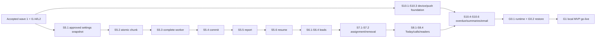

# S5–S10: local MVP, before code

Date: 2026-10-31. Lane: Large. Status: proposed; the picks in §10 still need review.
Scope: S5 import commit, S6 leads, S7 assignment, S8 Today/calls, S10 overdue/push/summaries, then local go-live. S9 scoring editor/recompute and S11 dashboard wait. This document authorizes no implementation or data operation.

## 1. Outcome, inputs and current seams

An entered staff member imports a file once, sees what happened to every row, and can recover a stopped run. A manager assigns the new leads. An Admin sees only their leads, calls them, saves the outcome and moves to the next lead. Overdue reminders and summaries still work after the worker restarts. The local Compose stack is production for this MVP.

Success: an overlapping export creates only genuinely new leads; invalid phones remain repairable; no committed chunk is repeated; a removed member cannot read or change leads; every call and assignment has an actor; company-local day boundaries agree across Today, reminders and email. Backup restoration must recover the complete workflow, including an unfinished import.

Read against [wave 1 §§2, 3, 6–9](s3-s10-modules.md), [foundation §8](s1-s2-foundation.md#8-fan-out-after-s2-agency), [developer flows 6.1–6.5](../developer-design.md#6-key-flows-new), [migration rules](../migrations/README.md), and [email templates](email-templates.md). The source below was read in the shared working tree, not inferred from the last commit. Wave 1C is moving; the integrator must publish its accepted contract before S5 source begins.

| Verified source | Consequence for this spec |
| --- | --- |
| API `settings/index.ts`, `fields.ts`, `guard.ts` | `createFields(tx,current,input,meta)` has a fourth argument, `{at,ip}`. It checks `settings.manage` and fresh OTP. There is no exported option-extension or historical-label reader yet. |
| API `scoring/index.ts`, `score.ts`, `config.ts` | Use `scoreLead({custom},config)` and `loadActiveConfig(tx)`. No copied scorer. Seeded timeline/budget/decision-maker rules remain the MVP rules. |
| API `leads/index.ts`, `importMatches.ts`, `referenceCounts.ts` | Only reference/count and import-match reads exist. Lead writes, list/detail, assignment and Today below are new real implementations. |
| API `imports/index.ts`, `types.ts`, domain `imports.ts` | Pure parser/mapping/normalization exists in the observed tree. The complete I2–I4 contracts are prerequisites, not claimed as finished here. `NormalizedLead` currently belongs to API imports. |
| DB `schema/{leads,leadEvents,imports}.ts` | Live-phone uniqueness, result ledger and progress exist. Events currently allow only imported/duplicate_import. Import authorization/run records do not exist. |
| API `notifications/service.ts`, domain `notifications.ts` | `notifications.create(deps).notify(tx,input)` exists. Keys include company. Reusing a key with changed content returns conflict, so retries must reuse the saved notification snapshot. URLs currently reject query strings and `/notifications`. |
| API `tenant/context.ts`, `permissions.ts`, `stepUp.ts` | HTTP `Ctx` includes a session. Entered staff have `member:null` and `followups.log` capability. Fresh OTP means age ≤15 minutes. Admin access needs an assigned-member resource predicate. |
| API `members/service.ts`, domain `members.ts` | Deactivation refuses open leads and any `reassignTo`; DTO currently allows an optional UUID, not null. Preserve current last-manager and identity-lock rules when adding reassignment. |
| Domain `jobs.ts`, API `lib/jobs`, worker `main.ts`, DB `queueSetup.ts` | Only auth `notify.email` is registered/typed. Queue runtime has scheduling disabled. Tenant job authority and scheduler enumeration are new integrator work. |
| DB `tenantScope.ts` | Every existing company scope requires a UUID `userId`. A system scheduler cannot be implemented by passing a fake user or an HTTP `Ctx`. See §3. |
| Web `leads`, `followups`, `notifications` screens | Keep the layouts and controls listed in §8. Lead/follow-up adapters remain demo-backed; notification list/bell is already real. |
| `compose.yml`, `lib/email/{config,index}.ts` | Resend transport already exists. Worker currently lacks the uploads mount. The local overlay uses the gitignored root `.env` for API and worker runtime values; G0.1 supplies setup and presence checks. |

The five approved wave-1 decisions remain: import and flag invalid phones; keep the three failed-outcome defaults; seed only the three generic scoring fields; Super Admin import flag defaults off; an authorized import may outlive browser entry while current actor/company authority remains valid.

## 2. Shared rules and proof commands

### Ownership, transactions and HTTP

Use the existing public owner entries, `withContext(ctx, (tx,current) => ...)`, `permissions.require`, `stepUp.requireFreshOtp`, `audit.audit`, `enqueue`, `apiRequest`, `requireFeatureContext` and `hasCapability`. A web view is display data, never authority. Real failures do not select the demo path. Owners supply public methods through composition when a direct import would create a cycle.

Every company route below is under `/api/companies/:slug/`. Reads are GET; writes POST, validated JSON and exact Origin. UUIDs, finite numbers, limits, discriminated unions and unknown-key rejection are enforced at the API. Dates are ISO UTC over HTTP and decoded to `Date` at the web boundary; date-only answers stay `YYYY-MM-DD`. Errors remain 400 `validation`, 403 `forbidden`, 404 `not_found`, 409 `conflict`, 428 `step_up_required`, and the existing `unavailable` envelope. Missing/foreign/not-owned lead IDs look missing. Never return partial success for a bulk request containing a foreign ID.

All permission and resource checks run on refreshed context inside the same transaction as writes. Retain the foundation lock order: affected user identities sorted first, session/agency/company, member/reference rows, then leads sorted by ID, then event/result rows. The company lock is the existing serialization point for settings changes and lead writes. Worker chunks use that same point; file parsing and network delivery never hold it. A preliminary lookup supplies identities to lock but confers no authority; recheck after locking.

User writes use `WriteMeta = {at:Date; ip:string|null}`. HTTP services generate `at`, never accept it from the browser. Audit metadata is allowlisted strings and IDs/counts only, not names, phones, notes, source rows or provider errors. Timeline events may contain the typed business values below; audit and timeline are separate.

### Storage and migrations

Every new tenant table uses `companyColumns()` and `companyPolicies()`: UUIDv7 ID, company FK, created/updated timestamptz(3), company/ID unique key when referenced. Every relational tenant reference is a composite company/ID FK with RESTRICT; user/session references use platform FKs plus service ownership checks. Enable and FORCE RLS. Require both the scoped company and its persisted agency relationship in USING/WITH CHECK. Missing/identity/agency scope and mismatched agency/company must fail. Runtime is `anar_app`, never migration role or BYPASSRLS. Product tables get SELECT/INSERT/UPDATE only; immutable event/history tables need no deletion path.

Each storage slice names an unnumbered note in `docs/migrations/<owner>/`. The integrator alone registers schema/exports, custom SQL, grants and the single generated `0000_initial.sql`/snapshot/journal. Before go-live prove empty DB, repeat migrate/role bootstrap, catalog policies and schema drift. An older disposable DB needs explicit recreation: replaying a rewritten initial migration is not an upgrade. Do not reset the shared stack. No backfill is authorized here; retained rows require a separate impact/count/recovery decision. At the first retained production import, switch the repository to append-only migrations as part of G1.

### Proof vocabulary

All proofs here are **planned, not run by this documentation task**. Each source stop is followed by its separate test review. Aim for 100–200 handwritten source lines per stop; declarations, migrations and fixtures count separately. Split a second behavior into another stop if needed; do not drop concurrency or refusal cases to meet a line count.

| Code | Exact command / expected result |
| --- | --- |
| U(module/name) | `pnpm --filter @anar/api test test/<module>/<name>.test.ts`; domain: `pnpm --filter @anar/domain test`; web: `pnpm --filter @anar/web test modules/<module>`. Named cases pass. |
| I(module/name) | `pnpm --filter @anar/api test:integration test/<module>/<name>.integration.spec.ts`. Real disposable PostgreSQL 17; assertions as `anar_app`. |
| DB | `pnpm --filter @anar/db test:integration` and `pnpm check:migrations`. New table/column/index/RLS/catalog checks pass. |
| W | `pnpm --filter @anar/worker test`; `pnpm --filter @anar/worker test:integration`. Real queued jobs, restart and shutdown checks pass. |
| E(name) | `pnpm --filter @anar/web e2e:auth <name>.spec.ts --project=phone --project=desktop`. Existing auth harness: 390×844 and 1440×900, built proxy/API/worker. |
| ALL | Integrator serially runs `pnpm lint`, `pnpm check:boundaries`, `pnpm typecheck`, `pnpm test`, `pnpm test:integration`, `pnpm check:migrations`, `pnpm build`, `pnpm e2e`, `pnpm --filter @anar/web e2e:auth`, `pnpm smoke:compose`. |

Every route I adds owner denial, allowed manager/entered staff, Admin own/other lead behavior as applicable, expired staff entry, revoked session, inactive membership, same-agency second company, different agency, forged scope pair, no scope and hostile/missing Origin for POST. Fresh-OTP routes prove stale refusal without writes, exact 15-minute boundary, fresh retry and audit rollback. Every E asserts no sideways scroll, one copy of each control, keyboard focus, retained input on error and direct real URL/action refusal for unfinished features. Helpers have no artificial browser endpoint: their named consumer E is an enablement gate, not an omitted proof.

## 3. Job and event contracts

### Job authority and queue extension

The integrator extends `packages/domain/src/jobs.ts` to a name-to-payload map and makes the existing `enqueue` generic over that map. Auth email stays its explicit platform exception with the existing encrypted message. Browser payloads never supply tenant authority, roles, user IDs or run IDs.

```ts
type ImportCommitJob = {
  agencyId: string; companyId: string; actorUserId: string;
  batchId: string; runId: string;
};
type SystemTenantJob = {
  agencyId: string; companyId: string; actorUserId: null;
  authority: "scheduler"; scheduledAt: string;
};
type OverdueJob = SystemTenantJob;
type SummaryJob = SystemTenantJob & { period: "daily" | "weekly"; localDate: string };
type NotificationDeliveryJob = SystemTenantJob & { notificationId: string };
type ImportJobCtx = {
  agencyId: string; companyId: string; actorUserId: string;
  actorMemberId: string | null; role: "agency_staff" | "super_admin";
  batchId: string; runId: string; authorizedAt: Date;
};
type SchedulerCtx = { agencyId: string; companyId: string; authority: "scheduler" };
type JobControl = { signal: AbortSignal };

withImportJob<T>(payload: ImportCommitJob,
  fn: (tx: TenantTx, current: ImportJobCtx) => Promise<T>): Promise<T>;
withScheduledJob<T>(payload: SystemTenantJob,
  fn: (tx: TenantTx, current: SchedulerCtx) => Promise<T>): Promise<T>;
```

`runId` is a deliberate extension to wave 1's four-field import payload. Without it, a delayed delivery from the old authorization can write after a new actor resumes the batch. `withImportJob` loads the immutable run, verifies its active pointer on the batch, IDs and original actor, active agency/company, usable user and current staff/member/import flag. It produces `ImportJobCtx`, not a fabricated session. It checks before the first write and every ≤500-row transaction. Staff entry expiration, switching companies or logout do not cancel the already-authorized operation; membership removal, suspension or lost permission do. Resume requires a new live HTTP entry and creates a new run.

System jobs have null actor IDs and a named scheduler authority, not an owner. Integrator adds a separate `withSystemTenant({agencyId,companyId,authority:"scheduler"},fn)` DB entry and a discriminated scope reader; existing `withTenant` retains required user IDs. System scope sets `app.scope_kind=company`, the validated agency/company, `app.actor_kind=scheduler`, and clears `app.user_id`; user scope sets actor_kind=user. Existing HTTP/session paths reject system scope. Company RLS still checks both IDs; no feature policy becomes unscoped.

Scheduler enumeration needs its own narrow platform read: `listScheduledCompanies(cursor,limit:100): Promise<{items:{agencyId,companyId,timezone}[];nextCursor:string|null}>`. Integrator adds a scheduler-catalog scope and a SELECT-only companies policy for active companies whose agency is active. It returns only these IDs/timezones, no leads or identities. No HTTP route exposes this scope. Worker registration is the only caller; per-company handlers recheck active status before feature reads. No runtime DDL or generic system-user bypass.

| Job name | Owner / enqueue key / behavior |
| --- | --- |
| `import.commit` | Imports; `import:<companyId>:<batchId>:<runId>`; chunks 500; initial try + 2 retries. |
| `followups.overdue_scan` | Follow-ups; `overdue-scan:<companyId>:<UTC-half-hour-slot>`; rechecks all still-overdue eligible leads, pages 100. |
| `summary.daily`, `summary.weekly` | Reports summaries only; `daily:<companyId>:<localDate>`, `weekly:<companyId>:<weekStart>`; immutable period snapshot, pages recipients 100. |
| `notify.push`, `notify.summary_email` | Notifications; `push:<companyId>:<notificationId>`, `email:<companyId>:<notificationId>`; initial try + 3 retries, bounded by expiry. |

Extend `queueSetup.ts` rather than creating queues in feature startup. Existing `publish` throws when pg-boss refuses an occupied key; callers must return their durable existing run/delivery/period result before enqueueing again. Queue singleton keys are not the permanent idempotency ledger. Registration, retries, cancellation and scheduler lifecycle belong to integrator `jobs/index.ts`, `lib/jobs`, DB queue setup and worker main. Scheduler tick is immediate on start and every five minutes, not pg-boss's currently-disabled scheduler; DB dedupe admits one due period across multiple workers. No overlapping tick within one process; await it on shutdown.

### Concrete event additions

Keep imported and duplicate_import payloads from L2. Extend the domain discriminated union and DB type check only when the owning behavior lands. Retain demo-only extra variants in its separate mock adapter until their real features ship.

| Type | Exact data |
| --- | --- |
| `assigned`, `unassigned` | `{assignmentId:string; from:string|null; to:string|null}`; assigned requires non-null to, unassigned requires null to. |
| `stage_changed` | `{from:string; to:string; fromKind:"open"|"won"|"lost"; toKind:"open"|"won"|"lost"; lostReasonId:string|null}`. |
| `fields_updated` | `{keys:string[]; systemKeys:("fullName"|"phoneRaw"|"email")[]}`; no old/new contact values in the event. |
| `score_changed` | `{from:"hot"|"warm"|"cold"; to:"hot"|"warm"|"cold"; score:number}`; only priority changes. |
| `follow_up_logged` | `{followUpId:string; outcomeId:string}`. |
| `lost_suggested` | `{followUpId:string; failedAttempts:number}`. |
| `lost_suggestion_dismissed` | `{suggestionEventId:string}`. |

Events always have real `actorUserId` and nullable `actorMemberId`; scheduler does not manufacture user timeline events. Event writes and their lead mutation share one transaction. Repeated no-op assignments/stage/field edits add no event. The integrator adds typed audit allowlist entries with their owning slice: `imports.committed`, `imports.resumed`, `leads.updated`, `leads.stage_changed`, `leads.assign`, `followups.logged`, `leads.suggestion_dismissed`, `notifications.subscribed`, `notifications.unsubscribed`. Audit includes IDs/counts and actor, not event payload copies.

## 4. S5: import commit and recovery

### Contracts and state

I4 must hand over the saved revision, canonical schema fingerprint, immutable file identity and complete distinct option proposals, not only its first-50 preview arrays. S5 adds these server-only saved values if I4 has not persisted them. Hash covers actual file bytes, mapping/new fields/labels/options and company country/timezone. No re-parsing under long authorization locks; any missing complete proposal calculation runs with I4's bounded, abortable outside-lock scan and final revision check before Commit is enabled.

```ts
type FieldOptionAddition = { fieldKey:string; options:{value:string;label:string}[] };
type CommitImportInput = ImportDraftInput & { previewRevision:number };
type CommitImportResult = { jobId:string };
type ImportRunAuthorization = {
  actorUserId:string; role:"agency_staff"|"super_admin";
  authorizedAt:string; mappingRevision:number;
};
type ImportInsert = {
  rowNo:number; lead:NormalizedLead; issues:ImportIssue[];
  score:ScoreResult;
};
type ImportWriteResult = {
  rows:{rowNo:number; leadId:string;
    result:"imported"|"duplicate_db";
    reason:"same_submission"|"resubmitted"|"invalid_phone"|null}[];
};
type ImportResultRow = Omit<ImportRow,"raw"> & {
  raw:Record<string,string>|null; issues:ImportIssue[];
};
type ImportReport = ImportBatch & {
  startedAt:Date|null; finishedAt:Date|null;
  error:{code:"file_missing"|"file_changed"|"schema_changed"|"access_removed"|"processing_failed";
    message:string}|null;
  runState:"queued"|"running"|"retrying"|"stopped"|"done"|null;
  canResume:boolean;
};
type ImportRowsQuery = {batchId:string; afterRowNo?:number;
  filter?:"all"|"exceptions"|"phone_review"};
type ImportRowsPage = {items:ImportResultRow[]; nextRowNo:number|null; total:number};

extendFieldOptions(tx:TenantTx,current:Ctx,input:FieldOptionAddition[],meta:WriteMeta):Promise<void>;
addImportedLeads(tx:TenantTx,current:ImportJobCtx,
  input:{batchId:string;stageId:string;rows:ImportInsert[]}):Promise<ImportWriteResult>;
commitImport(ctx:Ctx,input:CommitImportInput,meta:WriteMeta):Promise<CommitImportResult>;
runImport(job:ImportCommitJob,control:JobControl):Promise<void>;
getImportBatch(ctx:Ctx,batchId:string):Promise<ImportReport>;
listImportRows(ctx:Ctx,input:ImportRowsQuery):Promise<ImportRowsPage>;
resumeImport(ctx:Ctx,input:{batchId:string},meta:WriteMeta):Promise<CommitImportResult>;
```

`NormalizedLead` moves structurally unchanged from API imports types to browser-safe domain imports and is re-exported by its old backend type entry. This keeps leads from importing private imports code. `ScoreResult` remains scoring-owned. `addImportedLeads` writes leads/events only; imports owns ledger/progress. The caller wraps both in one transaction. No public lead-creation route appears in S5.

New storage: `import_runs` has company columns, batch_id scoped FK, run_no positive, actor_user_id FK, role, authorized_at, mapping_revision, state (`queued/running/retrying/stopped/done`), failure_count 0–3, job_id nullable, stop_code nullable; unique company/batch/run_no. Authorization fields are immutable in service writes. `import_batches` adds active_run_id scoped FK and frozen JSON `{fileSha256,mappingRevision,mapping,newFields,approvedOptions,fields,defaultCountry,timezone,defaultStageId,schemaFingerprint,commitHash,newOptionsAdded}`. It records post-settings fingerprint and fixed batch.createdAt normalization time. Lead score uses the active config inside each chunk; S9 config changes are not available in this MVP.

`uploaded → mapped → running → done`; a failed chunk sets `failed`, with runState retrying while retries remain and stopped after exhaustion/permanent refusal. Retry/resume returns to running without rewriting accepted settings or the frozen mapping. `last_row_no` is the last contiguous committed data row, not physical line number. Done requires one ledger row per data row and totals summing to rowCount. Invalid phone rows count as imported plus needPhoneReview. Expected invalid structure counts invalid; infrastructure failures roll back the chunk, not fabricate successful error rows.

### S5.1 Approve import field additions

**Files.** Settings owner adds `apps/api/src/modules/settings/importOptions.ts`, updates its `index.ts`; imports owner extends saved preview/frozen metadata in `imports/{preview,types,repository}.ts` and domain imports. Tests `settings/importOptions.*`, `imports/commitSnapshot.*`. Integrator exports public `WriteMeta` or structural equivalent; no private `guard.ts` import from imports. Note `docs/migrations/imports/commit-snapshot.md`.

**Uses/gives.** Uses I4 and existing `createFields(tx,current,input,meta)`. Gives `extendFieldOptions` and the complete revision-bound snapshot. Only append codes that do not exist, keep existing labels, validate ≤200 options with the existing field rule; never call createFields with an empty array. Both mutations require settings.manage + fresh OTP. Snapshot read/calculation itself needs imports.upload and no OTP.

**Behavior/UI.** Check shows every proposed code/label (paginated if needed), including additions to existing fields, and says a fresh code is required only when settings will change. Missing OTP retains all mapping edits and returns to the same batch after verification. Pure repeat/import with no settings writes requires no step-up.

**Proof.** U option union, same code/different label, 200/201 bound and unchanged mapping hash. I fresh-OTP rollback across new fields and added options, concurrent archive/type edit, complete proposals beyond first 50 rows. E `imports-commit` owns the eventual Check/fresh-code flow. No commit button enabled yet; initial migration update only if snapshot storage needs a new column.

### S5.2 Persist one chunk exactly once

**Files.** Leads owner adds API `leads/{importWrite,events}.ts`, updates index/domain types; imports owner adds `imports/chunk.ts`, extends repository and DB imports/run schema. Integrator wires `withImportJob` in `modules/tenant/jobs.ts`. Notes `docs/migrations/imports/commit-runs.md`, `docs/migrations/leads/import-writes.md`.

**Uses/gives.** Uses S5.1 types, L2 phone uniqueness, scorer, tenant guard. Gives `addImportedLeads` and `commitChunk(tx,current,{rows,throughRowNo}):Promise<void>` where rows are normalized classifications with source row/rowNo and throughRowNo is the last row in the chunk. The chunk consumer is S5.3, not a public endpoint.

**Behavior.** Under the batch lock, refuse a stale run and recheck frozen settings compatibility. Keep all 500 row classifications in source order. Existing ledger rows and previous first valid phones are the durable dedupe source: look up previous non-invalid row phones in this batch, including duplicate_db, so a duplicate across row 500/501 is still duplicate_file after restart. Invalid structure never claims a phone; null/invalid phones never dedupe. Partial live-phone uniqueness resolves concurrent imports; if insert loses, read the existing live row and classify same campaign/exact UTC timestamp versus resubmitted. Existing lead values stay unchanged. Score/new lead/imported event or duplicate_import event, result ledger and lastRowNo commit together. Lock/order inserted phone candidates consistently to avoid inverted multi-phone conflicts.

**Proof.** U ordered classifications and summary partitions. I 501+ rows, crash before/after transaction commit, repeated chunk including invalid phones, cross-batch phone race, same-submission no event, resubmission one event, rollback when ledger/audit fails, scope/FKs and stale run. DB policies/indexes. E `imports-commit` later observes exact counts and no duplicated leads after worker restart.

### S5.3 Run and finish an authorized import

**Files.** Imports owner adds `imports/{job,complete}.ts`, updates public index; integrator extends jobs exports/worker composition, typed enqueue and queue setup. Worker gets read-only `uploads_data` at the same path and `UPLOADS_ROOT`; API retains write access. Tests `imports/job.*`, worker import lifecycle. No new table beyond S5.2.

**Uses/gives.** `runImport` uses parser/normalizer through public imports functions, chunk writer, active scorer and injected `notify`. It can be executed through a real queued integration job before the HTTP trigger ships. Queue registration ships with the complete handler; no empty job entry.

**Behavior.** Verify file hash before writes; stream outside locks in ≤500 rows, observe shutdown signal at row/chunk boundaries, use batch.createdAt for missing dates. Resume scanning from the start if parser cannot seek safely, but never rewrite ledger rows ≤lastRowNo. Each short chunk checks current actor/company and frozen settings. Require the frozen post-commit schema fingerprint, country/timezone and active default stage to match; any drift stops for review. Non-retryable missing/changed file, incompatible schema or removed access stop without a blind retry. Transient failures preserve last progress, increment failureCount once per observed failed delivery and throw for the queue's two retries. Cancellation rolls back only the active chunk. Queue visibility/expiry must cover the measured 25 MiB job; integrator chooses a 15-minute delivery deadline and proves it, rather than inheriting auth email's 30 seconds.

Hard process death cannot update failureCount. Integrator supplies `readImportJobState(tx,jobId):Promise<{state:"queued"|"active"|"retrying"|"failed"|"completed"|"missing";attempts:number}>` from the existing queue, with job/run identity checked by the caller. Queue state, not the error callback count, determines exhaustion. Report GET derives a recoverable stopped state for terminal failed jobs or completed jobs whose batch is incomplete; it does not mutate on read. A missing job is recoverable only once its recorded run time exceeds the maximum 15-minute delivery plus five-minute grace. S5.6 reconciles that state under the batch lock before resuming; this prevents final-attempt crashes leaving an unresumable running batch. New run IDs fence any delayed old process.

Completion locks batch/run, derives totals from the ledger and approved option count, marks done and calls notify atomically. Recipients are the uploader plus active usable Super Admins, deduped by user ID. Use one common immutable content snapshot for an uploader who is also manager; key `import:<companyId>:<batchId>`. An uploader who lost access is omitted; do not turn a finished import into failure because one recipient disappeared. Completion without eligible recipients still succeeds. Retry reads saved result before recomputing notification content.

**Proof.** U retry classification/redacted failure strings. I/W real queue kill/restart including death on the final attempt, terminal/missing job reconciliation, full-file hash mismatch, absence of file, third transient failure, expired staff entry continues, actor deactivation stops, import flag removed stops, final notification failure rolls back completion, duplicate completion stable content, two-company payload forgery. E `imports-commit` observes queued/running/done after S5.4–5.5; HTTP access still requires current entry.

### S5.4 Commit the checked revision

**Files.** Imports `commit.ts`, routes/index/repository; web `imports/{actions,server,types}.ts`, `data/commit.ts`, `ui/{CheckStep,ImportMapPage}.tsx`; integrator API registration/audit allowlist. Note storage was delivered by S5.2.

**API.** POST `imports/commitImport`, imports.commit. Match the submitted draft/revision/hash to the saved successful preview; advisory duplicate totals may change, mapping and schema may not. Require settings.manage + fresh OTP only when creating fields/extending options. Under current context and batch lock: apply S5.1 writes, freeze the post-change schema, save/update template and lastUsedAt, insert run, set mapped, enqueue and save jobId, audit. All or none. The same committed revision returns its saved jobId; changed input after commit conflicts. Empty template name is validation; existing fingerprint updates follow I3's explicit save choice.

```diff
+ Check -> commitImportAction -> apiRequest -> imports/commitImport
+   -> withContext -> imports.commit -> lock batch / revision / schema
+   -> optional settings changes with fresh OTP -> freeze -> run + enqueue
+   -> worker -> withImportJob per chunk -> scorer + lead write + ledger
+   -> completion + immutable notifications -> result page uses batchId
```

**Web.** Navigate to `/<slug>/imports/<batchId>`, never jobId. Double-click disables while pending; a lost response can safely retry that revision. Show conflict with retained form and explicit re-preview. No automatic mutation retries in apiRequest.

**Proof.** U request/wire decoding, jobId distinct from batchId. I duplicate request/lost response, enqueue/field/template/audit rollback, no fresh OTP needed for unchanged schema, fresh OTP needed for any option append, re-preview required on schema drift. E `imports-commit` at both widths, using a genuine synthetic multipart file. Commit stays gated until this and S5.3 are accepted together.

### S5.5 Read live progress and every result row

**Files.** Imports `report.ts`, route/index/repository; web `data/batches.ts`, `ui/{ImportResultPage,CheckStep}.tsx`, new `ui/ImportProgress.tsx`. No schema change; no job producer.

**API.** GET `imports/getImportBatch?batchId` and `imports/listImportRows?batchId&afterRowNo&filter`, imports.upload, no OTP. Result access is also allowed to an active manager with leads.assign (even when Super Admin import is off); Admins are denied raw batch reports. This explicit manager report rule makes completion links usable without granting upload. Page size 50, ordered rowNo ascending; default filter exceptions includes duplicate/invalid/error and imported phone-review rows. Counts are whole-file; null raw displays “Source row expired”. Paths never leave API.

**Web.** Preserve File → Columns → Check → Done rail, side-by-side counts/evidence desktop and bottom actions phone. Queued/running polls GET at five seconds while visible; failed shows lastRowNo plus sanitized reason; no mapping redirect while running. Paginate all categories, not just resubmissions. Queue/detail links enable only after S6. Done exposes no fake 100% when ledger is incomplete.

**Proof.** U each status, null raw and page decoder. I 0/50/51 rows, exact total, result permission independent of upload flag, polling no mutation. E `imports-report`: reload running/failed/done, later pages, no redirect loop, retained company entry semantics; this consumes S5.1–5.4 E obligations. No migration.

### S5.6 Resume a stopped run

**Files.** Imports `resume.ts`, routes/index/repository; web actions/`ImportProgress.tsx`. No schema change.

**API.** POST `imports/resumeImport`, imports.commit + current entry, no OTP because it cannot change settings. Under the batch lock, first reject done; then inspect the persisted active job. If it is genuinely queued/active/retrying, return its existing jobId with no new authorization or writes. This read-only replay comes before the stopped-run check, so concurrent resumes and a lost response return the same active job. If queue state is terminal (or missing beyond S5.3's grace), atomically reconcile the run to stopped with processing_failed, preserving lastRowNo. Only a stopped run can create new work. Recheck frozen file/schema and current permission, create a new immutable run with incremented runNo/new actor/time, preserve frozen settings/progress, enqueue atomically. Delayed old jobs fail the active-run check. If schema needs a new decision, say why resume is blocked; never silently remap a partially imported batch.

**Proof.** U resume state table. I stale actor/session entry, changed schema/file, concurrent resume, old job after new run, worker stopped after committed row 500 with invalid-phone rows. E `imports-resume`: stop/reload/re-enter/resume/done, no duplicate rows/events/notifications. Browser tests run at both widths. No migration.

## 5. S6: real lead list, detail and edits

### Contracts

```ts
type LeadFilters = {
  assignedTo?:string|"unassigned"; priority?:Priority; stageId?:string;
  q?:string; cursor?:string;
};
type LeadPage = {items:LeadRow[]; nextCursor:string|null; total:number};
type HistoryReferences = {
  fields:Field[]; stages:Stage[]; outcomes:Outcome[]; lostReasons:LostReason[];
  actors:{userId:string; memberId:string|null; name:string}[];
};
type RealLeadDetail = LeadDetail & {
  history:HistoryReferences; nextEventCursor:string|null;
};
type LeadTimelinePage = {
  events:LeadEvent[]; followUps:FollowUp[];
  history:HistoryReferences; nextCursor:string|null;
};
type UpdateLeadFieldsInput = {
  leadId:string; fullName?:string|null; phoneRaw?:string|null;
  email?:string|null; custom?:Record<string,string|number|null>;
};
type ChangeStageInput = {leadId:string; stageId:string; lostReasonId?:string|null};

listLeads(ctx:Ctx,filters:LeadFilters):Promise<LeadPage>;
getLead(ctx:Ctx,id:string):Promise<RealLeadDetail>;
listLeadEvents(ctx:Ctx,input:{leadId:string;cursor?:string}):Promise<LeadTimelinePage>;
loadHistoricalReferences(tx:TenantTx,input:{fieldKeys:string[];stageIds:string[];
  outcomeIds:string[];lostReasonIds:string[]}):Promise<Omit<HistoryReferences,"actors">>;
updateLeadFields(ctx:Ctx,input:UpdateLeadFieldsInput,meta:WriteMeta):Promise<{lead:Lead}>;
changeStage(ctx:Ctx,input:ChangeStageInput,meta:WriteMeta):Promise<{lead:Lead}>;
```

LeadDetail keeps `hotMin`, stored score/breakdown, hidden-empty display fields and `duplicates:[]` (no merge UI in MVP). Extra history resolves only references used by this visible lead/page, including archived rows; active schema still supplies editable choices. Actor labels come through the tenant/profile owner, not a second identity store. Timeline pages contain at most 50 events and exactly the follow-ups referenced by those events; the first page lives in detail. Do not grow an unbounded all-history response.

### S6.1 Browse the lead queue

**Files.** Leads API `list.ts`, `repository.ts`, `routes.ts`, index/domain wire schemas; web `data/list.ts`, server/types, `ui/{UnassignedPage,AssignList}.tsx`. Integrator enables existing `app/(company)/[slug]/leads/page.tsx` and nav. Note `docs/migrations/leads/list-indexes.md`.

**API.** GET `leads/listLeads`, leads.view, no OTP. Manager/staff default to unassigned queue; Admin is always restricted to their member ID irrespective of filters. Reject Admin requests for other assignees/unassigned rather than quietly showing another set. Filter priority/stage, q trimmed ≤120, page 50. Sort `leadDate DESC,id ASC`; cursor encodes both values and normalized filter fingerprint, validates format and fails when used with different filters. Total uses exactly the same company/visibility/filter predicates. Live rows exclude deleted/merged. Search literal case-insensitive name substring or normalized phone prefix; escape SQL wildcards and parameterize. Do not advertise arbitrary phone-substring search with the existing prefix index.

**Storage/UI.** Extend lead-date index to company/date DESC/id ASC; use existing name trigram, phone prefix, assignee and priority indexes. Prove plans on synthetic 50k-company rows. Reuse queue filters/cards/table and score chips. Until S7, show an explanatory disabled assignment panel. Admin gets own-lead list with no manager member list fetch. Empty company, no matches and unavailable are distinct. No job.

**Known limit (accepted).** Under row security Postgres will not use an index for `ILIKE`/`LIKE`, which are not leakproof. Name search therefore reads every live company row: about 378 ms on 50k rows. Phone search uses a `~>=~`/`~<~` range on the prefix index instead. Nothing is marked leakproof.

**Proof.** U filters/cursor/escaping and real adapter dates. I pagination ties, deleted cursor row, cross-filter cursor, Admin predicate on count as well as rows, phone/name search and query plans. DB index drift. E `leads-list`: real import → queue, search/filter/page/reload, 0 results versus outage, Admin direct URL/filter negatives, both widths.

### S6.2 Read a lead and its history

**Files.** Leads `detail.ts`, `history.ts`, routes/index/repository; settings owner adds `settings/history.ts` + public export; web `data/detail.ts`, `ui/{LeadDetailPage,LeadDetailView,Timeline,Facts,LeadHeader}.tsx`. Integrator composes historical-reference reader and enables detail route. No schema change.

**API.** GET `leads/getLead?leadId`, `leads/listLeadEvents?leadId&cursor`; leads.view with live lead resource, no OTP. Admin only assigned rows. Cursor order `createdAt DESC,id DESC` scoped to this lead. Each later page rechecks visibility. Resolve archived names/option labels from persisted settings; never put them back in active stage/outcome pickers. Current detail stage comes from history so archiving a non-default stage cannot crash rendering. Store breakdown remains the score evidence; load active config only for Hot threshold. Do not recompute score on read.

**Web.** Preserve header actions, facts, WhyScore and timeline split. Keep `tel:`, WhatsApp and email for valid values; until S8, dialing does not navigate into an unimplemented log sheet. An invalid phone has the existing reason text and no dial link. Timeline Open lead links from imports now work. Disallowed deep link returns the same missing view, not the lead's name.

**Proof.** U nested date decoding and archived-label projection. I own/other detail and timeline pages, archived field/stage/outcome/reason, 51 events, equal timestamps, missing config gives unavailable. E `lead-detail`: imported/resubmitted history, stable score explanation, empty facts hidden, invalid phone and unavailable states; both widths. No job/migration.

### S6.3 Repair contact details and score edited answers

**Files.** Leads `update.ts`, `validation.ts`, events/routes; web `data/update.ts`, actions and new `ui/EditLeadFields.tsx` beside Facts. Integrator audit addition only. Note `docs/migrations/leads/edit-events.md` extends event type check, no new table.

**API.** POST `leads/updateLeadFields`, leads.update on resource, no OTP. Omitted keys remain; null clears. Require at least one supplied change; fullName ≤200, email null or valid ≤320, text custom ≤2000; unknown/system field keys are validation. Active field codes/types only, finite numbers/date-only values, JSON merge preserves omitted custom fields. Archived answers remain readable and untouched. Phone repair uses existing `lib/phone` and company defaultCountry, stores raw plus normalized/valid flags. A live-phone conflict is 409 with no other edits, never an automatic merge.

**Behavior.** Lock visible lead and current schema, validate all changes, call the one scorer only when custom actually changes. Save fields/score/scoredAt together; one fields_updated event, score_changed only if priority changes, audit IDs/key-count. No-op yields unchanged lead without noise. Existing score remains when only contact changes. Browser retains input on invalid code, conflict, expired access or server failure.

**Proof.** U patch/null/finite/code/date semantics and normalization. I duplicate repair rollback, concurrent settings archive, Admin reassignment during edit, scorer failure rollback, same-priority point change without event, untouched archived values. E `lead-edit`: repair phone enables Call, answer changes badge/explanation, conflict keeps draft. DB event check; no job.

### S6.4 Change stage with a reason

**Files.** Leads `stage.ts`, validation/events/routes; web update adapter/actions, new `ui/ChangeStage.tsx` using `ReasonChips`. Note `docs/migrations/leads/stage-events.md`.

**API.** POST `leads/changeStage`, leads.update on resource, no OTP. Target must be active in the company; lost requires active lostReasonId, other kinds clear it. Selecting an archived current stage unchanged is allowed only as a no-op, not as a new destination. Same stage with changed lost reason is a real edit. Closed target clears nextActionAt; returning to open leaves it null until a later call schedules it. Moving to lost clears lostSuggestedAt; returning from won or lost to an open stage resets failedAttempts so a new pursuit starts cleanly; won to lost or lost to won keeps the count. This same transaction-level stage helper is reused by follow-ups, not another HTTP call.

**Behavior/proof.** One stage_changed event records kinds at the time, including reason-only change; bookings count only non-won→won transitions. U stage/reason matrix. I no reason/foreign/archived refusal, atomic event/audit, clearing next action, reopening and no-op. E `lead-stage` verifies chips, required reason, retained input and timeline at both widths. No job; generated event check via integrator.

## 6. S7: assignment and safe member removal

```ts
type AssignLeadsInput = {leadIds:string[];memberId:string|null};
assignLeads(tx:TenantTx,current:Ctx,input:AssignLeadsInput):Promise<{updated:number}>;
reassignOpenLeads(tx:TenantTx,current:Ctx,from:string,to:string|null):Promise<number>;
assign(ctx:Ctx,input:AssignLeadsInput,meta:WriteMeta):Promise<{updated:number}>;
```

Keep the frozen transaction-taking exports above. The outer HTTP service supplies refreshed context; the transaction helpers recheck permission/scope and cannot open their own transaction. Operation time/assignment ID are generated once inside the operation; audit IP comes from the service. The integrator composes active-member lookup and notifications. Public request allows 1–500 unique IDs, null for unassign. Assignment to any active company member (Admin or Super Admin) is allowed; staff are not company assignees. Live closed leads may be reassigned for ownership/history but never enter Today.

### S7.1 Assign, reassign or unassign selected leads

**Files.** Leads API `assign.ts`, repository/events/routes/index; domain new `assignment.ts` owned by leads, event union in leads; web `data/assign.ts`, actions, `ui/{AssignList,UnassignedPage}.tsx`, new `ui/AssignLead.tsx` on detail. Integrator domain export and audit. Note `docs/migrations/leads/assignment-events.md`.

**API.** POST `leads/assignLeads`, leads.assign, no OTP. Pre-read target identity for the foundation sorted identity locks, then recheck active membership under the company/member lock. Validate all lead IDs before updating any. For each changed row write assigned/unassigned event with common assignmentId and before/after member. Identical target is a no-op. Bulk audit records count/memberId/assignmentId. If target non-null and changed count >0, one notification `assign:<companyId>:<assignmentId>` to its user ID, count of changed leads, URL `/<slug>/today`; preserve the existing URL whitelist, no query suffix. No notification on unassign/no-op.

**Web.** Use members owner's real list; do not fetch it as Admin. Keep checkbox selections/target on failure, clear only on success, select-all affects shown page only. Add explicit Unassign choice distinct from the empty “Pick a person”. Preserve sticky side panel desktop and safe-area bottom panel phone. Detail uses the same assignment route. Success refreshes affected lists/detail.

**Proof.** U 0/500/501, repeated IDs/null, response decoder. I cross-company mixed IDs rolls all back, inactive/pending member, same assignee no-op, concurrent deactivation, event/notify rollback, >1 changed row one notification. E `leads-assign`: queue and detail assignment, unassign, filtered selection, error retention, Admin denied at both widths. DB type check; push is added later through notify without changing assignment code.

### S7.2 Remove a member and move their open work atomically

**Files.** Leads adds transaction implementation `reassignOpenLeads` in assign.ts; integrator owns API `members/service.ts`, domain `members.ts`, member web adapter/actions/`ui/RemoveMember.tsx`, shared fixture. Note `docs/migrations/leads/member-reassignment.md`: no new table.

**API.** Existing POST members/deactivateMember remains members.deactivate + fresh OTP. Extend `reassignTo` to optional UUID|null; omitted/null leaves open leads unassigned. Reject target=self, inactive/foreign target. Keep staff-only removal of a Super Admin and the last-usable-Super-Admin guard, existing all-session revocation and issuer-invite revocation. Lock source/target/all manager identity rows using the existing foundation pattern; re-read before changing anything.

**Behavior.** Reassign every open, live, unmerged lead before deactivation in the same transaction, using the assignment writer's event helper. Public 500 cap does not silently truncate this internal path: select/update in ordered batches of 500 within that one transaction, count all rows, issue one operation notification/audit. Closed leads retain historical owner. Rollback all work if any reassignment, revoke or audit fails. No job: eventual reassignment would leave an active access window. Measure 10k open leads within DB deadline; if too slow, this slice needs a revised removal design before shipping, not partial removal.

**Web/proof.** Removal dialog shows actual open/overdue counts, explicit destination/unassign choice and fresh-code retry. U input semantics; I 501+ open rows, closed rows retained, last manager race, reassign-to-self, revoked multi-company sessions, failure halfway no partial status. E `member-reassignment`: remove/reassign/fresh-code flow and old-session denial; both widths. Integrator runs existing membership regressions plus DB checks.

## 7. S8: Today, calls and lost suggestions

### Shared read/write contracts

```ts
type TodayResult = {
  overdue:LeadRow[]; dueToday:LeadRow[]; newLeads:LeadRow[];
  counts:TodayCounts; hasAssignedLeads:boolean;
  nextCursors:{overdue:string|null;dueToday:string|null;newLeads:string|null};
};
type BucketPage = {items:LeadRow[];nextCursor:string|null;total:number};
type FollowUpActor = {byUserId:string;byMemberId:string|null};
type LogFollowUpInput = {
  requestId:string; leadId:string; outcomeId:string; notes?:string|null;
  nextActionAt?:Date|null; stageId?:string; lostReasonId?:string|null;
  custom?:Record<string,string|number|null>;
};
type LogFollowUpResult = {
  lead:Lead;followUp:FollowUp;lostSuggested:boolean;nextLeadId:string|null;
};
type ApplyFollowUpInput = {
  leadId:string;followUpId:string;happenedAt:Date;outcomeId:string;
  countsAsFailed:boolean;nextActionAt:Date|null;
  stageId?:string;lostReasonId?:string|null;
  custom?:Record<string,string|number|null>;
};
type DueFollowUp = {leadId:string;memberId:string;userId:string;nextActionAt:Date};
type DueFollowUpQuery = {at:Date;afterLeadId?:string;limit:100};
type DailyCounts = Pick<TodayCounts,"overdue"|"dueToday"|"newLeads">;
type WeeklyCounts = {
  leads:number;calls:number;siteVisits:number;bookings:number;overdue:number;
  byAdmin:{memberId:string;userId:string;name:string;calls:number}[];
  staffCalls:number;
};

getMyToday(ctx:Ctx):Promise<TodayResult>;
listTodayBucket(ctx:Ctx,input:{bucket:Bucket;cursor?:string}):Promise<BucketPage>;
getBucketCounts(ctx:Ctx,memberId:string):Promise<DailyCounts>;
applyFollowUp(tx:TenantTx,current:Ctx,input:ApplyFollowUpInput):Promise<Lead>;
logFollowUp(ctx:Ctx,input:LogFollowUpInput,meta:WriteMeta):Promise<LogFollowUpResult>;
dismissLostSuggestion(ctx:Ctx,input:{leadId:string;suggestionEventId:string},meta:WriteMeta):Promise<{ok:true}>;
listDueFollowUps(tx:TenantTx,input:DueFollowUpQuery):Promise<{items:DueFollowUp[];nextId:string|null}>;
readDailyCounts(tx:TenantTx,input:{memberId:string;at:Date;timezone:string}):Promise<DailyCounts>;
readWeeklyCounts(tx:TenantTx,input:{from:Date;to:Date;at:Date}):Promise<WeeklyCounts>;
```

`FollowUp` stays in domain/leads; replace required byMemberId with `string|null` and add required byUserId. This is Q1's proposed explicit staff attribution. Integrator updates the explicit demo fixture/adapters with their existing actor user IDs in the same type-change merge; no fabricated memberships. New follow_ups table: company columns; lead_id, by_member_id nullable, by_user_id required, outcome_id, notes nullable max 2000, happened_at, next_action_at nullable, stage_before_id/stage_after_id, counts_as_failed boolean snapshot, is_site_visit boolean snapshot, request_id UUID, request_hash, response JSON of LogFollowUpResult. Composite FKs for lead/member/outcome/stages, user FK, unique company/by_user/request_id, indexes company/lead/happened_at/id and company/by_member/happened_at/id. Immutable call history; response snapshot excludes any extra private context. Retry uses saved result only after rechecking current access to the logged lead and saved nextLeadId; return nextLeadId=null if that candidate is no longer visible/eligible, without changing the saved call or choosing an unauthorized ID.

### S8.1 Read today's three buckets

**Files.** Lead owner adds API `today.ts`, `buckets.ts`, `due.ts`, extends repository/routes/domain; web `data/today.ts`, `ui/{TodayPage,TodaySection,TodayFilters,LeadRowCard}.tsx`. Integrator date helper extension and Today route/nav enablement. Note `docs/migrations/leads/today-indexes.md` if the query plan requires index changes; prefer existing assignee/next-action and event indexes.

**Rules.** One server implementation feeds Today, next-lead and S10 readers. Open/live/assigned only, active assignee. Overdue: nextActionAt < captured now. Due today: not overdue and within company local day [start,nextStart). New: neither previous bucket, latest assignment to current assignee ≤now and strictly <24h old, and no follow-up ever. Use lastContactedAt=null for that last predicate: S8.2 sets it atomically on every call and no MVP operation clears it. This lets S8.1 work before the follow_ups table exists. Equality with now is due today; equality at 24h is not New. A future appointment tomorrow can still be New today. Latest assignment uses assigned events, ordered timestamp/ID; reassignment cannot revive a previously called lead into New. Sort overdue/due by nextActionAt ASC, priority hot/warm/cold, ID; New by priority then assignedAt ASC, ID.

Read first 50 per bucket and independent cursors; counts cover all matching rows, not sampled arrays. `hasAssignedLeads` means any live assigned lead, even if closed or outside today's buckets, preserving the mock distinction between “nothing assigned” and “all caught up”. nextDueAt is earliest future open assigned follow-up. callsTarget=null because target editing/storage is S11; hide target denominator, no invented quota. S8.1 computes bookings from S6.4's actor-attributed stage events. Calls/siteVisits are explicitly zero before any call writer exists; S8.2 replaces those constants with its persisted actor-attributed call reader in the same merge that enables logging, with no query to a not-yet-created table.

**API.** GET leads/getMyToday, leads/listTodayBucket: reports.view_own + real member; staff member-null has no personal Today and receives 403. GET leads/getBucketCounts?memberId permits own member or reports.view_all; validates active same-company member. No OTP. `listDueFollowUps` is an internal paged reader, not an unrestricted route. Shared date helper returns UTC start/end for company-local day and Monday week, including DST/quarter-hour zones; extend existing API lib/dates rather than fork it in summaries. Use a single at snapshot per response/cursor.

**Proof.** U precedence, equality, 24h, Kathmandu, DST short/long days and no overlap. I counts versus 51+ rows, repeated assignments, called/closed/unassigned/deactivated leads, cursor replay, hasAssignedLeads distinctions. E `today`: three buckets/chips/selected detail, mobile back-to-list, desktop split, next-due/all-caught-up states. No job; DB query-plan check.

### S8.2 Save a call and return the next lead

**Files.** Follow-ups owner adds API `followups/{index,service,repository,routes}.ts`, DB `schema/followups.ts`, domain `followups.ts`; leads owner supplies `applyFollowUp` in `leads/followUp.ts` and `nextLead.ts`, event/domain changes. Settings owner adds public `readOutcomeFacts(tx,outcomeId):Promise<{countsAsFailed:boolean;isSiteVisit:boolean}>` in settings/history.ts here, before its first caller: use immutable seed_key=site_visit_done and require the selected outcome active. Web followups server/data/log/actions and `ui/{LogCallSheet,LogCallForm}.tsx`; leads owner adjusts CallButton/LeadHeader. Integrator composes dependencies, route/schema/exports/audit and S8.1 call counters. Note `docs/migrations/followups/log-call.md`.

**API.** POST followups/logFollowUp, followups.log on visible lead, no OTP. Admin assigned only; manager any; staff with active entry logs as user with null member if Q1 approved. Require active company outcome and any new stage/reason; unchanged archived stage remains valid as history. Notes ≤2000, custom uses S6 validation/scorer. Dates must carry an offset/UTC on wire; omitted nextActionAt clears it, matching the current form; closed stages always clear it. Server creates happenedAt. Reject malformed date, do not turn it into now.

**Atomic behavior.** Lock context/lead; get its original Today bucket for a real member. Validate full request; insert follow-up, apply next action/stage/custom, lastContactedAt, failed counter (failed +1, otherwise 0), scoring and events. Snapshot countsAsFailed and site-visit classification at write time. At ≥5 failures on an open stage with no outstanding suggestion, set lostSuggestedAt and create one lost_suggested event; notification behavior follows S8.3. Preserve notes even when the lead becomes lost; the old mock dropped them, the real flow must not silently discard saved input.

Select nextLeadId inside the same authorized transaction after updating: first remaining visible lead in the original bucket, exclude just-logged lead, use S8.1 order. Null when none, staff logs or lead was outside the member's buckets. UI can return to Today overview; do not trust a browser-supplied candidate or choose from a stale pre-save array. Reassignment between response and navigation still requires detail authorization.

Use requestId created once per form submission attempt and retained across transport retry; same user/key/hash returns stored response, changed payload/key collision is 409. This prevents double calls after a lost HTTP response. A changed form after a definitive validation failure can use a new requestId. The saved response, call, counters and events are one transaction. No HTTP write auto-retry.

```diff
+ LogCallSheet(slug,leadId) -> requireFeatureContext -> active choices + visible lead
+   -> logFollowUpAction -> POST followups/logFollowUp -> refreshed resource check
+   -> lock/replay request -> insert call -> leads.applyFollowUp -> events/score
+   -> next visible lead in original bucket -> save result -> commit
+   -> refresh Today/detail; keep sheet input for any rejected request
```

**Web.** Preserve outcome chips, note, Tomorrow/3 days/1 week/Pick date, stage/reason chips, phone bottom sheet and desktop 480px side sheet. Pass company timezone; convert local selected date at 10:00 through the shared web date helper, remove fixed offset/zone copy. Keep the typed note visible and send it even when the selected stage is lost. Keep custom-answer edit in S6 detail; API supports custom for future form reuse without inventing extra default fields. Dialing opens the sheet via log=1 but never logs a call automatically. No successful-call event merely on focus/visibility return.

**Proof.** U retained requestId, timezone date shortcuts, failed/reset math, next selection and lost notes. I call/lead/score/event/audit rollback, concurrent calls and reassignment, double-click/lost response idempotency, archived references, changed outcome flag affects only later calls, actor staff/null-member, no foreign nextLeadId. DB RLS/FKs and duplicate request key. E `log-call`: dial intent, retained input on validation/outage, successful save/next/null, local date, score/timeline updates at both widths. No background job for logging.

### S8.3 Notify and resolve a lost suggestion

**Files.** Follow-ups service adds notification composition; leads `suggestion.ts`, routes/events; web `ui/LostSuggestion.tsx`, update adapter/actions. Notes `docs/migrations/leads/lost-suggestions.md` for event type changes only.

**Behavior.** Fifth failed call creates one immutable notification per active usable manager, key `lost:<companyId>:<leadId>:<suggestionEventId>`, data failedAttempts at creation, URL lead detail. Sixth failed call does not update/re-notify under the old key. No automatic stage change. A successful call resets the counter but leaves an existing manager review suggestion until explicitly resolved or marked lost.

**API.** POST leads/dismissLostSuggestion, leads.assign on visible lead, no OTP. Require current suggestionEventId; stale suggestion conflicts rather than clearing a newer one. Keep resets failedAttempts=0 and lostSuggestedAt=null with dismissal event/audit. Mark Lost uses S6 changeStage and active reason, clearing suggestion atomically. A later series of five failures gets a new event/key. Manager-only buttons; Admin sees the call outcome without manager actions.

**Proof.** U 4/5/6, successful reset and later new cycle. I simultaneous fifth calls create one suggestion, removed manager skipped, notify rollback, stale dismissal, archive reason and Mark Lost refusal. E `lost-suggestion`: manager notification → detail → Keep/Mark Lost, no automatic stage movement, Admin direct-call denial, both widths. No separate job; S10 later delivers the existing notification.

### S8.4 Make summary counts stable

**Files.** Leads `summaryReads.ts`, settings `history.ts` public classification extension, followups repository read export; integrator supplies composition. Domain reports receives `DailyCounts`, `WeeklyCounts` through its owner. No reports UI/targets editor. Note `docs/migrations/followups/summary-counts.md` records snapshot/index decisions from S8.2.

**Uses/gives.** Gives `readDailyCounts`, `readWeeklyCounts`; consumes S8.2's `readOutcomeFacts` and persisted call snapshots. Site visit uses immutable seed_key `site_visit_done`, not mutable display name; S8.2 copies classification to the follow-up at write time. Booking counts stage events fromKind != won and toKind=won, not current stage name or number of calls. These are Q2's recommended metric definitions.

Weekly interval is previous local Monday 00:00 through this Monday 00:00, half-open. Leads in = createdAt in period (actual import arrival), calls = logged happenedAt, visits = snapshot, bookings = transitions, overdue = current instant. Include all historical calls in totals even if caller later deactivated; actor-null-member staff calls are counted in total and staffCalls but not Admin rankings. Ranking includes active Admins with assigned work or calls in period, including zero calls; ties choose member ID, show tie wording, omit top/bottom when fewer than two eligible Admins. Super Admin calls are in total, outside Admin ranking. No response-time/dashboard work.

**Proof.** U week boundary/tie rules; I renamed/archived outcome, caller removal, reopen/rebook, staff call and zero-call Admin, company timezone change uses current zone explicitly. E consumed by `today` counter assertions and S10 `summary-notifications` at both widths. Internal readers have no public cross-member route; no job until S10.

## 8. S10: overdue push and summary email

### Delivery contracts and tables

```ts
type SubscribePushInput = {
  endpoint:string;keys:{p256dh:string;auth:string};expirationTime:number|null;
};
type PushState = {enabled:boolean;subscriptionId:string|null;publicKey:string};
type PushMessage = {notificationId:string;title:string;body:string;url:string;tag:string};
type DeliveryResult = "sent"|"skipped"|"retry"|"expired"|"indeterminate";
type DailySummaryView = DailyCounts & {companyName:string;localDate:string;url:string};
type WeeklySummaryView = Omit<WeeklyCounts,"byAdmin"> & {
  companyName:string;weekStart:string;weekEnd:string;url:string;
  top:{name:string;calls:number}|null;bottom:{name:string;calls:number}|null;
};

getPushState(ctx:Ctx):Promise<PushState>;
subscribePush(ctx:Ctx,input:SubscribePushInput,meta:WriteMeta):Promise<{subscriptionId:string}>;
unsubscribePush(ctx:Ctx,input:{subscriptionId:string},meta:WriteMeta):Promise<{ok:true}>;
deliverPush(job:NotificationDeliveryJob,control:JobControl):Promise<DeliveryResult>;
deliverSummaryEmail(job:NotificationDeliveryJob,control:JobControl):Promise<DeliveryResult>;
scanOverdue(job:OverdueJob,control:JobControl):Promise<void>;
runSummary(job:SummaryJob,control:JobControl):Promise<void>;
renderDailySummary(input:DailySummaryView):Pick<EmailMessage,"subject"|"text"|"html">;
renderWeeklySummary(input:WeeklySummaryView):Pick<EmailMessage,"subject"|"text"|"html">;
```

| New storage | Columns/constraints beyond companyColumns and common RLS |
| --- | --- |
| `push_subscriptions` | user_id/session_id FKs, endpoint, endpoint_hash SHA-256, p256dh/auth, expires_at nullable, disabled_at nullable; unique company/session/endpoint_hash. Service proves session.user_id and recipient company access. Never return endpoint/keys in list DTOs or logs. |
| `push_endpoint_bindings` (integrator/auth platform exception) | endpoint_hash PK, user_id/session_id FKs, created_at/updated_at. One browser endpoint belongs to one live session across all companies. Same session can subscribe in multiple companies. Narrow auth-owned bind/read/release methods only; explicit platform policy/grant review, no browser listing. Prevents old-account notifications reaching a newly signed-in account on the same browser. |
| `notification_deliveries` | notification_id scoped FK, channel push/email, target_key (subscription UUID or `email`), subscription_id scoped nullable FK, state pending/sending/sent/skipped/failed/indeterminate, attempts, lease_until, first_attempt_at, expires_at, delivered_at; encrypted_message nullable for email, message_hash; unique company/notification/channel/target_key. Notification table gains company/ID unique key for FKs. |
| `company_job_periods` | job_name, period_key, scheduled_at, timezone, status pending/running/done, cursor nullable, snapshot JSON nullable; unique company/job_name/period_key. Snapshot holds a typed WeeklySummaryView source/counts or the due-period metadata, never secrets. RLS as other tenant tables. |

The endpoint binding is needed because subscriptions are browser-origin-wide while Anar authorization is company/session-scoped. A bind collision with another live session is conflict, never ownership takeover; UI unsubscribes the browser's old subscription and requests a new one after sign-in. An expired/revoked binding can be replaced under auth's identity/session locks. Delivery verifies binding, session and membership again. Disable subscriptions when logout/revoke/deactivate invalidates them; delivery checks remain necessary for expiry and races. Browser permission denial is an ordinary off state.

Endpoint input is untrusted outbound destination. Accept HTTPS only, bounded length, no credentials or fragments, and supported provider hosts explicitly configured by integrator (initial Android/iPhone targets: `fcm.googleapis.com`, `web.push.apple.com`; add another only with provider proof). Do not follow redirects or allow loopback/private-network endpoints, even in a forged subscription. Tests inject a fake transport, not an unrestricted production URL exception. Validate decoded p256dh/auth byte lengths and expiration; VAPID private key stays server-only, stable across restarts.

### S10.1 Bind push to the current device and session

**Files.** Notifications API `subscriptions.ts`, repository/routes/index; DB `schema/pushSubscriptions.ts`; domain notifications DTOs. Integrator auth `pushBindings.ts`, binding schema/platform allowlist, auth session invalidation hooks. Notes `docs/migrations/notifications/push-subscriptions.md`, `docs/migrations/auth/push-bindings.md`.

**API.** GET notifications/getPushState and POST notifications/subscribePush/unsubscribePush. Own current session/user/company from Ctx, no caller-supplied user/session; no fresh OTP. Subscription is an own-device operation like N2 read-mark, available to active company members and entered staff, owner denied. Unsubscribe foreign ID is 404; own already-disabled ID is idempotent. POST keeps Origin protection. Audit IDs only for subscription changes.

**Behavior/proof.** U endpoint/key validation and response decoding. I same user two companies, other user/session binding conflict, revoked/expired session, forged subscription owner, cross-company unsubscribe, repeated own subscribe and logout invalidation. DB RLS/grants/unique binding. E consumed by S10.2 `push-settings`; no notification sending route and no public test-message endpoint.

### S10.2 Install and enable push from the existing notifications page

**Files.** Web notification actions/data, new `ui/PushSettings.tsx`, extend `NotificationsPage.tsx`; PWA files `app/manifest.ts`, `public/sw.js`, own icon assets. Integrator owns shell registration, Next config/service-worker headers and proxy allowances. No DB change.

**UI.** Keep N2 list/bell/unread/read-mark layout. Add a compact device section: Enable notifications, Disable this device, blocked/unsupported state and install instructions. Permission request only on a deliberate click. Install guidance disappears in standalone mode. Browser subscription is saved through S10.1; if save fails, show retry and do not claim enabled. Same origin manifest/scope/start URL, generic app identity; no company-specific cache. Service worker handles push and click only, not offline caching of authenticated pages or APIs. It accepts validated same-origin permitted paths and opens/focuses the app; access is checked again on navigation.

**Local constraint.** Phone device proof needs a phone-reachable HTTPS origin; host-only localhost is insufficient. iPhone push requires a Home Screen web app and a permission request triggered by user interaction. [WebKit platform requirements](https://webkit.org/blog/13878/web-push-for-web-apps-on-ios-and-ipados/). Follow the installed Next guide at `apps/web/node_modules/next/dist/docs/01-app/02-guides/progressive-web-apps.md` for manifest/service-worker conventions, while retaining the existing API-owned auth/storage architecture.

**Proof.** U subscription/error states and service-worker URL rejection; I built manifest/worker headers, API subscription through proxy and logout. E `push-settings` at both widths covers support/denied/enable/disable/reload and no offline lead cache. Real device receipt remains S10.3/G1, not simulated by a desktop Playwright viewport. No job/migration.

### S10.3 Deliver each in-app notification to live devices

**Files.** Notifications `delivery.ts`, `push.ts`, service/repository, DB `schema/notificationDeliveries.ts`; integrator `lib/push/index.ts`, dependency pin/lockfile, config, notify.push job registration. Note `docs/migrations/notifications/delivery-ledger.md`.

**Uses/gives.** Extend the existing injected `notify` to insert its notification plus a push job/ledger transactionally when a new notification is created. Before this slice, notifications remain in-app only. Do not mass-push historical rows at enablement. Duplicate notify returns the existing snapshot and does not re-enqueue sent work. Delivery uses no HTTP route and trusts no recipient from queue input; loads notification.userId from DB.

**Behavior.** Claim pending target with bounded lease in a short transaction; recheck active agency/company/user, recipient role/resource, bound live session, subscription expiry and staff entry for that company. An Admin's overdue lead must still belong to them and still be overdue/open; lost suggestion must still be outstanding and recipient a manager. Assignment notification may still link to Today, but recipient must retain company access. Suppress stale/unauthorized messages as skipped. Use generic lock-screen text without lead name/phone/notes, stable notification ID tag, same-company URL. Transport is outside DB locks with 10-second timeout; recheck lease on acknowledgement.

On provider 404/410 disable only that subscription and stop retrying it. Retry 429/5xx/network failures up to three times after initial attempt, respecting bounded Retry-After; failed targets do not resend already-sent targets. Set notification.pushedAt on first accepted device delivery. No-live-subscription is a recorded skipped outcome. A crash after provider acceptance but before acknowledgement can repeat a push; stable tag reduces duplicate presentation, but this is at-least-once delivery, not exactly once. Revocation after an outbound send begins cannot recall that push.

Delivery snapshots freeze timezone/deadline: overdue and daily expire at that local day's next midnight; weekly at the next local Monday; import/assignment/lost-suggestion push at createdAt+24 hours. Process targets in pages of 100, with no unbounded network fan-out. Before retry, require now<expiresAt; expired messages stay in-app without stale push/email. Summary email also uses the 23-hour replay bound in S10.6.

**Proof.** U transport status/deadline/URL/key checks. I/W transactional enqueue, rollback, two workers claiming a target, crash/lease expiry, successful target not resent when another fails, 404/410, logout/revoke/entry expiry, reassignment before send, no in-app duplication. E `push-delivery` uses fake provider plus real notification navigation at both widths. Manual Android and installed iPhone: receive while app closed, tap authorized destination, then revoke session and prove no later delivery. DB ledger/RLS; exact dependency pin selected by integrator when implementing.

### S10.4 Scan all still-overdue leads

**Files.** Follow-ups owner adds `overdue.ts` and export; leads due reader from S8.1. Integrator adds scheduled enumeration/scope (§3), period table/schema, queue registration and worker tick. Note `docs/migrations/notifications/job-periods.md` and `docs/migrations/tenant/scheduler-scope.md`.

**Job.** followups.overdue_scan every half-hour slot. Each company transaction validates system authority, snapshots at/timezone/localDate, reads open/live/assigned leads with nextActionAt<at and active assignee; page 100 IDs. Do not restrict to leads newly overdue since last scan: a still-overdue lead must qualify again on the next local day. Before notify, look up the existing key and keep its content; key `overdue:<companyId>:<leadId>:<localDate>`, user is current assignee's user. Reassignment can notify the new recipient under the same key because notification uniqueness also includes userId. Repeat scans/day cannot add another for the same recipient. No lead mutation or failed-attempt increment.

Commit each page's notifications and period cursor together. A crash resumes from persisted progress; newly changed earlier-ID leads can wait for the next half-hour scan. Completed period stays done. Suspended companies are skipped without enumerating their leads. Worker restart immediately considers current due slot, not every missed historical slot. Stable in-app notification is the durable reminder even when all push attempts fail.

**Proof.** U boundary/localDate/key. I/W same overdue lead across two days, two scans same day, two workers/restart, no assigned recipient, closed/reassigned/removed member, mismatch agency/company, no-user scheduler with no HTTP bypass, outside-scope catalog refusal. E `overdue-notifications`: clock-driven alert → own detail and forbidden old-assignee link at both widths. DB checks and auth regressions required for scope change.

### S10.5 Produce the daily and weekly in-app summaries

**Files.** Push/jobs owner adds API `reports/{summaries,summaryRepository,index}.ts`; domain reports DTOs; notification weekly data extends with nullable top/bottom and staffCalls; integrator queue/tick registration. No dashboard routes or scoring editor changes. Note job-period storage from S10.4.

**Schedule.** Five-minute tick chooses each company's local due time: daily 08:00; weekly Monday 08:00. Store local date/week-start and timezone on the period; convert with the same S8 date helper. Kathmandu must fire at 08:00–08:04, not 08:45 from a UTC-hour poll. Q3 recommends daily catch-up only for the current local day and weekly catch-up for the current local week, after the due time, once when the machine wakes; no older backlog. Missed Monday can send that week's previous-week summary on Tuesday. Recheck period eligibility before retry; never relabel an old job as today's period.

**Daily.** Active Admins only, with assigned work and at least one nonzero bucket. Use S8 readDailyCounts, same exclusive precedence; zero all three means no notification/email. Persist the resulting notification before advancing recipient cursor, including a durable cursor advance for skipped zero recipients. Key `daily:<companyId>:<localDate>`; recipient user makes it unique. Snapshot counts/content are immutable, even if calls change totals before retry.

**Weekly.** Active usable Super Admins only. Prior local week metrics from S8.4 and current overdue snapshot; send even if zero, as a weekly report. Freeze one company summary snapshot plus ordered recipient list at period start; validate each recipient again before notify. Key `weekly:<companyId>:<weekStart>`. Include top/bottom Admin calls and separate staff calls using Q2. A user managing two companies gets two independent messages. URLs: daily Today, weekly `/<slug>/notifications`, so the domain URL whitelist adds precisely the notifications path; no link to the deferred dashboard.

**Proof.** U timezone/period and recipient/ranking/template inputs. I/W duplicate scheduler, interrupted recipient page, zero counters, same user two companies, suspended company/removed recipient, late start/DST/quarter-hour zone, immutable content on retry (no N1 conflict). E `summary-notifications`: counts match Today, weekly content and link work, no dashboard dependency; both widths. DB period uniqueness; no new table.

### S10.6 Send summary email when push cannot deliver

**Files.** Notifications `summaryEmail.ts`/delivery repository; shared email owner adds `lib/email/templates/{dailySummary,weeklySummary}.ts` using existing layout, renderer exports; integrator notify.summary_email queue/worker composition. Existing auth email codec/sender is reused, not broadened to accept unvalidated auth jobs. No new table beyond delivery ledger.

**Policy.** Daily/weekly summaries use push first. If no live subscription exists at delivery, enqueue fallback email immediately; if all targets terminate without success, enqueue it then. Do not send email while a push target remains retryable, or after any device accepted the push. Other notification types remain in-app/push only in MVP. Recipient and period eligibility are rechecked before fallback/send. In-app record always remains.

Render an immutable summary snapshot with current verified recipient email captured once, text+HTML using existing layout.stats/rows; escape company/member labels and build links from configured public origin plus validated relative URL. Reuse createMailCodec for persisted encrypted envelope and createEmailSender for Resend/Mailpit. Queue payload contains IDs only. deliveryKey `summary:<companyId>:<notificationId>` stays stable across retries; notification.emailedAt means provider accepted, not inbox/read receipt. Do not log email content or address.

Resend keeps idempotency keys for 24 hours. Bound automatic replay to 23 hours after first attempt and the period's delivery deadline; after an ambiguous accepted-but-unacknowledged attempt beyond that boundary, mark indeterminate for operator review instead of risking a blind duplicate. A saved sent record never resends. [Resend idempotency contract](https://resend.com/docs/dashboard/emails/idempotency-keys).

**Proof.** U zero/positive summary HTML+text, escaping, unchanged snapshot/key and timeout. I/W no subscription→email, successful push→no email, every device 410→fallback, partial push success→no fallback, transient retry then success, recipient removed/email changed (cancel old envelope and require explicit new authorized delivery), crash after provider accepts, 23-hour stop, secret-free queue/log fields. E `summary-email` at both widths uses Mailpit inbox plus notification UI and followed links. Real test-inbox receipt is G1; no email is sent during this spec task. No migration except any reviewed ledger fields missing from S10.3.

### Screen acceptance map

| Existing screen/seam | Preserve / real change | Owning browser proof |
| --- | --- | --- |
| imports FileCard/MappingRows/CheckStep/ImportResultPage | Four-step rail, editable labels, exact counts; revision-safe commit, progress/resume and all-row paging. | imports-commit/report/resume |
| leads UnassignedPage/AssignList | Search/chips, table→cards, selected count, sticky side/bottom assignment. General own-lead view for Admin uses same rows. | leads-list/assign |
| LeadDetailView/Header/Facts/WhyScore/Timeline | Hidden-empty facts, stored score, history, call intent; add compact repair/stage controls and archived labels. | lead-detail/edit/stage |
| TodayPage/TodaySection/TodayFilters | Three exclusive buckets, counts, detail beside list on desktop, list/detail switch on phone, caught-up versus unassigned. | today |
| LogCallSheet/LogCallForm | Bottom/right sheet, chips, retained input, Save and next, required lost reason; actual company time and API-owned next ID. | log-call/lost-suggestion |
| N2 NotificationsPage/NotificationBell | Own list, unread badge, read mark, pages and error state; add device/install section and working summary links. | push-settings/delivery, overdue-notifications, summary-notifications/email |

Every row above is exercised at 390×844 and 1440×900. Manual native push receipt is additional evidence. No browser is needed to inspect the sidebar HTML produced by this docs task.

## 9. Two writers, integrator and local go-live

### Merge order and exclusive files

Two writers plus integrator, not a writer per module. A writer can rotate ownership only at an accepted hand-off. In the shared checkout, preserve the other writer's changes; never stage, reset, format or generate their files. The integrator serializes installs, build-stack runs and migration generation. No parallel full Compose/Playwright runs against the same volumes/ports.

| Window | Writer A | Writer B | Integrator / merge gate |
| --- | --- | --- | --- |
| Finish 1C | Existing I1–I4 imports work | Existing L2/reference contribution | Accept S3/C1/C2/N1/N2 + I1–I4/L2; publish actual public DTOs and migration head. |
| S5 preparation | S5.1 imports snapshot; then S5.2 imports chunk | S5.1 settings option method; then S5.2 leads writes | Shared domain type move, ImportJobCtx wrapper, run schema/queue changes. S5.2 needs both owner contributions. |
| S5 execution | S5.3 runner → S5.4 commit → S5.5 report → S5.6 resume | S6.1 read code may start against frozen lead contract; S6.2 historical reader after S5.1 settings hand-off | S5.3 handler/worker/mount before S5.4 enablement; complete S5 before accepting real S6 screens. |
| S6 | S6.1–S6.4 leads, one owner for lead files | S10.1 subscriptions then S10.2 PWA may run early behind feature gate | Lead routes/events, auth binding hooks and PWA files do not share writers. Source stops still apply. |
| S7 | S7.1 assignment and reassign helper | S10.3 delivery foundation | S7.2 membership integration owns members files; serialize event/domain registration and migration checks. |
| S8 first | S8.1 buckets → leads half of S8.2 | Follow-ups half of S8.2, after accepted applyFollowUp types | One owner for Today/next-lead; follow-ups owns call table/service/form. Merge complete logging path together. |
| S8 finish | Leads half S8.3; S8.4 readers | Follow-ups half S8.3; S10.4 overdue handler | Overdue enablement waits for accepted S8 readers and complete S10.3 delivery. |
| S10 finish | S10.5 reports summaries | S10.6 email templates/fallback, after frozen summary view types | Both need S8.4; one writer owns notification service/repository at a time. Queue/jobs/exports through integrator. |
| Launch preparation | Focused module failures only | Focused module failures only | G0.1 runtime secrets/TLS → G0.2 backup/restore → G1. Full suites serialized. |

S5 imports and leads contributions are one accepted behavior, not permission for a writer to edit the other's module. Same for S8 logging. The settings/history additions return to the settings owner or are explicitly transferred; members/auth/public job composition remains integrator-only. Domain `leads.ts` has one lead writer; follow-ups supplies requested type changes to them. Common domain/package exports, schema index/custom SQL/generated migration, audit allowlist, fixtures, API app/main, web shell/nav, proxy/Compose, manifests and lockfile are always integrator-owned.



### G0.1 Start local Compose with root `.env` secrets

**Owner/files.** Integrator only: `scripts/env-init.ts`, `scripts/local-compose.ts`, focused temp-directory tests, `compose.local.yml`, local TLS Caddy configuration, `.env.example`, and `docs/local-mvp.md`. Reuse the existing API and worker config and email transport. No schema change.

**Secret setup.** `pnpm env:init` starts from `.env.example`, keeps every nonempty value already set in the gitignored root `.env`, and writes it mode 600. It generates distinct 32-byte `MAIL_ENCRYPTION_KEY` and `OTP_PEPPER` values and a matching VAPID P-256 pair when those entries are empty. It reads `RESEND_API_KEY` only when empty from `/usr/bin/security find-generic-password -s env:anar -a email_api_key -w`. It fills `PUBLIC_ORIGIN=https://anar.visitshankhuwasabha.com`, Resend transport, `EMAIL_FROM` and `EMAIL_REPLY_TO=info@visitshankhuwasabha.com`, `VAPID_SUBJECT=mailto:info@visitshankhuwasabha.com`, and `ANAR_PUSH_ENABLED=false` when empty. It prints only names and statuses, never values. Sishir approves before this script touches the real `.env`.

**Compose.** The local overlay loads the root `.env` with `env_file` for API and worker and replaces the base service environment blocks so secret values come from that file. Compose also reads the same file for DB/migration and public site interpolation. `pnpm local:up` checks required names and reports missing names only; it validates Compose quietly, starts the DB, runs migration, then starts API, worker, web, and Caddy. `pnpm local:down` stops only the named project without removing DB/uploads volumes. The launcher never prints Compose config or `.env` values. Operator fills database passwords and matching URLs plus LAN bind address and hostname before local up.

The local overlay exposes Caddy HTTPS only on the chosen LAN address and uses an internally issued certificate for the stable hostname. Install the local CA on test devices. DB/API ports stay private. `PUBLIC_ORIGIN` matches that hostname, cookies use HTTPS, and Origin checks stay strict. No remote tunnel or hosting is assumed.

**Proof.** Unit tests use only a temporary `.env` and fake Keychain reader: preservation, generated key formats/pairing, mode 600, missing-name output, and no secret values in command arguments or statuses. Check the local Compose model without printing resolved environment, build the images without secrets, and run local login/import/Today/notifications at both widths once operator values and device trust are available. No real Keychain or `.env` read during implementation; no email is sent without the later explicit test-inbox instruction.

### G0.2 Back up and restore local Postgres plus pending imports

**Owner/files.** Integrator `scripts/local-backup.ts`, `scripts/local-restore.ts`, tests and `docs/local-mvp.md`. Commands `pnpm local:backup --output <private-dir>` and `pnpm local:restore --input <backup> --project <new-isolated-project>` are added in this slice. No application schema change.

**Contract.** `BackupManifest = {format:1;createdAt:string;sourceRevision:string;schemaVersion:string;databaseSha256:string;uploadsSha256:string;rowCounts:Record<string,number>}`. JSON records no keys/DSNs/contact values. Backup directory 0700, files 0600, outside the repo; default under the user's local application state. Backups contain customer data, so do not commit or attach them to a review. Preserve stable encryption keys separately in the protected `.env`; a database dump is not their backup.

Quiesce ingress and stop/drain API/worker before the coordinated DB/uploads snapshot, since filesystem and DB do not share a transaction. Use PostgreSQL 17 `pg_dump --format=custom --no-owner --no-acl` against the named local DB, save dump and a complete uploads archive with checksums/manifest, then restart through G0.1 even on backup failure. Source uploads include unfinished imports; DB-only backup would strand their file paths. Keep 7 daily and 4 weekly complete sets; only remove an old set after a new set verifies, never remove the only restorable set. Schedule local backup at 02:00 while awake, catch up on next launch; log metadata-only success time and show an overdue backup warning in the local operator command, not in lead workflows. Proposed local recovery objectives: ≤24 hours data loss and ≤60 minutes restore, measured at G1.

Restore always targets a new Compose project/new empty volume; reject the source project name, occupied volume and unverified archive. Bootstrap restricted DB roles, restore schema/data as the migration owner using pg_restore `--no-owner --no-acl --role=anar_migrate`, then reapply the reviewed runtime grants/FORCE policies and queue grants through a new idempotent integrator-owned grants entry. Do not run CREATE TABLE migrations over the already-restored schema or mark a failed restore as successful. Restore uploads to their original relative paths; validate generated path containment to reject archive traversal. Secrets come from the protected `.env` at runtime, never the backup manifest. Start restored app with outbound delivery disabled/fake transport until checks finish; do not replay restored OTP, push or summary deliveries to real devices.

**Proof.** U wrong target, checksum/traversal rejection and retention only after success. I disposable Postgres and separate uploads volume: compare row counts and actual relationships across leads/events/follow_ups/import_rows/notifications, restored RLS/grants, stored scores, sessions and encrypted queued mail. Include a stopped import at row 500: restored synthetic file resumes without duplicate ledger/events. Delete neither the source DB nor its volume. Kill backup halfway and prove source restarts plus last good set survives; failed restore leaves only the disposable target unusable. E restored stack login → detail/timeline → Today → import report at both widths; measure elapsed restore time. Run ALL after script/source acceptance.

### G1. Final local MVP go-live

**Owner/files.** Integrator records evidence only in `docs/verification/local-mvp.md`; writers handle only specifically assigned failed checks. G1 is an operational acceptance slice after G0.1/G0.2, no new product code. Uses all accepted contracts. Gives a reproducible local run, real receipt evidence, verified recovery and the first-retained-data migration boundary.

**Preconditions.** All preceding source/test stops accepted, Q1–Q4 decided, ALL passes at the integrated tree. Record revision, local project, image versions, test command/results and widths, not copied old test counts. Real email sender identity and a test inbox controlled/explicitly named by Sishir are provided at execution time. The protected root `.env` has the required names filled. This spec neither reads a secret nor authorizes sending any message now.

**Go-live proof, in order:**

1. Use `pnpm local:up`; prove healthy DB/API/worker/web/proxy, real auth enabled, demo actions inaccessible, restricted database role and stable volumes across stop/start. Check worker can read the uploads volume and restored queue. Secrets enter runtime from the gitignored root `.env` as G0.1; assertions record only present/absent.
2. To the explicitly authorized test inbox, complete one actual OTP sign-in, then trigger one synthetic daily summary with push off and verify the received HTML/text/link. Record provider acceptance ID and receipt time, not the API key or inbox contents. Restore push and prove summary uses push without fallback. On Android and installed iPhone receive one overdue push while app closed, follow its link, revoke session, then prove later delivery is suppressed. No success claim from a Playwright mock alone.
3. Walk a **generated synthetic real-format Meta export** through upload → columns → preview → commit → report → assignment → Today → call → reminder/summary. File bytes: UTF-16LE BOM, tab-separated, CRLF, these ten headers in documented order: `created_time`, `campaign_name`, `platform`, `which_apartment_are_you_planning_to_purchase?`, `when_are_you_planning_to_purchase?_`, `what_is_your_primary_purpose?`, `full_name`, `phone`, `job_title`, `email`. Header names/order were checked against developer-design's appendix table, without opening a CSV. Use fabricated labels/people, reserved/example contacts and intercepted call links in the test harness. Values exercise `p:` phones, offset timestamps, fb/ig and machine-code labels. There is no external ID, ad metadata or form name in this format. Mapping shortens question keys and labels explicitly; default score uses purchase_timeline only until call answers add other seeded values.
4. Deterministic six-row fixture at first run: three valid distinct new phones; one invalid-phone new row; one repeated valid phone in-file; one extra nonempty cell (invalid structure). Expected first summary: imported 4, needPhoneReview 1, duplicateFile 1, invalid 1, duplicateDb 0, error 0. Re-upload unchanged: valid phones become 3 same-submission DB duplicates, invalid-phone row is new again under the approved no-null-dedupe rule, one duplicate_file and one invalid. State that limitation openly; invalid raw phone is not a stable identity. A separate changed-campaign/date row on an existing valid phone must give one resubmitted event without changing that lead. No test calls or messages go to the synthetic phone values.
5. Assign valid leads, repair the invalid phone, prove Admin isolation and manager history. Call failed outcome five times with distinct request IDs: one lost suggestion; Keep resets, Mark Lost needs a reason, closed lead leaves Today. Stop worker during a separate 501+ synthetic-row import and resume after restart; exact ledger count proves recovery. Run this walkthrough at both widths and confirm staff entry expiry does not grant browser access to the continuing job.
6. Run G0.2 backup and isolated restore drill; prove source unaffected, counts/history/RLS correct, restored pending import resumes with fake delivery only, recovery time ≤60 minutes. Retain one verified backup before entering any real customer data.
7. Before the first retained production import, integrator changes `docs/migrations/README.md` and `scripts/check-migrations.ts` plus its tests to enforce append-only migrations from the accepted initial revision. Existing applied migrations stop being regenerated. Record that boundary in local-mvp evidence. Start with retained volumes; there is no server deployment/hosting step and no reset of other writers' stacks.

**Acceptance.** Report separate results for automated checks, native device receipt, real test-inbox receipt, backup/restore and synthetic walkthrough. Missing device/secrets/network evidence is explicitly not run or failed, not a passed MVP. The laptop must remain awake and online for scheduled work; catch-up behavior is Q3, not a promise of delivery while it is asleep.

## 10. Four open questions, recommended picks

1. **Can entered agency staff log calls?** Current API capability says yes, while the mock rejects staff and FollowUp requires a company member. **Pick: yes**, store required byUserId and nullable byMemberId; display staff attribution, keep personal Today and Admin rankings member-only. Denying staff would instead require changing the existing permission contract. This blocks S8.2's attribution schema, not S5–S7.
2. **What do weekly visits/bookings mean?** Labels are editable; matching the words would silently change totals after a rename. **Pick: visits use the immutable seeded `site_visit_done` outcome, bookings count non-won→won transitions; staff calls remain in company total, outside Admin ranking.** New custom visit outcomes would need a later explicit metric flag/editor. This blocks S8.2's metric snapshot and S8.4/S10.5 metric acceptance.
3. **What happens when the Mac misses 08:00?** **Pick: five-minute checks, daily catch-up once that local day, weekly catch-up once that local week; no old backlog.** Counts reflect the saved catch-up snapshot and delivery says delayed when appropriate. An exact-time-only choice means a sleeping Mac simply loses that report. This blocks S10.5 schedule acceptance.
4. **How should phones reach local Compose?** **Pick: stable LAN hostname + locally trusted HTTPS on Caddy**, with trust installed on the two test phones. A temporary public tunnel is easier for remote devices but changes exposure/origin and needs its own approval. No server hosting is proposed. This blocks G0.1/native-device proof, not backend feature slices.

No other product questions are left implicit. Call target remains absent until S11; unchanged-key notification content is immutable; summaries use push with email fallback; notes survive marking lost; first retained data switches migrations to append-only. A filled `.env`, sender and test-inbox address are execution inputs for G1, not reasons to read secrets during planning.

## 11. Review focus and final hand-off

| Failure easy to miss | Required proof owner |
| --- | --- |
| I4 has only sampled option proposals; commit mutates unseen settings | S5.1 complete frozen proposal/hash proof before S5.4 enablement. |
| Current settings createFields metadata argument is lost | S5.1 typecheck/import transaction test with actual public signature. |
| Duplicate phone at row 501 or null phone is repeated after restart | S5.2 ledger progress/crash proofs; G1 repeat-file counts. |
| Worker cannot see uploaded file, or old run writes after resume | S5.3 shared mount/hash; S5.6 active run identity and stale delivery test. |
| Manager receives an import notification they cannot open | S5.5 manager report permission independent of import flag. |
| Archived settings crash historical detail or permit fresh use | S6.2 history reader; S6.3–4 and S8.2 active choice refusal. |
| Admin count/page/next lead reveals somebody else's lead | S6.1/2 and S8.1/2 resource predicates and race tests. |
| Member removed after assignment target check | S7.1/2 shared identity/company lock and all-or-nothing proof. |
| Double Save creates two calls or two fifth-failure alerts | S8.2 request ledger, S8.3 suggestion event identity. |
| Wrong local day or renamed outcome changes metrics | S8.1 DST/boundaries and S8.4 immutable snapshots. |
| Scheduler uses fake user or weakens HTTP scope | S10.4 explicit system/catalog scope and foundation regression tests. |
| One browser endpoint leaks the previous signed-in user's alerts | S10.1 binding, session invalidation and S10.3 delivery recheck. |
| Repeat daily job conflicts with N1's immutable key | S10.5 saved period/cursor/notification snapshots, not recomputed retry body. |
| Push accepted then crash causes duplicate; email replay outlives provider dedupe | S10.3 stable tag/ledger limit; S10.6 23-hour ambiguous-send cutoff. |
| Local `.env` is missing or incomplete | G0.1 `env:init` and name-only launcher checks; protect the file mode and rotate before server deploy. |
| Restored DB has no pending-import file or sends real queued mail | G0.2 coordinated upload archive and outbound-disabled restore proof. |
| A real retained DB is treated like disposable initial-migration setup | G1 append-only boundary before first retained import. |

Integrator hand-off per merge: accepted revision, contract diff, logical migration owner, generated initial migration (before retained data), enabled routes/jobs, proof commands/results and next source stop. This spec itself changes no application source, migration, database, live stack or secret. Final review checks every requirement against its slice and every public type against the accepted wave-1 hand-off.
