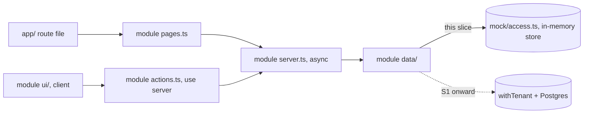

# Anar UI on mock data

Date: 2026-10-28. Lane: Large (new app, sets the structure every later slice plugs into).
Base: `docs/developer-design.md` (the doc), `docs/design-brief.md` (the brief), the design artifact `Anar Screens` (16 boards), and the 18 findings in `anar-design-review.md`.

## 1. Product

**Problem.** The four screens exist only as design boards. Nobody can tap through them on a phone, and the dev team has no app to plug S1 onward into.

**What we build.** The designed screens as a real Next.js app on mock data. Phone first, desktop where the design has it. No backend, no DB. A demo bar switches between Admin, Super Admin and DNA so one person can walk the whole day: DNA imports, the manager assigns, the salesperson calls and logs.

**Success.**

- On a phone, an Admin opens Today, taps Call, logs No Answer with "Tomorrow" in under 15 seconds, and the lead leaves Overdue.
- DNA uploads the same company's file twice: first time maps columns, second time is one tap to "Check rows" and reads "374 already in, 38 new".
- The manager bulk assigns 3 leads, the Unassigned tile drops by 3, and the Admin sees them under New after switching role.
- Every page has a real layout at 390 px and at 1440 px, with no sideways scroll at either. The 4 design bugs are gone.
- When S6 (say) lands, it rewrites `modules/leads/data/list.ts` and `detail.ts`. No page, component or action changes.

## 2. Architecture: one seam



The seam is the module's server function. Route files only re-export a module page. Pages and server slots call `server.ts`, client components call `actions.ts`, and both end in the module's `data/` files, the only code that touches `mock/**` (lint rules in section 4). A later slice rewrites a `data/` file and deletes the mock rows it no longer needs; pages, components and actions stay as they are. Module tests call `server.ts` functions with a `Ctx`, so they carry over as integration tests once the DB lands.

**Every module data function is async** and returns a `Promise`, even when the mock body is sync, so the move to Postgres changes no caller. Data files get the store only through `await store()` from `mock/access.ts`; U1's `db()` stays behind it. Pure helpers stay sync: `can`, `bucketOf`, `templateNameFromFile`.

**Actions return expected errors instead of throwing**: `ActionResult<T> = { ok: true; data: T } | { ok: false; error: AppErrorCode; message: string }` in `lib/errors.ts`. The form that called the action keeps its input and shows the message where the fix is (section 7). Each action runs zod, then `requireContext`, then `can`, then the server function. Server functions check company, role and ownership again; a hidden button is never the guard.

The store is a plain object on `globalThis` (survives hot reload), built by `buildSeed(now)` at boot and on "Reset demo". It lives in one Node process, so the demo runs with `pnpm dev` or `pnpm start` on one machine. For now that is Sishir's laptop (section 13).

**Simulate failure.** `mock/access.ts` holds a switch the demo bar flips (`setDemoFailure`). While it is on, `store()` rejects, so every load and save fails. It exists to show and test the failed states and goes away with the mock.

**Demo identity.** Cookie `anar_demo = { userId, actingCompanyId }`. `requireContext(slug)` reads it where S1 will read the session. The demo bar sets it through `switchDemoUserAction`. S1 deletes the bar, the cookie and the demo actions.

| Module function (doc name), all async except `can` | Entry | Body in this slice | Real in |
| --- | --- | --- | --- |
| `requireContext(slug)` | tenant/server | demo cookie → user, member or DNA acting company | S1, S2 |
| `can(ctx, perm, res?)` | tenant/server | **real**, doc 5.1 table | S2 |
| `listCompanies`, `enterCompany`, `leaveCompany` | companies/server | store; enter skips the reason prompt | S1, S2 |
| `loadSchema(ctx)`, `createFields(ctx, fields)` | settings/server | store | S3 |
| `listMembers(ctx)` | members/server | store | S2 |
| `getMyToday(ctx)`, `getBucketCounts(ctx, memberId)` | leads/server | store + real `bucketOf` | S8 |
| `listLeads`, `getLead`, `changeStage`, `dismissLostSuggestion` | leads/server | store | S6, S8 |
| `assignLeads(ctx, { leadIds, memberId })` | leads/server | store | S7 |
| `addImportedLeads(ctx, leads)`, `applyFollowUp(ctx, change)` | leads/server | store; the only way another module changes a lead or adds a lead event | S5, S8 |
| `logFollowUp(ctx, input)` | followups/server | store; lead changes through `applyFollowUp` | S8 |
| `createImportBatch(ctx, file)`, called by `POST /api/imports` | imports/server | ignores the bytes, returns the company's fixture file | S4 |
| `getUploadResult`, `dryRunImport`, `commitImport`, `getImportBatch`, `listImportRows` | imports/server | store, commit runs inline (no job); fields through `createFields`, leads through `addImportedLeads` | S4, S5 |
| `getTeamOverview`, `getMemberDashboard`, `compareMembers` | reports/server | store | S11 |

Pure functions built real now because the clicks need them, each with its table test: `can` (role switching), `bucketOf` (a logged call moves the lead), `templateNameFromFile` (finding 6). Scores, breakdowns and import results are fixed values in the mock data.

## 3. Screens and routes

| Route | Screen (design board) | Who | Phone | Desktop (≥1024 px) |
| --- | --- | --- | --- | --- |
| `/` | redirect to role home | all | | |
| `/companies` | company list, plain, not designed | DNA | cards | table: company, status, members, leads, last import, Open |
| `/[slug]/today` | 1 My Leads Today, Good day state | `reports.view_own` | designed | filter column, bucket list, selected lead detail (`?lead=`) |
| `/[slug]/leads/[id]` | 2 Lead detail; `?log=1` opens the Log a call sheet, Lost reason inside it | `leads.view` on that lead | designed | lead facts left, timeline right; the sheet opens from the right |
| `/[slug]/leads` | 4 Unassigned queue (default filter `unassigned`) and bulk assign | `leads.assign` | designed | filter column, lead table, assign panel |
| `/[slug]/dashboard` | 4 Manager dashboard | `reports.view_all` | designed | designed, queue as the right aside |
| `/[slug]/imports/new` | 3 step 1 File | `imports.upload` | designed | step rail, company and file left, what the file holds right |
| `/[slug]/imports/[batchId]/map` | 3 steps 2 Columns and 3 Check, one client component | `imports.upload` | designed | step 2 designed table; step 3 counts left, row tables right |
| `/[slug]/imports/[batchId]` | 3 step 4 Done | `imports.upload` | designed | summary left, affected-row tables right |
| `POST /api/imports` | upload (route handler, as in the doc) | `imports.upload` | | |

Desktop is the `lg` breakpoint (1024 px and up, drawn at 1440); below it the phone layout stretches. Route files only re-export the module page named in section 4. Role homes: Admin `today`, Super Admin `dashboard`, DNA `imports/new` of the acting company, else `/companies`. A page the role cannot open redirects to its home; a lead the Admin does not own is `notFound()` (doc: foreign and missing look the same).

Steps 2 and 3 share one route because the doc's `commitImport({ batchId, mapping, saveTemplate, newFields })` takes the mapping at commit. The mapping stays in client state between the two steps; no draft-save call is needed.

Not ported: direction boards A, B, C (finding 18 does not apply), dark theme, Team and Reports pages, Companies and Mappings beyond the plain list. Desktop nav shows only routes that exist: Super Admin `Dashboard`, `Leads`; DNA `Companies`, `Import`.

## 4. Folder layout

Feature modules own their pages, components and behaviour. `app/` holds thin route files and `components/` holds generic primitives only. Paths follow the doc's slice list (section 10): root `app/`, `modules/<area>/`, `lib/`. The rules come from `docs/design-principles.md` 1 to 6.

```
anar/
  root configs                        built in U0
  app/                                route files only, each re-exports a module page
    layout.tsx  globals.css  page.tsx (role home)  error.tsx
    companies/page.tsx                CompaniesPage
    api/imports/route.ts              calls createImportBatch
    (company)/[slug]/
      layout.tsx                      CompanyShell
      error.tsx                       LoadError, inside the shell
      today/page.tsx                  TodayPage
      leads/page.tsx                  UnassignedPage
      leads/[id]/page.tsx             LeadDetailPage, with followups' LogCallSheet in its callSheet slot
      dashboard/page.tsx              DashboardPage
      imports/new/page.tsx            ImportFilePage
      imports/[batchId]/map/page.tsx  ImportMapPage, steps 2 and 3
      imports/[batchId]/page.tsx      ImportResultPage
  components/                         generic primitives, import no module
    ui/sheet.tsx  Chip.tsx  BottomBar.tsx  PageShell.tsx  LoadError.tsx  EmptyState.tsx
  lib/   errors.ts (AppError, ActionResult)  dates.ts  phone.ts (display only)
  mock/  store.ts  seed.ts  names.ts (built in U1)  access.ts  metaExport.ts
  modules/<name>/
    types.ts       types only, safe to import anywhere
    server.ts      starts with import "server-only"; async queries and writes, the server seam
    actions.ts     "use server"; checks, calls server.ts, returns ActionResult
    components.ts  client-safe components other modules may render; never imports server.ts or data/
    pages.ts       page components and server slots, imported only by app/
    data/          store access today, Postgres later; the only code that imports mock/**
    ui/            the module's own components
    *.test.ts      next to the file it tests
  e2e/   one spec per slice
```

Entry files export by name, one line each, never `export *`. A module has only the entries it needs.

**Public surface.** What each module lets the rest of the app use. Every module also has `types.ts` (U1).

| Module | server.ts | actions.ts | components.ts | pages.ts |
| --- | --- | --- | --- | --- |
| tenant | `requireContext`, `can`, `homeFor`, `setDemoFailure` | `switchDemoUserAction`, `resetDemoAction`, `setDemoFailureAction` | | `CompanyShell`, `DemoBar` |
| companies | `listCompanies`, `enterCompany`, `leaveCompany` | `enterCompanyAction`, `leaveCompanyAction` | | `CompaniesPage` |
| members | `listMembers` | | | |
| settings | `loadSchema`, `createFields` | | | |
| scoring | | | `ScoreBadge`, `WhyScore` | |
| leads | `getMyToday`, `getBucketCounts`, `listLeads`, `getLead`, `changeStage`, `dismissLostSuggestion`, `assignLeads`, `addImportedLeads`, `applyFollowUp` | `changeStageAction`, `dismissLostSuggestionAction`, `assignLeadsAction` | `AssignList`, `ReasonChips` | `TodayPage`, `LeadDetailPage`, `UnassignedPage` |
| followups | `logFollowUp` | `logFollowUpAction` | | `LogCallSheet` |
| imports | `createImportBatch`, `getUploadResult`, `dryRunImport`, `commitImport`, `getImportBatch`, `listImportRows` | `dryRunImportAction`, `commitImportAction` | | `ImportFilePage`, `ImportMapPage`, `ImportResultPage` |
| reports | `getTeamOverview`, `getMemberDashboard`, `compareMembers` | | | `DashboardPage` |

**Dependencies run one way.** tenant ← companies, members, settings ← scoring ← leads ← followups, imports, reports. Concretely: leads uses tenant, settings, members, scoring; followups uses leads and settings; imports uses leads and settings; reports uses leads, members and settings. A module writes only its own state: imports adds leads through `addImportedLeads` and fields through `createFields`, followups changes a lead through `applyFollowUp`. The dashboard renders `AssignList` from `@/modules/leads/components` with data from `@/modules/leads/server`, never from another route's files. The lead page gets the call sheet through its `callSheet` slot, filled by the route file, because leads importing followups would close a loop (followups already uses leads). That route is the one that composes two modules.

**Shared by meaning, not by look.** Sheet, Chip, BottomBar, PageShell, LoadError and EmptyState are generic and live in `components/`. ScoreBadge and WhyScore belong to scoring, CallButton and the bucket header to leads, StepBar and the step rail to imports. Being used on two screens does not make a component generic.

**Names.** Page components end in `Page`. Callback props start with `on`. Component files are PascalCase, functions camelCase. Product names come from the spec (`Lead`, `logFollowUp`, `assignLeads`), one name per concept.

**Lint enforces it** (Biome `noRestrictedImports`, set in U2): `mock/**` only from `modules/*/data/**` (U0's override for all of `modules/**` gets narrowed); no `@/modules/**` from `components/**` or `lib/**`; no `@/modules/*/data/**` or `@/modules/*/ui/**` from anywhere, so code outside a module reaches it only through its entry files. `import "server-only"` makes a client import of `server.ts` fail the build. Relative imports that climb into another module are not linted; review catches them.

Files that are not obvious, one line each:

- `modules/tenant/data/context.ts`: finds who is asking and in which company, from the demo cookie.
- `modules/tenant/permissions.ts`: the doc 5.1 table and `can()`, which also checks "own" against `lead.assignedTo`.
- `modules/leads/buckets.ts`: says whether a lead is overdue, due today, new, or none, in the company's time zone.
- `modules/leads/data/today.ts`: the Admin's three buckets plus today's counts.
- `modules/leads/data/write.ts`: the only code that changes a lead or adds a lead event; other modules reach it through `addImportedLeads` and `applyFollowUp`.
- `modules/imports/data/upload.ts`: turns an upload into a batch; here it hands back the company's fixture file.
- `modules/imports/data/commit.ts`: counts what an import would do (`dryRunImport`) and does it (`commitImport`).
- `modules/imports/templates.ts`: names a new saved mapping from the file name; `data/templates.ts` finds the saved one for a header set.
- `modules/reports/data/queries.ts`: the dashboard numbers, team table, funnel, one-person view and compare.
- `mock/access.ts`: hands data files the store, async, and fails on purpose while Simulate failure is on.
- `mock/seed.ts`: builds both companies with people, leads, calls, events, targets and templates, relative to `now`, from a fixed random seed.
- `mock/metaExport.ts`: the fake daily Meta file per company, built from the seed so its duplicates point at real seeded leads.
- `lib/dates.ts`: "Overdue 2 days", "Due 11:30", "Yesterday 23:47", Kathmandu time.

## 5. Mock data shape

Types mirror the doc tables (4.2) in camelCase and the 5.2 outputs. Ids are strings (UUIDv7 later). Dates are `Date`, stored UTC.

```ts
// modules/tenant/types.ts
type Role = 'super_admin' | 'admin'
type Company = { id; name; slug; status: 'active' | 'suspended' | 'closing'; defaultCountry: 'NP'; timezone: 'Asia/Kathmandu' }
type User = { id; email; name; platformRole: 'dna' | null }
type Member = { id; companyId; userId; name; role: Role; status: 'invited' | 'active' | 'deactivated' }
type Ctx = { user: User; companyId: string; member: Member | null; role: Role | 'dna'; session: { id: string; actingCompanyId: string | null } }

// modules/settings/types.ts
type Field = { id; companyId; key; label; type: 'text' | 'number' | 'date' | 'dropdown'; options: { value: string; label: string }[] | null; isSystem: boolean; position: number; archivedAt: Date | null }
type Stage = { id; companyId; name; position; kind: 'open' | 'won' | 'lost'; isDefault: boolean }
type Outcome = { id; companyId; name; countsAsFailed: boolean; position }
type LostReason = { id; companyId; name; position }
type CompanySchema = { fields: Field[]; stages: Stage[]; outcomes: Outcome[]; lostReasons: LostReason[] }

// modules/scoring/types.ts
type ScoringRule = { fieldKey: string; kind: 'options'; points: Record<string, number> }
type ScoringConfig = { id; companyId; version; basePoints; hotMin; warmMin; rules: ScoringRule[]; active: boolean }

// modules/leads/types.ts
type Priority = 'hot' | 'warm' | 'cold'
type Lead = {
  id; companyId; fullName: string | null; phoneE164: string | null; phoneRaw: string | null; phoneValid: boolean; email: string | null
  source: 'facebook' | 'instagram' | 'event' | 'web' | 'other' | null; sourceKind: 'import' | 'manual' | 'api'; externalId: string | null
  leadDate: Date; campaignName: string | null; formName: string | null; assignedTo: string | null /* member id */
  stageId; lostReasonId: string | null; custom: Record<string, string | number | null>
  score: number; priority: Priority; scoreBreakdown: Record<string, number>; scoredAt: Date
  nextActionAt: Date | null; lastContactedAt: Date | null; failedAttempts: number; lostSuggestedAt: Date | null
  importBatchId: string | null; mergedIntoId: string | null; deletedAt: Date | null; createdAt: Date
}
type FollowUp = { id; companyId; leadId; byMemberId; outcomeId; notes: string | null; happenedAt: Date; nextActionAt: Date | null; stageBeforeId; stageAfterId }
type LeadEvent = { id; companyId; leadId; type: LeadEventType /* doc 4.2 list */; actorMemberId: string | null; actorUserId; data: Record<string, unknown>; createdAt: Date }
type Bucket = 'overdue' | 'due_today' | 'new'
type LeadRow = { id; fullName; phoneE164; phoneValid; priority; score; stage: Pick<Stage, 'id' | 'name' | 'kind'>
  answers: { key: string; label: string }[] /* dropdown option labels, form order */; nextActionAt; assignedAt: Date | null
  failedAttempts; assignee: { memberId; name } | null; source; leadDate; bucket: Bucket | null }
type LeadDetail = { lead: Lead; fields: { key; label; value: string }[] /* only with data */; followUps: FollowUp[]; events: LeadEvent[]; duplicates: [] }
type TodayCounts = { overdue; dueToday; newLeads; callsToday; callsTarget: number | null; siteVisitsToday; bookingsToday; nextDueAt: Date | null }

// modules/imports/types.ts
type MappingTarget = `system:${'full_name' | 'phone' | 'email' | 'lead_date' | 'campaign_name' | 'source'}` | `field:${string}` | 'skip'
type Mapping = { header: string; target: MappingTarget }[]
type NewField = { header; key: string; label; type: Field['type']; options?: { value; label }[] }
type ImportSummary = { imported; needPhoneReview; duplicateDb; duplicateFile; invalid; error; newOptions }
type ImportBatch = { id; companyId; uploadedBy; sourceKind: 'csv'; fileName; fileSize; encoding: 'utf-16le'; delimiter: '\t'; rowCount
  status: 'uploaded' | 'mapped' | 'running' | 'done' | 'failed'; mappingTemplateId: string | null; mapping: Mapping | null; lastRowNo; summary: ImportSummary | null; createdAt }
type ImportRow = { id; batchId; rowNo; raw: Record<string, string>; phoneE164: string | null
  result: 'imported' | 'duplicate_db' | 'duplicate_file' | 'invalid' | 'error'; leadId: string | null; reason: 'same_submission' | 'resubmitted' | 'invalid_phone' | null }
type UploadResult = { batchId; encoding; delimiter; headers: string[]; sample: string[][]; rowCount; dateRange: { from: Date; to: Date }
  matchedTemplate?: { id; name }; suggestedMapping: Mapping; proposedFields: NewField[]; newColumns: string[]; missingColumns: string[] }
type DryRun = { toAdd; needPhoneReview; sameSubmission; resubmitted: ImportRow[]; duplicateFile: ImportRow[]; phoneReview: ImportRow[] }

// modules/reports/types.ts
type Range = { from: Date; to: Date }
type TeamOverview = {
  tiles: { newToday; unassigned; overdue; siteVisitsThisWeek; bookingsThisMonth; bookingsTarget: number | null }
  perMember: { memberId; name; leadsHeld; calls; callsTarget: number | null; overdue; siteVisits; bookings; hot; warm; cold; hotIdle2d }[]
  funnel: { stageId; name; kind; count }[]; bySource: { source; count }[]
}
type MemberDashboard = { counts: Pick<TodayCounts, 'overdue' | 'dueToday' | 'newLeads'>; targets: { metric: 'calls' | 'site_visits' | 'bookings'; period: 'day' | 'week' | 'month'; value; actual }[] }
type Metrics = { calls; medianResponseHours: number | null; siteVisits; bookings; conversion: number }
```

`FollowUp` stays in `leads/types.ts`, where U1 put it: `LeadDetail` reads it, and moving it to followups would make the types loop. `ActionResult<T>` lives in `lib/errors.ts` with `AppError`.

**Seed content** (`buildSeed(now)`). All names made up, from `mock/names.ts`. "Sarina" is the real salesperson in the base doc and "Soaltee" looks like a real client, so neither is used.

- **Sundar Heights** (`sundar-heights`): Super Admin Prakash Joshi; Admins Sunaina Shrestha, Aakash Pandey, Rojina Lama, Sujan Basnet, Prerana Joshi; about 420 leads, 45 of them unassigned from this morning; follow-ups and events behind every number; targets calls 30/day, 150/week, 600/month, site visits 3/week, bookings 2/month; the doc 4.2 Meta mapping saved as template "Sundar Heights 2 3 BHK October".
- **Pahad View Apartments** (`pahad-view`): Super Admin Mina Rai, 2 Admins, no leads, no template.
- **DNA**: Rohan Gautam.
- **Schema per company**: doc 4.3 defaults (8 stages, 10 outcomes with No Answer, Not Interested, Callback Requested as failed, 7 lost reasons); fields `purchase_timeline` (base options and the Meta codes), `budget_fit`, `decision_maker`; Sundar also has `apartment_type`, `purchase_purpose`, `job_title`. Scoring config v1 is stored as data only (Hot 8+, Warm 5 to 7, for the "Hot starts at 8" line). Every lead carries a fixed `score`, `priority` and `scoreBreakdown`.
- **Story leads for Sunaina**: Overdue 3 (Bikash Thapa, Hot, 2 days), Due today 3 (Nirmal Adhikari, 5 failed calls, already suggested Lost, for the manager banner), New 4. Plus one lead with `phoneValid = false`, one with no email.
- **Lead values look like appendix A after import**: `phoneRaw` `p:+977...`, a few `+91`, `+971`; `source` facebook or instagram; `campaignName` shaped `Sundar Heights | Lead | October 2026`; `custom` holds the codes (`within_1_month`, `3_bhk`, `for_myself/family`), never labels.

**Meta fixture** (`mock/metaExport.ts`): the 10 appendix A headers, exact text and file order, UTF-16 LE, tab. File name `<form>_Leads_<now-14d>_<now>.csv` (finding 9). Sundar's file has 412 rows: 371 rows equal to seeded leads (same phone, campaign, created time), 3 with a seeded phone but a new created time, 38 new, 2 of those with a bad phone (`p:+97798123`, empty). Pahad's file has 64 new rows, 2 with a bad phone. Each row carries its result, reason, score and priority as fixed values, so the check and result counts come from the fixture. Committing the same file again adds nothing. The picked file's bytes are never read; dropping the real CSV in is safe.

## 6. Key flows (program design)

**Log a call** (lane A):

```diff
+ Today row Call: <a href="tel:+977…" onClick={router.push(`leads/${id}?log=1`)}>
+ route leads/[id]/page.tsx: <LeadDetailPage params callSheet={<LogCallSheet leadId />} />
+ LeadDetailPage: requireContext(slug) → getLead(ctx, id) (not_found → notFound())
+ LogCallSheet (followups pages): getLead + loadSchema → client LogCallForm, open when ?log=1 or "Log a call" tapped
+     outcome chips | note | next: Tomorrow, 3 days, 1 week, Pick date (10:00 Kathmandu) | stage chips
+     stage kind lost → note and next hide, ReasonChips required, Save disabled until picked
+ followups/actions.ts logFollowUpAction(form): zod → requireContext → can('followups.log', lead) → logFollowUp
+   logFollowUp: insert follow_up → leads applyFollowUp: lastContactedAt, nextActionAt, stageId, events follow_up_logged (+ stage_changed)
+   { ok: false } → sheet stays open, input kept, message above Save
+   Admin: redirect to the first lead still in the bucket the saved lead was in, else today
+   others: revalidate, close the sheet
```

**Lost suggestion (finding 17, decided: manager only).** The banner shows on lead detail only for Super Admin and DNA, only while `lostSuggestedAt` is set (seeded on Nirmal). "Mark as Lost" opens `ReasonChips` and calls `changeStage({ leadId, stageId: lost, lostReasonId })`. "Keep trying" calls `dismissLostSuggestion({ leadId })`, which clears `lostSuggestedAt`. The Admin sees no banner. `failedAttempts` is seeded and only shown; the counter and when a suggestion starts come with S8.

**Import** (lane B):

```diff
+ imports/new: company select → enterCompanyAction → /[other]/imports/new
+   file input → POST /api/imports → createImportBatch → UploadResult
+   matchedTemplate ? CTA "Check 412 rows" → map?step=check (one tap) : CTA "Match columns" → map
+ ImportMapPage: the one owner of { mapping, newFields, saveTemplate }, kept when going back from step 3
+   step 2: one row per header, <select value={target}> controlled per row (bugs 1, 2)
+     new field: key (editable, from normalised header), label, type, code → label inputs (finding 7)
+   step 3: dryRunImport(ctx, { batchId, mapping }) → DryRun
+     "374 already in, 38 new" headline; resubmitted listed with links; same submission as a count only
+     phone review listed as "will import, needs phone review" (finding 8)
+   Import → commitImportAction({ batchId, mapping, saveTemplate, newFields }) → /imports/[batchId]; { ok: false } keeps step 3, message at Import
+ ImportResultPage: getImportBatch + listImportRows → added, need phone review (links), resubmitted (links), Open queue
```

`commitImport` in the mock creates the new fields, saves the template (name from `templateNameFromFile`, finding 6), inserts the fixture's new leads unassigned, writes `import_rows` and the summary from the fixture, sets `done`. No dedupe, parsing or scoring runs; S4 and S5 bring those.

## 7. Styling

- Tailwind v4 with the tokens below in `@theme`. shadcn/ui only for `Sheet` (bottom sheet with focus trap). Select, checkbox and date stay native as designed, with `accent-color: brand`.
- Fonts through `next/font/google`, self-hosted at build, no runtime call to Google: Bricolage Grotesque 600 and 700 (titles, big numbers), Figtree 400 to 700 (body), JetBrains Mono 400 and 500 (CSV headers, codes, file names).
- Tap targets 44 px minimum, main actions 52 to 56 px, bottom bars fixed for the thumb. Body 15 to 16 px, inputs 16 px (no iOS zoom). Light theme only.

| Token | Value | Token | Value |
| --- | --- | --- | --- |
| bg | #F3F5F4 | brand / soft | #7A1438 / #F1E4E9 |
| surface | #FFFFFF | call / soft | #0B6E4F / #E3F2EA |
| line / strong | #DEE3E1 / #C9D0CD | overdue / soft | #B42318 / #FDECEA |
| ink / ink-2 | #15191B / #2E3639 | due / soft / edge | #7A4A00 / #FFF3D1 / #D99A06 |
| muted / faint | #4A5458 / #8B9592 | new / soft | #1E4FC2 / #E6EEFC |
| hot | #B93A0B on #FFE9DC | warm | #7A5000 on #FFF1C7 |
| cold | #2650A8 on #E4ECFA | compare a / b | #1E4FC2 / #C2410C |

### UI rules

From `docs/design-principles.md` 7 to 12. Each one has a proof in the slice that owns the screen (section 10).

- **Responsive from the start.** Every screen gets a real layout at 390 px and at 1440 px from its first slice; a phone column centred on a wide screen does not count. On desktop use the width: a list beside the selected item's detail, filters in a side column, tables where the phone shows cards, sheets from the right instead of the bottom. Where the design has no desktop board, the slice says the layout. Every screen slice proves its desktop layout in the `desktop` Playwright project by role (the `table`, the filter `complementary`, the detail `region`), checks the main content is wider than 1000 px, and checks no sideways scroll at 1440. `PageShell` sets the outer width only; each screen owns its desktop grid.
- **One filled button per decision.** Today row: Call. Lead page: Call (question 1 in section 13). Lost banner: Mark as Lost, with Keep trying as outline. Call sheet: Save (red "Mark as Lost" when the stage is Lost). Queue: Assign. Import step 1: Check rows or Match columns, with "Review columns" as a link. Step 2: Check rows. Step 3: Import. Step 4: Open queue, with Import another as outline. Labels say what happens next: "Save and next lead", "Import 38 leads", "Assign 3 leads".
- **Hidden when the role can never do it, disabled with the reason beside it when it can't right now.** Hidden from the Admin: the lost banner, the queue, assign, the dashboard. Hidden from the Super Admin: Import. Disabled with a reason: Call with "Phone needs review", Save with "Pick an outcome" or "Pick why it was lost", Assign with "Select leads to assign". No Email button when there is no email. The second compare picker leaves out the first person. Server functions still check every one.
- **Failed, empty and no match are three different screens.** A failed load shows `LoadError` with Retry inside the shell. Empty says what is missing ("No leads assigned to you yet", "No unassigned leads"). No match says the filter is why ("No hot leads match"). A failure never shows zeros, the Good day card or "Nothing overdue".
- **Keep the input on error and fix it where it broke.** No red text on a field nobody touched; a disabled button with its reason does that job. A failed save keeps the sheet open with outcome, note, next date and stage as they were, and the message above Save. Back from import step 3 keeps every target and edited label. A backwards custom range keeps both dates and shows the message at the "to" field. One owner per form's state: `LogCallForm`, `ImportMapPage`, `RangePicker`, `AssignList`.
- **Show the summary and the evidence.** Why Hot keeps its points per answer, the timeline keeps each entry, import results link to the affected leads. Each tile names its own period ("Site visits · this week"); table headers name the range ("Calls this week").
- **Every element answers a current question.** Unfinished routes stay out of the nav, lead fields with no data are left out.
- **Tokens only.** Colours, radii and fonts come from the `@theme` tokens above; no hex values in components.

## 8. Review findings: what this slice does

| # | Finding | Here |
| --- | --- | --- |
| 1, 2 | Mapping selects all say Name | Fixed: controlled `value` per row, phone and desktop. e2e asserts each row's value. |
| 3 | Lost reason chips run off the edge | Fixed: plain heading, chips wrap. e2e asserts every chip inside 390 px. |
| 4 | Compare pickers both show one name | Fixed: controlled selects; the same person cannot be picked twice. |
| 5 | "Saved mapping applied, 1 new, 1 missing" | Follows the doc: exact match applies all 10, no match goes to suggest mode. No Budget column, no Missing card. |
| 8 | Bad phones "will not import" | Follows the doc: imported and flagged, "2 need phone review", Call disabled on those leads. |
| 9 | Duplicates read as errors | Follows the doc: "374 already in, 38 new", same submission vs resubmitted, file name `<form>_Leads_<from>_<to>.csv`. |
| 17 | Who dismisses the suggestion | Decided, manager only (section 6). |
| 6 | Mapping named after the form | Covered: name from the file name. |
| 7 | Labels plain text, key not editable | Covered: key, label and code labels editable on new fields. |
| 10 | "Foreign number" tag | Covered: dropped. |
| 11 | Desktop phone row as a +977 dropdown | Covered: dropped, phone reads "kept as is". |
| 12 | No DNA "inside company X, Leave" banner | Covered: on every company page for DNA. |
| 13 | No one-person target vs actual | Covered in the designed tap-to-expand panel, via `getMemberDashboard`: buckets plus calls, visits, bookings against target. No separate page. |
| 14 | Custom range has no date picker | Covered: two native date inputs, "to" before "from" refused. |
| 15 | Phone sort has 4 options | Covered: every column, both directions. |
| 16 | Queue: no filters, "All" ticks 10 of 45, midnight times | Covered: score chips, page of 50 with "Select all 50 shown", "Yesterday 23:47". |
| 18 | Boards A, B, C say "New" | Not ported. |

## 9. Out

Auth (invite, OTP, sessions, step-up), Postgres, Drizzle, RLS, the worker and jobs, push, PWA, service worker, notifications and the bell, real CSV parsing (encoding, delimiter, headers, phone parsing), settings pages, export, merge, manual lead entry, the Admin's own lead list, Team and Reports pages, dark theme, the import "running" state (S5 adds it with the job).

## 10. Slices

U0 and U1 are built. **One module, one helper at a time**: a module's entry files and `data/` are edited only by the slice that owns that module in the plan below, so parallel helpers never touch the same file. Shared files (`components/`, `lib/`, `mock/store.ts`, `mock/seed.ts`, `mock/names.ts`, every `types.ts`) are frozen after U5; a slice that needs a change there stops and asks. Every slice has two stops: source, then tests after review. Tests find things by role, label and visible text (`getByRole`, `getByLabel`), not by class or test id.

```
U0 ✓ → U1 ✓ → U2 ✓ → U3 ✓ → U5 ✓ ─┬─ lane A, leads then followups: U6 ✓ → U7 → U6b → U8 → U9
          └─ U4 ✓ (beside U2)      │                                        └─ lane C, reports: U10 (after U8, beside U9)
                                   ├─ lane B, imports: U11 → U12 (beside lane A)
                                   └─ U3b (companies, beside any lane)
                                                                     all in → U13
```

U4 lands before U3 (the shell uses `LoadError`).

**U0. Scaffold** (built). `git init` with a `.gitignore`. Next.js current stable, App Router, React 19, TypeScript strict, pnpm, Tailwind v4 tokens, fonts, Biome (with the `mock/**` import rule), Vitest, Playwright (projects `phone` 390×844, `desktop` 1440×900), `zod`, `date-fns` and `@date-fns/tz`, shadcn init. `/` renders "Anar".
Files: root configs, `app/{layout.tsx,globals.css,page.tsx}`. Gives: `pnpm dev|build|typecheck|lint|test|e2e`.
Proof: `pnpm build`, `pnpm typecheck`, `pnpm lint` exit 0; `e2e/scaffold.spec.ts` sees "Anar" on both projects.

**U1. Types, store, seed** (built; seed 570 lines). No change needed under this layout (section 13).
Files: `modules/*/types.ts`, `mock/{store,seed,names}.ts`.
Gives: every type in section 5, `db()`, `resetStore(now)`, `buildSeed(now)`.
Proof: `seed.test.ts` with a fixed `now`: 2 companies, Sundar 45 unassigned, Sunaina's story leads present, Rojina holds the most overdue.

**U2. Boundaries and context** (~150). Uses U1.
Files: `biome.json` (narrow the mock override, add the module rules), `package.json` (`server-only`), `vitest.config.ts` (alias `server-only` to an empty file, since the real one throws outside Next and module tests import `server.ts`), `lib/errors.ts`, `mock/access.ts`, `modules/tenant/{server,actions,permissions}.ts`, `modules/tenant/data/context.ts`.
Gives: `requireContext(slug): Promise<Ctx>` (reads the cookie, then calls `resolveContext(demo, slug): Promise<Ctx>`, which tests use without a request), `can(ctx, perm, res?: { assignedTo: string | null }): boolean`, `homeFor(ctx): string`, `AppError`, `ActionResult<T>`, `store(): Promise<MockStore>`, `setDemoFailure(on): Promise<void>`, `switchDemoUserAction`, `resetDemoAction`, `setDemoFailureAction`.
Proof: `permissions.test.ts`, every permission × role × own/foreign per doc 5.1; `context.test.ts` on `resolveContext`, Admin on the other company → `not_found`, DNA on a company not entered → `forbidden`; `access.test.ts`, `store()` rejects while failure is on. Lint probes piped through `biome lint --stdin-file-path`, not committed: `import { db } from "@/mock/store"` fails as `components/Probe.tsx` and `modules/leads/ui/Probe.tsx` and passes as `modules/leads/data/probe.ts`; `@/modules/leads/data/x` fails as `app/Probe.tsx`; `@/modules/leads/server` passes.

**U3. Shell** (built; the companies list is phone only, U3b gives it its desktop layout). Uses U2, U4.
Files: `modules/tenant/{pages.ts,ui/{CompanyShell,DemoBar,DnaBanner,TopNav}.tsx}`, `modules/companies/{server,actions,pages}.ts` with `data/companies.ts` and `ui/CompaniesPage.tsx`, `modules/members/{server.ts,data/members.ts}`, `modules/settings/{server.ts,data/schema.ts}`, `app/{layout,page,error}.tsx`, `app/companies/page.tsx`, `app/(company)/[slug]/{layout,error}.tsx`, `e2e/shell.spec.ts`.
Gives: `CompanyShell`, `DemoBar`, `CompaniesPage`, `listCompanies`, `enterCompany`, `leaveCompany`, `enterCompanyAction`, `leaveCompanyAction`, `listMembers(ctx)`, `loadSchema(ctx)`, `createFields(ctx, fields: NewField[]): Promise<Field[]>`.
Proof: e2e: each role lands on its home; DNA sees the banner and Leave goes to `/companies`; the desktop nav shows only built routes for the role; with Simulate failure on, a company page shows "Couldn't load this page" with Retry inside the shell; failure off and Retry loads it.

**U3b. Companies on desktop** (~50). Uses U3. Runs beside any lane.
Files: `modules/companies/ui/CompaniesPage.tsx`, `e2e/shell.spec.ts`.
Desktop: a table with company, status, members, leads, last import and an Open button per row; phone keeps the cards.
Proof: desktop e2e finds the table with both companies and Open enters one; phone e2e still shows cards; no sideways scroll at either width.

**U4. Shared primitives and dates** (~150). Uses U1. Runs beside U2.
Files: `components/{ui/sheet,Chip,BottomBar,PageShell,LoadError,EmptyState}.tsx`, `lib/{dates,phone}.ts`, `modules/scoring/{components.ts,ui/{ScoreBadge,WhyScore}.tsx}`.
Gives: the primitives, `formatDue`, `formatClock`, `formatDay`, `formatPhone`, `ScoreBadge({ priority, score? })`, `WhyScore({ breakdown, fields, hotMin })`.
Proof: `dates.test.ts`: "Yesterday 23:47" at 08:00, "Overdue 2 days", "Due 11:30", the day turning at Kathmandu midnight; `pnpm lint` shows `components/` imports no module.

**U5. Leads core** (~120). Uses U2.
Files: `modules/leads/{server.ts,buckets.ts,data/write.ts}`.
Gives: `bucketOf({ nextActionAt, stageKind, assignedTo, assignedAt, followUpCount }, now, tz): Bucket | null` (doc 6.5, overdue before due today before new), `addImportedLeads(ctx, leads: Lead[]): Promise<{ added: number }>`, the `leads/server.ts` entry.
Proof: `buckets.test.ts`: due 23:50 Kathmandu is due today at 00:10 Kathmandu but overdue at 23:55; a closed stage is never overdue; unassigned is never in a bucket; new needs no follow-up and assigned under 24 h. `write.test.ts`: added leads arrive unassigned with one `imported` event each; a lead id already in the store is not added again.

**Lane A, leads then followups**

**U6. My Leads Today** (built, phone only; U6b gives it its desktop layout). Uses U3, U4, U5.
Files: `modules/leads/{pages.ts,data/today.ts,ui/{TodayPage,TodaySection,LeadRowCard,CallButton}.tsx}`, `app/(company)/[slug]/today/page.tsx`, `e2e/today.spec.ts`; adds `getMyToday` and `getBucketCounts` to `leads/server.ts`.
Gives: `getMyToday(ctx): Promise<{ overdue: LeadRow[]; dueToday: LeadRow[]; newLeads: LeadRow[]; counts: TodayCounts }>`, `getBucketCounts(ctx, memberId): Promise<Pick<TodayCounts, 'overdue' | 'dueToday' | 'newLeads'>>`, `TodayPage`.
Screen: calls strip against target, search by name or phone (client-side over the buckets), score chips, stage select, three sections, row Call, "N tries, no answer" when `failedAttempts > 0`, Good day card when Overdue is empty with "Next one is due tomorrow at 10:00". The design's "See tomorrow's calls" button is dropped (no screen behind it).
Proof: `today.test.ts`, Sunaina gets 3/3/4 and never another Admin's lead. e2e phone: chips filter; search "980" finds by phone; Call is the only filled button on a row; a filter with no hits says "No hot leads match", while a Pahad Admin sees "No leads assigned to you yet"; with Simulate failure on, Today shows the load error, never "Nothing overdue" or zero counts; no sideways scroll.

**U7. Lead detail and the lost banner** (~200). Uses U6.
Files: `modules/leads/{components.ts,actions.ts,data/{detail,update}.ts,ui/{LeadDetailPage,LeadHeader,Facts,Timeline,ReasonChips,LostSuggestion}.tsx}`, `app/(company)/[slug]/leads/[id]/page.tsx`, `e2e/lead.spec.ts`; adds `getLead`, `changeStage`, `dismissLostSuggestion` to `leads/server.ts`, `LeadDetailPage` to `leads/pages.ts`.
Gives: `getLead(ctx, leadId): Promise<LeadDetail>`, `LeadDetailView({ detail, schema, ctx })`, `changeStage(ctx, { leadId, stageId, lostReasonId? })`, `dismissLostSuggestion(ctx, { leadId })`, `changeStageAction`, `dismissLostSuggestionAction`, `ReasonChips({ reasons, value, onPick })`, `LeadDetailPage({ params, callSheet?: ReactNode })`.
Screen: name, score badge with points, stage, due line; Call (`tel:`), WhatsApp (`https://wa.me/<digits>`), Email (`mailto:`); Why Hot; facts; form answers as option labels, only fields with data; timeline from events, newest first; the lost banner for Super Admin and DNA (section 6). "Log a call" opens `?log=1`; the sheet arrives in U9. The body is `LeadDetailView`, so U6b can show it beside the Today list.
Desktop: header across the top with Call, WhatsApp, Email and Log a call in one row; left column Why Hot, facts and form answers; right column the lost banner and the timeline. No bottom bar.
Proof: `detail.test.ts`: Admin on a foreign lead → `not_found`; fields with null left out. `update.test.ts`: Lost without a reason → `validation`; Admin dismiss → `forbidden`. e2e: Bikash shows "Hot · 10"; the invalid-phone lead shows Call disabled with "Phone needs review" beside it and no `tel:` link; no Email button without an email; Nirmal shows the banner to Prakash and not to Sunaina; Keep trying hides it; with Simulate failure on, Mark as Lost keeps the picked reason and shows the error. Desktop e2e: facts and timeline side by side, Log a call in the header row, no bottom bar, main content wider than 1000 px, no sideways scroll.

**U6b. Today on desktop** (~90). Uses U6, U7. After U7, because the right pane is the lead detail.
Files: `modules/leads/ui/{TodayPage,TodaySection}.tsx`, `modules/leads/ui/TodayFilters.tsx`, `components/PageShell.tsx` (drop the `max-w-lg` default so no page sits in a phone column; a shared-file change this rule approves), `e2e/today.spec.ts`.
Desktop: left column with the calls strip, search, score chips and stage select; middle the three bucket sections as rows; right the selected lead's detail from U7's `LeadDetailView`, picked with `?lead=<id>` and defaulting to the first overdue lead. A row tap selects instead of navigating; row Call selects the lead and opens `?log=1` there. Phone stays as built.
Proof: desktop e2e: filters sit in the `complementary` column, the bucket list and the detail `region` side by side, clicking the second overdue row shows that lead's detail without leaving Today, main content wider than 1000 px, no sideways scroll; the empty, no-match and failed states fill the list column, never the detail. Phone e2e from U6 still passes.

**U8. Unassigned queue and bulk assign** (~180). Uses U7.
Files: `modules/leads/{data/{list,assign}.ts,ui/{UnassignedPage,AssignList}.tsx}`, `app/(company)/[slug]/leads/page.tsx`, `e2e/queue.spec.ts`; adds `listLeads`, `assignLeads` to `server.ts`, `assignLeadsAction` to `actions.ts`, `AssignList` to `components.ts`, `UnassignedPage` to `pages.ts`.
Gives: `listLeads(ctx, { assignedTo?, priority?, q?, cursor? }): Promise<{ items: LeadRow[]; nextCursor; total }>`, `assignLeads(ctx, { leadIds, memberId }): Promise<{ updated }>`, `assignLeadsAction`, `AssignList({ items, members, onAssigned? })`.
Desktop: left column with search and score chips; middle a table (checkbox, name, score, apartment, buying when, platform, time) with select all in the header; right an assign panel with the picked count, Assign to, and the Assign button. Phone keeps the cards and the bottom bar.
Proof: `list.test.ts`: an Admin passing another member's id still gets only own. `assign.test.ts`: 3 ids → 3 `assigned` events; an assignee outside the company → `validation`. e2e: pick 3, assign to Sunaina, the count drops 45 → 42 and the status line names her; Assign stays disabled with "Select leads to assign" until one is picked; "Select all 45 shown"; with Simulate failure on, the 3 stay picked and the error shows; "No unassigned leads" at 0 vs "No hot leads waiting" under a filter; Sunaina never reaches the queue. Desktop e2e: the `table` with 45 rows, filters in the `complementary` column, assign from the right panel drops the count, no sideways scroll.

**U9. Log a call** (~190). Uses U7. Runs beside U10.
Files: `modules/followups/{server,actions,pages}.ts`, `modules/followups/{data/log.ts,ui/{LogCallSheet,LogCallForm}.tsx}`, `app/(company)/[slug]/leads/[id]/page.tsx` (fills the `callSheet` slot), `e2e/log-call.spec.ts`; adds `applyFollowUp` to `leads/server.ts` and `leads/data/write.ts`.
Gives: `logFollowUp(ctx, { leadId, outcomeId, notes?, nextActionAt?, stageId?, lostReasonId? }): Promise<{ lead, followUp, lostSuggested }>`, `logFollowUpAction`, `applyFollowUp(ctx, change): Promise<Lead>`, `LogCallSheet({ leadId })`.
Desktop: the sheet opens from the right, 480 px, with the lead still visible beside it; outcomes in two columns, quick picks in one row. On Today (U6b), saving selects the next lead in the same bucket in the detail pane instead of navigating.
Proof: `log.test.ts`: Lost without a reason → `validation`; an Admin on a foreign lead → `not_found`; the lead gets `lastContactedAt`, `nextActionAt` and a `follow_up_logged` event. e2e: No Answer + Tomorrow on Bikash, back on Today, Bikash is gone from Overdue; Save is the one filled button and stays disabled with "Pick an outcome" until one is picked, no red text before that; Lost says "Pick why it was lost" until a reason, all 7 chips inside 390 px; with Simulate failure on, Save shows the error above the button and outcome, note, next date and stage are kept. Desktop e2e: the sheet opens on the right with the lead visible beside it; on Today, saving Bikash selects the next overdue lead in the pane.

**Lane C, reports**

**U10. Dashboard, phone and desktop** (~200). Uses U8. Runs beside U9.
Files: `modules/reports/{server,pages}.ts`, `modules/reports/{data/{queries,targets}.ts,ui/{DashboardPage,Tiles,Funnel,TeamTable,MemberPanel,Compare,RangePicker}.tsx}`, `app/(company)/[slug]/dashboard/page.tsx`, `e2e/dashboard.spec.ts`.
Gives: `getTeamOverview(ctx, range): Promise<TeamOverview>`, `getMemberDashboard(ctx, { memberId, ...range }): Promise<MemberDashboard>`, `compareMembers(ctx, { a, b, ...range }): Promise<{ a: Metrics; b: Metrics }>`, `DashboardPage`.
Desktop (designed board): tiles in one row; team table, then funnel and compare side by side; the unassigned `AssignList` as the right aside; a team row expands its member panel under it.
Screen: tiles (Unassigned links to the queue on phone, the `AssignList` aside on desktop), funnel, team table sortable by every column both ways, tap a person for the expand panel, compare two, ranges Today, This week, This month, Custom. Each tile names its period, table headers name the range.
Proof: `queries.test.ts` against seed numbers: tiles, per-member calls for today and the week, funnel sums to the lead count, `hotIdle2d`, compare of a person with themself → `validation`. e2e: the compare selects show the two people compared and the second leaves out the first; sort by Overdue puts Rojina first; Custom with "to" before "from" keeps both dates and shows the message at "to"; desktop assign from the aside updates the tile; Pahad shows empty states, not an error; with Simulate failure on, the load error shows, never zero tiles. Desktop e2e: five tiles in one row, the team `table` sortable by its headers, the aside beside it, main content wider than 1000 px, no sideways scroll.

**Lane B, imports**

**U11. Import file and columns** (~200). Uses U3, U4, U5.
Files: `mock/metaExport.ts`, `modules/imports/{server,actions,pages,templates}.ts`, `modules/imports/{data/{upload,templates}.ts,ui/{ImportFilePage,ImportMapPage,StepBar,ImportRail,FileCard,MappingRows,MappingTable}.tsx}`, `app/api/imports/route.ts`, `app/(company)/[slug]/imports/{new,[batchId]/map}/page.tsx`, `e2e/import-columns.spec.ts`.
Gives: `createImportBatch(ctx, { fileName, fileSize }): Promise<UploadResult>`, `getUploadResult(ctx, batchId): Promise<UploadResult>`, `templateNameFromFile(name): string`, `ImportFilePage`, `ImportMapPage` (step 2).
Desktop: step rail left. Step 1: company select and file drop on the left, what the file holds on the right (name, rows, columns, date range, format, saved mapping notice) with the step's button under it. Step 2: the designed mapping table.
Proof: `templates.test.ts`: `Sundar Heights 2 3 BHK October_Leads_2026-10-14_2026-10-28.csv` → `Sundar Heights 2 3 BHK October`; a name without the tail stays as it is. e2e: Pahad, no template: six system columns matched, four new fields proposed, each select shows its own target, the timeline column remapped to `purchase_timeline`. Sundar: "Saved mapping found", one filled button "Check 412 rows", "Review columns" as a link. With Simulate failure on, the upload keeps the picked company and shows the error on the file card. Desktop e2e: step 1 shows the rail, the file column and the details column side by side; step 2 shows the mapping `table` with one row per header; main content wider than 1000 px; no sideways scroll at 1440.

**U12. Import check and result** (~190). Uses U11.
Files: `modules/imports/{data/{commit,batches}.ts,ui/{CheckStep,ImportResultPage}.tsx}`, `ui/ImportMapPage.tsx` (adds step 3), `app/(company)/[slug]/imports/[batchId]/page.tsx`, `e2e/import-commit.spec.ts`; adds `dryRunImport`, `commitImport`, `getImportBatch`, `listImportRows` to `server.ts`, `dryRunImportAction`, `commitImportAction` to `actions.ts`, `ImportResultPage` to `pages.ts`.
Gives: `dryRunImport(ctx, { batchId, mapping }): Promise<DryRun>`, `commitImport(ctx, { batchId, mapping, saveTemplate?, newFields? }): Promise<{ jobId }>`, `getImportBatch(ctx, batchId): Promise<ImportBatch>`, `listImportRows(ctx, { batchId, result? }): Promise<ImportRow[]>`.
Desktop: step rail left. Step 3: the counts and the bar on the left; resubmitted and phone-review rows as tables on the right (row, name, why, link). Step 4: the summary and both buttons on the left; tables of the added leads that need phone review and of the resubmitted leads on the right.
Proof: `commit.test.ts`: the Sundar file adds 38 leads and its summary reads needPhoneReview 2, duplicateDb 374 (371 same submission, 3 resubmitted); committing it again adds nothing; the Pahad commit creates the 4 fields and the template. e2e: Sundar one tap from step 1 to "374 already in, 38 new", import, the result reads "38 added" and its links open the resubmitted leads; Back from step 3 keeps every target and edited label; with Simulate failure on, Import shows the error at the button and step 3 stays; on the result, "Open queue" is the one filled button. Desktop e2e: steps 3 and 4 show counts beside the row tables, each table links to its leads, no sideways scroll.

**U13. Day story across roles** (~80). Uses everything.
Files: `e2e/story.spec.ts`.
Proof: DNA imports Sundar's file → Prakash's Unassigned tile reads 83 → he assigns 3 new leads to Sunaina → Sunaina sees them under New, calls one, logs Callback Requested → Prakash's dashboard shows her calls today +1. The story runs in both Playwright projects, and every route is checked for no sideways scroll at 390 and 1440. The Simulate failure specs run in their own Playwright project after the rest, because the switch is one per process.

## 11. Review focus

Cases the spec implies, most likely first, each with its owner: a foreign lead id for an Admin (U7, U9); DNA on a company not entered (U2); a failed load showing zeros or the Good day card (U6, U10); a failed save losing what was typed (U7 to U9, U12); Back from import step 3 losing edits (U12); a client component importing a `server.ts` (U2 lint, build); Kathmandu midnight in buckets and "Yesterday" (U4, U5); invalid phone has no Call (U7); no email hides Email (U7); Lost without a reason (U7, U9); an Admin calling dismiss (U7); the same file twice adds nothing (U5, U12); assign with nothing picked keeps the button off (U8); assign to someone outside the company (U8); compare the same person twice (U10); custom range backwards (U10); a company with no members or leads shows empty states, not errors (U6, U10 on Pahad).

## 12. Doc gaps

Moved to `docs/specs/ui-mock-doc-gaps.md`, with the product logic this slice leaves out. The names this spec adds (`requireContext(slug)`, `LeadRow`, `TodayCounts`, `TeamOverview.tiles`, `UploadResult.dateRange`, `dryRunImport`, `getUploadResult`) are listed there too.

## 13. Open questions

Decided 2026-10-28:

- **Git:** a fresh `git init` in `~/Projects/anar`, no clone. U0 does it with a `.gitignore`.
- **Where the demo runs:** Sishir's laptop, `pnpm dev`. Vercel comes later; before that the in-memory store has to move to something that survives separate requests (a cookie or a hosted store), its own small slice.

- **The design is the base.** Where the design shows a behaviour, the app does that. Product questions the design does not answer wait for the real slices. So:
  - Dashboard range: as designed, the tiles stay fixed and the range drives the team table and compare.
  - After 5 failed calls: the banner as designed, shown to Super Admin and DNA only (finding 17). The design shows the Admin nothing else.

Still open:

1. **Two filled buttons on the lead page.** The design has a green Call at the top and a dark "Log a call" bar at the bottom. Rule 10 allows one lead action per decision. Option A: Call stays filled and "Log a call" becomes an outline button. The sheet already opens by itself when you come back from a call, so "Log a call" is the fallback for a call made outside Anar. A small change to the design. Option B: keep both filled as designed, treating "contact" and "record" as two decisions. I'd pick A.

2. **The queue moved into lane A.** Under this layout the queue and bulk assign live in `modules/leads`, so they now come after lead detail in lane A instead of having their own lane. Two lanes run side by side (leads, imports) instead of three, and the dashboard waits for the queue. The other way is two helpers editing the `leads` entry files at once, which is where clashes happen. I'd keep it this way.
